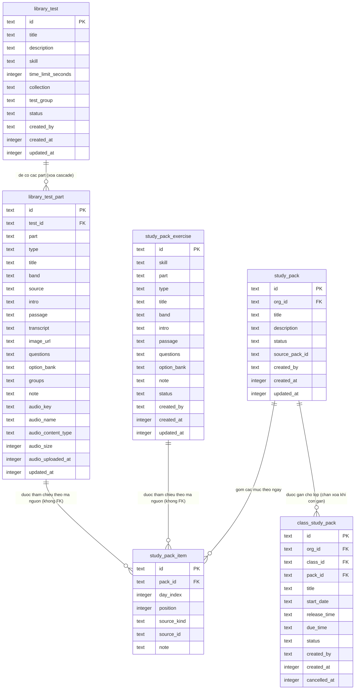

# srs/admin-library-reverse-erd — admin-library

Sáu thực thể của feature (khối thuộc tính liệt kê CỘT THẬT, tên cột giữ nguyên DB).
Khóa tham chiếu ngoài (organization, class, bản vật hóa) liệt kê ở cuối — không vẽ
vì thuộc schema feature khác.

## Ràng buộc cấp DB và cấp ứng dụng

- **library_test_part**: unique (test_id, part) — mỗi slot một dòng; FK cascade xóa
  theo đề; index (skill, status) trên đề. ✅ packages/db/src/schema/library-test.ts:98-101, packages/db/src/schema/library-test.ts:46-47
- **study_pack_item**: unique (pack_id, day_index, source_kind, source_id) — một
  nguồn không lặp trong cùng ngày; index vị trí để sắp thứ tự. ✅
  packages/db/src/schema/study-pack.ts:95-105
- **class_study_pack**: unique riêng phần (class_id, pack_id) CHỈ với status active —
  gán lại sau hủy được phép; pack_id restrict — xóa bộ bị DB chặn khi còn gán (route
  cũng chặn trước bằng 409). ✅ packages/db/src/schema/study-pack.ts:141-144
- **created_by không FK** trên library_test/study_pack_exercise/study_pack: xóa người
  dùng không xóa dữ liệu thư viện (dữ liệu sống độc lập tài khoản). ✅
  packages/db/src/schema/library-test.ts:32-36
- **org_id NULL** trên study_pack = bản hệ thống; bản sao tổ chức có org + source_pack_id
  (unique org+source). ✅ packages/db/src/schema/study-pack.ts:52-76 (unique 70-73)

## Tham chiếu ngoài (không vẽ trong ERD)

- study_pack.org_id / class_study_pack.org_id → organization (cascade); class_study_pack
  .class_id → class (cascade). ✅ packages/db/src/schema/study-pack.ts:53-55, packages/db/src/schema/study-pack.ts:119-126
- Bản vật hóa cho học viên: assignment_prompt mang library_ref trỏ đề/part nguồn
  (migration 0060) — học viên đọc bản chụp, không đọc library_test. 🔵
  packages/db/src/migrations/0060_study_pack.sql:1-79, apps/server/src/routes/student-practice.ts:44-90
- Nguồn của study_pack_item: source_kind = "library_test_part" (part đề đọc ready) hoặc
  "library_exercise" (bài tập ready); mã nguồn lưu ở source_id. ✅
  packages/db/src/schema/study-pack.ts:90-92, apps/server/src/lib/study-pack-clone.ts:524-624
