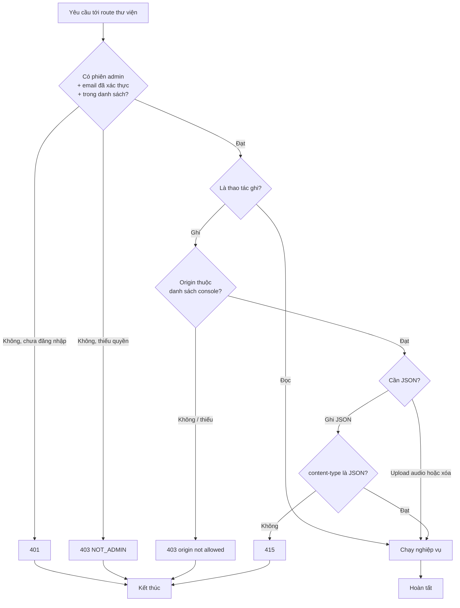
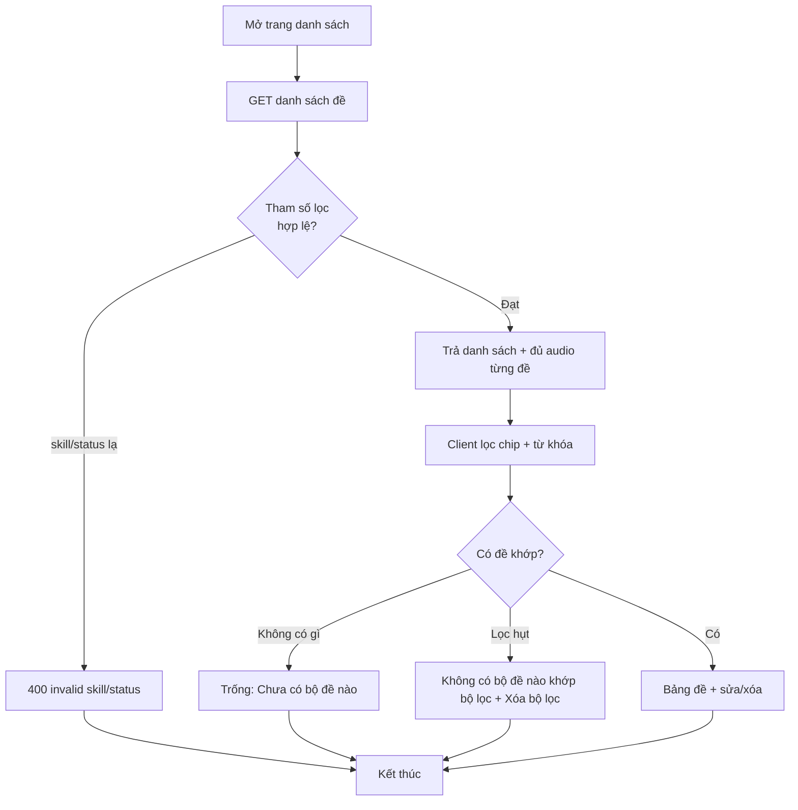
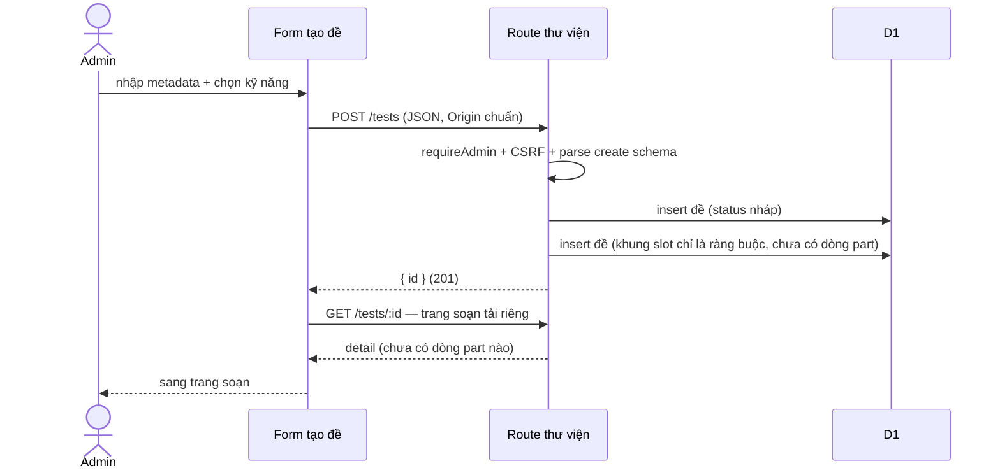
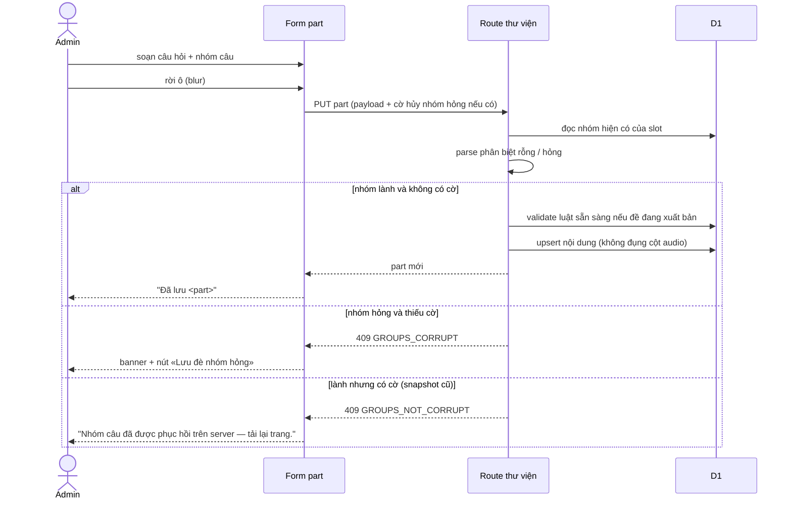
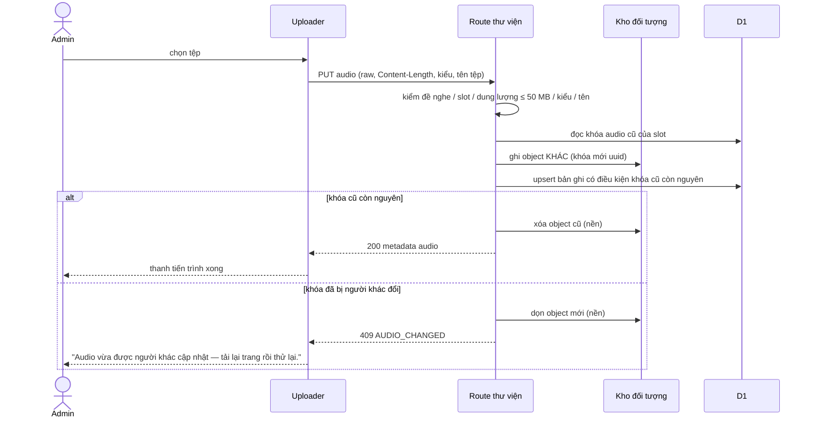
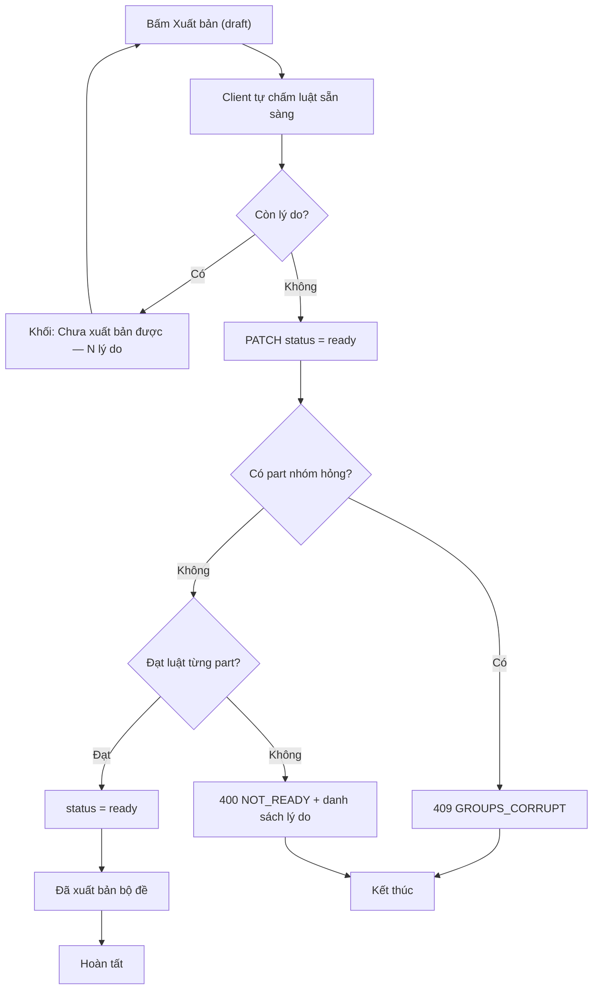
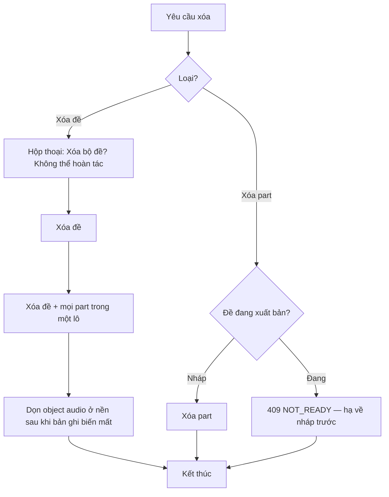
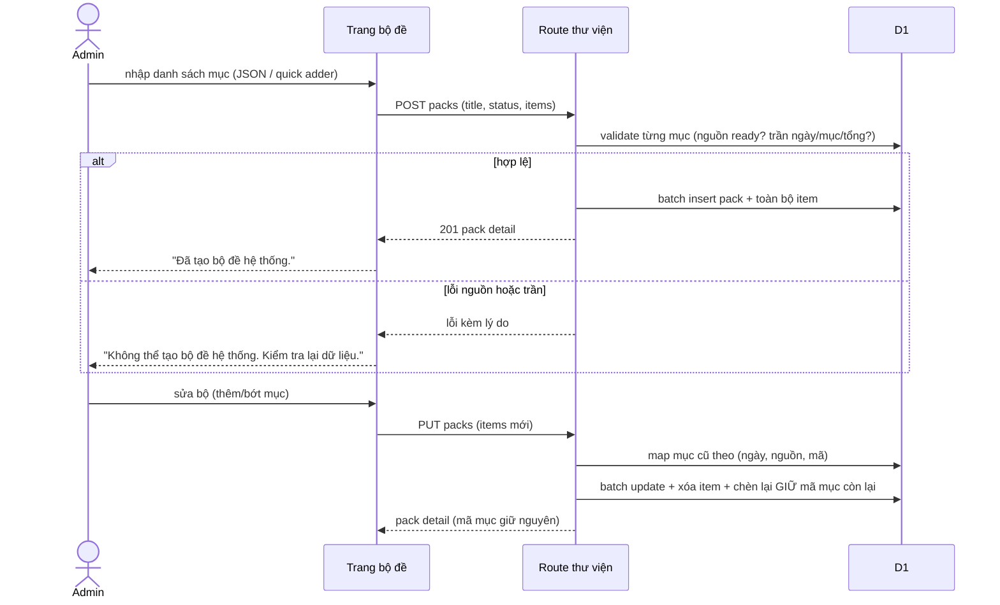

# srs/admin-library-reverse-flows — admin-library

Chín luồng (F1-F9 theo Mục 9 spec). Cổng admin + CSRF chạy trước mọi luồng — đặc tả
một lần ở đây, các luồng khác không vẽ lại.

## Cổng chung — qua cổng admin và CSRF

Chứng thực: require-admin.ts:28-49; CSRF 381-401; test vai trò admin-library.test.ts:130-164,
CSRF :166-189, audio matrix admin-library-audio.test.ts:242-264. ✅

## F1 — Xem và lọc danh sách đề

Mở `/library` → tải toàn bộ đề hợp lệ (không gửi tham số lọc) →
bảng: tên, kỹ năng, bộ sưu tập · nhóm đề, nhãn trạng thái, "N part · M câu", thời gian
cập nhật, cờ đủ audio của đề nghe. Lọc chạy phía client trên dữ liệu đã tải; server
vẫn nhận tham số lọc và tự chặn giá trị lạ.

Chứng thực: route lọc 404-429 (400 lạ 406-419); sắp 432-434; hasAllAudio 455-465;
client chip 170-192, empty 235-268; wording "N part · M câu" test-table.tsx:87-89. ✅

## F2 — Tạo đề mới

Chứng thực: draft cứng 498; khung part 297-299 + preset contracts.ts:410-447; form
new.tsx:1-122. ✅

## F3 — Soạn nội dung part và nhóm câu (chốt bảo vệ nhóm hỏng)

Chứng thực: parse 165-201; ba nhánh guard 632-654; validate ready 655-669; không đụng
audio 670-686; client banner part-form.tsx:804-826, wording lỗi library-error.ts:24-26;
blur save $testId.tsx:552-566. ✅

## F4 — Quản lý audio part nghe (upload CAS)

Chứng thực: kiểm đầu vào 725-766; CAS 769-822; dọn cũ 818-822; lỗi giữa chừng dọn mới
giữ cũ 811-817; test thua CAS admin-library-audio.test.ts:452-486, purge 488-628;
503 khi vắng kho 725 + test 630-646. ✅

## F5 — Xuất bản / hạ ngược đề

Hạ ngược: bấm "Hạ về nháp" → PATCH status = draft, luôn được; sau khi hạ mới xóa
part/audio được (nút xóa bị chặn khi đang xuất bản).

Chứng thực: client chặn trước publish-bar.tsx:42-58; guard corrupt 562-569; validate
570-576; chú giải UI "phải hạ về nháp để xóa part/audio" publish-bar.tsx:111-115. ✅

## F6 — Xóa đề và xóa part

Chứng thực: chặn xóa part 703-705; hộp thoại delete-test-dialog.tsx:59-83; batch +
comment object mồ côi 594-611; test xóa 740-773. ✅ (Xóa đề KHÔNG kiểm tham chiếu —
GAP-01, OQ-03 🟡)

## F7 — Quản lý bài tập thư viện

Tạo/sửa bài tập như soạn part (cùng hình dạng nội dung). Hai điểm chặn tham chiếu:
hạ bài tập đã sẵn sàng về nháp khi còn bộ đề dùng → 409; xóa khi còn bộ đề dùng → 409.
Chứng thực: 973-987, 1022-1034; wording client packs.tsx:195, :213. ✅

## F8 — Bộ đề hệ thống và giao lớp

Giao lớp (cross-ref): giáo viên gán bộ → máy sao chép vật hóa từng mục tham chiếu
thành nội dung lớp (bản sao sở hữu tổ chức) + bản ghi gán lớp. Chứng thực: validate
354-632; tuple 902-908; insert giữ id 910-940; test #554 admin-library.test.ts:1482-1656;
xóa chặn tham chiếu 1177-1187. ✅

## F9 — Xem trước đề

Gộp dữ liệu đã lưu và đang soạn (part hiệu lực) → render khung như học viên: intro,
đoạn văn/phiên âm, nhóm câu, ngân hàng đáp án, ảnh; dùng được cả khi nháp.
Chứng thực: effective-parts.ts:1-126 (gộp), test-preview-model.ts:1-139 (render
model), $testId.tsx:763-776 (mở hộp xem trước). ✅
