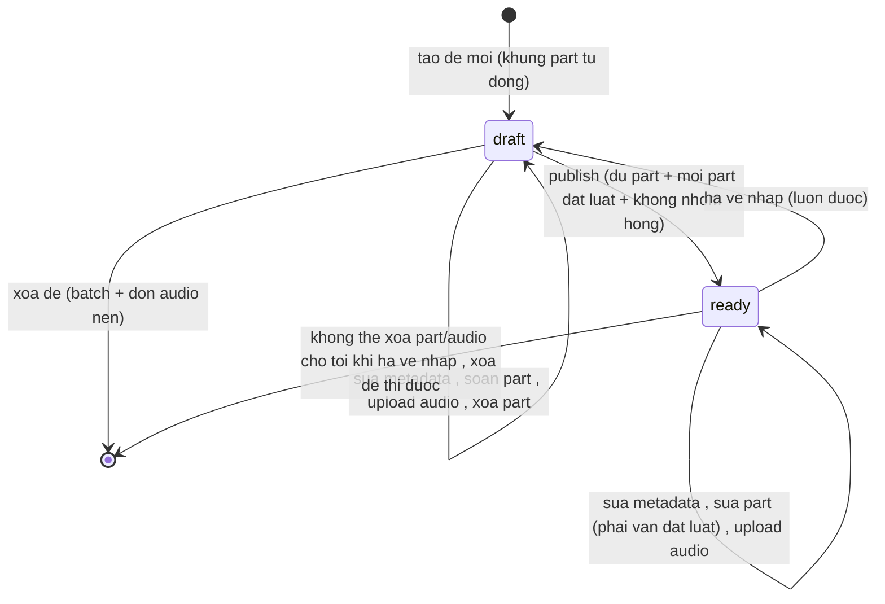
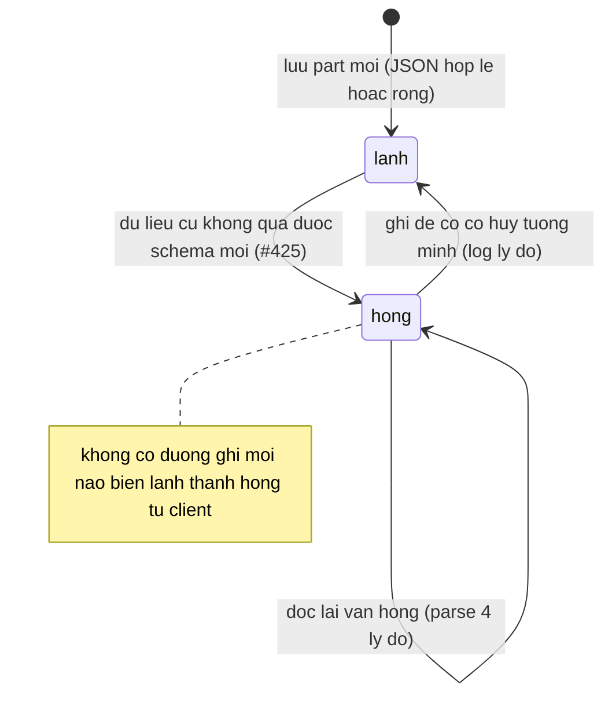
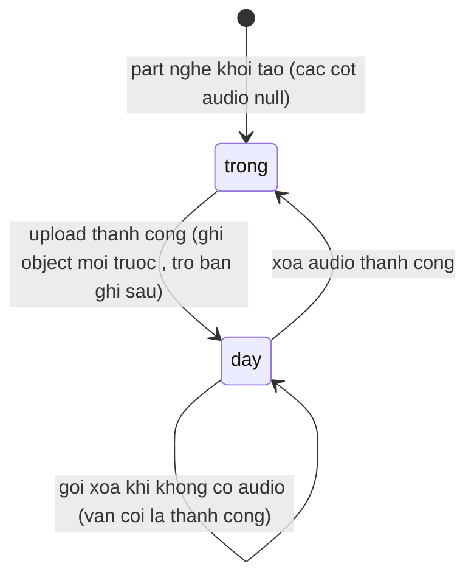
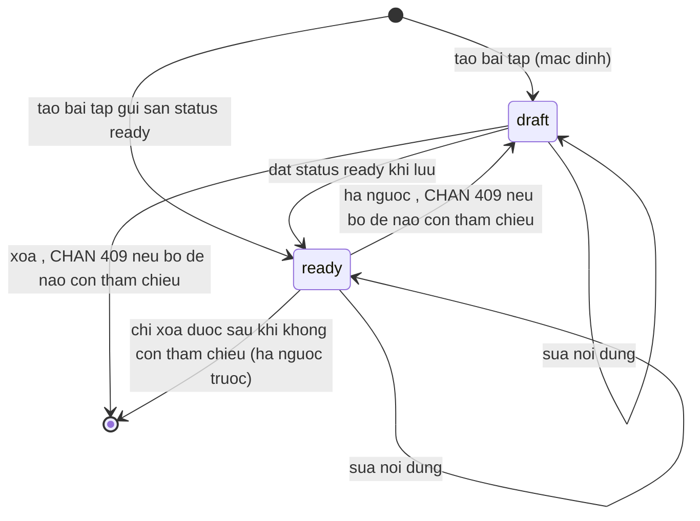
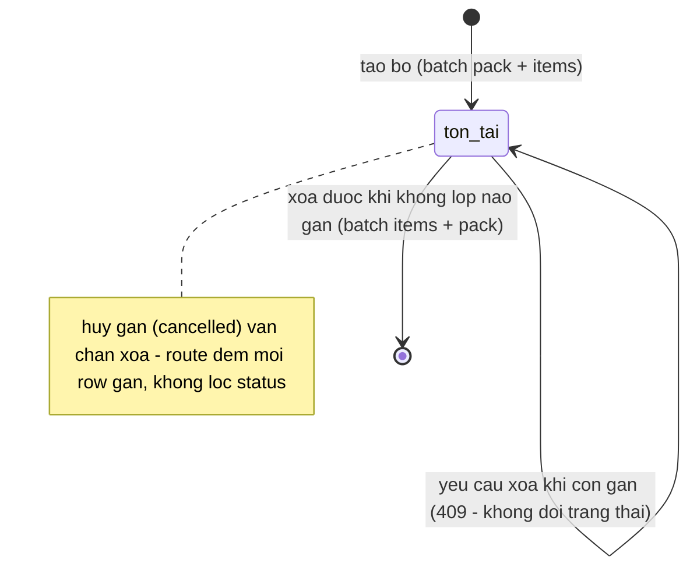
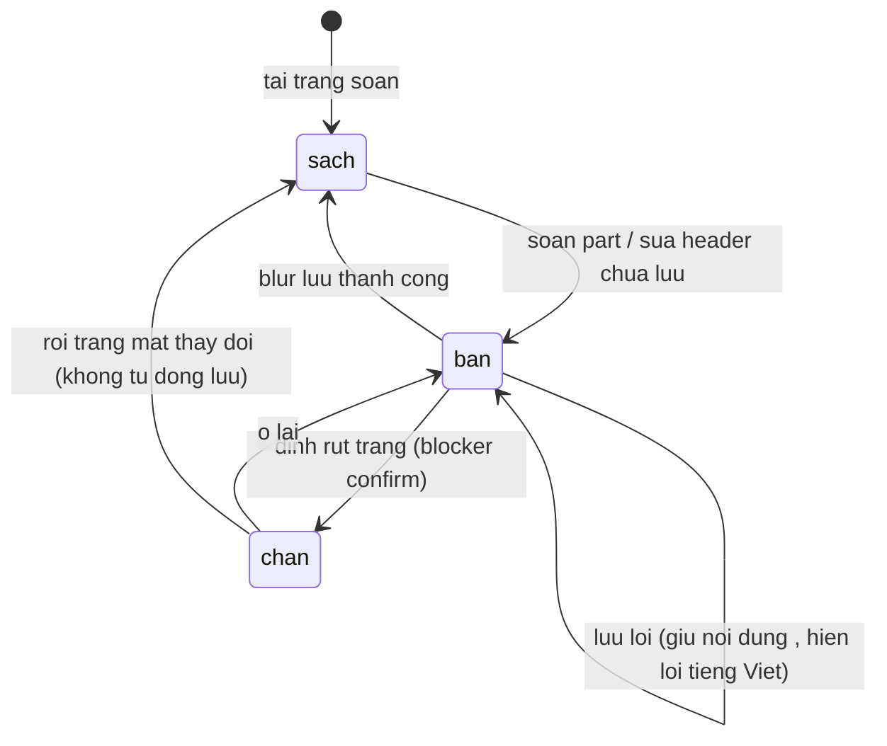

# srs/admin-library-reverse-states — admin-library

Sáu máy trạng thái: (1) đề — máy chính; (2) nhóm câu part; (3) slot audio; (4) bài tập
thư viện; (5) bộ đề hệ thống; (6) trạng thái bẩn phía client (UI, không bền). Tên
trạng thái giữ "từ vựng hợp đồng" (status = draft | ready).

## 1. Đề thư viện (library_test.status) — SM-01

Điều kiện chuyển một chiều có luật: ready chỉ đạt qua cửa validate; mọi phần xóa
(phần/audio) chỉ làm được ở draft.

Chứng thực:

- Tạo luôn draft — admin-library.ts:498, schema default library-test.ts:31. ✅
- publish chạy corrupt-guard TRƯỚC validate — admin-library.ts:562-569, :570-576. ✅
- ready: sửa part được nhưng phải đạt luật (validate trên trạng thái hiệu lực) —
  admin-library.ts:655-669. ✅
- xóa part/audio chỉ ở draft — admin-library.ts:703-705, :860-861. ✅
- hạ ngược tự do — admin-library.ts:575-576. ✅

## 2. Nhóm câu part (lành ↔ hỏng) — SM-02

Trạng thái hỏng KHÔNG phải giá trị cột — là kết quả parse khi đọc (cột giữ JSON cũ).
Chuyển ra khỏi hỏng chỉ bằng ghi đè tường minh.

Chứng thực:

- 4 lý do hỏng — admin-library.ts:153 (type) + :166-201 (parse). ✅
- cờ bắt buộc khi hỏng; cờ khi lành bị chặn ngược — :638-646. ✅
- log khi hủy tường minh — :647-654. ✅
- publish chặn khi còn hỏng — :562-569. ✅ (ý nghĩa nghiệp vụ gốc 🟡 OQ-09)

## 3. Slot audio part nghe — SM-03

Trường hợp ngang (không phải trạng thái): kho audio chưa cấu hình thì mọi thao tác
audio bị từ chối 503 ở cửa route, máy trên không đổi.

Chứng thực:

- slot trống: cột null — schema library-test.ts:87-91. ✅
- insert-when-missing / update-with-CAS theo khóa cũ (hoặc isNull) — admin-library.ts:798-805. ✅
- thua CAS dọn object mới, giữ nguyên khóa hiện hữu — :806-810; test admin-library-audio.test.ts:452-486. ✅
- xóa idempotent + đọc lại chống thua CAS — :865, :884-892. ✅
- 503 khi vắng kho — :104-106, :725, :836, :856. ✅
- nghe không hỗ trợ Range — :832-833. ✅ (kế hoạch 🟡 OQ-10)

## 4. Bài tập thư viện (study_pack_exercise.status) — SM-04

Chứng thực:

- status do payload truyền, không có cửa validate riêng như đề — POST :948 (body.data.status),
  PUT :1001; 🟡 OQ-12 về vòng đời có chủ đích. ✅ (hành vi) / 🟡 (ý đồ)
- chặn hạ ngược khi tham chiếu — :973-987. ✅
- chặn xóa khi tham chiếu — :1022-1034. ✅

## 5. Bộ đề hệ thống (study_pack, org NULL) — SM-05

Chứng thực:

- tạo batch — admin-library.ts:1081-1095; cập nhật giữ mã mục — :1123-1157 + study-pack-clone.ts:902-940. ✅
- xóa chặn khi class_study_pack còn — :1177-1187. ✅
- status là nhãn tự do (không validate luật sẵn sàng cho pack) — PUT set trực tiếp
  :1142-1148; 🟡 OQ-12. ✅ (hành vi)
- trạng thái gán lớp active/cancelled là máy của feature study-pack (cross-ref) —
  schema study-pack.ts:132. ✅

## 6. Trạng thái bẩn phía client (UI, không bền) — SM-06

Chứng thực:

- dirty = slot bẩn hoặc header bẩn — $testId.tsx:281-283. ✅
- blocker confirm "Còn thay đổi chưa lưu..." — :284-291. ✅
- lưu theo blur + toast "Đã lưu <part>" — :301-314. ✅
- lỗi map tiếng Việt — library-error.ts:11-46. ✅ (rời trang không tự lưu — hành vi
  blocker không cancel save; không thấy đường lưu khi rời 🔵 dựa trên :284-291 (blocker không cancel save) +
  :767-773 (chỉ flush lưu khi đóng preview, không có đường lưu trên unload))
