# Flows — assignment-prompt-bank (reverse)

Repo: /root/projects/teacher-os @ develop d6c0f6b5. Mỗi flow có **cả** sequenceDiagram và flowchart. actors/participants dùng tên ASCII, label tiếng Việt đặt trong ngoặc kép.

## Bảng flow

| ID | Flow | Nguồn chính | Nhãn |
|----|------|-------------|------|
| F1 | Tạo đề mới và lưu vào ngân hàng (ready) | `apps/web/src/routes/_auth/assignments/new.tsx:829-991`, `apps/server/src/routes/assignments/index.ts:113-153` | ✅ |
| F2 | Lưu bị chặn vì thiếu mục bắt buộc | `apps/web/src/routes/_auth/assignments/new.tsx:836-844,1141-1172` | ✅ |
| F3 | Chỉnh sửa đề — field-diff + khóa nội dung/Writing + reconcile | `apps/web/src/routes/_auth/assignments/new.tsx:846-926,992-1051`, `apps/server/src/routes/assignments/index.ts:199-525` | ✅ |
| F4 | Xem trước góc nhìn học viên (handoff hoặc đề đã lưu) | `apps/web/src/routes/_auth/assignments/preview.tsx:19-66`, `apps/web/src/lib/assignment-preview-draft.ts:57-78` | ✅ |
| F5 | Tự động lưu nháp và phục hồi (banner) | `apps/web/src/lib/assignment-draft-store.ts`, `apps/web/src/routes/_auth/assignments/new.tsx:556-568,687-699,774-785` | ✅ |
| F6 | Đối chiếu sau lưu (committed / outcome-unknown) | `apps/web/src/lib/use-kernel-form-submit.ts:66-113`, `apps/web/src/routes/_auth/assignments/new.tsx:992-1051` | ✅ |
| F7 | Giao đề cho lớp (touchpoint — feature classes) | `apps/server/src/routes/kernel.ts:1511-1542` | ✅ |

## F1 — Tạo đề mới và lưu vào ngân hàng

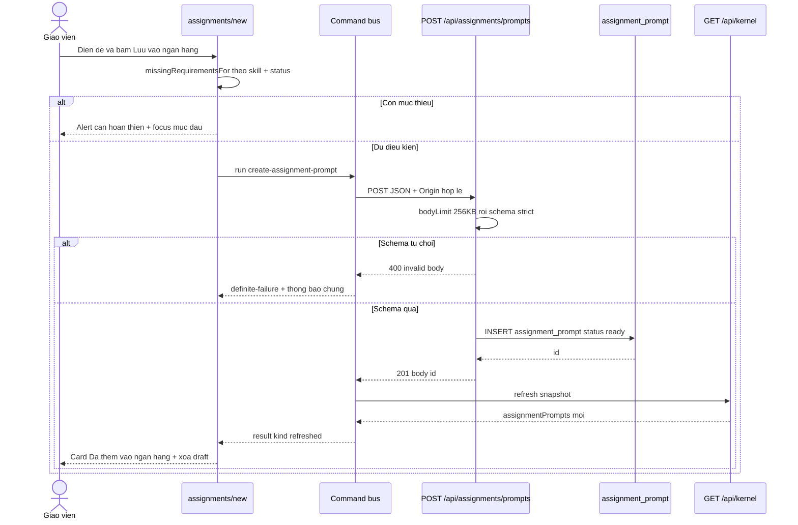

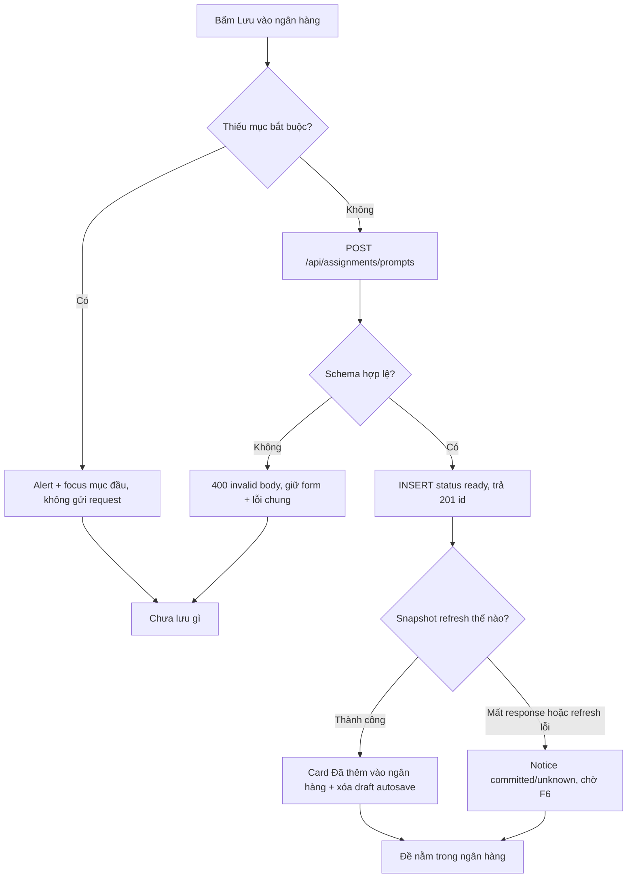

## F2 — Lưu bị chặn vì thiếu mục bắt buộc

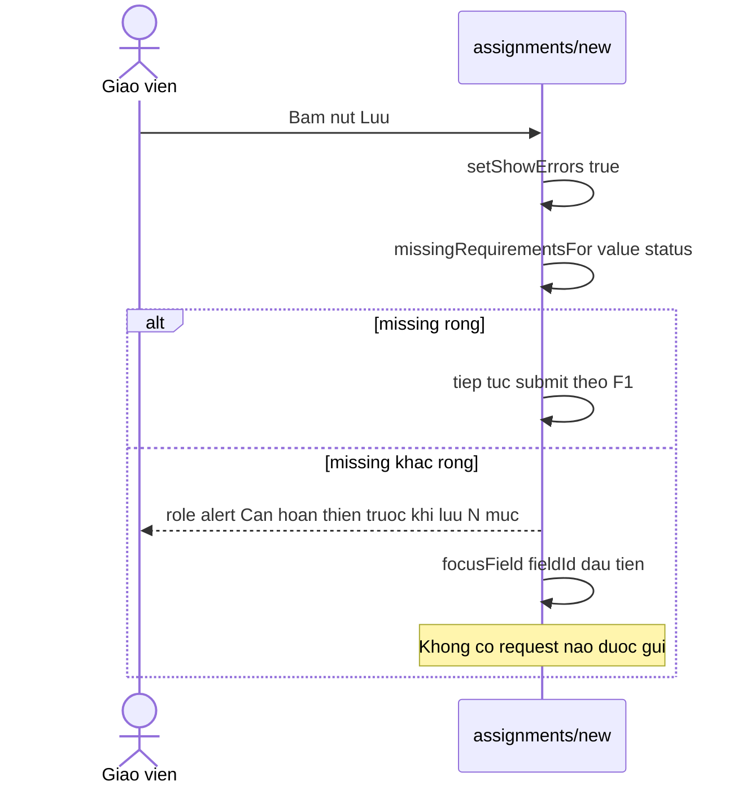

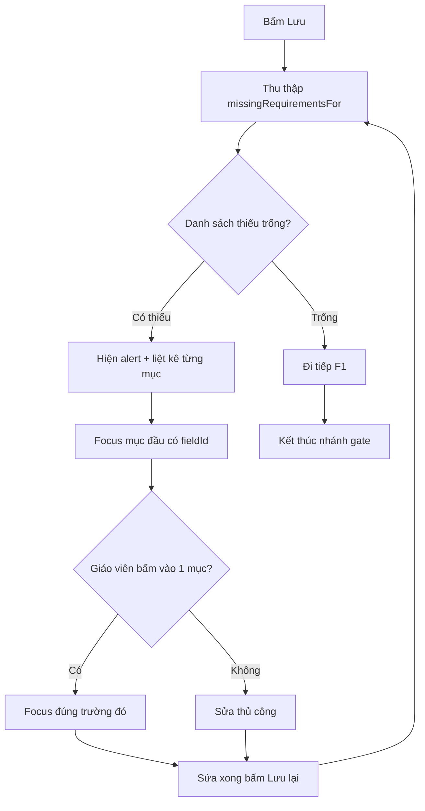

## F3 — Chỉnh sửa đề (field-diff + khóa nội dung)

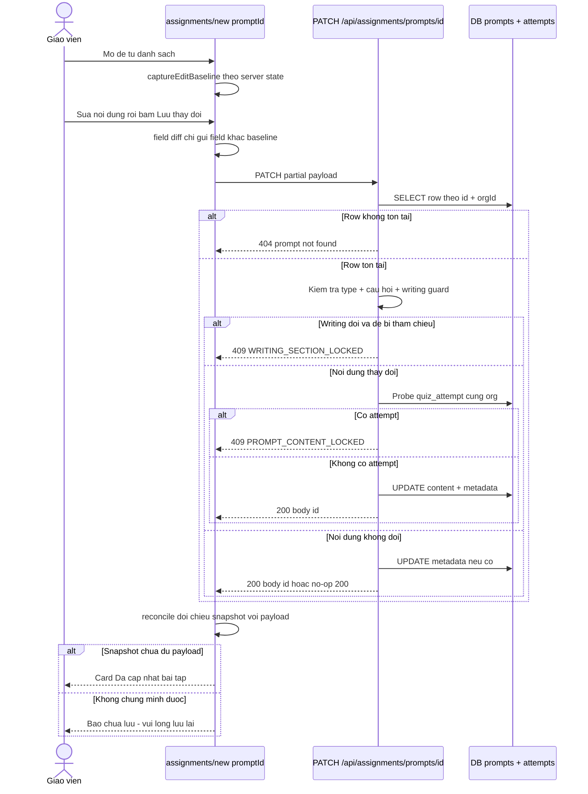

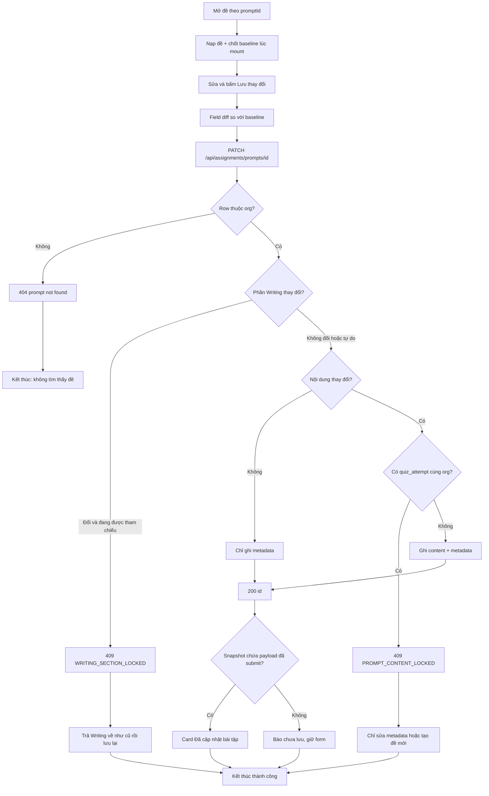

## F4 — Xem trước góc nhìn học viên

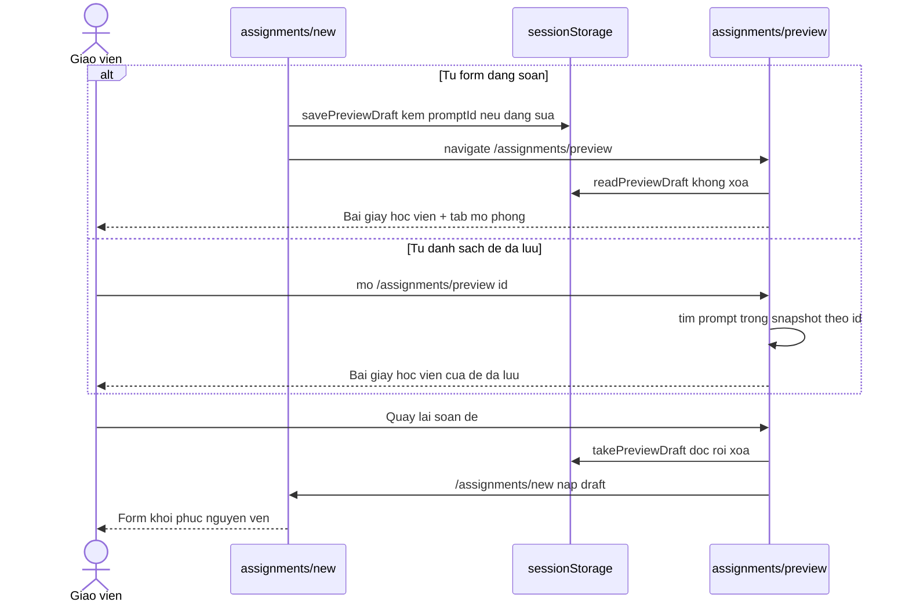

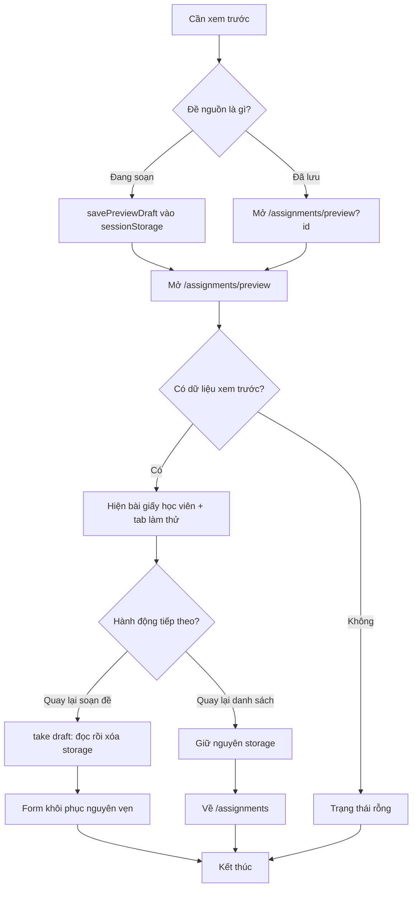

## F5 — Tự động lưu nháp và phục hồi

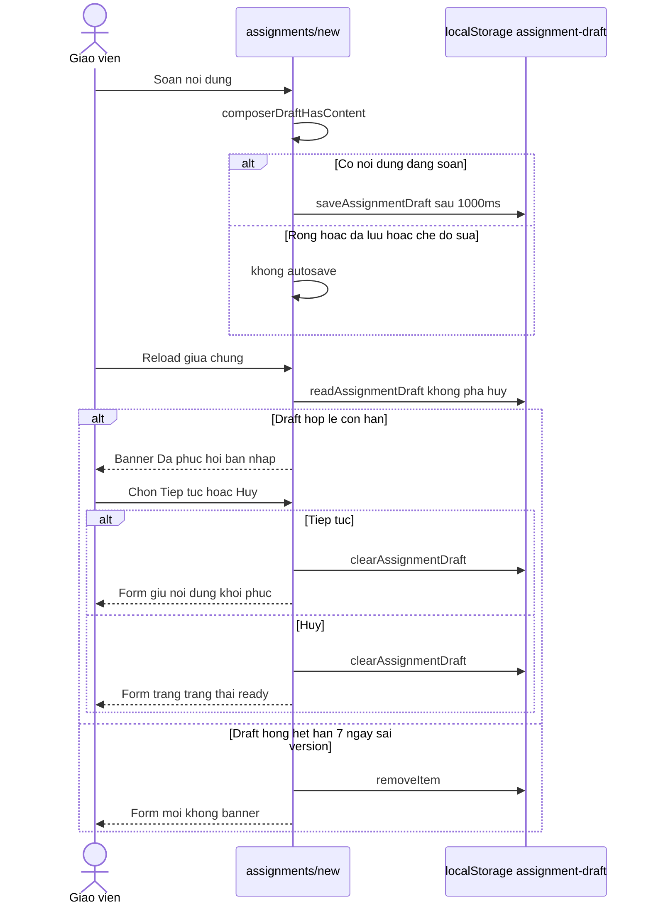

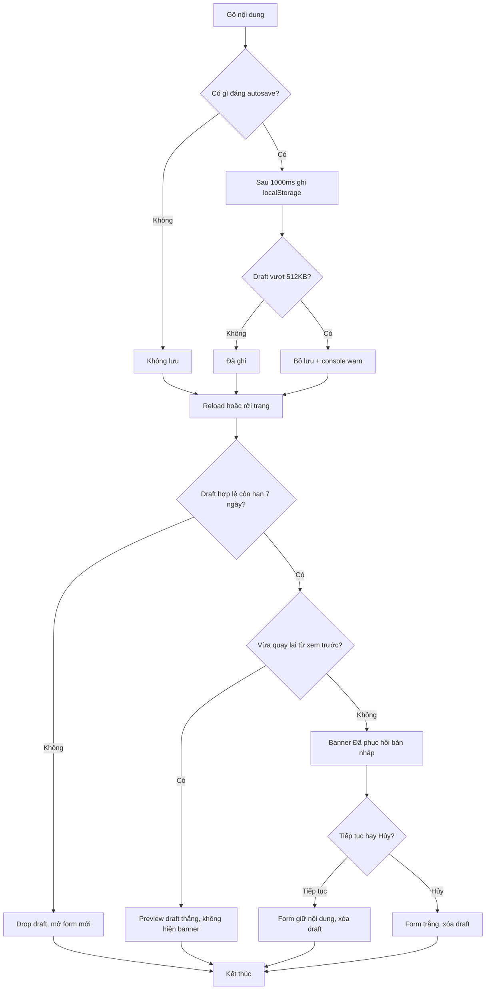

## F6 — Đối chiếu sau lưu (committed / outcome-unknown)

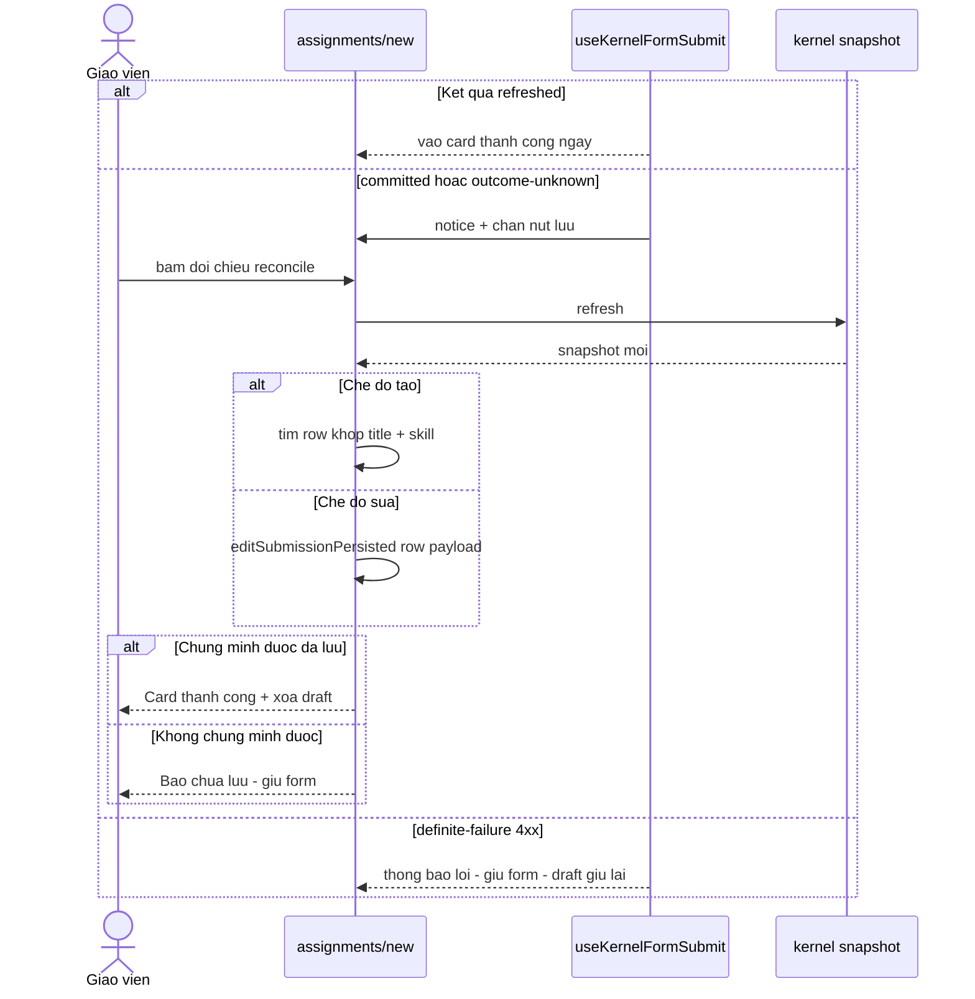

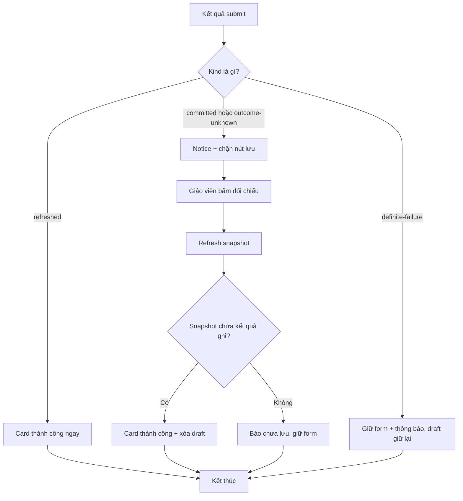

## F7 — Giao đề cho lớp (touchpoint)

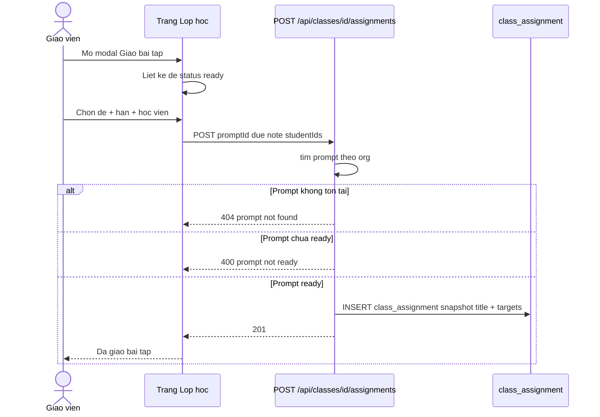

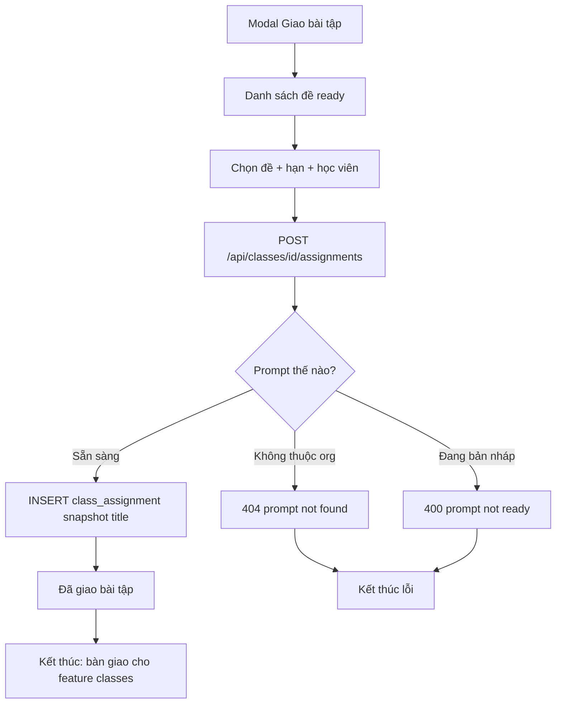
