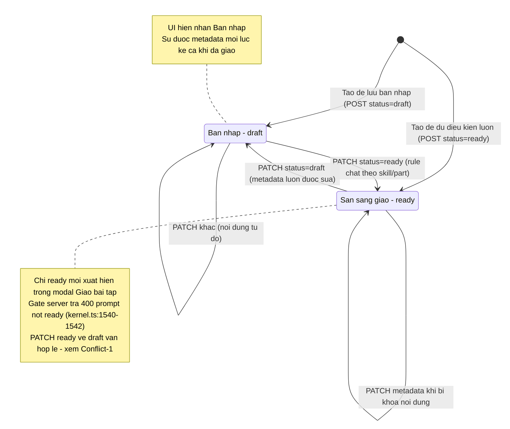
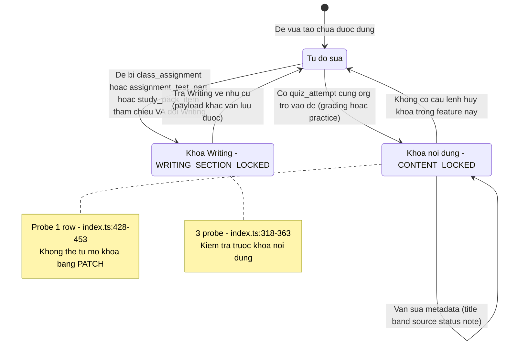
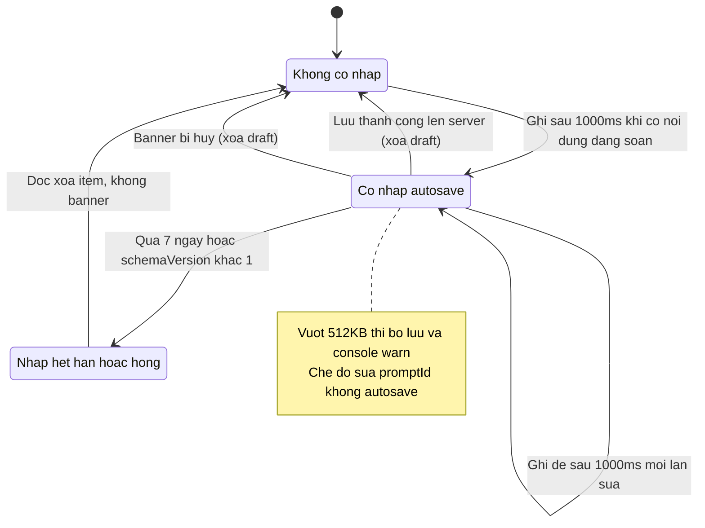
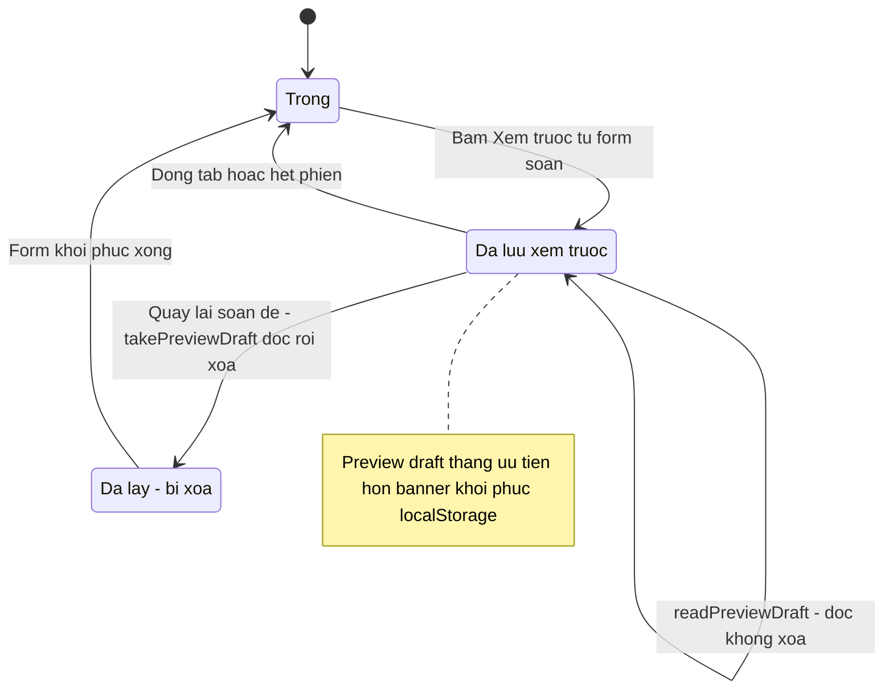
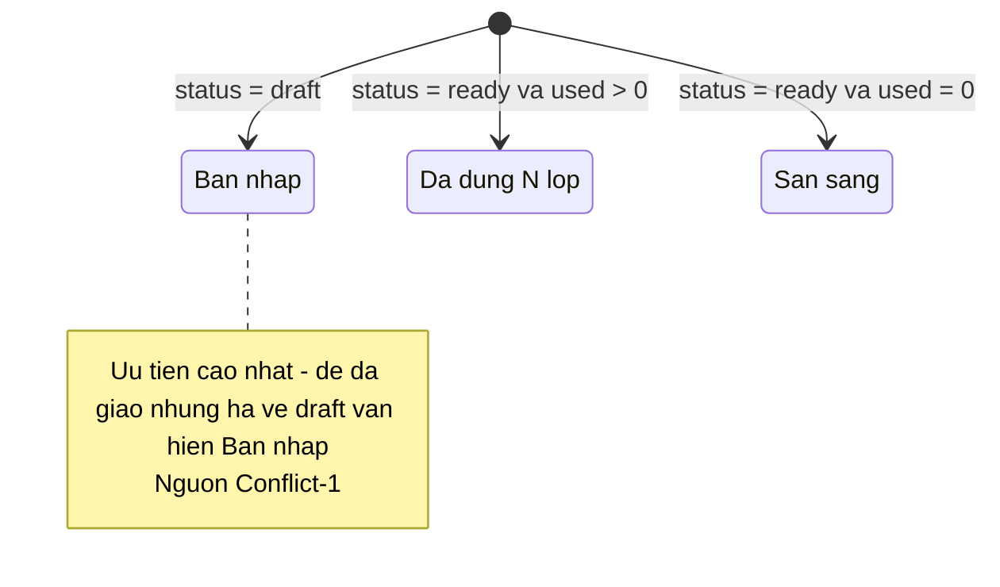

# States — assignment-prompt-bank (reverse)

Repo: /root/projects/teacher-os @ develop d6c0f6b5. Feature có 1 state-machine được lưu bền (`assignment_prompt.status`) và các máy trạng thái phái sinh/phiên (khóa nội dung derive theo dữ liệu tham chiếu; nháp soạn thảo sống trong localStorage/sessionStorage).

## 1. `assignment_prompt.status` — máy trạng thái lưu bền

Cột `status` text not null default `draft`, enum `draft | ready` — `packages/db/src/schema/assignment-prompt.ts:50`; enum hợp đồng `packages/api/src/contracts.ts:868` (trong base schema); migration `packages/db/src/migrations/0017_wet_jetstream.sql:13`.

Chi tiết chuyển tiếp:
- **Tạo trực tiếp ready**: create schema chấp nhận `status: "ready"` khi qua mọi rule chặt (stem, answer, audio, image...) — `packages/api/src/contracts.ts:874-1123`; E2E flow đầu tiên lưu luôn ready `apps/e2e/specs/assignment-prompt-create.spec.ts:18-68`. ✅
- **draft → ready**: PATCH `status:"ready"` — route validate lại type + per-question theo part/skill của ROW với rule chặt — `apps/server/src/routes/assignments/index.ts:241-281`. ✅
- **ready → draft**: `status` thuộc nhóm metadata luôn được ghi (`apps/server/src/routes/assignments/index.ts:471`); không có rào chắn nào dựa trên việc đề đã giao — lý do ra Conflict-1/OQ-2. 🟡
- **Không có trạng thái xóa/lưu trữ**: không có DELETE route hay cột deleted_at (Gap-1). ✅

## 2. Khóa chỉnh sửa — trạng thái derive (không lưu trong DB)

Hai khóa này không phải cột; chúng được tính lúc xử lý PATCH bằng probe dữ liệu tham chiếu — `apps/server/src/routes/assignments/index.ts:304-374,428-463`.

Lưu ý biên: hai khóa **kết hợp theo chiều AND**: nếu đề vừa bị tham chiếu Writing vừa có attempt, đổi nội dung + đổi Writing cùng lúc → Writing lock thắng vì được kiểm trước — `apps/server/src/routes/assignments/index.ts:319,429` (thứ tự if). ✅

## 3. Nháp soạn thảo cục bộ (localStorage `assignment-draft`)

Không thuộc DB; sống theo thiết bị trình duyệt — `apps/web/src/lib/assignment-draft-store.ts`.

Chuyển tiếp "xoa khi luu thanh cong" chỉ xảy ra với kind `refreshed` / `committed` / `outcome-unknown` — `apps/web/src/routes/_auth/assignments/new.tsx:969-978`. ✅

## 4. Nháp xem trước (sessionStorage `teacher-os:assignment-preview-draft`)

Vòng đời ngắn trong 1 tab — `apps/web/src/lib/assignment-preview-draft.ts:57-78`.

## 5. Nhãn hiển thị derive (promptStatus)

Không phải state-machine thật — hàm derive thuần, nhưng quyết định nhãn chính của danh sách — `apps/web/src/components/assignments/assignment-status.ts:198-206`:

used = số lớp distinct từ `classAssignments` theo promptId — `apps/web/src/routes/_auth/assignments/index.tsx:162-170`. ✅
