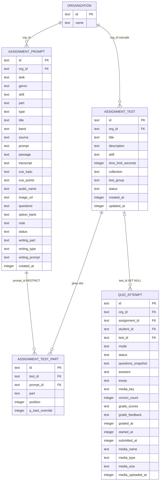

# ERD — assignment-tests (reverse)

## Entity Reference

| Entity | Bảng | Vai trò trong feature | Nguồn |
|--------|------|----------------------|-------|
| ORGANIZATION | `organization` | Gốc multi-tenant; xóa org cascade xóa bộ đề | `packages/db/src/schema/assignment-test.ts:22-24` |
| ASSIGNMENT_TEST | `assignment_test` | 1 row = 1 bộ đề full một kỹ năng; status draft/ready | `packages/db/src/schema/assignment-test.ts:18-44` |
| ASSIGNMENT_TEST_PART | `assignment_test_part` | Slot ghép; unique (test_id, part); không có orgId | `packages/db/src/schema/assignment-test.ts:53-78` |
| ASSIGNMENT_PROMPT | `assignment_prompt` | Đề nguồn trong ngân hàng; RESTRICT khi đang nằm trong test; hybrid loại khỏi test | `packages/db/src/schema/assignment-test.ts:60-66`; `apps/server/src/routes/assignments/tests.ts:214-218` |
| QUIZ_ATTEMPT | `quiz_attempt` | Lượt làm; test_id SET NULL khi xóa đề; nguồn khóa parts | `packages/db/src/schema/quiz-attempt.ts:57-59,99-106` |

Index đáng chú ý: `assignment_test_org_idx` (`assignment-test.ts:43`); `assignment_test_part_test_part_unique` (test_id, part) (`assignment-test.ts:72-77`); `quiz_attempt_assignment_student_uq`, `quiz_attempt_student_mode_idx` (`quiz-attempt.ts:86-97`).

Snapshot/web view: `KernelAssignmentTestRow` (parts nhúng) — `packages/api/src/contracts.ts:1882-1892`; mapping defensive — `apps/web/src/lib/repos/assignment-tests.ts:21-41`.

## Quan hệ

| Quan hệ | Cardinality | Hành vi xóa | Ý nghĩa nghiệp vụ |
|---------|-------------|-------------|-------------------|
| organization → assignment_test | 1..N | cascade | Bộ đề thuộc đúng một trung tâm |
| assignment_test → assignment_test_part | 1..N | cascade | Xóa bộ đề xóa hết slot |
| assignment_prompt → assignment_test_part | 1..N | RESTRICT | Prompt đang nằm trong test không xóa được khỏi ngân hàng |
| assignment_test → quiz_attempt | 0..N | SET NULL | Xóa đề giữ nguyên lượt làm + điểm; tồn tại attempt khóa parts |
