# Flows — assignment-tests (reverse)

Mỗi flow có cả sequenceDiagram và flowchart. Số câu/tên màn hình lấy nguyên văn từ code.

## F1 — Tạo bộ đề mới (create)

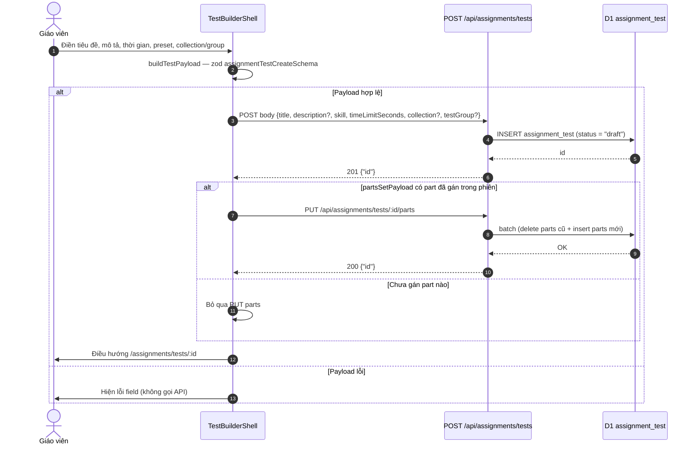

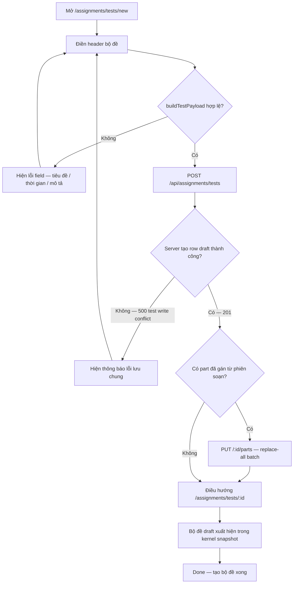

Nguồn: `apps/server/src/routes/assignments/tests.ts:63-86`; `apps/web/src/components/assignment-tests/test-builder-shell.tsx:489-532`; `apps/web/src/components/assignment-tests/test-header-form.tsx:85-121`.

## F2 — Ghép part vào slot (ngân hàng hoặc soạn mới)

```mermaid
sequenceDiagram
    autonumber
    actor GV as Giáo viên
    participant SH as TestBuilderShell
    participant PK as PromptPickerDialog / PromptComposer
    participant API as PUT parts · POST/PATCH prompts
    GV->>SH: Bấm "Chọn từ ngân hàng" hoặc "Soạn mới" trên slot
    alt Chọn từ ngân hàng
        SH->>PK: Mở dialog (prompt lọc skill+part, không hybrid, mới nhất trước)
        PK-->>GV: Danh sách part kèm badge Sẵn sàng / Bản nháp
        GV->>PK: Chọn một prompt
        PK-->>SH: onPick(promptId)
        SH->>SH: setAssigned(part → promptId); xóa slot draft của part
    else Soạn mới trong slot
        SH->>PK: Mở composer lockPart (skill/part của slot)
        GV->>PK: Soạn nội dung + chọn trạng thái Bản nháp / Sẵn sàng
        PK->>API: create-assignment-prompt (status draft hoặc ready)
        API-->>PK: 201 {id}
        PK-->>SH: Tự gán prompt vào slot (handleAssign)
    end
    alt Chế độ edit
        SH->>API: set-assignment-test-parts (PUT replace-all)
        alt definite-failure (ví dụ 409 khóa)
            SH-->>SH: Rollback slot về prompt cũ
        else refreshed
            SH-->>GV: Snapshot cập nhật, slot hiển thị dải câu mới
        end
    else Chế độ create
        SH-->>SH: Chỉ giữ state — gửi phần khi "Tạo bộ đề"
    end
```

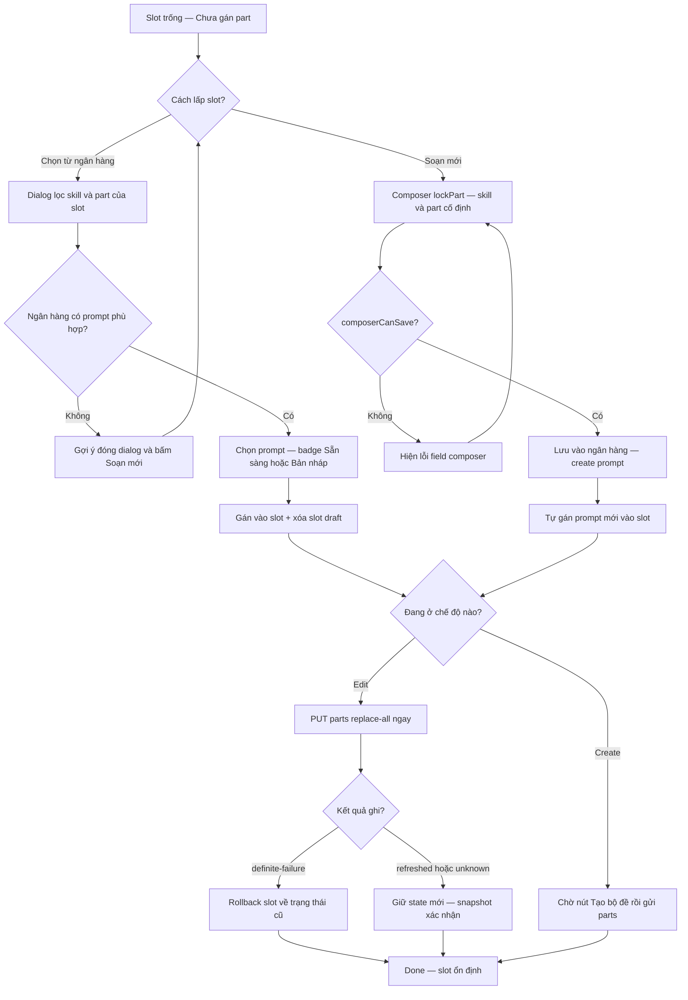

Nguồn: `test-builder-shell.tsx:341-369,371-487,603-613,838-848`; `prompt-picker-dialog.tsx:29-65`; `test-part-slot.tsx:42-76`.

## F3 — Soát đáp án (paste key → compare → apply)

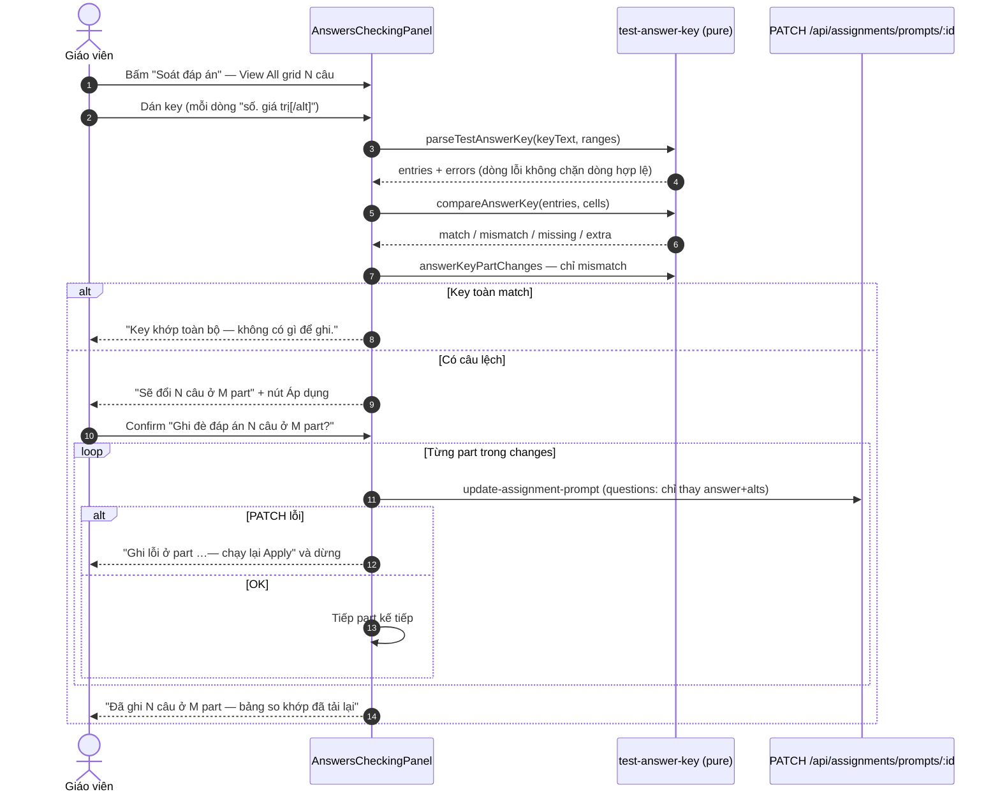

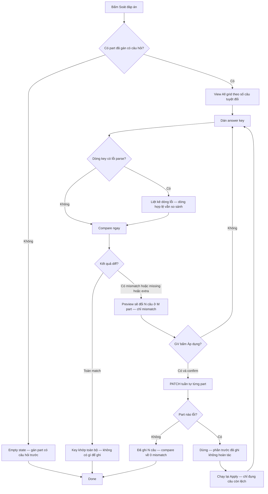

Nguồn: `answers-checking-panel.tsx:112-137,139-256`; `apps/web/src/lib/test-answer-key.ts:105-181,206-231`; `apps/web/src/lib/repos/assignment-tests.ts:164-219`; e2e `apps/e2e/specs/assignment-test-create.spec.ts:226-259`.

## F4 — Xem trước bộ đề (giấy thi học viên)

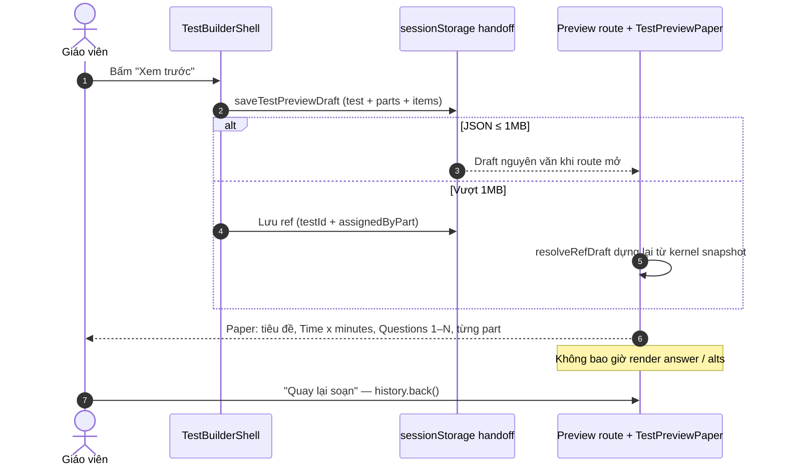

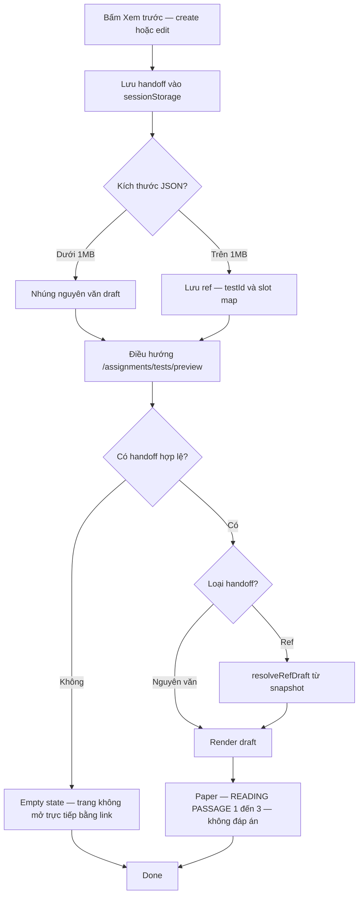

Nguồn: `test-builder-shell.tsx:553-587`; `apps/web/src/lib/assignment-test-preview-draft.ts:135-202`; `preview.tsx:29-146`; `test-preview-paper.tsx:37-61,96-174`.

## F5 — Sửa bộ đề (metadata + khóa parts 409)

```mermaid
sequenceDiagram
    autonumber
    actor GV as Giáo viên
    participant SH as TestBuilderShell (edit)
    participant API as PATCH test · PUT parts
    participant DB as D1
    GV->>SH: Mở /assignments/tests/:id (skill select khóa)
    GV->>SH: Đổi tiêu đề/thời gian/collection… rồi "Lưu thông tin"
    SH->>API: PATCH /:id (partial)
    alt skill bị đổi
        API-->>SH: 400 {"error":"skill is immutable"}
    else OK
        API->>DB: UPDATE (trả 200 {id}; body rỗng → no-op 200)
        API-->>SH: 200
        SH-->>GV: "Đã lưu thông tin bộ đề."
    end
    GV->>SH: Đổi/gỡ part trong slot
    SH->>API: PUT /:id/parts
    alt Test đã có quiz_attempt cùng org và payload tạo diff
        API-->>SH: 409 {"error":"test parts locked","code":"TEST_PARTS_LOCKED"}
        SH-->>GV: Thông báo khóa + slot hoàn nguyên (rollback)
    else Không có attempt
        API->>DB: batch delete + insert parts
        API-->>SH: 200 {id}
    end
```

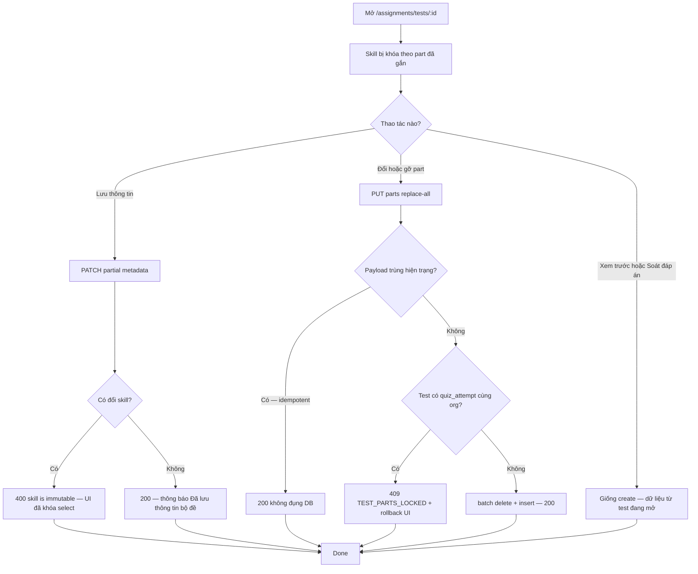

Nguồn: `tests.ts:88-131,244-281`; `test-builder-shell.tsx:302-328,489-515`; `use-kernel-form-submit.ts:18-30`; test `tests.test.ts:301-314,392-555`.

## F6 — Xóa bộ đề

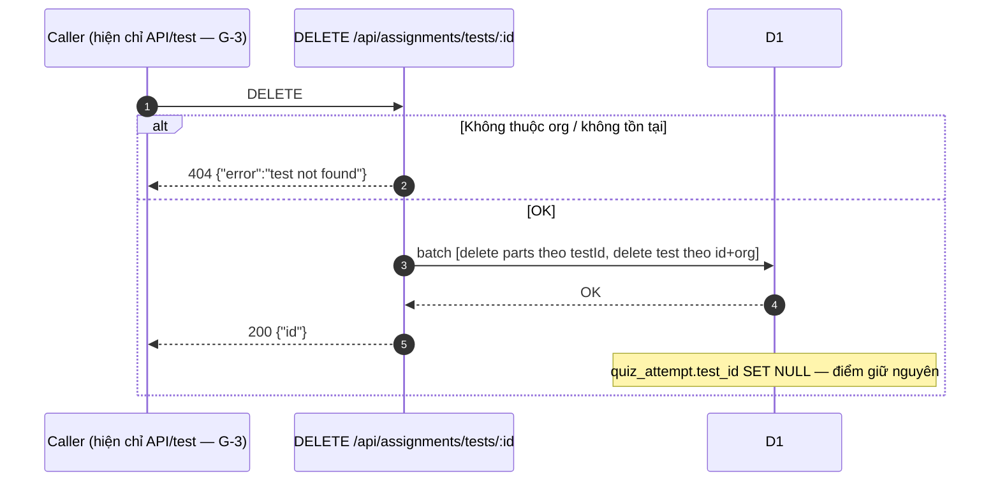

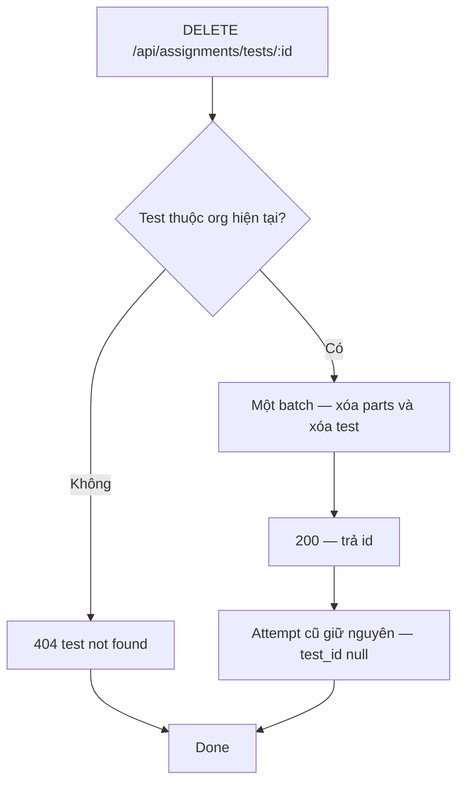

Nguồn: `tests.ts:133-161`; `packages/db/src/schema/quiz-attempt.ts:35-40,57-59`; mutation map `apps/web/src/lib/repos/kernel.ts:289-294`; gap `../reverse-gaps.md` G-3.

## F7 — Bản nháp autosave + phục hồi

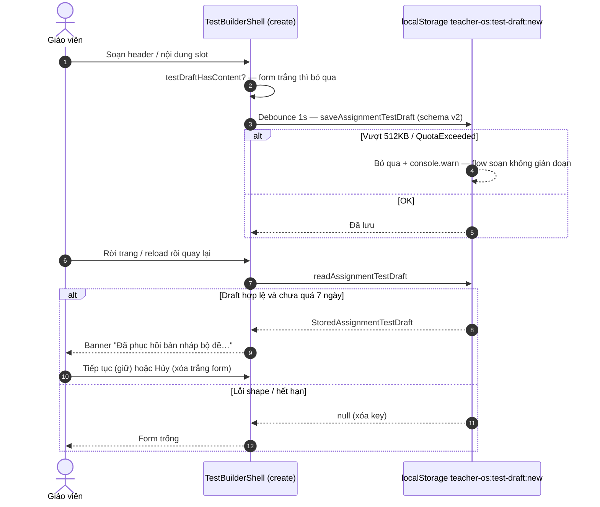

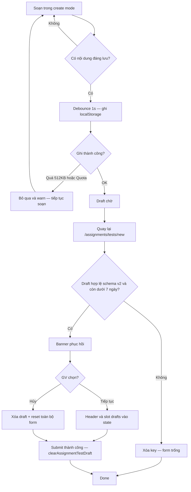

Nguồn: `apps/web/src/lib/assignment-test-draft-store.ts:15-23,144-226`; `test-builder-shell.tsx:101-171,256-277,489-510,589-601`.
