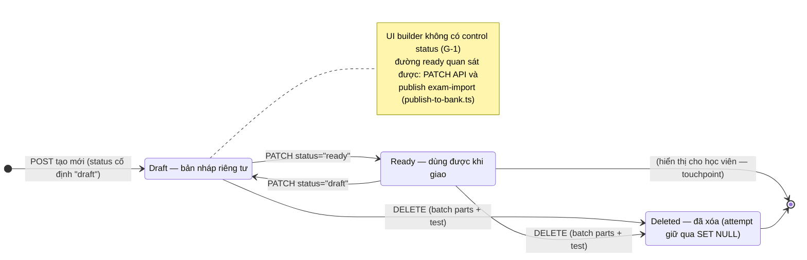
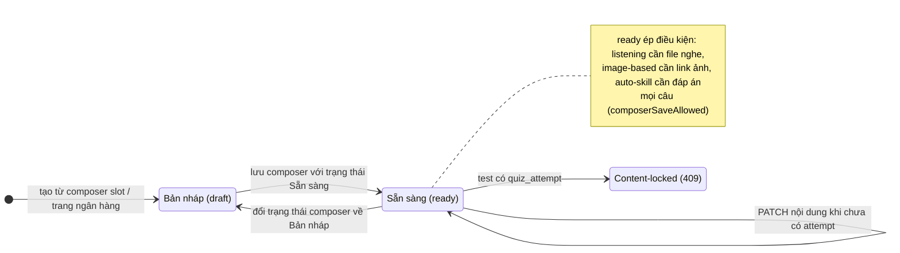
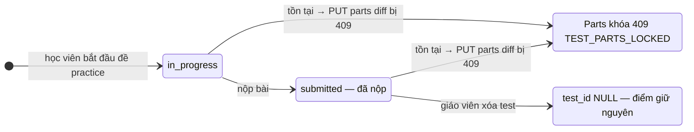
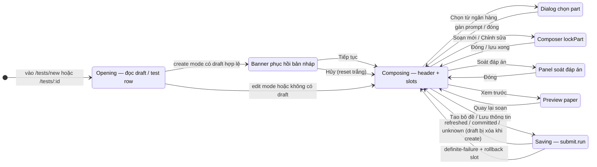

# States — assignment-tests (reverse)

## S1 — `assignment_test.status` (draft / ready) + xóa

Nguồn: `packages/db/src/schema/assignment-test.ts:16,34`; `apps/server/src/routes/assignments/tests.ts:81,118`; `packages/api/src/contracts.ts:1217-1221`.

## S2 — `assignment_prompt.status` (nguyên liệu slot)

Nguồn: `apps/web/src/components/assignment-tests/test-builder-shell.tsx:752-763,892-914`; khóa nội dung `apps/server/src/routes/assignments/index.ts:428-463`.

## S3 — `quiz_attempt` (điều kiện khóa parts)

Nguồn: `packages/db/src/schema/quiz-attempt.ts:30-40,57-59,99-106`; khóa `apps/server/src/routes/assignments/tests.ts:264-281` (cả in_progress lẫn submitted — test `tests.test.ts:408-513`).

## S4 — Máy trạng thái màn builder (UI)

Nguồn: `test-builder-shell.tsx:101-181,341-601,722-836`.
