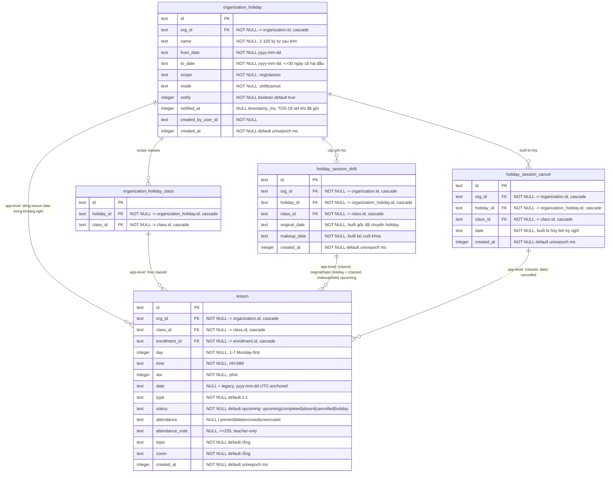

# srs/attendance-reverse-erd — attendance

Kiểu cột khớp schema thật (packages/db/src/schema/lesson.ts, packages/db/src/schema/organization-holiday.ts). FK ghi ở đây là FK schema-level (`references` + ON DELETE cascade); các quan hệ APP-LEVEL (không có FK) được ghi chú riêng dưới biểu đồ.

Unique indexes (schema thật):

- `organization_holiday_class_holiday_class_uq (holiday_id, class_id)` — packages/db/src/schema/organization-holiday.ts:63-68 ✅.
- `holiday_session_shift_class_original_uq (class_id, original_date)` và `holiday_session_shift_class_makeup_uq (class_id, makeup_date)` — packages/db/src/schema/organization-holiday.ts:100-111 ✅.
- `holiday_session_cancel_class_date_uq (class_id, date)` — packages/db/src/schema/organization-holiday.ts:141-148 ✅.
- `lesson`: không unique trên bucket; index thường `lesson_class_date_idx (class_id, date)`, `lesson_enrollment_idx (enrollment_id, status)`, `lesson_org_idx` — packages/db/src/schema/lesson.ts:75-79 ✅.

Quan hệ tham chiếu ngoài feature (không đặc tả ở đây): `lesson.class_id → class.id`, `lesson.enrollment_id → enrollment.id` (1 buổi = 1 enrollment), `organization_holiday_class.class_id → class.id`, mọi `org_id → organization.id` — packages/db/src/schema/lesson.ts:33-41 ✅.

Migration tương ứng: packages/db/src/migrations/0045_aspiring_thena.sql:1-2 (2 cột điểm danh); packages/db/src/migrations/0047_slim_nightmare.sql:1-42 (holiday + shift + class); packages/db/src/migrations/0050_bent_spectrum.sql:1-15 (cancel) ✅.
