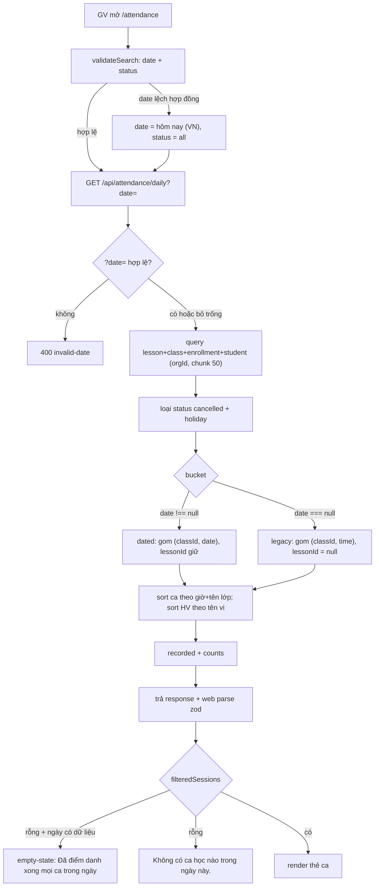
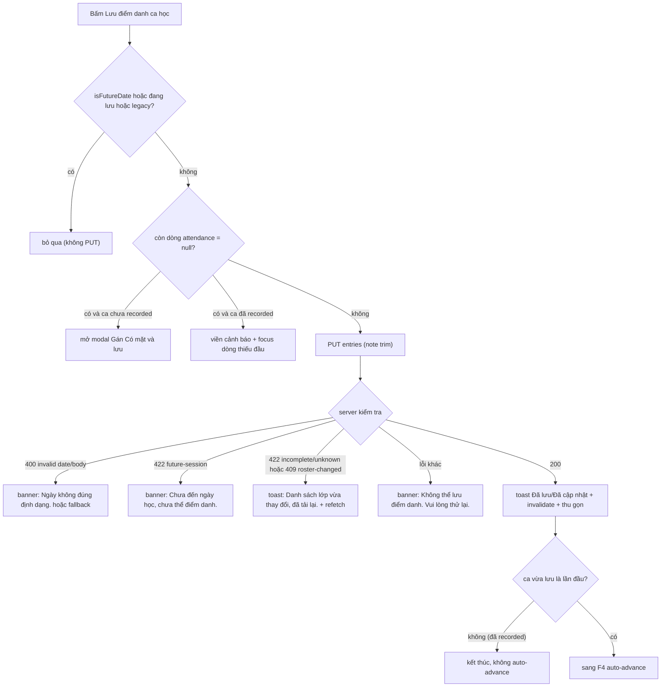
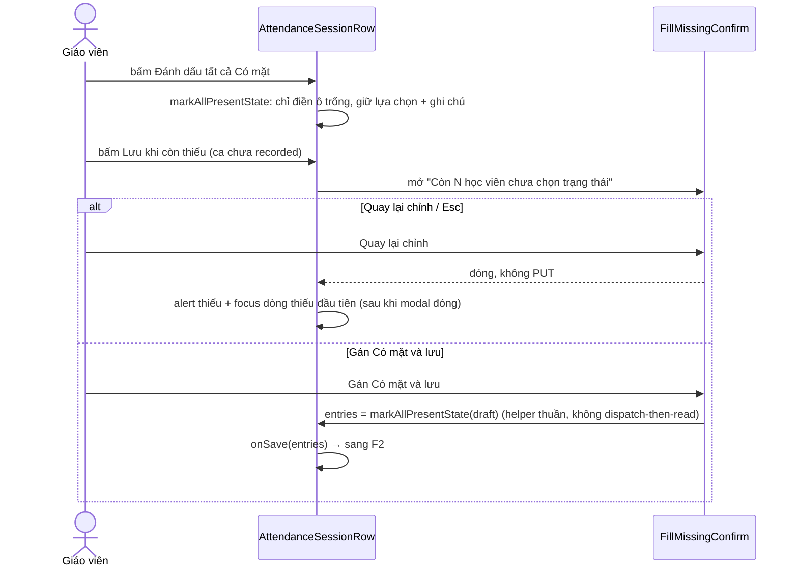
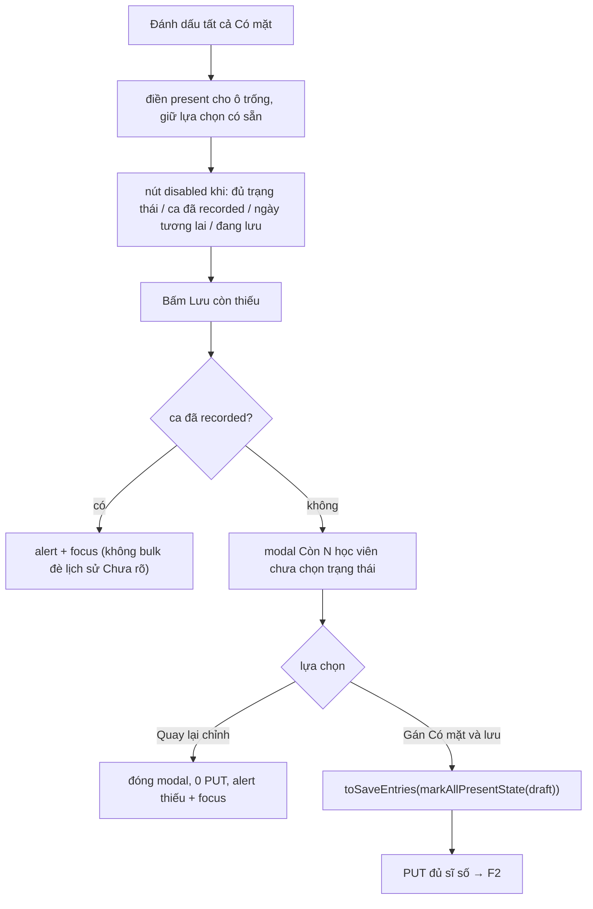
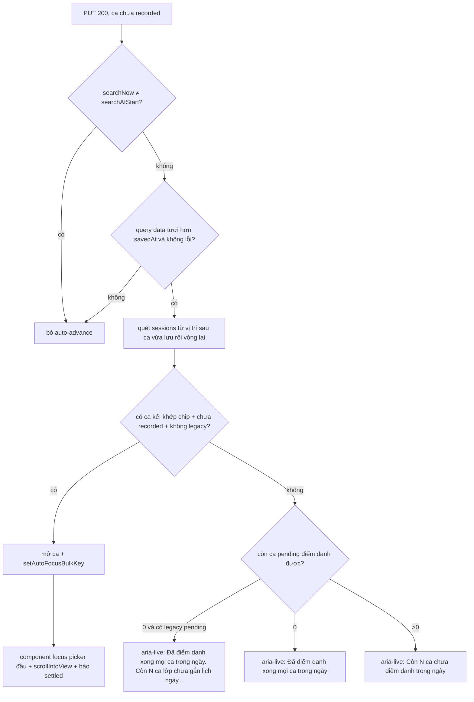
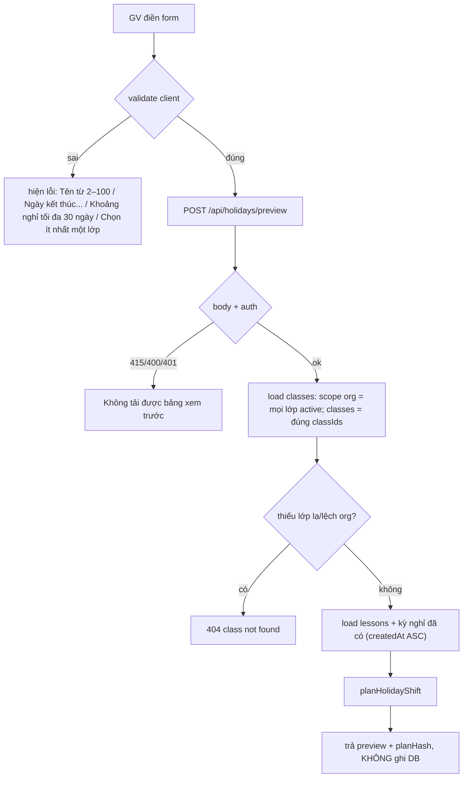
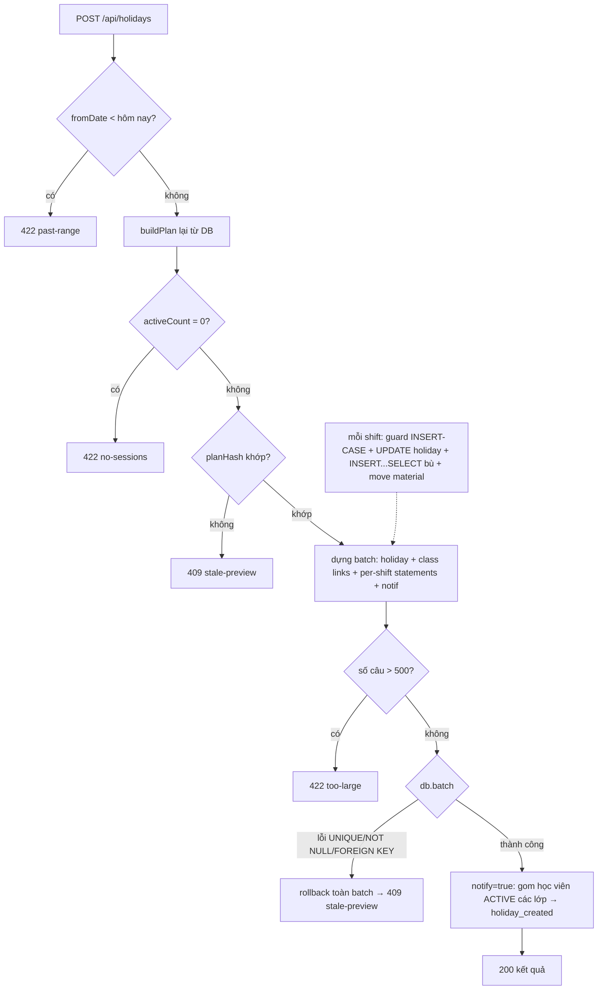
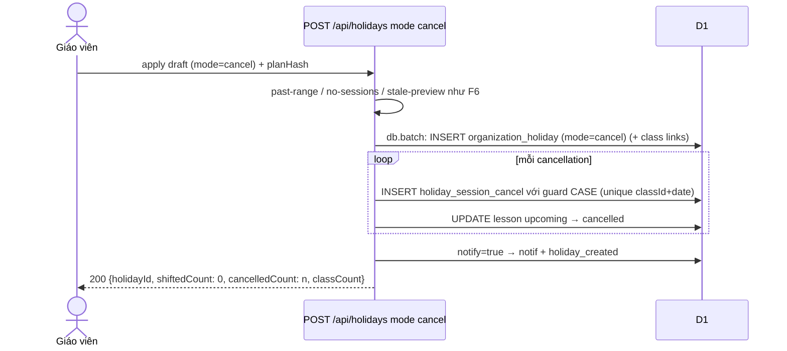
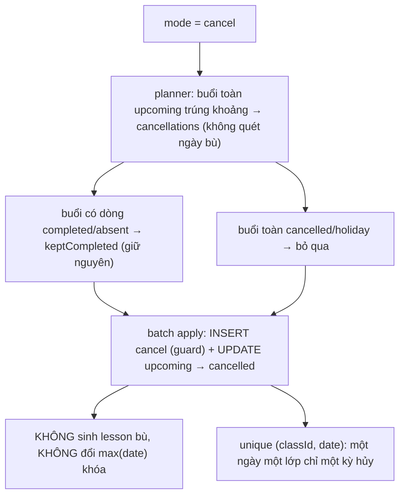
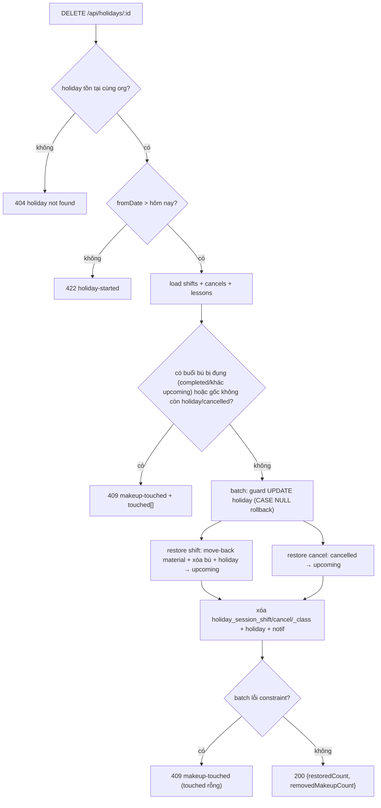

# srs/attendance-reverse-flows — attendance

Mỗi flow có CẢ HAI diagram. Chỉ vẽ bước có trong code; bước suy đoán gắn 🔵/🟡.

## F1 — Xem điểm danh theo ngày (GET /api/attendance/daily)

```mermaid
sequenceDiagram
    actor GV as Giáo viên
    participant Web as Man hinh /attendance
    participant API as GET /api/attendance/daily
    participant DB as D1
    GV->>Web: mở /attendance?date=&status=
    Web->>Web: validateAttendanceSearch (date sai về hôm nay, status lạ về all)
    Web->>API: GET ?date= (thiếu date → hôm nay VN)
    API->>API: date sai định dạng → 400 invalid-date
    API->>DB: SELECT lesson ⋈ class ⋈ enrollment(active) ⋈ student (chunk 50, cùng orgId)
    DB-->>API: raw rows (kèm status/attendance/attendanceNote)
    API->>API: excludeNonTeachingSessions (loại cancelled + holiday)
    API->>API: gom bucket dated (classId,date) / legacy (classId,time)
    API->>API: recorded = không còn dòng upcoming; counts all/pending/completed
    API->>API: coerce hiển thị (completed+NULL → present; absent+NULL → null)
    API-->>Web: DailyAttendanceResponse (zod parse)
    Web-->>GV: danh sách thẻ ca + chip counts + empty-state
```



Nguồn: apps/web/src/routes/_auth/attendance.tsx:56-69, apps/web/src/routes/_auth/attendance.tsx:308-321, apps/web/src/routes/_auth/attendance.tsx:373-413; apps/server/src/routes/daily-attendance.ts:80-330; apps/server/src/routes/daily-attendance.test.ts:94-583.

## F2 — Lưu điểm danh cả ca (PUT)

```mermaid
sequenceDiagram
    actor GV as Giáo viên
    participant Row as AttendanceSessionRow
    participant API as PUT /api/classes/:id/sessions/:date/attendance
    participant DB as D1
    GV->>Row: chọn 4 trạng thái + ghi chú, bấm Lưu
    Row->>Row: còn thiếu? → ca chưa recorded: modal xác nhận; ca recorded: alert + focus (không PUT)
    Row->>Row: toSaveEntries (throw nếu còn null) → entries trim
    Row->>API: PUT {entries}
    API->>API: auth + date strict (400) + lớp/scope 404
    API->>API: date > hôm nay VN → 422 future-session
    API->>DB: roster = lesson cùng (orgId,classId,date), enrollment active, loại cancelled + holiday
    API->>API: roster rỗng → 404; id lạ → 422 unknown-lesson; thiếu → 422 incomplete-roster
    API->>DB: db.batch UPDATE từng lesson (status = D2(attendance), attendance, note) + roster-count guard
    API->>API: updated ≠ entries.length → 409 roster-changed
    API-->>Row: 200 {updated, recorded: true}
    Row-->>GV: toast Đã lưu điểm danh / Đã cập nhật điểm danh; thu gọn thẻ
```



Nguồn: apps/web/src/components/attendance/attendance-session-row.tsx:136-162; apps/web/src/lib/attendance-draft.ts:93-109; apps/web/src/lib/repos/daily-attendance.ts:93-112; apps/web/src/routes/_auth/attendance.tsx:162-306; apps/server/src/routes/kernel.ts:2909-3040; test: apps/server/src/routes/daily-attendance.test.ts:585-921, apps/web/src/routes/_auth/attendance.test.tsx:176-302.

## F3 — Điền nhanh & lưu thiếu có xác nhận





Nguồn: apps/web/src/lib/attendance-draft.ts:111-131; apps/web/src/components/attendance/attendance-session-row.tsx:136-162, apps/web/src/components/attendance/attendance-session-row.tsx:310-327, apps/web/src/components/attendance/attendance-session-row.tsx:425-431; apps/web/src/components/attendance/fill-missing-confirm.tsx:14-58; test: apps/web/src/components/attendance/attendance-session-row.test.tsx:89-168, apps/web/src/components/attendance/attendance-session-row.test.tsx:301-470; apps/web/src/lib/attendance-draft.test.ts:107-190; E2E: apps/e2e/specs/daily-attendance.spec.ts:244-438.

## F4 — Auto-advance sau lưu lần đầu (client)

```mermaid
sequenceDiagram
    participant Web as /attendance route
    participant QC as React Query cache
    Web->>Web: PUT 200 và ca vừa lưu CHƯA recorded (CR-Bugs F3)
    Web->>Web: search đổi giữa lúc lưu? → dừng
    Web->>QC: đọc query state ngày đó (phải tươi hơn thời điểm lưu, không lỗi)
    Web->>QC: refetch (invalidate ["kernel"]) đã xong
    Web->>Web: quét từ ca sau ca vừa lưu, vòng lại đầu; khớp chip và chưa recorded và mode ≠ legacy
    alt có ca kế tiếp
        Web->>Web: mở ca + autoFocusBulk (focus picker đầu tiên)
    else hết ca trong chip
        Web->>Web: aria-live: Đã điểm danh xong mọi ca trong ngày (hoặc còn N ca / còn legacy)
        Web->>Web: focus về ô chọn ngày
    end
```



Nguồn: apps/web/src/routes/_auth/attendance.tsx:98-130, apps/web/src/routes/_auth/attendance.tsx:184-261; apps/web/src/components/attendance/attendance-session-row.tsx:78-99; test: apps/web/src/routes/_auth/attendance.test.tsx:304-850; E2E: apps/e2e/specs/daily-attendance.spec.ts:440-535.

## F5 — Xem trước lịch nghỉ (POST /api/holidays/preview)

```mermaid
sequenceDiagram
    actor GV as Giáo viên
    participant Modal as Modal Tạo lịch nghỉ
    participant API as POST /api/holidays/preview
    participant Planner as planHolidayShift thuan
    participant DB as D1
    GV->>Modal: nhập tên, từ/đến ngày, scope, mode, notify
    Modal->>Modal: validate client (tên 2–100, toDate ≥ from, ≤30 ngày, scope classes ≥1 lớp)
    Modal->>API: POST draft (debounce theo previewKey)
    API->>API: auth + readBody (415/400)
    API->>DB: loadApplicableClasses (org hoặc classIds, active, cùng org; thiếu → 404)
    API->>DB: loadClassLessons (chunk 50) + loadExistingHolidayDates (createdAt ASC, id)
    API->>Planner: planHolidayShift(range, classes, existingHolidayDates, today, mode)
    Planner-->>API: shifts/cancellations + keptCompleted + unsupported
    API->>API: planHash = SHA-256 (gồm enrollmentIds nội bộ)
    API-->>Modal: HolidayPreview (bỏ enrollmentIds) — không ghi DB
    Modal-->>GV: bảng xem trước + nút xác nhận enable khi actionCount > 0
```



Nguồn: apps/web/src/components/schedule/holiday-modal.tsx:143-235; apps/web/src/lib/repos/holidays.ts:47-54; apps/server/src/routes/holidays.ts:230-305, apps/server/src/routes/holidays.ts:495-505; packages/api/src/holiday-plan.ts:94-283; test: apps/server/src/routes/holidays.test.ts:252-347, packages/api/src/holiday-plan.test.ts:61-393.

## F6 — Áp dụng lịch nghỉ, mode shift (POST /api/holidays)

```mermaid
sequenceDiagram
    actor GV as Giáo viên
    participant API as POST /api/holidays
    participant DB as D1
    participant Mail as emitNotifications
    GV->>API: apply draft + planHash
    API->>API: fromDate < hôm nay VN → 422 past-range
    API->>DB: buildPlan LẠI từ DB (không tin client)
    API->>API: 0 buổi trúng → 422 no-sessions; hash lệch → 409 stale-preview
    API->>DB: db.batch: INSERT organization_holiday (+ class links)
    loop mỗi shift
        API->>DB: INSERT holiday_session_shift với guard CASE (NULL → rollback cả batch)
        API->>DB: UPDATE lesson gốc upcoming → holiday
        API->>DB: INSERT...SELECT sinh buổi bù upcoming từ các dòng holiday (id holmk-*)
        API->>DB: dọn trùng + UPDATE lesson_material sang makeupDate
    end
    API->>DB: notify=true → INSERT notif kê schedule
    API->>API: statements > 500 → 422 too-large
    API->>DB: batch lỗi UNIQUE/NOT NULL → rollback sạch → 409 stale-preview
    API->>Mail: notify=true → holiday_created cho học viên ACTIVE (email + in-app, fail-open)
    API-->>GV: 200 {holidayId, shiftedCount, cancelledCount, classCount}
```



Nguồn: apps/server/src/routes/holidays.ts:307-441, apps/server/src/routes/holidays.ts:507-671; apps/web/src/components/schedule/holiday-modal.tsx:179-235; test: apps/server/src/routes/holidays.test.ts:348-523, apps/server/src/routes/holidays.test.ts:1303-1460; E2E: apps/e2e/specs/holiday-shift.spec.ts:69-199, apps/e2e/specs/holiday-skip-and-kept-completed.spec.ts:78-196.

## F7 — Áp dụng lịch nghỉ, mode cancel (POST /api/holidays)





Nguồn: packages/api/src/holiday-plan.ts:201-214; apps/server/src/routes/holidays.ts:414-441, apps/server/src/routes/holidays.ts:577-587; test: packages/api/src/holiday-plan.test.ts:395-640; apps/server/src/routes/holidays.test.ts:1551-1678; E2E: apps/e2e/specs/holiday-cancel-and-undo.spec.ts:50-112.

## F8 — Hoàn tác kỳ nghỉ tương lai (DELETE /api/holidays/:id)

```mermaid
sequenceDiagram
    actor GV as Giáo viên
    participant API as DELETE /api/holidays/:id
    participant DB as D1
    GV->>API: xóa kỳ nghỉ (Hoàn tác)
    API->>DB: tìm holiday cùng org → không thấy → 404
    API->>API: fromDate <= hôm nay VN → 422 holiday-started
    API->>DB: load shifts + cancels + lessons các lớp liên quan (chunk 50)
    API->>API: buổi bù còn nguyên upcoming và gốc còn holiday/cancelled?
    API->>API: lệch → 409 makeup-touched kèm touched[]
    API->>DB: db.batch: UPDATE guard trên organization_holiday (CASE → NULL = rollback)
    loop mỗi shift (restore)
        API->>DB: dọn trùng material + move-back material về originalDate
        API->>DB: DELETE buổi bù upcoming; UPDATE holiday → upcoming
    end
    loop mỗi cancel (restore)
        API->>DB: UPDATE cancelled → upcoming (chỉ dòng do kỳ này hủy)
    end
    API->>DB: DELETE bảng con + organization_holiday + INSERT notif Đã xóa kỳ nghỉ
    API->>API: statements > 500 → 422 too-large; batch constraint lỗi → 409 makeup-touched
    API-->>GV: 200 {restoredCount, removedMakeupCount}
```



Nguồn: apps/server/src/routes/holidays.ts:673-1009; apps/web/src/components/schedule/holiday-undo-dialog.tsx:9-19, apps/web/src/components/schedule/holiday-undo-dialog.tsx:100-161; apps/web/src/lib/repos/holidays.ts:73-122; test: apps/server/src/routes/holidays.test.ts:1679-1998; E2E: apps/e2e/specs/holiday-cancel-and-undo.spec.ts:113-231.
