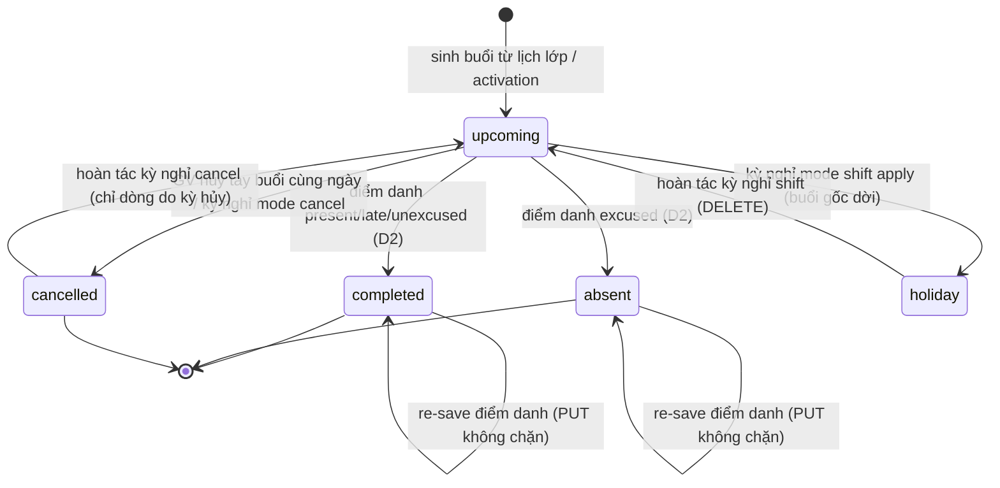
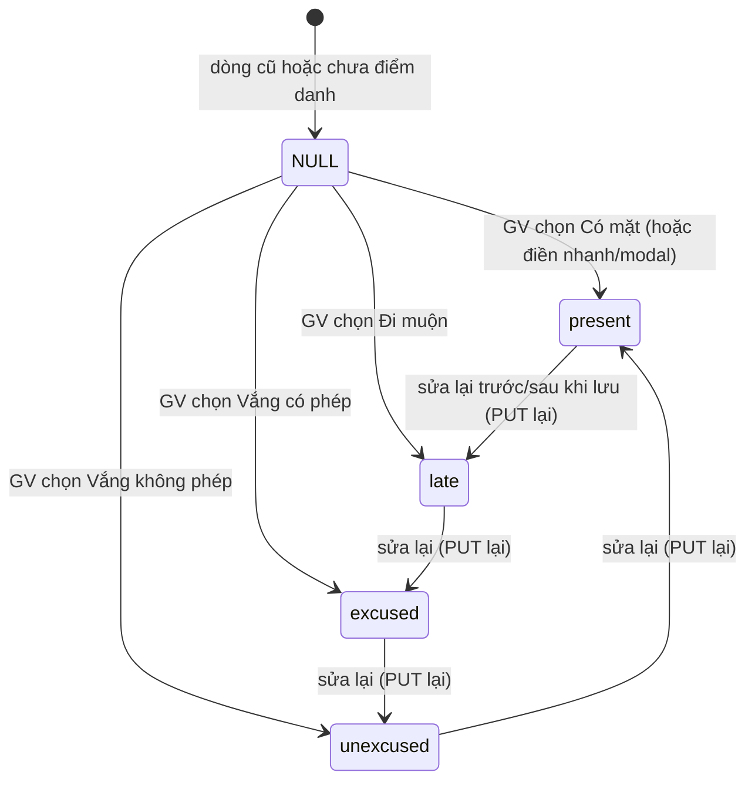
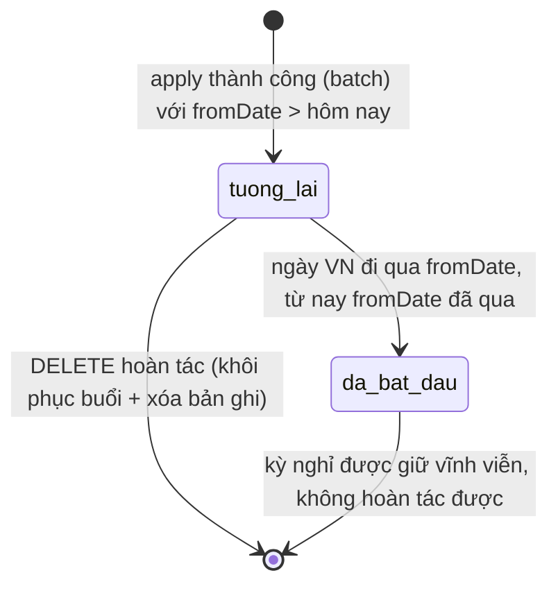

# srs/attendance-reverse-states — attendance

## 1. `lesson.status` — trạng thái buổi (multi-state, enum thật)

Enum: `upcoming | completed | absent | cancelled | holiday` — packages/db/src/schema/lesson.ts:48-57 ✅; nhãn hiển thị: packages/api/src/contracts.ts:3886-3892 ✅.

Chứng thực chuyển trạng thái:

- `upcoming → completed/absent`: apps/server/src/routes/kernel.ts:2993-3000 + packages/api/src/contracts.ts:1350-1358 (D2); test packages/api/src/attendance.test.ts:18-55, apps/server/src/routes/daily-attendance.test.ts:625-717 ✅.
- `upcoming → cancelled`: hủy tay (E2E seed apps/e2e/specs/daily-attendance.spec.ts:39-49) + kỳ nghỉ cancel (apps/server/src/routes/holidays.ts:429-440; test apps/server/src/routes/holidays.test.ts:1551-1632) ✅.
- `upcoming → holiday`: apps/server/src/routes/holidays.ts:328-338; hoàn tác ngược `holiday → upcoming`: apps/server/src/routes/holidays.ts:909-920 ✅.
- `cancelled → upcoming` khi undo cancel: apps/server/src/routes/holidays.ts:922-936; KHÔNG khôi phục buổi GV hủy tay (BR-08: packages/db/src/schema/organization-holiday.ts:114-121; test apps/server/src/routes/holidays.test.ts:1844-1888) ✅.
- `completed/absent` không phải terminal tuyệt đối: PUT guard chỉ loại `cancelled`/`holiday`/tương lai — re-save được (apps/server/src/routes/kernel.ts:3001-3025) 🟡 INF qua OQ-10 (không rõ chính sách aging).
- Không có chuyển thẳng `holiday → cancelled` hay `completed → holiday`: buổi có dòng settled không bị dời/hủy (keptCompleted — packages/api/src/holiday-plan.ts:176-187) ✅.

## 2. `lesson.attendance` — trạng thái điểm danh chi tiết

Giá trị: `present | late | excused | unexcused | NULL` — packages/api/src/contracts.ts:1335-1342 ✅. Đây là thuộc tính dữ liệu (enum một chiều khi ghi), không phải máy trạng thái phức tạp: ghi = PUT cả ca (từ null hoặc từ giá trị cũ sang giá trị mới); hiển thị NULL theo quy ước BR-03.

Ghi chú: mô hình "mọi giá trị đổi cho nhau qua PUT" là 🔵 suy từ guard PUT (apps/server/src/routes/kernel.ts:2993-3028 — không ràng buộc chuyển đổi hợp lệ) + client draft cho sửa tự do (apps/web/src/lib/attendance-draft.ts:47-83). Không có rule giới hạn chiều chuyển → OQ-10.

## 3. `organization_holiday` — vòng đời kỳ nghỉ

Chứng thực:

- Chỉ state "tương lai" được hoàn tác: apps/server/src/routes/holidays.ts:695-704 (422 `holiday-started` khi `fromDate <= vietnamTodayISO()`); test apps/server/src/routes/holidays.test.ts:1889-1908; E2E khóa nút undo khi đã bắt đầu: apps/e2e/specs/holiday-cancel-and-undo.spec.ts:196-231 ✅.
- `notifiedAt`: null = chưa gửi; TOS-19 set sau khi gửi — chỉ là metadata, không tạo state riêng (packages/db/src/schema/organization-holiday.ts:19-20,39-40) ✅.
- Kỳ "tương lai" chỉ tồn tại sau apply — không có bản nháp (draft không ghi DB; preview là tính toán thuần — apps/server/src/routes/holidays.ts:495-505) ✅.

## 4. Ca điểm danh (bucket) — trạng thái trên màn

`recorded` là thuộc tính tính được, không lưu trữ: `true` khi bucket không còn dòng `upcoming` (apps/server/src/routes/daily-attendance.ts:246,278) ✅. Chỉ 2 giá trị hiển thị (`Chưa điểm danh` / `Đã điểm danh`) — không đủ chiều để lập stateDiagram riêng, nên lược; nếu cần mô hình hóa: `recorded = false → true` (một chiều thực tế qua PUT, có thể quay về false chỉ khi dữ liệu thay đổi ngoài luồng này — ví dụ thêm enrollment mới kích hoạt sinh dòng upcoming: apps/server/src/routes/holidays.test.ts:524-570 cho thấy activation thêm dòng → OQ-04 liên quan). 🟡
