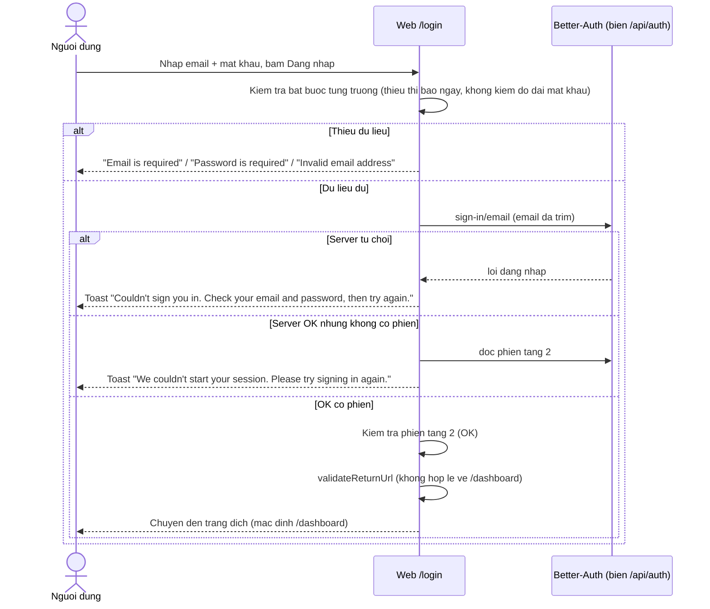
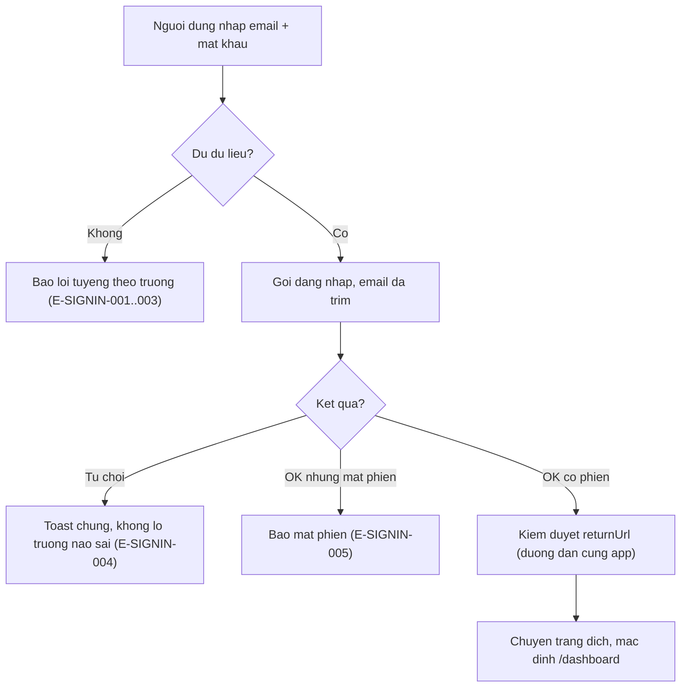
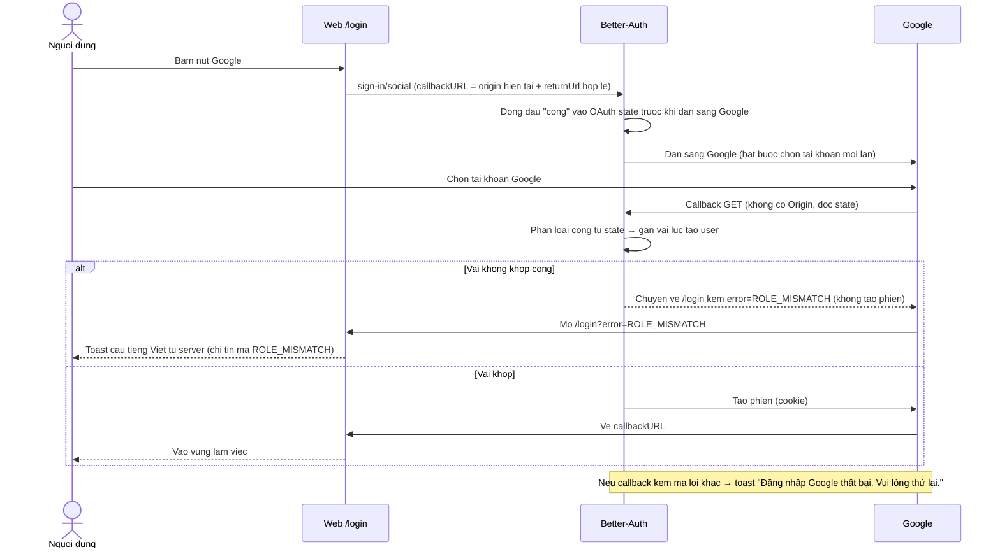
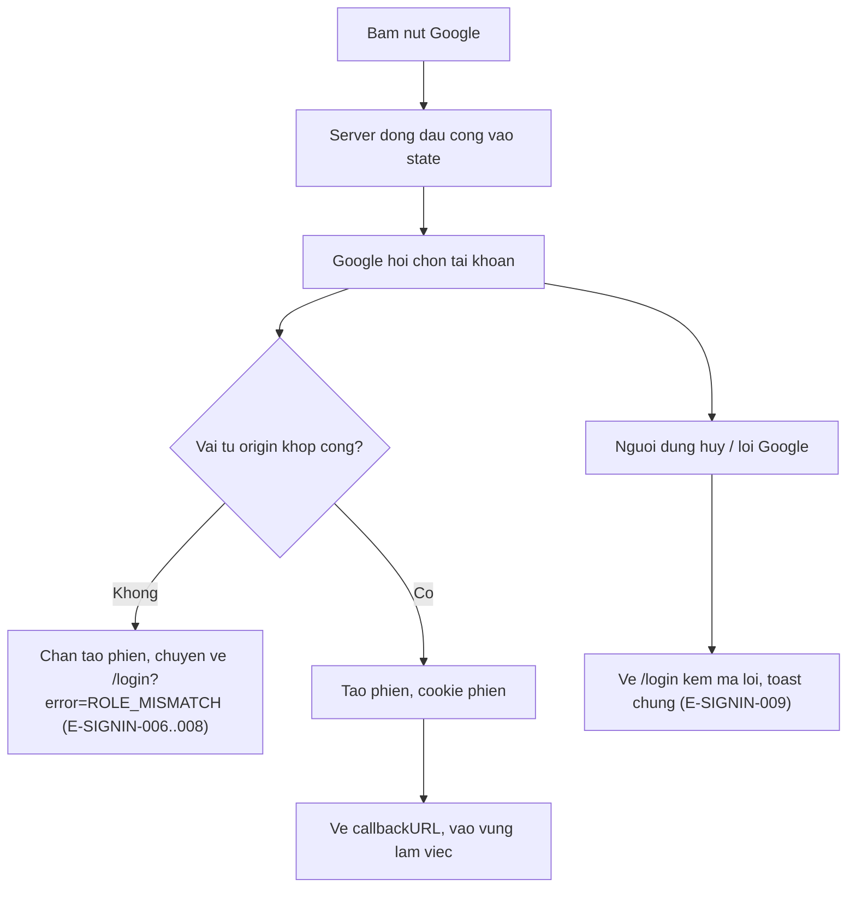
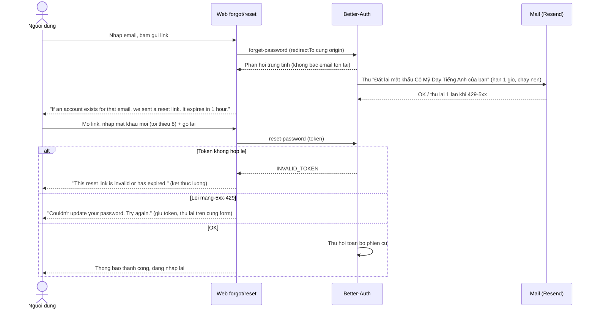
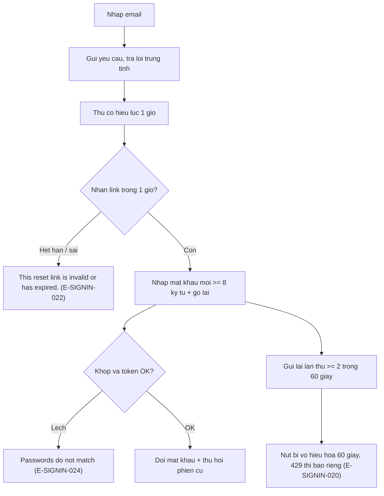
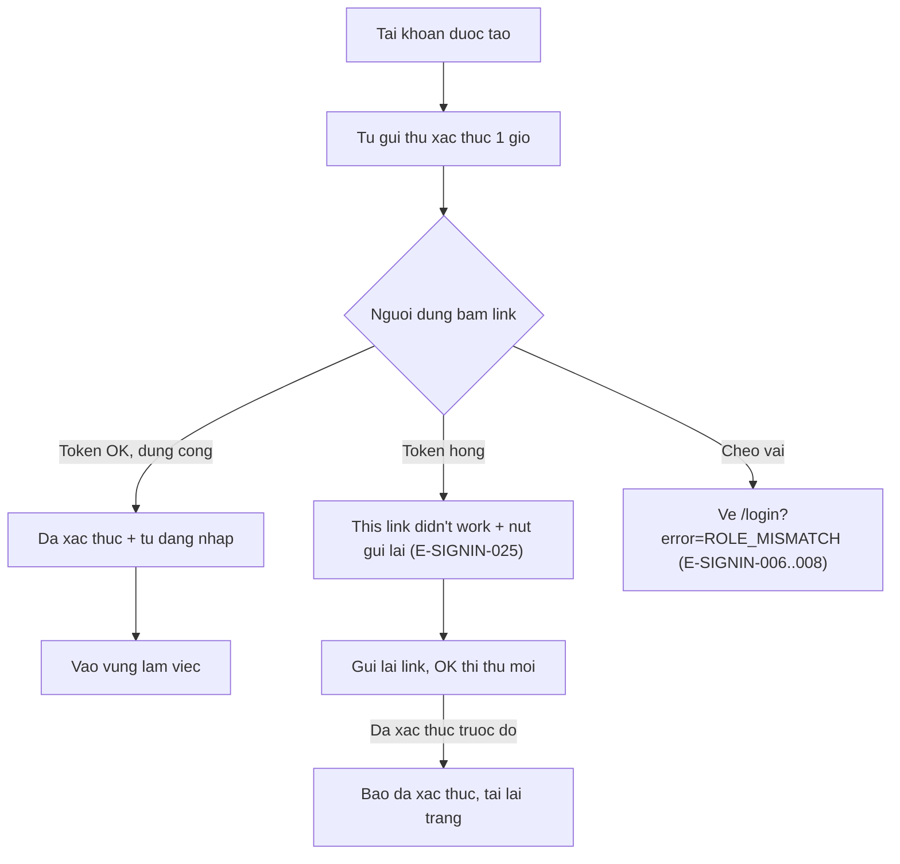
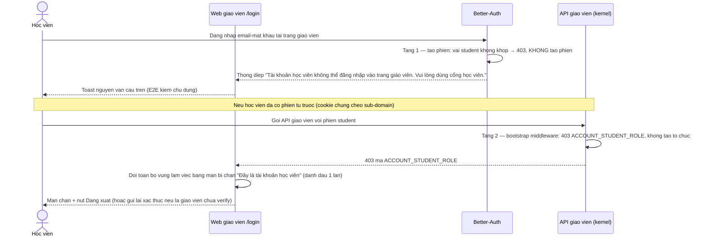

# auth-signin — Flows tái lập (reverse)

Mọi bước vẽ đều có trong code (không vẽ bước suy đoán). Đường dẫn tính từ gốc repo.

## Flow: F1 — Đăng nhập email/mật khẩu

### Sequence — F1 Đăng nhập email/mật khẩu


### Activity — F1 Đăng nhập email/mật khẩu


Nguồn: `apps/web/src/components/sign-in-form.tsx:32-66`, `apps/web/src/lib/sign-in-schema.ts:3-17`, `apps/web/src/lib/kernel-load-state.ts:149,175-212`.

## Flow: F2 — Đăng nhập Google OAuth

### Sequence — F2 Đăng nhập Google OAuth


### Activity — F2 Đăng nhập Google OAuth


Nguồn: `packages/auth/src/index.ts:248-257,335-364,440-497,501-538`, `apps/web/src/components/google-oauth-button.tsx:44-58`, `apps/web/src/routes/login.tsx:51-61`.

## Flow: F3 — Quên / đặt lại mật khẩu

### Sequence — F3 Quên/đặt lại mật khẩu


### Activity — F3 Quên/đặt lại mật khẩu


Nguồn: `packages/auth/src/index.ts:258-297`, `apps/web/src/components/auth/forgot-password-form.tsx:13-50`, `apps/web/src/components/auth/reset-password-form.tsx:14-29,42-75`, `packages/auth/src/mail/reset-password-email-template.ts`.

## Flow: F4 — Xác thực email (tạo tài khoản → bấm link)

### Sequence — F4 Xác thực email
```mermaid
sequenceDiagram
    actor U as Nguoi dung
    participant W as Web
    participant A as Better-Auth
    participant M as Mail
    U->>W: Dang ky (co bat) hoac duoc tao tai khoan
    A->>M: Tu gui thu "Xác thực email Cô Mỹ Dạy Tiếng Anh của bạn" (han 1 gio)
    Note over A: Gui that bai tren duong tao tai khoan thi KHONG chan viec tao (tha thu); gui lai thi bao loi ro (bao to)
    M-->>U: Thu chua link xac thuc
    U->>A: Bam link (verify-email)
    alt Token hop le, cung cong
        A->>A: emailVerified = true + TU DANG NHAP (tao phien)
        A-->>U: Ve /verify-email?verified=ok, vao lam viec duoc
    else Token hong / het han / da dung
        A-->>U: /verify-email chi con error → "This link didn't work" + gui lai link
    else Cheo vai (link dung cho cong khac)
        A-->>U: Chuyen ve /login?error=ROLE_MISMATCH, khong tao phien
    end
```

### Activity — F4 Xác thực email


Nguồn: `packages/auth/src/index.ts:298-326,501-538`, `apps/web/src/components/verify-email-view.tsx:29-67,96-127`, `packages/auth/src/auth-verification-email.test.ts:34-143`, `packages/auth/src/auth-verify-email-role.test.ts:77-113`.

## Flow: F5 — Chặn chéo vai trò (học viên vào trang giáo viên → 403)

### Sequence — F5 Chặn chéo vai trò học viên


### Activity — F5 Chặn chéo vai trò học viên
```mermaid
flowchart TD
    A["Hoc vien dang nhap trang giao vien"] --> B{"Tang 1 — vai khop cong?"}
    B -->|"Khong"| C["403, khong tao phien, toast cau VI (E-SIGNIN-006)"]
    B -->|"Co phien cu (cookie chung)"| D{"Tang 2 — API kernel"}
    D -->|"student"| E["403 ACCOUNT_STUDENT_ROLE, khong sinh to chuc (E-SIGNIN-010)"]
    D -->|"teacher ngoai allowlist"| F["403 ACCOUNT_TEACHER_NOT_ALLOWED (E-SIGNIN-012)"]
    D -->|"teacher chua verify"| G["403 ACCOUNT_TEACHER_EMAIL_UNVERIFIED (E-SIGNIN-013)"]
    E --> H["UI: man bi chan "Đây là tài khoản học viên" + Dang xuat"]
    F --> H
    G --> I["Man chan nhanh chua verify + gui lai email xac thuc"]
    C --> J["Huong dan sang cong hoc vien"]
```

Nguồn: `packages/auth/src/index.ts:92-99,501-538`, `apps/server/src/app.ts:206-269`, `apps/web/src/lib/query-client.ts:31-47`, `apps/web/src/lib/role-block.ts:12-22`, `apps/web/src/lib/data-provider.tsx:73-76`, `apps/web/src/components/account-blocked-view.tsx:40-160`, `apps/e2e/specs/account-role-separation.spec.ts:63-157`.

Điểm chưa chắc chắn: mã `ACCOUNT_ADMIN_ROLE` (quản trị chạm API giáo viên) không nằm trong danh sách UI chuyển màn chặn tại `apps/web/src/lib/repos/kernel.ts:718-726` → 🟡 (G-5). Nền service giới hạn đặt lại mật khẩu 3 lần/60 giây chỉ được biết qua comment và nhánh 429 → 🔵 (I-2). OTP chỉ có UI ở cổng học viên; giao viên không có đường OTP → 🟡 (OQ-007).

<!-- Bộ AI4BA BA-Kit -->
<sub>Tài liệu thuộc bộ AI4BA BA-Kit — bản Reverse Engineering.</sub>
