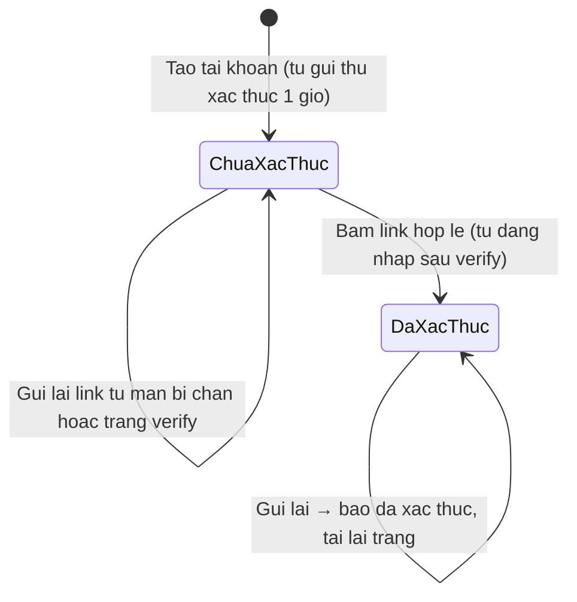
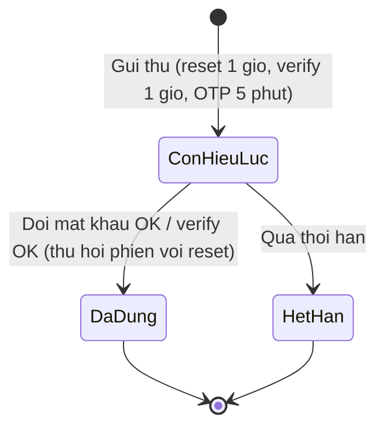
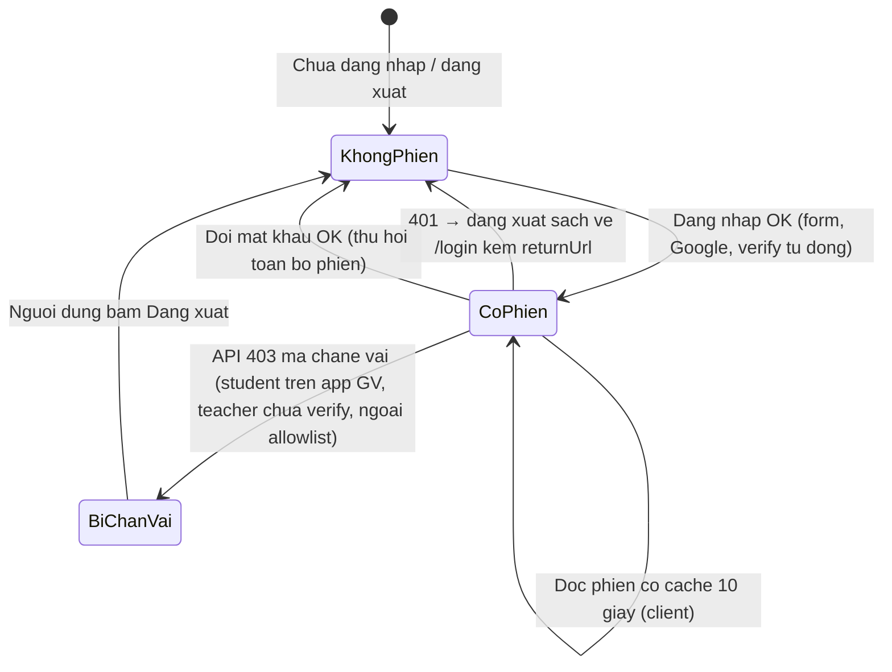
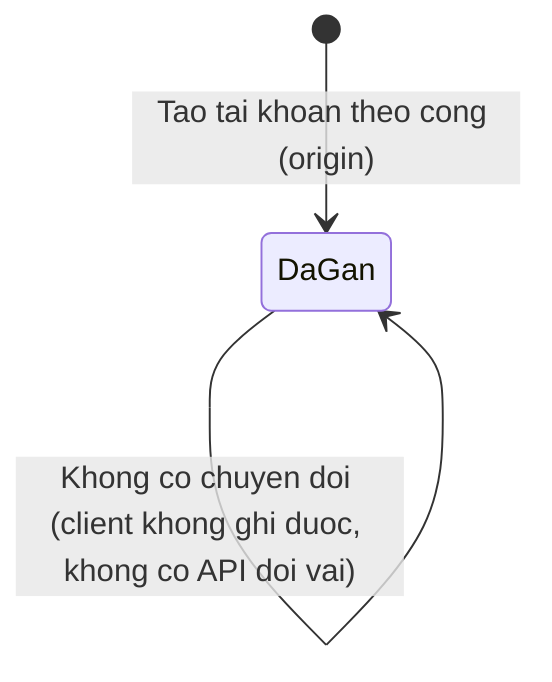

# auth-signin — States tái lập (reverse)

## State: Tài khoản — xác thực email (user.emailVerified)

> Nguồn: ✅ [S1, S6]. Hai trạng thái thật, có test phủ cả hai hướng.

**Ghi chú trạng thái:**

| Trạng thái | Ý nghĩa | Vào bằng | Ra bằng | Nguồn | Nhãn |
|-----------|---------|----------|---------|-------|------|
| ChưaXácThức | Tài khoản tồn tại, chưa bấm link | Tạo tài khoản (mật khẩu hoặc Google) | Bấm link hợp lệ | `packages/db/src/schema/auth.ts` (default false), `packages/auth/src/index.ts:298-326` | ✅ |
| ĐãXácThức | emailVerified = true; mở các cổng yêu cầu verify | verify-email token hợp lệ | không có (không quay lại) | `packages/auth/src/index.ts:501-538`, `apps/e2e/specs/web-email-verification.spec.ts:7-59` | ✅ |

## State: Token đặt lại mật khẩu / xác thực (bảng verification)

> Nguồn: ✅ [S1, S6]. Token một-lần, hết hạn theo hằng số.

**Ghi chú trạng thái:**

| Trạng thái | Ý nghĩa | Vào bằng | Ra bằng | Nguồn | Nhãn |
|-----------|---------|----------|---------|-------|------|
| CònHiệuLực | Token còn hạn, chưa dùng | Server tạo token khi gửi thư | Dùng hoặc hết hạn | `packages/auth/src/index.ts:258-266,298-326,564-596` | ✅ |
| ĐãDùng | Token đã tiêu | Đổi mật khẩu / xác thực thành công | hết | `apps/web/src/components/auth/reset-password-form.tsx:60-75` (INVALID_TOKEN khi dùng lại) | ✅ |
| HếtHạn | Quá 1 giờ / 5 phút | Hết thời hạn | hết | `packages/auth/src/index.ts:258-266,564-596` | ✅ |

## State: Phiên làm việc (session)

> Nguồn: ✅ [S9, S15]. Ứng dụng giáo viên coi phiên "hết" theo 3 đường: hết hạn, 401, thu hồi khi đổi mật khẩu.

**Ghi chú trạng thái:**

| Trạng thái | Ý nghĩa | Vào bằng | Ra bằng | Nguồn | Nhãn |
|-----------|---------|----------|---------|-------|------|
| KhôngPhiên | Chưa đăng nhập | khởi tạo; đăng xuất; 401; thu hồi | đăng nhập OK | `apps/web/src/lib/reauth.ts:25-33`, `packages/auth/src/index.ts:258-266` | ✅ |
| CóPhiên | Cookie phiên hiệu lực | đăng nhập/verify tự động | 401/thu hồi/bị chặn | `apps/web/src/lib/auth-client.ts:40,64-123` | ✅ |
| BịChặnVai | Phiên còn nhưng UI thay bằng màn chặn | API 403 mã vai lệch | đăng xuất | `apps/web/src/lib/role-block.ts:12-22`, `apps/web/src/lib/data-provider.tsx:73-76` | ✅ |

## State: Vai tài khoản (user.role) — gán một lần

> Nguồn: ✅ [S1, S2]. Vai KHÔNG phải máy trạng thái có chuyển đổi: gán đúng một lúc tạo và không có đường đổi.

**Ghi chú trạng thái:**

| Trạng thái | Ý nghĩa | Vào bằng | Ra bằng | Nguồn | Nhãn |
|-----------|---------|----------|---------|-------|------|
| ĐãGán (student/teacher/admin) | Vai cố định theo cổng lúc tạo | user.create.before theo origin | không có đường ra | `packages/auth/src/index.ts:329-333,481-497` | ✅ |

## Trạng thái KHÔNG tồn tại (bằng chứng tra ngược)

* Không có trạng thái "tài khoản bị khóa/vô hiệu hóa": đọc toàn bộ `packages/db/src/schema/auth.ts` không thấy trường lock/disabled/banned; mọi cơ chế chặn đều dựa trên vai + verify + allowlist kiểm tại thời điểm request → 🟡 (nếu nghiệp vụ cần khóa tài khoản, đây là khoảng trống — OQ-005).

<!-- Bộ AI4BA BA-Kit -->
Tài liệu thuộc bộ AI4BA BA-Kit — bản Reverse Engineering.
