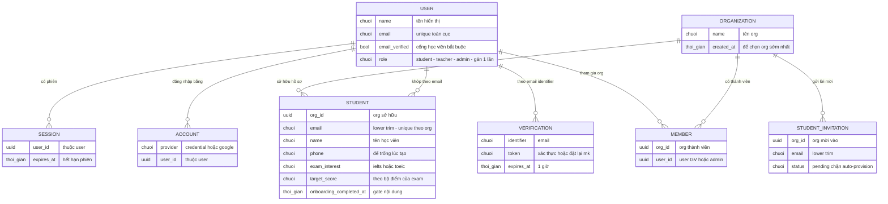

# auth-student-signup — ERD tái lập (reverse)

## Entity Reference

| Entity | Mô tả nghiệp vụ | Thuộc tính chính | Nguồn | Nhãn |
|--------|-----------------|------------------|-------|------|
| USER | Tài khoản người dùng toàn cục (một email một vai) | name, email, emailVerified, role | packages/auth/src/index.ts:436-498 | ✅ |
| SESSION | Phiên đăng nhập, đối tượng của gate role | userId, expires | packages/auth/src/index.ts:501-538 | ✅ |
| ACCOUNT | Phương thức đăng nhập (mật khẩu hoặc Google) | provider, userId | packages/auth/src/index.ts:564-596 | ✅ |
| VERIFICATION | Token xác thực email / đặt lại mật khẩu | identifier, token, expiresAt | packages/auth/src/index.ts:298-326 | ✅ |
| ORGANIZATION | Trung tâm/chi nhánh nhận hồ sơ học viên | id, name, createdAt | apps/server/src/student-provisioning.ts:53-64 | ✅ |
| STUDENT | Hồ sơ học viên theo org, chứa mục tiêu onboarding | orgId, email, name, phone, examInterest, targetScore, learningGoals, onboardingCompletedAt | packages/db/src/schema/student.ts:33-69 | ✅ |
| STUDENT_INVITATION | Lời mời học viên vào org theo email | orgId, email, status | apps/server/src/routes/student.ts:579-639 | ✅ |
| MEMBER | Thành viên org của GV/admin (không phải hồ sơ HV) | orgId, userId, role | packages/auth/src/index.ts (plugin organization) | 🔵 |

## Quan hệ

| Từ | Đến | Bản số | Ý nghĩa | Nguồn | Nhãn |
|----|-----|--------|---------|-------|------|
| USER | SESSION | 1-N | một tài khoản nhiều phiên/cổ | packages/auth/src/index.ts:501-538 | ✅ |
| USER | ACCOUNT | 1-N | mật khẩu + Google cùng tài khoản | packages/auth/src/index.ts:564-596 | ✅ |
| USER | STUDENT | 1-N logic | khớp theo email lower/trim, không có FK trực tiếp | apps/server/src/student-provisioning.ts:27-35 | ✅ |
| ORGANIZATION | STUDENT | 1-N | hồ sơ thuộc đúng 1 org; unique (org,email) | packages/db/src/schema/student.ts:67-69 | ✅ |
| ORGANIZATION | STUDENT_INVITATION | 1-N | lời mời theo email, trạng thái pending | apps/server/src/routes/student.ts:585-594 | ✅ |
| ORGANIZATION | MEMBER | 1-N | GV/admin thuộc org | packages/auth/src/index.ts | ✅ |
| USER | VERIFICATION | 1-N logic | token gắn email, không FK | packages/auth/src/index.ts:298-326 | 🔵 |

## Notes

* USER↔STUDENT là liên kết NGHIỆP VỤ theo email (lower+trim), cố ý không mô hình hoá FK — đúng như code. ✅ [S5]
* STUDENT_INVITATION chỉ liệt kê ở mức phục vụ skip-provision + accept; bộ trường đầy đủ nằm ngoài feature này.
* Thuộc tính kỹ thuật (timestamp, id nội bộ) không đưa vào ERD — chỉ giữ thuộc tính nghiệp vụ.
