# auth-student-signup — Flows tái lập (reverse)

> Mỗi flow: sequence + flowchart. Chỉ vẽ bước có trong code; suy đoán ghi 🔵/🟡.

## Flow: F1 — Đăng ký email + mật khẩu → xác thực email → tự đăng nhập

### Sequence — F1 Đăng ký và xác thực

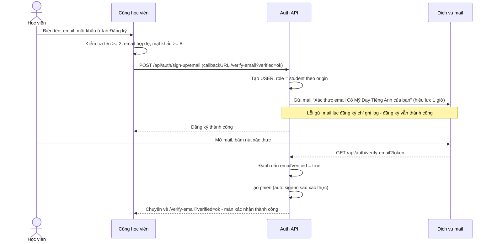

### Activity — F1

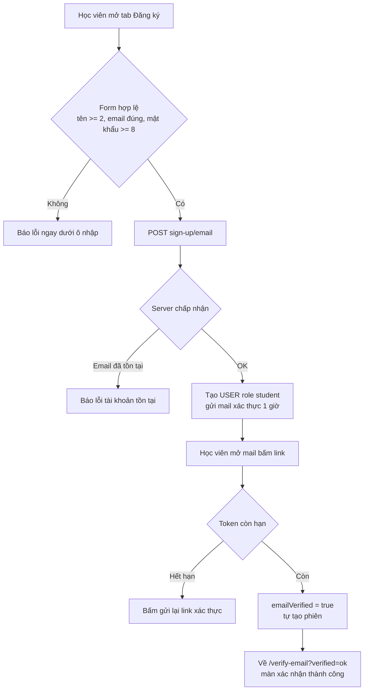

- Nguồn chính: packages/auth/src/index.ts:298-326 (sendOnSignUp, autoSignInAfterVerification, expiresIn 3600); apps/student/src/components/auth/sign-up-form.tsx:43 (callbackURL); apps/student/src/components/auth/verify-email-view.tsx:25 (điều kiện thành công); apps/e2e/specs/student-portal-email-verification.spec.ts:30-133. ✅
- Gửi lại link: POST /send-verification-email — lỗi được ném về client (khác đường sign-up nuốt lỗi). ✅ packages/auth/src/index.ts:299-322

## Flow: F2 — Đăng nhập Google lần đầu (cổng học viên)

### Sequence — F2 Google lần đầu

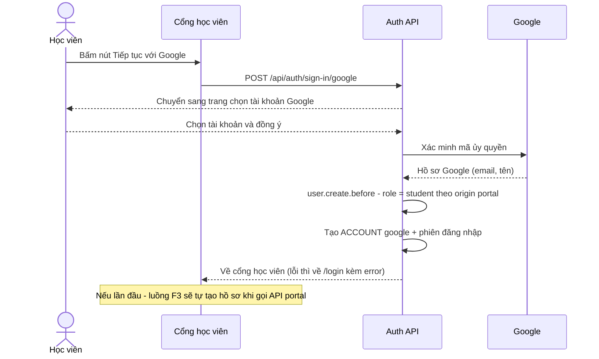

### Activity — F2

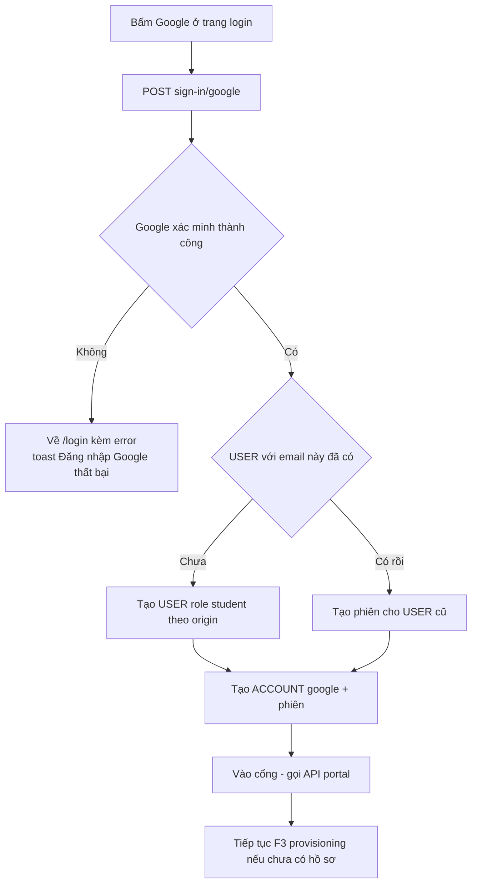

- Nguồn chính: apps/student/src/components/auth/google-oauth-button.tsx:48 (errorCallbackURL /login); apps/student/src/routes/login.tsx:59-63 (toast lỗi); packages/auth/src/index.ts:436-498 (role theo origin, chặn allowlist teacher/admin). ✅
- Google có đặt emailVerified cho học viên ngay không — chưa thấy trong code (OQ-4); nếu chưa, portal trả STUDENT_EMAIL_UNVERIFIED. 🟡

## Flow: F3 — Lần đầu vào portal → tự tạo hồ sơ trong org sớm nhất toàn cục

### Sequence — F3 Provisioning lần đầu

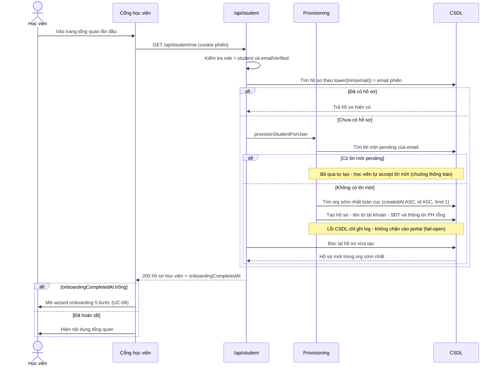

### Activity — F3

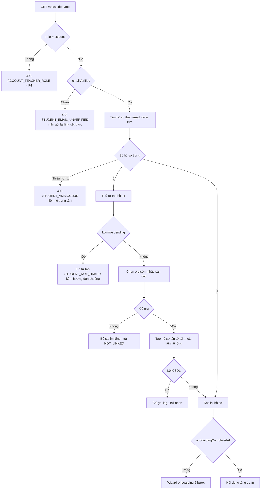

- Nguồn chính: apps/server/src/routes/student.ts:124-210 (guard + provision + requery + chọn org), 500-536 (gate toàn router); apps/server/src/student-provisioning.ts:27-83 (tất cả nhánh); apps/e2e/specs/student-portal-provisioning.spec.ts:11-36. ✅
- "Org sớm nhất" tính TOÀN CỤC (không theo domain email) — code rõ, ý định nghiệp vụ để mở (OQ-5). ✅ (code) / 🟡 (ý định)

## Flow: F4 — Teacher bị chặn vào cổng học viên

### Sequence — F4 Chặn teacher

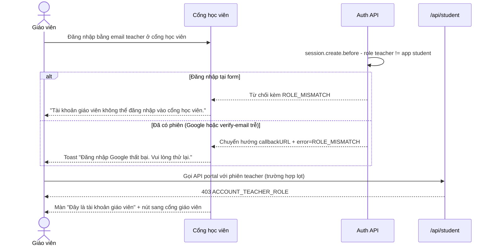

### Activity — F4

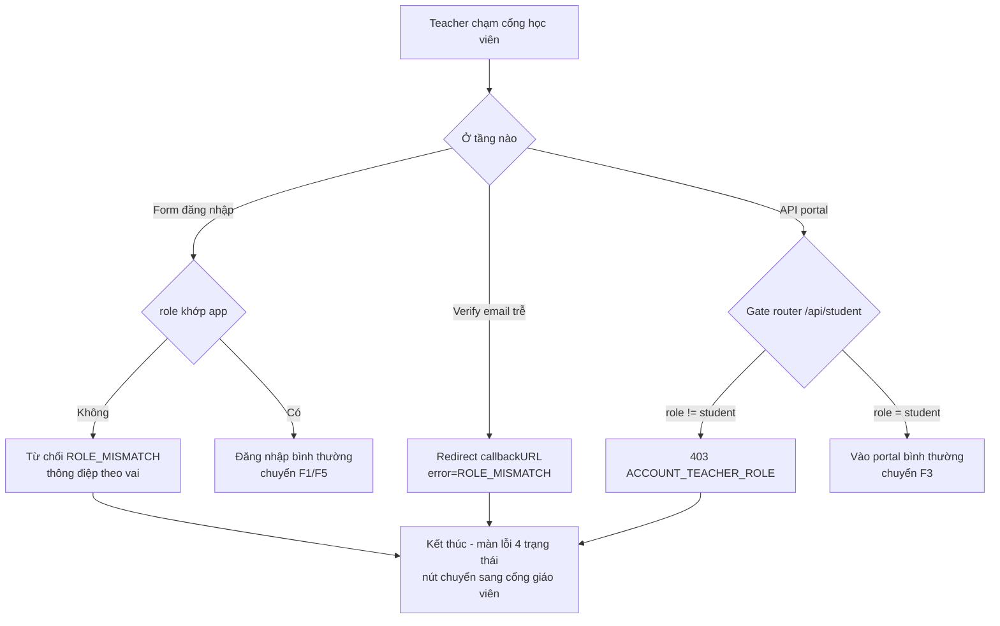

- Nguồn chính: packages/auth/src/index.ts:92-99 (2 thông điệp vai), 501-538 (gate + redirect verify-email #299); apps/server/src/routes/student.ts:511-512 (403); apps/student/src/components/overview/student-error-view.tsx:98-103 (màn teacher + nút cổng GV); apps/e2e/specs/account-role-separation.spec.ts:63-157; apps/server/src/role-gates.test.ts:190-283. ✅

## Flow: F5 — Đăng nhập bằng mã OTP email (tab mặc định)

### Sequence — F5 OTP email

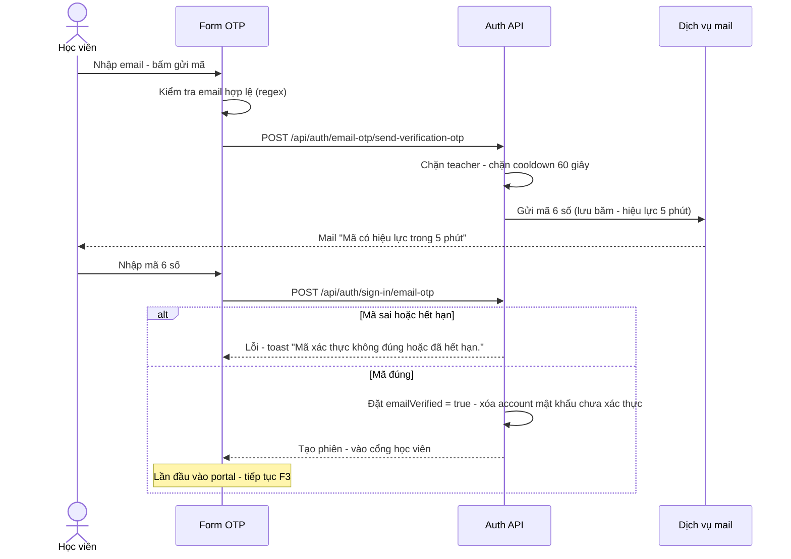

### Activity — F5

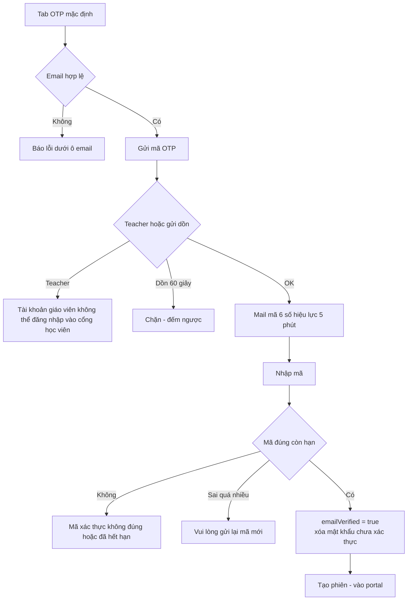

- Nguồn chính: packages/auth/src/index.ts:564-596 (OTP plugin 300 giây, hashed), 366-424 (block paths + cooldown + chặn teacher); packages/auth/src/auth-email-otp.test.ts:268-317 (chống hijack); apps/server/src/routes/student-auth-otp.test.ts:100-199 (kịch bản A/B/C); apps/student/src/components/auth/otp-sign-in-form.tsx:51-63,87,100-108,129-158 (validate + countdown + 4 nhóm toast); mail wording packages/auth/src/mail/otp-email-template.ts:43,88. ✅
- Ngưỡng "sai quá nhiều lần" server-side không thấy cấu hình (Gap). 🟡

## Flow: F6 — Quên mật khẩu / đặt lại mật khẩu

### Sequence — F6 Quên và đặt lại

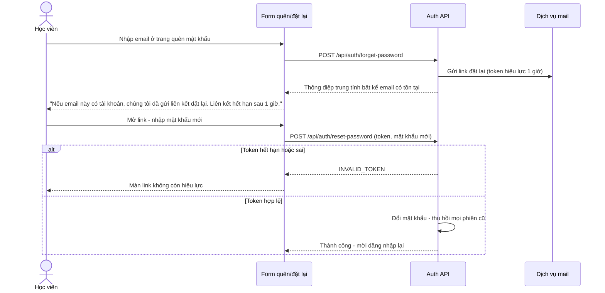

### Activity — F6

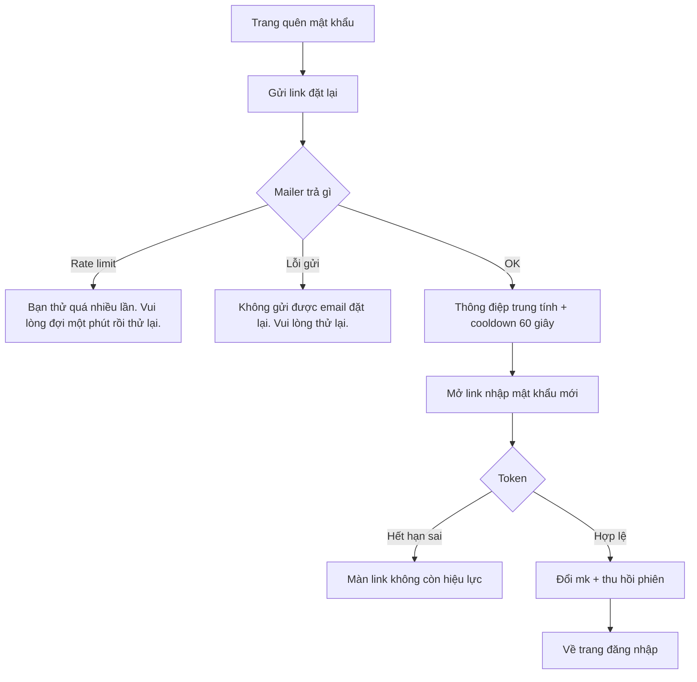

- Nguồn chính: apps/student/src/components/auth/forgot-password-form.tsx:13-18 (60 giây + 3 thông điệp); apps/student/src/components/auth/reset-password-form.tsx:56-70 (INVALID_TOKEN → InvalidLinkView 63-66); packages/auth/src/index.ts (resetPasswordTokenExpiresIn 3600, revokeSessionsOnPasswordReset); packages/auth/src/auth-reset-password.test.ts. ✅
- TTL phiên sau đặt lại và các trạng thái trung gian khác — repo không mô tả thêm. 🔵
