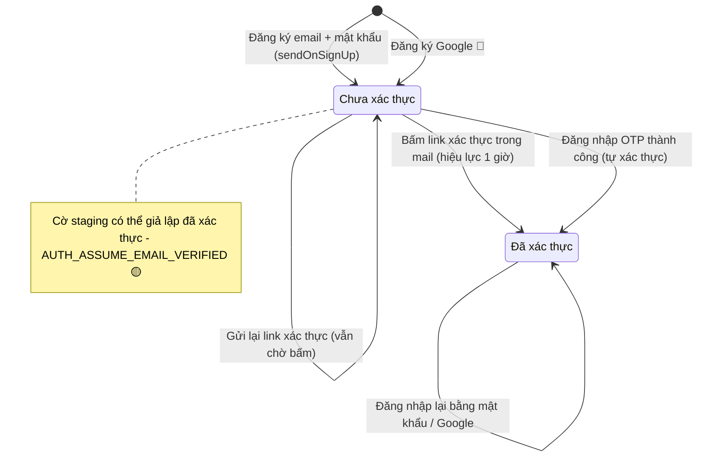
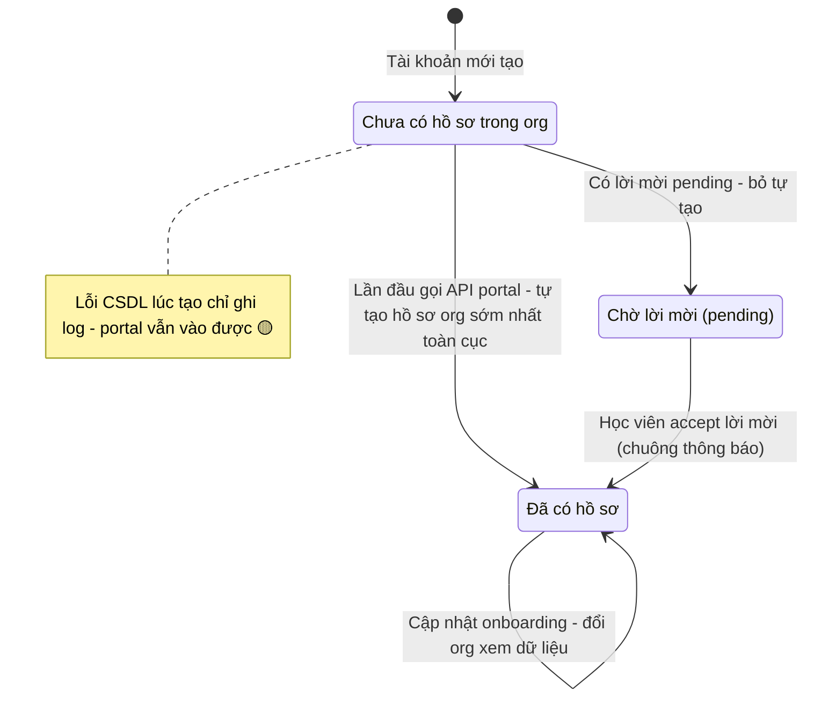

# auth-student-signup — States tái lập (reverse)

## Trạng thái 1 — Email của tài khoản học viên

### Ghi chú trạng thái email

| Trạng thái | Ý nghĩa nghiệp vụ | Sự kiện chuyển vào | Hệ quả trên portal | Nguồn | Nhãn |
|------------|-------------------|--------------------|--------------------|-------|------|
| Chưa xác thực | Tài khoản có, email chưa chứng minh | sign-up email/mật khẩu xong | API portal trả 403 STUDENT_EMAIL_UNVERIFIED, màn "Email chưa được xác thực" + nút gửi lại | apps/server/src/routes/student.ts:130-138,529-536 | ✅ |
| Chưa xác thực | (tiếp) | — | vẫn đăng nhập được phiên nhưng chưa thấy nội dung | packages/auth/src/index.ts:298-326 | ✅ |
| Đã xác thực | Email chứng minh xong | link verify, hoặc OTP login tự xác thực | được dùng portal, auto sign-in sau verify | packages/auth/src/index.ts:325,564-596 | ✅ |
| Đã xác thực | (Google lần đầu) | đăng nhập Google | không thấy code đặt cờ — phụ thuộc thư viện/nhà cung cấp | negative-search packages/auth/src | 🟡 |
| Không hồi | không có trạng thái "chưa kích hoạt khoá" | — | không thấy khoá/huỷ tài khoản trong phạm vi này | negative-search | 🔵 |

## Trạng thái 2 — Hồ sơ học viên theo org

### Ghi chú trạng thái hồ sơ

| Trạng thái | Ý nghĩa nghiệp vụ | Sự kiện chuyển vào | Hệ quả trên portal | Nguồn | Nhãn |
|------------|-------------------|--------------------|--------------------|-------|------|
| Chưa có hồ sơ | email chưa gắn với org nào | đăng ký/đăng nhập lần đầu | guard thử tự tạo rồi đọc lại | apps/server/src/routes/student.ts:148-164 | ✅ |
| Chờ lời mời | GV đã mời, học viên chưa accept | có student_invitation pending | bỏ auto-provision, portal báo "chưa liên kết" + hướng dẫn chuông | apps/server/src/student-provisioning.ts:37-51 | ✅ |
| Đã có hồ sơ | hồ sơ gắn 1 org, unique (org,email) | provision hoặc accept lời mời | dùng portal, onboarding gate theo onboardingCompletedAt | packages/db/src/schema/student.ts:67-69 | ✅ |
| Nhiều hồ sơ (multi-org) | 1 email nhiều org | accept thêm lời mời | GET /orgs + chọn org qua header/query | apps/server/src/routes/student.ts:177-208,676-713 | ✅ |
| Trùng hồ sơ (bất thường) | >1 hồ sơ cùng email trong 1 org | dữ liệu cũ trước migration | 403 STUDENT_AMBIGUOUS, liên hệ trung tâm | apps/student/src/components/overview/student-error-view.tsx:114-118 | ✅ |
| Lỗi tạo hồ sơ | CSDL lỗi lúc provision | exception | fail-open: không chặn portal, chỉ log — hồ sơ có được tạo lại lần sau không chưa thấy rõ | apps/server/src/student-provisioning.ts:77-83 | 🔵 |

## Trạng thái phụ — Onboarding hồ sơ

| Trạng thái | Điều kiện | Hệ quả | Nguồn | Nhãn |
|------------|-----------|--------|-------|------|
| Chưa onboarding | onboardingCompletedAt trống | wizard 5 bước chặn nội dung chính | apps/student/src/routes/_auth/index.tsx:77; apps/student/src/components/layout/student-page-gate.tsx:42 | ✅ |
| Đã onboarding | onboardingCompletedAt có giá trị | vào thẳng tổng quan | apps/server/src/routes/student.ts:1241-1290 | ✅ |
