# classes — Flows tái lập (reverse)

> Mỗi flow có CẢ Sequence và Activity. Chỉ vẽ các bước có trong code; bước suy đoán gắn nhãn 🔵/🟡.

## Flow: Tạo lớp học (kèm cảnh báo trùng lịch)

### Sequence — Tạo lớp học

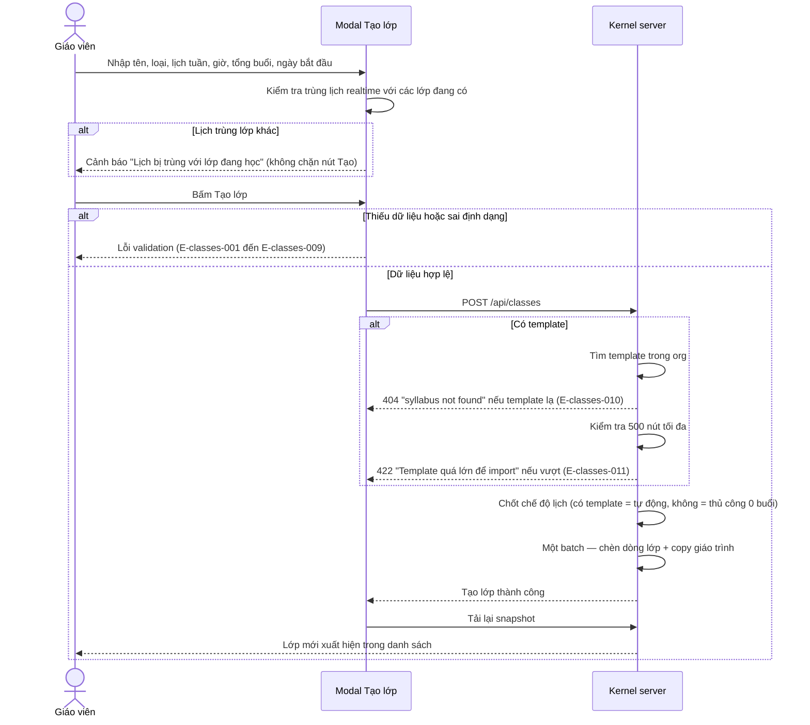

### Activity — Tạo lớp học

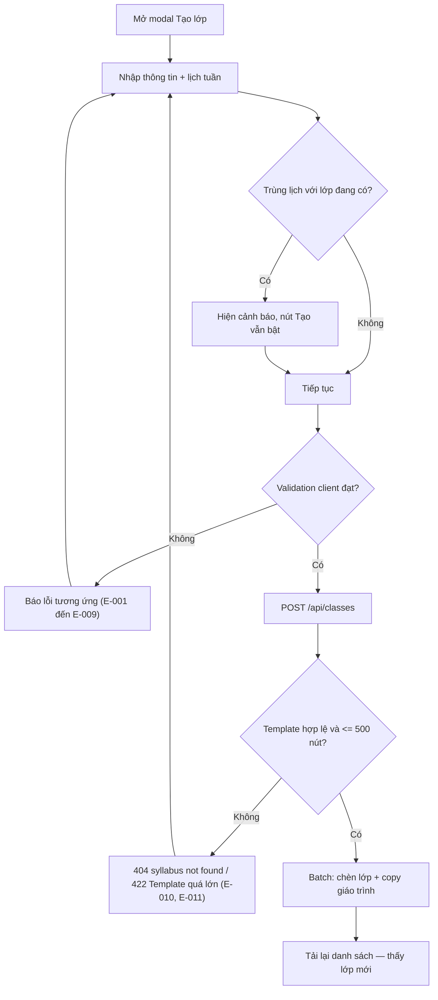

## Flow: Sửa ghi chú / học phí lớp

### Sequence — Sửa ghi chú / học phí lớp

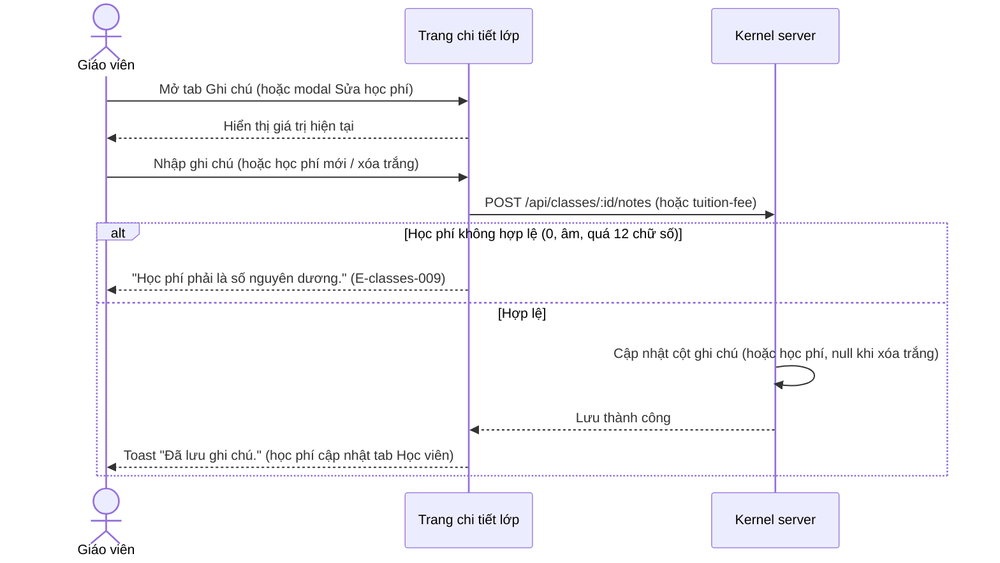

### Activity — Sửa ghi chú / học phí lớp

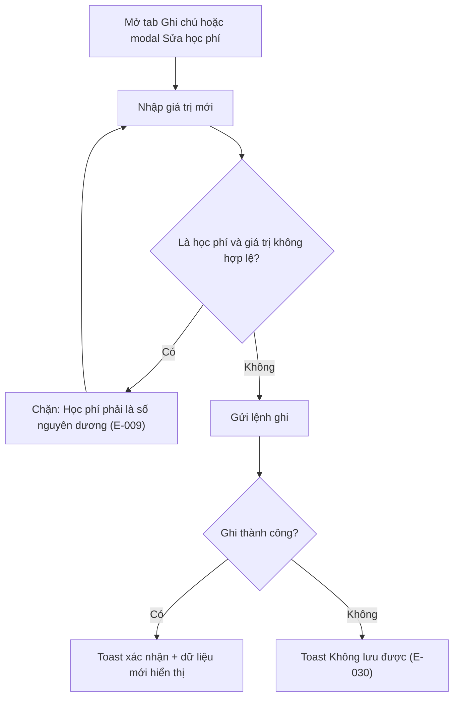

## Flow: Thêm buổi học thủ công (lớp manual)

### Sequence — Thêm buổi học thủ công

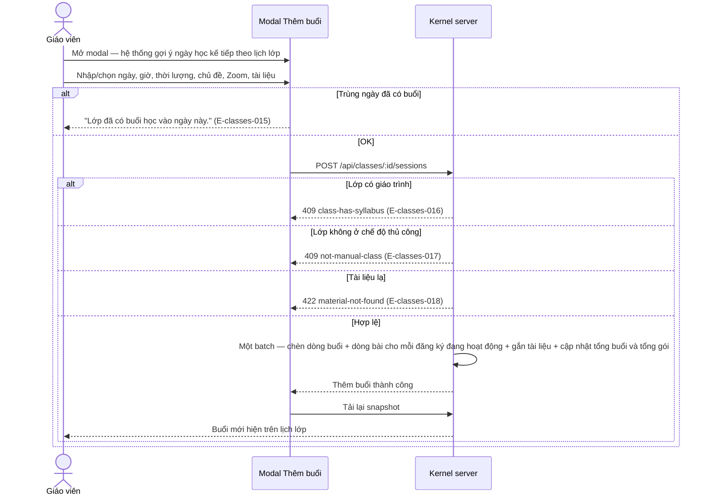

### Activity — Thêm buổi học thủ công

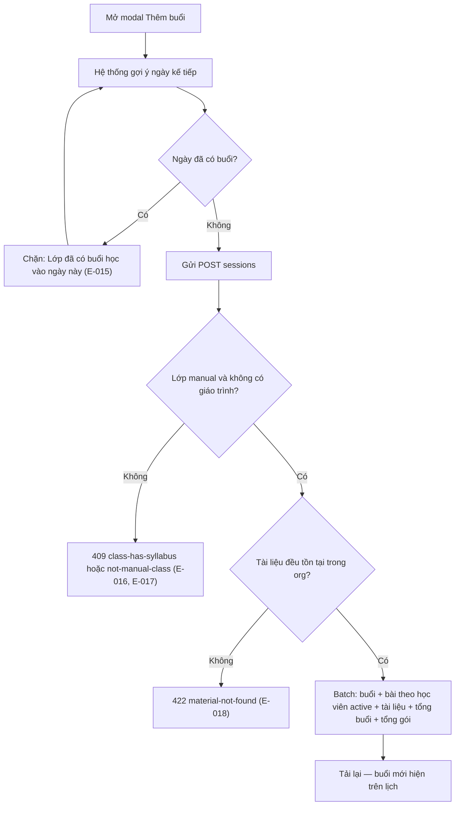

## Flow: Điều chỉnh buổi học (sửa / dời / xóa)

### Sequence — Điều chỉnh buổi học

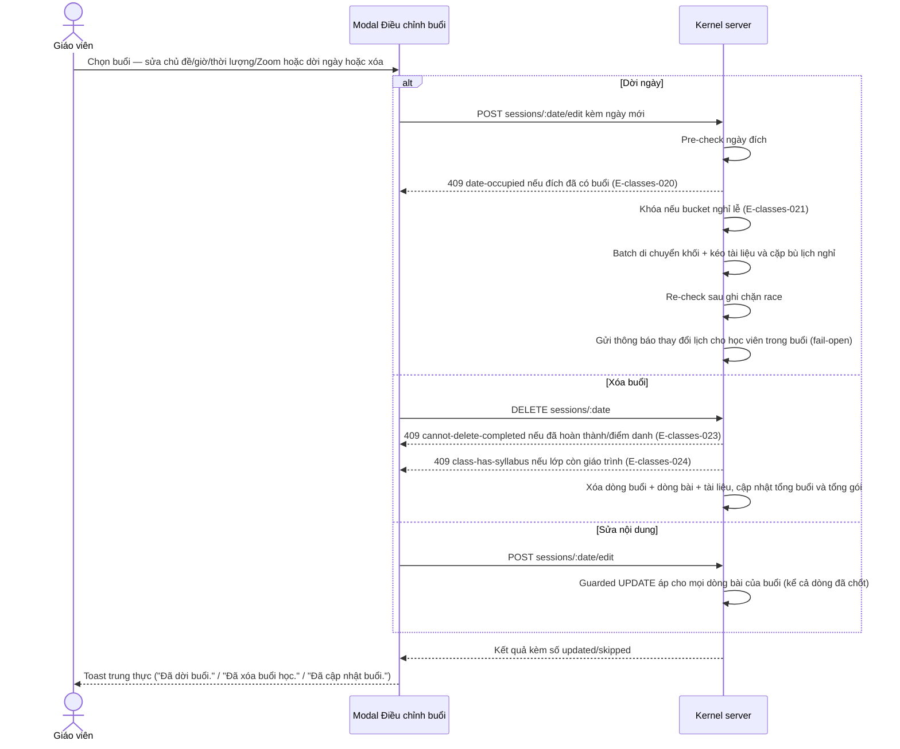

### Activity — Điều chỉnh buổi học

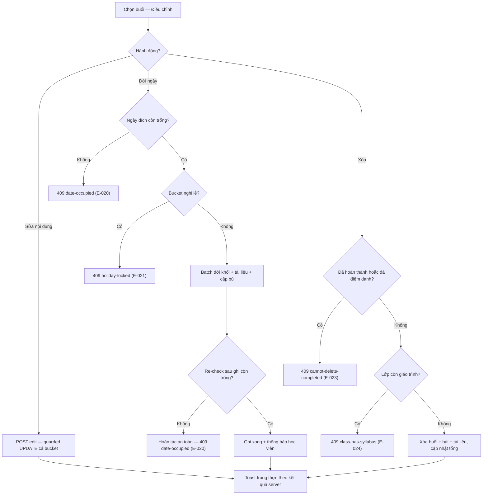

## Flow: Đổi trạng thái buổi (hoàn thành / hủy cả ca) và điểm danh

### Sequence — Đổi trạng thái buổi

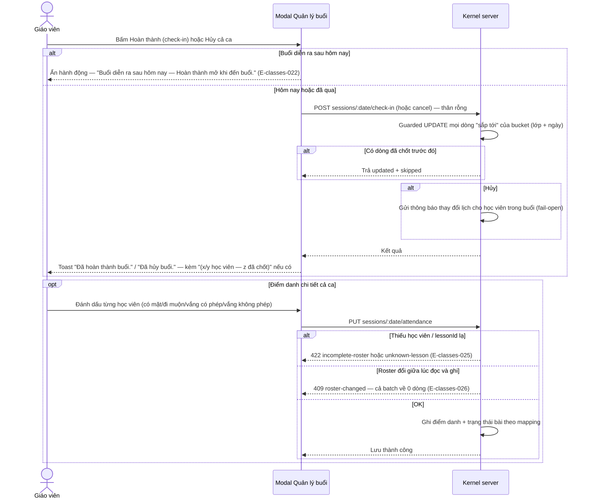

### Activity — Đổi trạng thái buổi

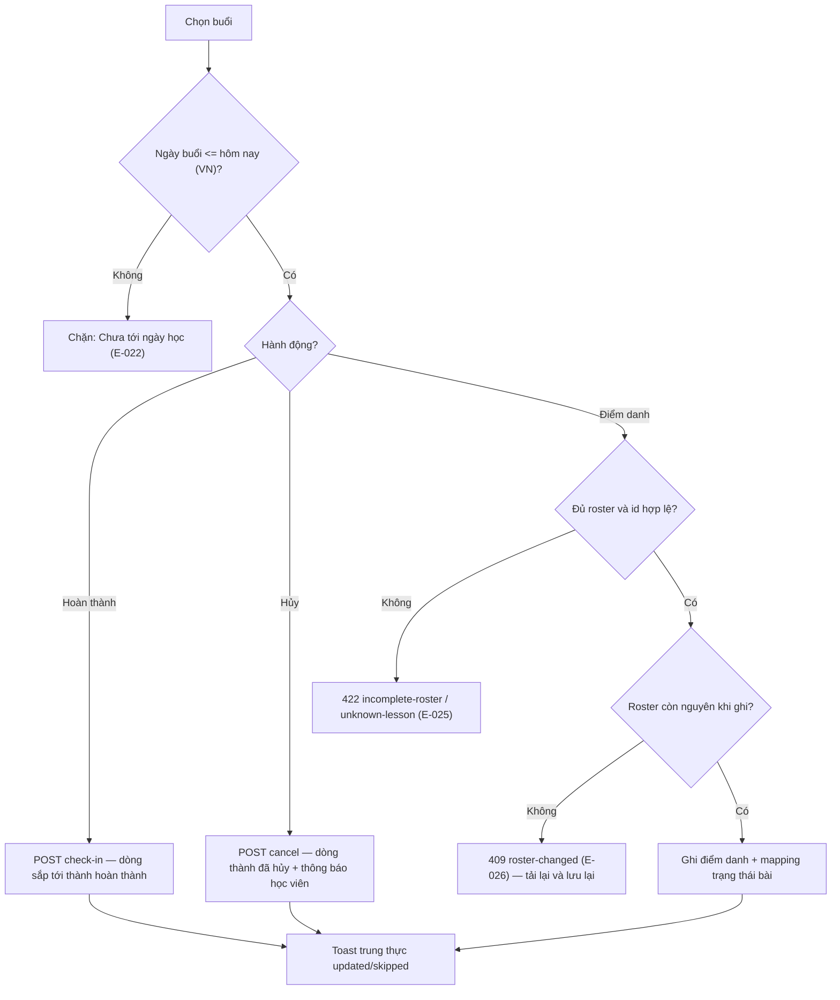

## Flow: Gán học viên vào lớp (tóm tắt — chi tiết lifecycle ở feature `enrollment-lifecycle`)

### Sequence — Gán học viên

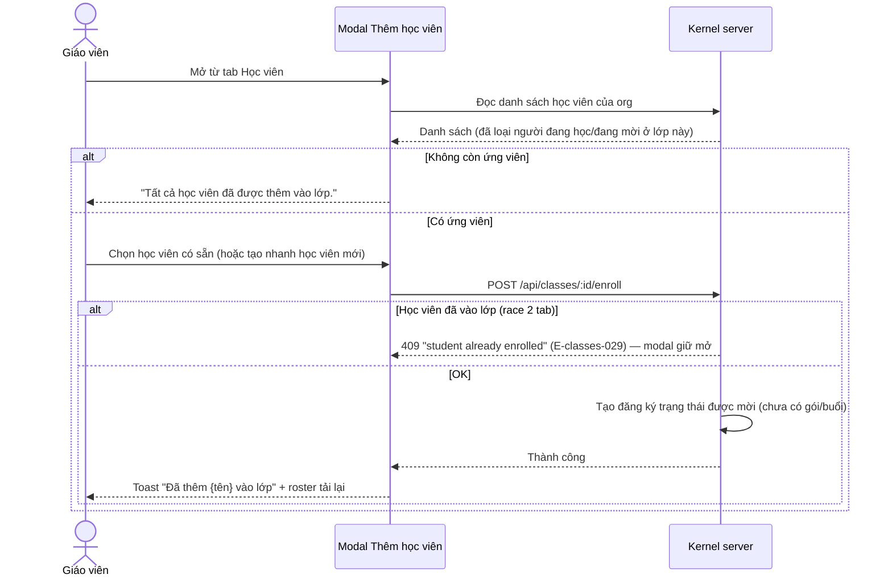

### Activity — Gán học viên

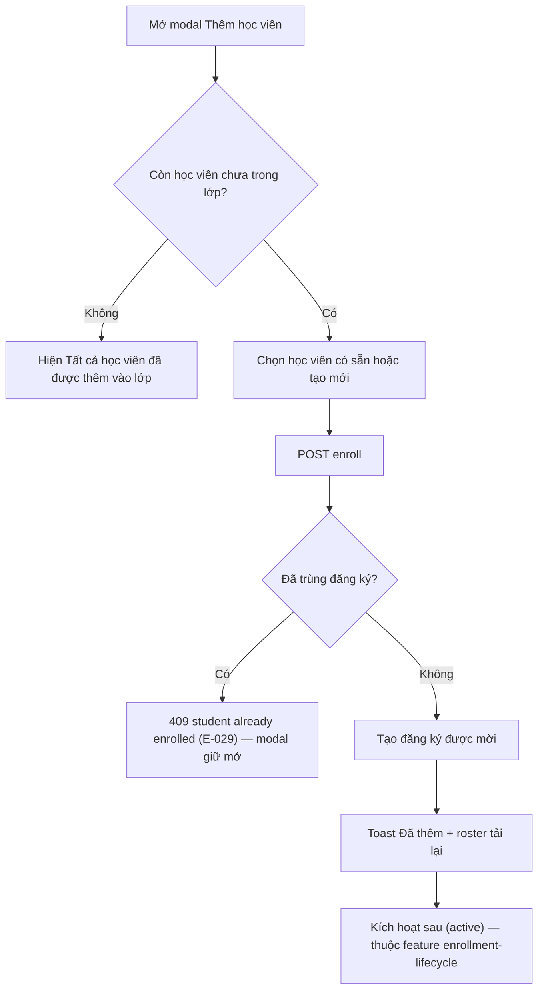

> Ranh giới: toàn bộ vòng đời sau khi tạo đăng ký (kích hoạt → sinh chuỗi buổi tự động, hủy mời, chấp nhận từ portal) thuộc feature `enrollment-lifecycle` (/root/projects/teacher-os/docs/project-overview-pdr.md:24).

<!-- wm:c3e3a8b9c06f46427bf9089e2fdafa48 -->
Tài liệu thuộc bộ AI4BA BA-Kit — bản quyền ai4ba.com
