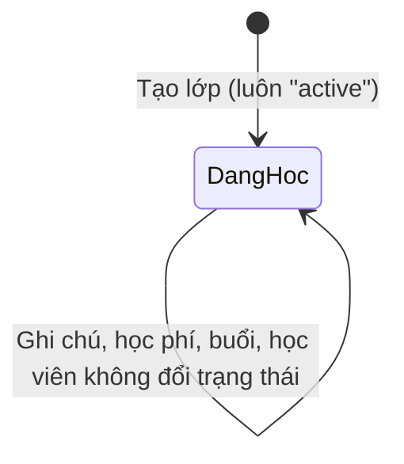
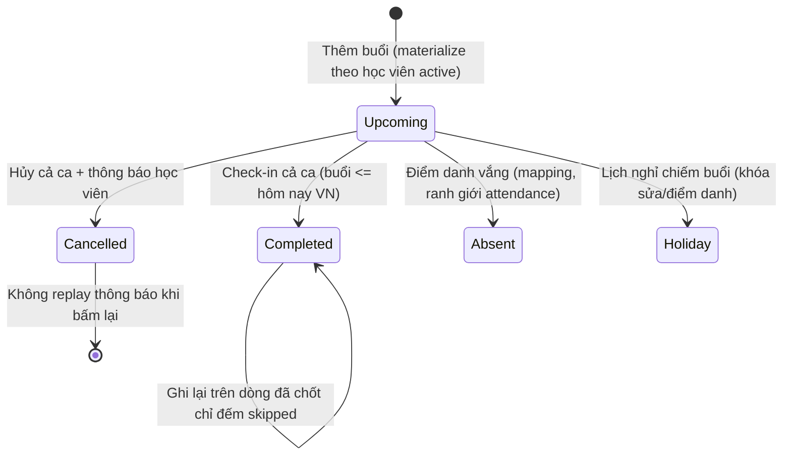
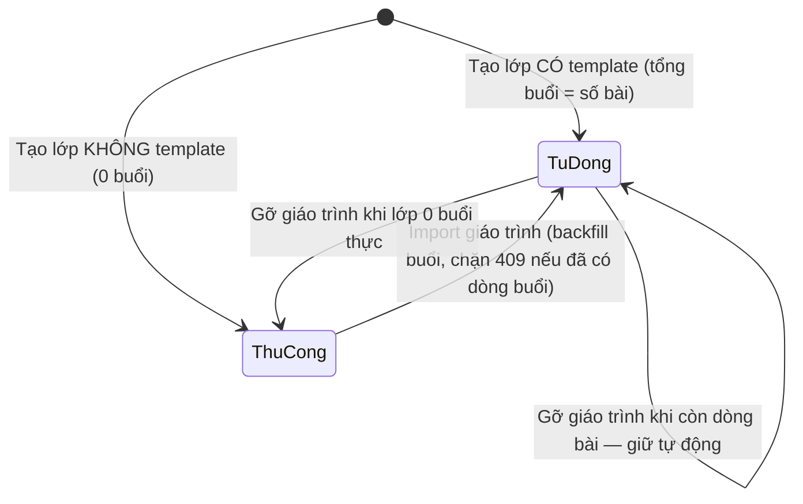
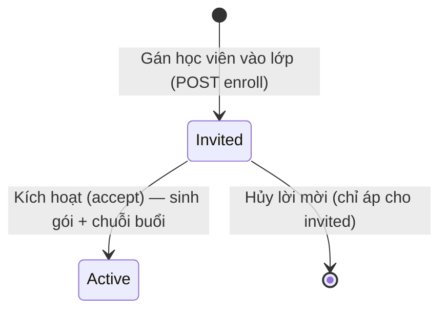

# classes — States tái lập (reverse)

## State: Trạng thái lớp (class.status)

> Nguồn: ✅ [S3/S4 — /root/projects/teacher-os/packages/db/src/schema/class.ts:27 (mặc định "active"), /root/projects/teacher-os/apps/server/src/routes/kernel.ts:1704 (chèn "active")]. Không có writer trạng thái nào khác — negative-search tại /root/projects/teacher-os/apps/server/src (mọi `update(classTable)` chỉ chạm syllabusId/schedulingMode/sessionsTotal/notes/tuitionFee).

**Ghi chú trạng thái:**

| Trạng thái | Ý nghĩa | Vào bằng | Ra bằng | Nguồn | Nhãn |
|-----------|---------|----------|---------|-------|------|
| active ("Đang học") | Lớp đang vận hành | Tạo lớp (duy nhất) | Không có — không có luồng kết thúc/tạm dừng trong code | /root/projects/teacher-os/apps/server/src/routes/kernel.ts:1704 | ✅ (hiện trạng) |
| paused ("Tạm dừng") | Badge UI có sẵn nhưng không bao giờ xảy ra | Không có đường vào | — | /root/projects/teacher-os/apps/web/src/routes/_auth/classes/index.tsx:123-129 | 🟡 dead state → OQ-1 |

## State: Trạng thái buổi dạy (lesson.status — bucket theo cặp lớp+ngày)

> Nguồn: ✅ [S3/S4 — /root/projects/teacher-os/packages/db/src/schema/lesson.ts:49-57, /root/projects/teacher-os/apps/server/src/routes/kernel.ts:2816-2907]. 🔵 nhánh "absent" phát sinh từ điểm danh (mapping) — chính sách chi tiết thuộc feature `attendance`.

**Ghi chú trạng thái:**

| Trạng thái | Ý nghĩa | Vào bằng | Ra bằng | Nguồn | Nhãn |
|-----------|---------|----------|---------|-------|------|
| upcoming ("Sắp tới") | Buổi chưa diễn ra | Thêm buổi; kích hoạt đăng ký trên lớp manual | Check-in / Hủy / Điểm danh vắng / Lịch nghỉ chiếm | /root/projects/teacher-os/apps/server/src/routes/kernel.ts:2537-2554 · /root/projects/teacher-os/apps/server/src/routes/enrollment-activation.ts:490-500 | ✅ |
| completed ("Hoàn thành") | Buổi đã diễn ra, học xong | Check-in cả ca (guard "chỉ từ upcoming", ngày <= hôm nay) | Kết — dòng đã chốt được đếm "skipped" nếu ghi lại | /root/projects/teacher-os/apps/server/src/routes/kernel.ts:2869-2887 · guard :1901/:1930 | ✅ |
| cancelled ("Đã hủy") | Buổi bị hủy | Hủy cả ca + notify schedule_changed (fail-open) | Không có luồng mở lại | /root/projects/teacher-os/apps/server/src/routes/kernel.ts:2889-2907 | ✅ |
| absent ("Vắng") | Học viên vắng buổi đó | Mapping điểm danh (excused → absent; vắng có phép không trừ buổi) | Kết | /root/projects/teacher-os/packages/api/src/contracts.ts:1350-1358 | ✅ (mapping) 🔵 (chính sách trừ buổi thuộc attendance) |
| holiday ("Nghỉ lễ — Đã dời") | Buổi bị lịch nghỉ chung chiếm hoặc nằm trong cặp gốc→bù | Luồng Lịch nghỉ (feature khác) | Không sửa/điểm danh được (409 holiday-locked); dời buổi kéo theo cặp bù | /root/projects/teacher-os/apps/server/src/routes/kernel.ts:1762-1799 · :2204-2212 | ✅ |

## State: Chế độ lập lịch của lớp (schedulingMode)

> Nguồn: ✅ [S4/S5 — /root/projects/teacher-os/apps/server/src/routes/kernel.ts:1682-1687 (derive khi tạo), /root/projects/teacher-os/apps/server/src/routes/syllabus.ts:399-409 · :657-665 (chuyển đổi qua giáo trình), /root/projects/teacher-os/apps/server/src/lib/class-mode.ts:19-41 (định nghĩa manual)].

**Ghi chú trạng thái:**

| Trạng thái | Ý nghĩa | Vào bằng | Ra bằng | Nguồn | Nhãn |
|-----------|---------|----------|---------|-------|------|
| auto ("tự động") | Lớp có bản copy giáo trình; buổi chiếu từ giáo trình | Tạo với template; import giáo trình từ manual | Gỡ giáo trình (chỉ khi 0 buổi thực) | /root/projects/teacher-os/apps/server/src/routes/syllabus.ts:399-409 · :657-665 | ✅ |
| manual ("thủ công") | Lớp tự xếp từng buổi; bắt đầu 0 buổi | Tạo không template; gỡ giáo trình lớp 0 buổi | Import giáo trình (chặn 409 nếu đã có dòng buổi — chống trạng thái lai) | /root/projects/teacher-os/apps/server/src/routes/kernel.ts:1702 · test /root/projects/teacher-os/apps/server/src/manual-sessions.test.ts:1232 | ✅ |
| NULL (tạm thời) | SQL đặt NULL khi vừa thêm buổi mà giáo trình vừa được gắn (race with import) | Thêm buổi trong lúc lớp đang có giáo trình | Trạng thái lai bị chặn ở các luồng khác bởi bộ định nghĩa manual | /root/projects/teacher-os/apps/server/src/routes/kernel.ts:2570-2583 | 🔵 (cửa sổ hẹp, có test chống lai :1232) |

## State: Đăng ký học viên (enrollment.status — ranh giới feature `enrollment-lifecycle`)

> Nguồn: ✅ [S1/S3 — /root/projects/teacher-os/docs/project-overview-pdr.md:24, /root/projects/teacher-os/packages/db/src/schema/enrollment.ts:30-34]. Liệt kê tại đây chỉ để định ranh giới với feature `classes` (nút Gán học viên tạo "invited").

| Trạng thái | Ý nghĩa | Vào bằng | Ra bằng | Nguồn | Nhãn |
|-----------|---------|----------|---------|-------|------|
| invited ("Đã mời") | Có trong lớp nhưng chưa có gói/buổi | Gán học viên | Kích hoạt hoặc hủy mời | /root/projects/teacher-os/docs/project-overview-pdr.md:24 | ✅ |
| active ("Đang học") | Đã kích hoạt, nhận dòng bài + gói | Accept (admin hoặc portal) | Kết (feature enrollment-lifecycle) | /root/projects/teacher-os/apps/server/src/routes/enrollment-activation.ts:490-500 | ✅ |

## State: Điểm danh từng học viên trong buổi (attendance — ranh giới feature `attendance`)

> Nguồn: ✅ [S2 — /root/projects/teacher-os/packages/api/src/contracts.ts:1335-1341 (enum), :1350-1358 (mapping)].

| Giá trị | Ý nghĩa | Ảnh hưởng trạng thái bài | Trừ buổi? | Nguồn | Nhãn |
|---------|---------|--------------------------|-----------|-------|------|
| present | Có mặt | completed | Không | /root/projects/teacher-os/packages/api/src/contracts.ts:1335-1341 · :1350-1358 | ✅ |
| late | Đi muộn | completed | Không | như trên | ✅ |
| excused | Vắng có phép | absent | KHÔNG (không trừ) | /root/projects/teacher-os/packages/api/src/contracts.ts:1333 · :1350-1358 | ✅ |
| unexcused | Vắng không phép | absent | CÓ (UNEXCUSED_CONSUMES_SESSION = true) | như trên | ✅ |

<!-- wm:c3e3a8b9c06f46427bf9089e2fdafa48 -->
Tài liệu thuộc bộ AI4BA BA-Kit — bản quyền ai4ba.com
