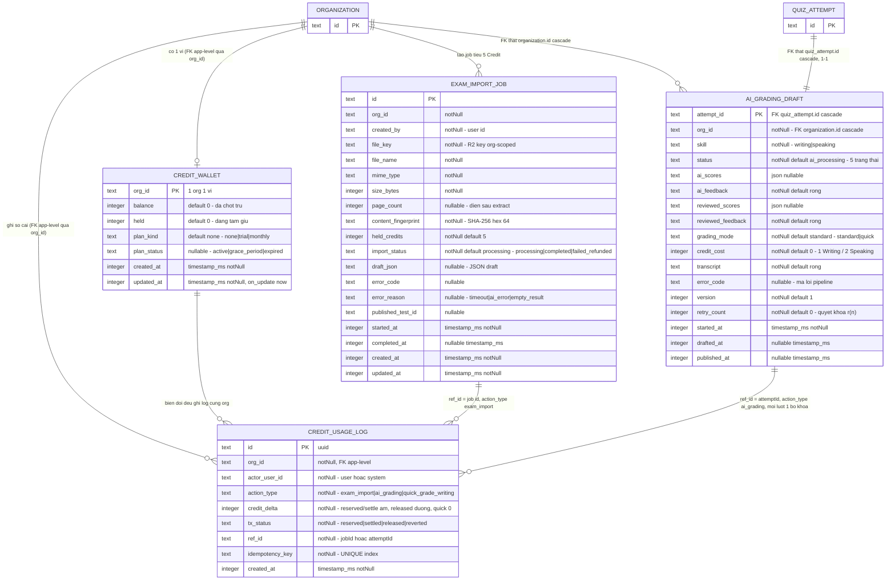

# ERD — feature credits

> Kiểu cột khớp schema thật (text/integer, timestamp_ms là integer ms). `credit_wallet` và `credit_usage_log` KHÔNG có FK DB-level: `org_id` chỉ là text tham chiếu nghiệp vụ tới `organization.id` (FK app-level). `ai_grading_draft` CÓ FK thật tới `organization.id` và `quiz_attempt.id` (onDelete cascade).

Ghi chú:
- Cột `ai_grading_draft` liệt kê theo packages/db/src/schema/ai-grading-draft.ts:24-78; `exam_import_job` theo packages/db/src/schema/exam-import-job.ts:14-60; hai bảng credit theo packages/db/src/schema/credit-wallet.ts:17-71; SQL thật: packages/db/src/migrations/0051_tan_slayback.sql:1-21, 0055_premium_blazing_skull.sql:1.
- Index sổ cái: UNIQUE(idempotency_key) và (org_id, created_at) — packages/db/src/schema/credit-wallet.ts:65-70.
