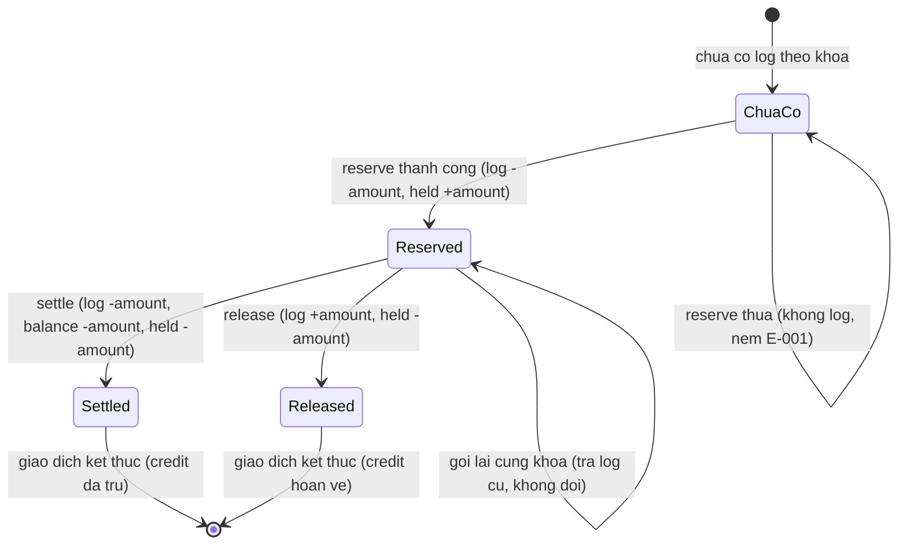
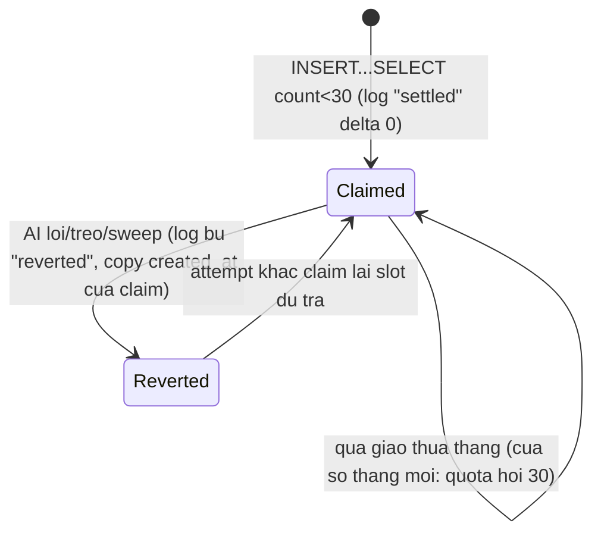
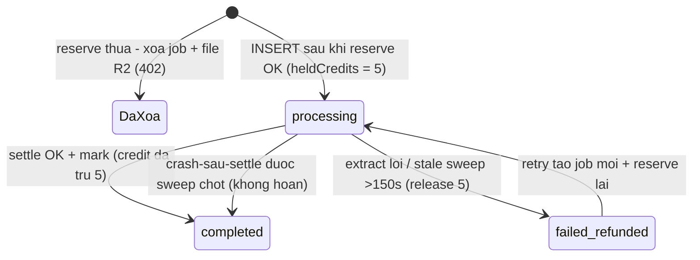
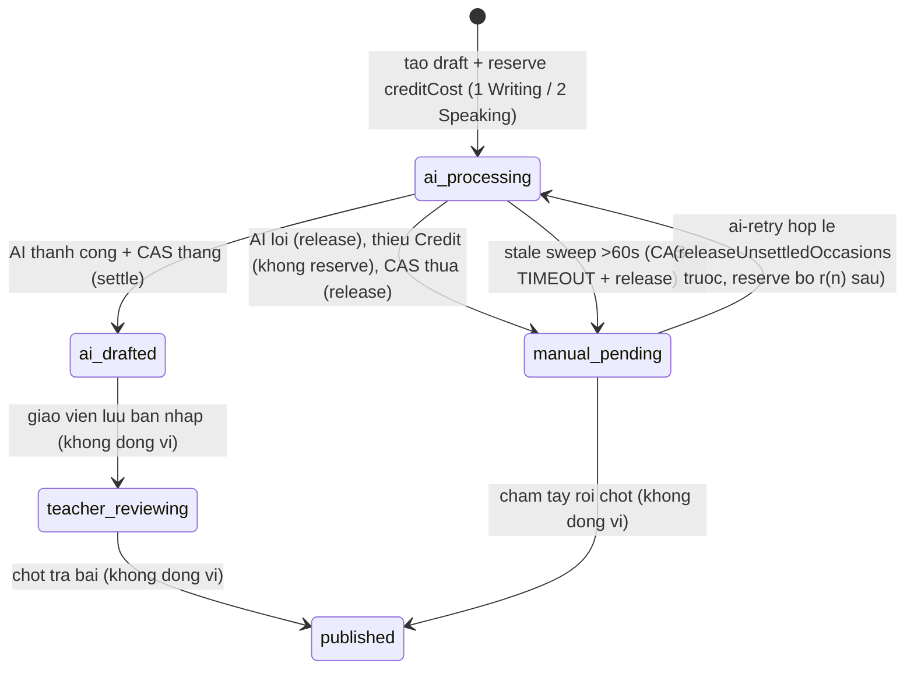
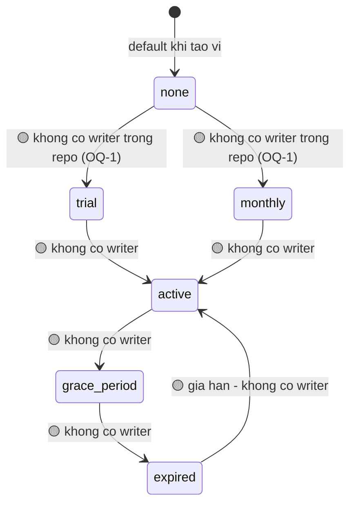

# Máy trạng thái — feature credits

> Sổ cái append-only nên "trạng thái" của một giao dịch là trạng thái của **nhóm khóa** `<dịch vụ>:<ref>[:r<n>]`; row cũ không bao giờ đổi, bước mới là row mới (🟡 mô tả theo comment schema + hành vi service). Trạng thái job/draft là trạng thái cột thật.

## 1. Giao dịch ví (một lượt tiêu Credit, theo khóa idempotency)

- Bằng chứng: guard + cột set theo op — apps/server/src/lib/credits/wallet.ts:271-284; log chỉ sinh khi UPDATE khớp — apps/server/src/lib/credits/wallet.ts:289-302; replay trả log cũ — apps/server/src/lib/credits/wallet.ts:303-309; UNIQUE khóa — packages/db/src/schema/credit-wallet.ts:65-69.

## 2. Lượt Chấm nhanh Writing (delta 0, theo attemptId)

- Bằng chứng: apps/server/src/lib/credits/wallet.ts:148-233; test biên tháng + revert: apps/server/src/lib/credits/wallet.test.ts:446-497, 499-552.

## 3. Job nhập đề (import_status) — liên kết Credit

- Bằng chứng: vòng đời ghi trong schema — packages/db/src/schema/exam-import-job.ts:6-16; reserve thua xóa job — apps/server/src/routes/exam-imports.ts:305-321; settle trước mark — apps/server/src/lib/exam-import/run-import.ts:186-216; sweep — apps/server/src/lib/exam-import/release-stale.ts:35-73; retry — apps/server/src/routes/exam-imports.ts:500-570.

## 4. Draft chấm AI (status) — liên kết Credit

- Bằng chứng: máy trạng thái ghi trong schema — packages/db/src/schema/ai-grading-draft.ts:16-22; CAS trước ví sau — apps/server/src/lib/ai-grading/run-grading.ts:528-551; nhánh thiếu Credit — apps/server/src/lib/ai-grading/run-grading.ts:400-440; sweep 3 nhóm — apps/server/src/lib/ai-grading/release-stale.ts:47-172; ai-retry — apps/server/src/routes/grading.ts:1279-1327.
- Ghi chú 🟡: các nhánh "không đụng ví" của teacher_reviewing/published là suy ra từ việc publish/PATCH không import hàm ví + comment sweep (apps/server/src/lib/ai-grading/release-stale.ts:26-28).

## 5. Gói tổ chức (plan_kind × plan_status)

- Bằng chứng tồn tại trạng thái: cột + default — packages/db/src/schema/credit-wallet.ts:24-27, migration 0055; reader chuẩn hóa — apps/server/src/lib/credits/wallet.ts:108-146; consumer duy nhất — apps/server/src/lib/ai-grading/run-grading.ts:405-414. Toàn bộ chuyển trạng thái là 🟡 Inferred (GAP-1/OQ-1).
