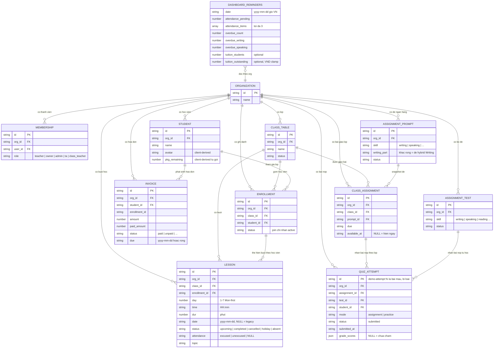

# dashboard — ERD & Entity Reference (reverse)

> Phạm vi: các entity mà feature dashboard ĐỌC (server `computeReminders` + client kernel snapshot). `DASHBOARD_REMINDERS` là read model tính toán, không persist. Mọi entity trong quan hệ đều có khối thuộc tính.

## Entity Reference

| Entity | Vai trò trong dashboard | Nguồn chính (repo-relative) |
|--------|-------------------------|------------------------------|
| ORGANIZATION | Phạm vi mọi truy vấn (orgId predicate) | apps/server/src/routes/dashboard-reminders.ts:66-67, 110-131, 240-250 |
| MEMBERSHIP | role quyết định `finance` (ẩn/hiện thẻ 3) | apps/server/src/app.ts:296-300; apps/server/src/routes/dashboard-reminders.ts:273-280; packages/auth/src/role.ts:75-87 |
| CLASS_TABLE | Tên lớp trên thẻ 1 + lịch | apps/server/src/routes/dashboard-reminders.ts:101-113; apps/web/src/routes/_auth/dashboard.tsx:213-215 |
| STUDENT | Bảng "Cần kiểm tra" (client) + đếm học viên nợ (server) | apps/web/src/routes/_auth/dashboard.tsx:177-181, 271-289; apps/server/src/routes/dashboard-reminders.ts:252 |
| ENROLLMENT | Join `status="active"` khi đếm ca | apps/server/src/routes/dashboard-reminders.ts:114-122 |
| LESSON | Thẻ 1 + Lịch hôm nay + Lịch sắp tới + Risk | apps/server/src/routes/dashboard-reminders.ts:99-158; apps/web/src/lib/dashboard-from-kernel.ts:13-178 |
| INVOICE | Thẻ 3 (server) + KPI "Còn phải thu" (client) | apps/server/src/routes/dashboard-reminders.ts:231-258; apps/web/src/lib/tuition-from-kernel.ts:28-48 |
| QUIZ_ATTEMPT | Thẻ 2 (bài quá hạn chấm) | apps/server/src/routes/dashboard-reminders.ts:160-222 |
| ASSIGNMENT_PROMPT | skill + writingPart (hybrid Writing) | apps/server/src/routes/dashboard-reminders.ts:162-198; packages/api/src/lib/ielts-band.ts:61-85 |
| ASSIGNMENT_TEST | Deck practice writing/speaking | apps/server/src/routes/dashboard-reminders.ts:200-222 |
| CLASS_ASSIGNMENT | Bài gắn lớp + availableAt | apps/server/src/routes/dashboard-reminders.ts:167-198; apps/server/src/lib/assignment-visibility.ts:11-16 |
| DASHBOARD_REMINDERS | Read model trả về web (không persist) | packages/api/src/contracts.ts:2680-2719; apps/web/src/components/dashboard/reminder-cards.tsx:42-80 |

## Quan hệ (ý nghĩa nghiệp vụ)

| Quan hệ | Ý nghĩa với dashboard | Cite |
|---------|------------------------|------|
| ORGANIZATION 1—N mọi entity | Cô lập dữ liệu org (IDOR guard) — org khác không đếm | apps/server/src/routes/dashboard-reminders.ts:110-131, 240-250; test apps/server/src/routes/dashboard-reminders.test.ts:270-275, 495-501 |
| CLASS_TABLE 1—N LESSON 1—1 ENROLLMENT (per-lesson) | Ca học gắn lớp qua enrollment active; bucket dated (classId,date) / legacy (classId,time) | apps/server/src/routes/dashboard-reminders.ts:99-158 |
| CLASS_TABLE 1—N CLASS_ASSIGNMENT N—1 ASSIGNMENT_PROMPT | Bài lớp → prompt (skill/writingPart) quyết định phân loại writing | apps/server/src/routes/dashboard-reminders.ts:167-198, 224-229 |
| ASSIGNMENT_TEST 1—N QUIZ_ATTEMPT | Practice tự học chỉ tính writing/speaking, loại demo | apps/server/src/routes/dashboard-reminders.ts:200-222 |
| STUDENT 1—N INVOICE | Đếm học viên distinct có hóa đơn đến hạn; cộng outstanding | apps/server/src/routes/dashboard-reminders.ts:231-258 |
| ORGANIZATION 1—1 DASHBOARD_REMINDERS (đọc) | 1 response/1 org/1 lần gọi; không persist | packages/api/src/contracts.ts:2688-2716 |
