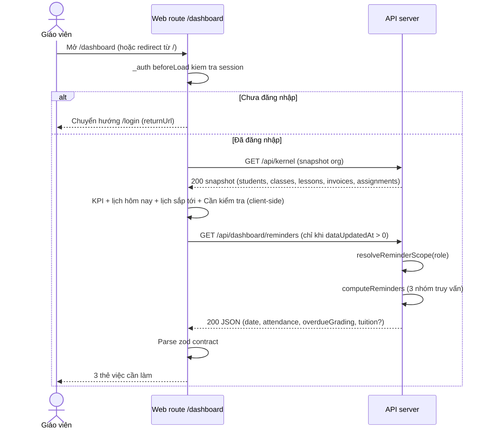
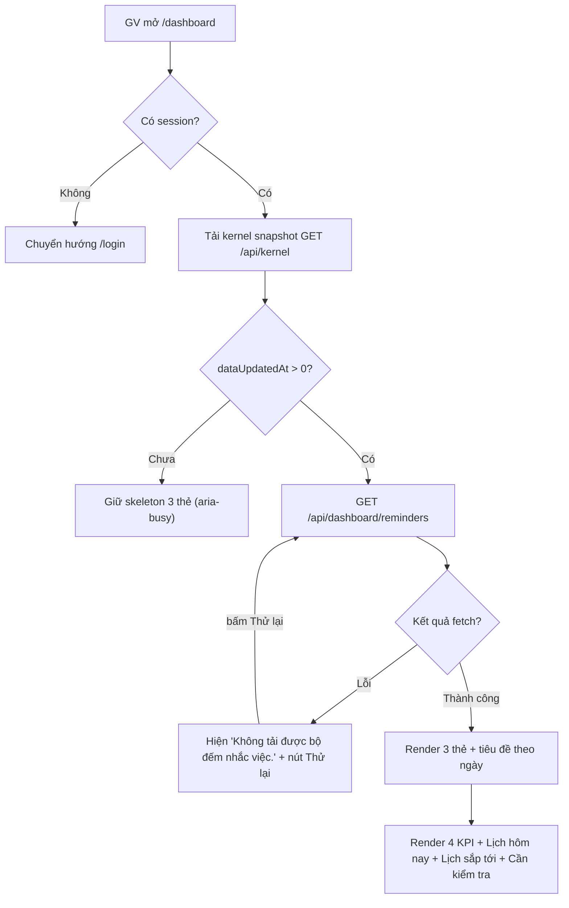
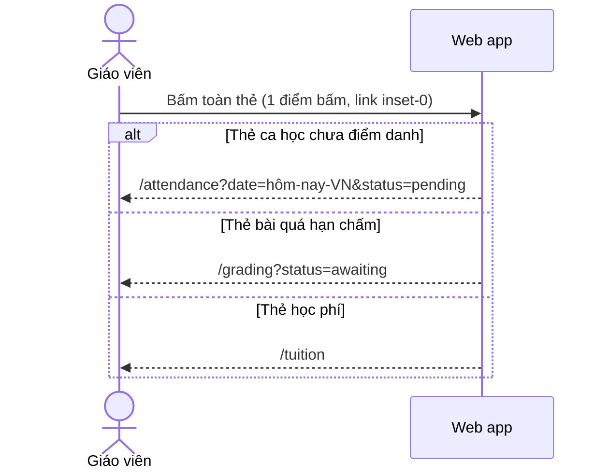
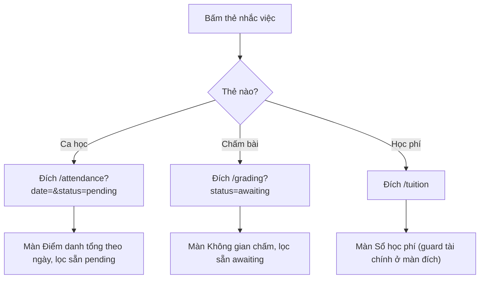
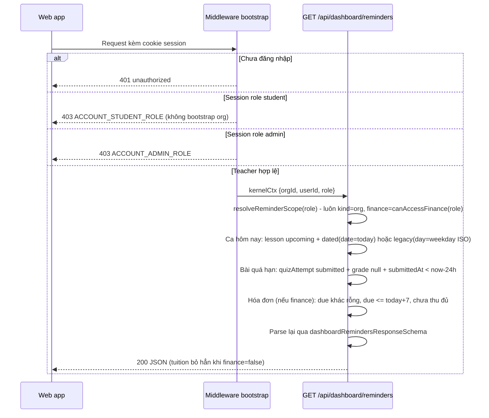
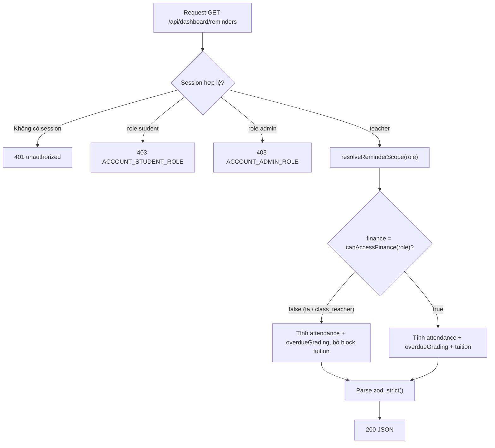
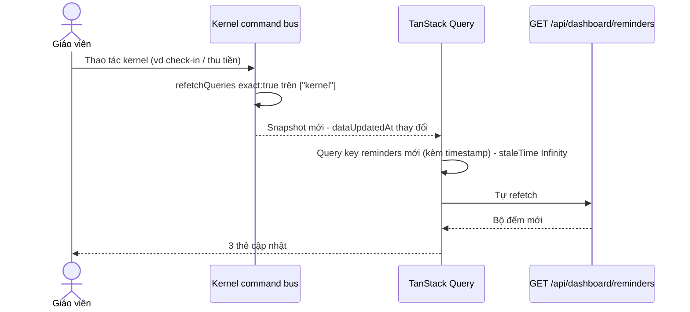
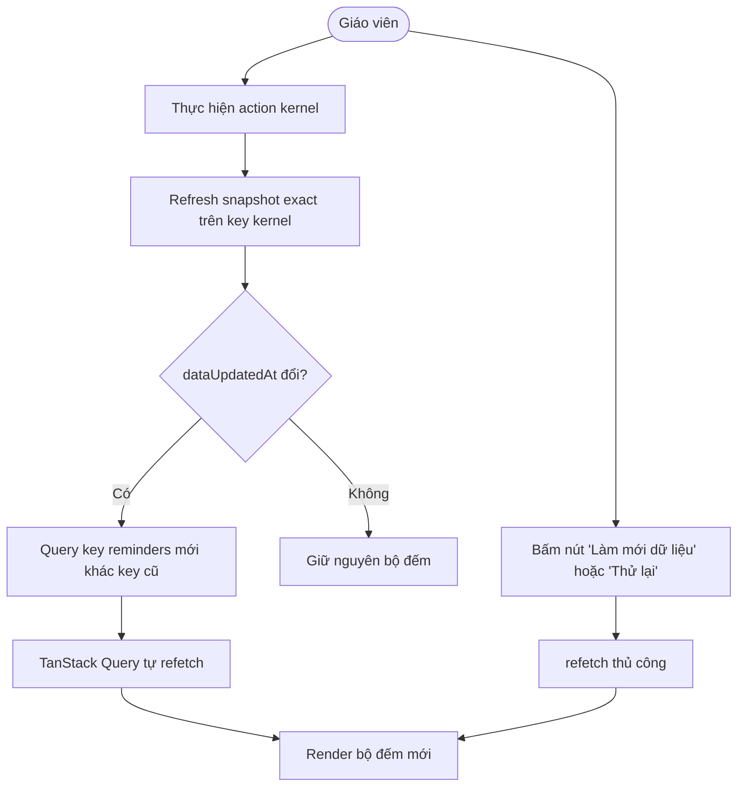
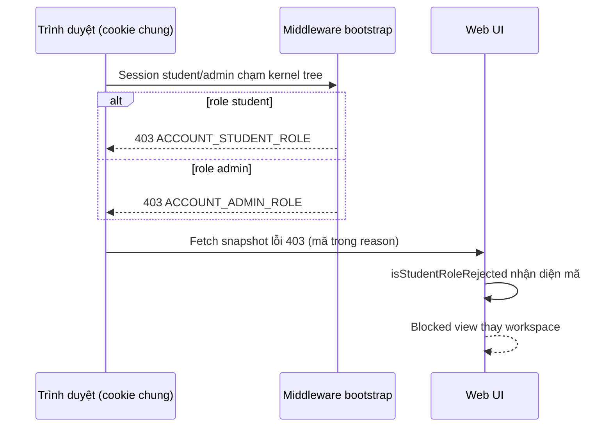
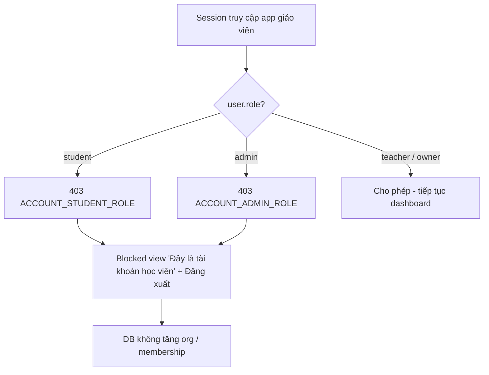

# dashboard — Flows (reverse)

> Mỗi flow có sequenceDiagram + flowchart. Nguồn chính: apps/web/src/routes/_auth/dashboard.tsx, apps/server/src/routes/dashboard-reminders.ts, apps/server/src/app.ts, apps/web/src/lib/repos/dashboard-reminders.ts.

## F1 — Mở dashboard và tải dữ liệu tổng hợp

**Chuẩn bị:** giáo viên đã có session (đăng nhập); org được bootstrap tự động nếu trống (apps/server/src/app.ts:278-291).

Nguồn: apps/web/src/routes/_auth/dashboard.tsx:67-164, apps/web/src/routes/_auth/dashboard.tsx:167-296; apps/web/src/routes/index.tsx:3-7; apps/web/src/routes/_auth/route.tsx:6-37; apps/e2e/specs/login.smoke.spec.ts:10-18 (sign-up dẫn tới dashboard với org bootstrap).

## F2 — Bấm thẻ nhắc việc → màn đích đã lọc (AC-001)

Nguồn: apps/web/src/components/dashboard/reminder-cards.tsx:45-77, apps/web/src/components/dashboard/reminder-cards.tsx:96-104; e2e assert URL apps/e2e/specs/dashboard-reminders.spec.ts:143-163.

## F3 — Server tính bộ đếm reminders

Nguồn: apps/server/src/routes/dashboard-reminders.ts:80-300; apps/server/src/app.ts:202-303; test apps/server/src/routes/dashboard-reminders.test.ts:585-622.

## F4 — Tự làm mới bộ đếm theo vòng đời kernel snapshot

Nguồn: apps/web/src/lib/repos/dashboard-reminders.ts:16-24; apps/web/src/routes/_auth/dashboard.tsx:81-96, apps/web/src/routes/_auth/dashboard.tsx:135-142; test refetch apps/web/src/routes/_auth/dashboard.test.tsx:248-282.

## F5 — Chặn tài khoản sai app (student/admin)

Nguồn: apps/server/src/app.ts:221-242; apps/web/src/lib/repos/kernel.ts:718-726 (isStudentRoleRejected); e2e apps/e2e/specs/account-role-separation.spec.ts:120-150.
