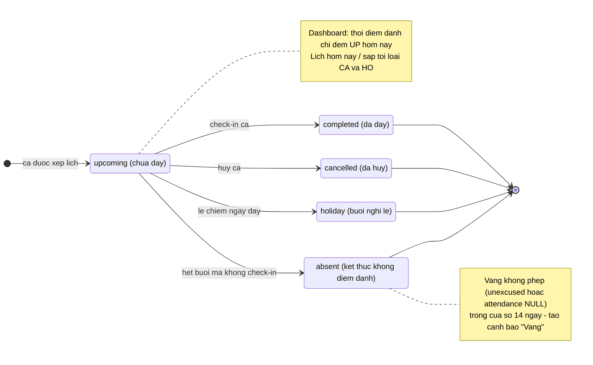
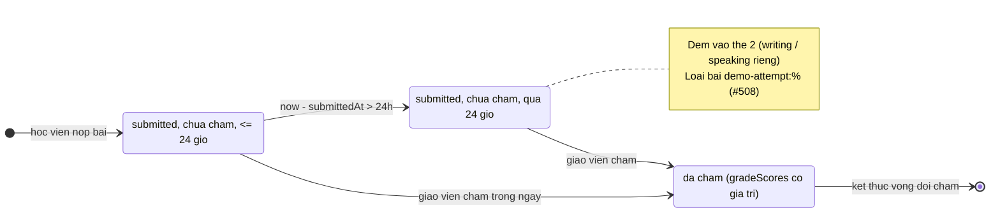
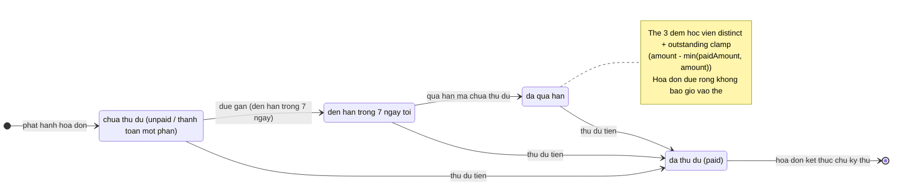
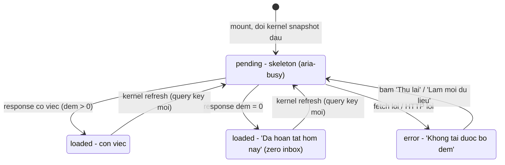

# dashboard — States (reverse)

> Feature dashboard chỉ ĐỌC, không sở hữu vòng đời ghi nào. Các entity dưới đây là entity multi-state mà dashboard quan sát và phân loại; transition do feature domain khác sở hữu (lịch/attendance/grading/tuition) — dashboard chỉ phản ánh đúng trạng thái hiện có. Có đủ entity multi-state nên KHÔNG lược.

## ST-1 — Ca học (lesson) theo lăng kính dashboard

Trạng thái đọc tại: apps/server/src/routes/dashboard-reminders.ts:99-132 (`status="upcoming"` mới đếm), apps/web/src/lib/dashboard-from-kernel.ts:13-25 (loại cancelled + holiday), apps/web/src/lib/dashboard-from-kernel.ts:124-136 (attendance excused/unexcused/null).

- Trong scope dashboard: UP hiện ở thẻ 1 + "Lịch hôm nay"; CA/HO bị loại mọi khối (BR-005); AB/attendance phản ánh ở bảng "Cần kiểm tra". ✅ [apps/server/src/routes/dashboard-reminders.ts:126; apps/web/src/lib/dashboard-from-kernel.ts:17-22, apps/web/src/lib/dashboard-from-kernel.ts:124-136]

## ST-2 — Bài nộp (quiz_attempt) theo lăng kính thẻ "quá hạn chấm"

DB chỉ có `status="submitted"` + `submittedAt` + `gradeScores`; hai trạng thái giữa là phân loại thời gian của thẻ (không phải cột DB).

Nguồn: apps/server/src/routes/dashboard-reminders.ts:38-39, apps/server/src/routes/dashboard-reminders.ts:160-229 (isNull gradeScores + lt submittedAt cutoff + notLike demo), test apps/server/src/routes/dashboard-reminders.test.ts:299-431.

## ST-3 — Hóa đơn (invoice) theo lăng kính thẻ học phí

Nguồn: apps/server/src/routes/dashboard-reminders.ts:231-258 (ne due khác rỗng, lte due today+7, or status≠paid / paidAmount<amount, clamp 253-256); apps/web/src/lib/tuition-from-kernel.ts:28-48; test apps/server/src/routes/dashboard-reminders.test.ts:435-510.

## ST-4 — Bộ đếm trên web (query + thẻ) — trạng thái UI

Mỗi thẻ có trạng thái riêng `done` (đếm 0) trên nền query chung.

Nguồn: apps/web/src/routes/_auth/dashboard.tsx:128-164 (pending/error/loaded), apps/web/src/components/dashboard/reminder-cards.tsx:97-112 (done → nhãn zero inbox), apps/web/src/lib/repos/dashboard-reminders.ts:16-24 (key đổi theo dataUpdatedAt).
