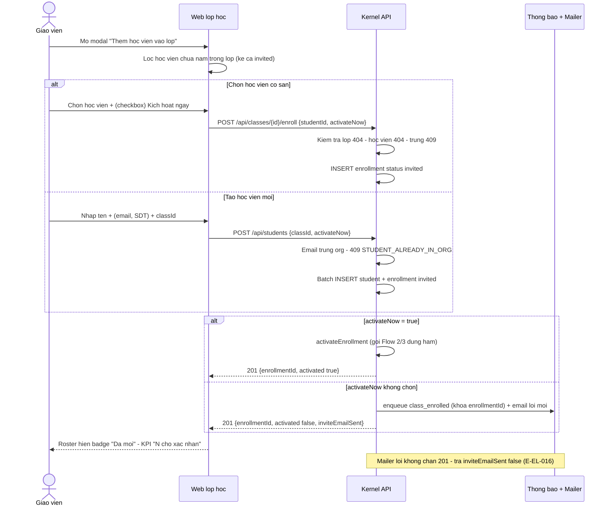
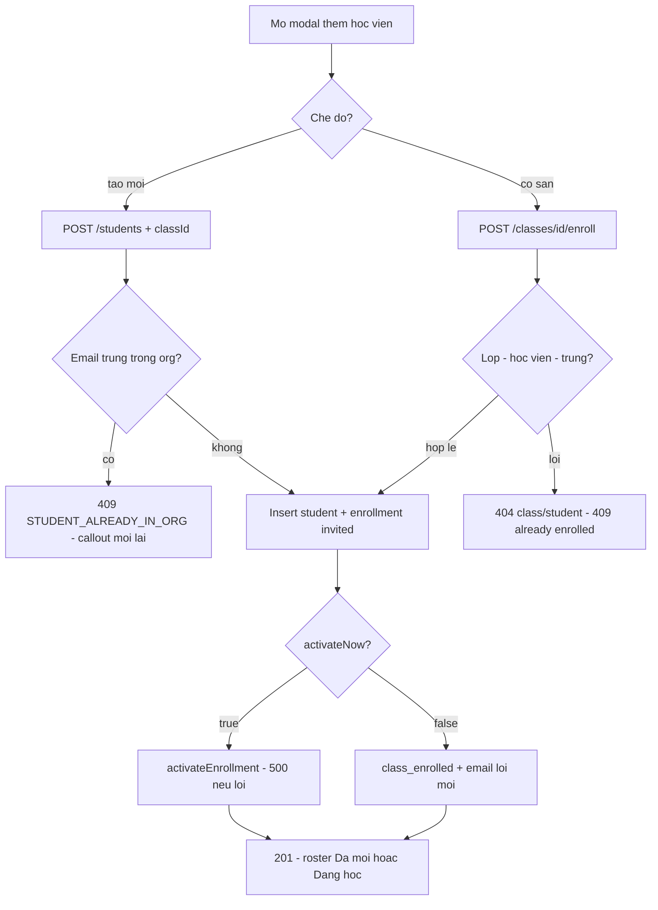
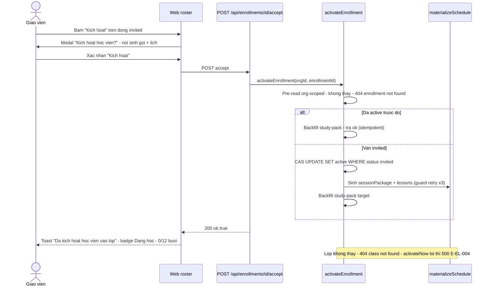
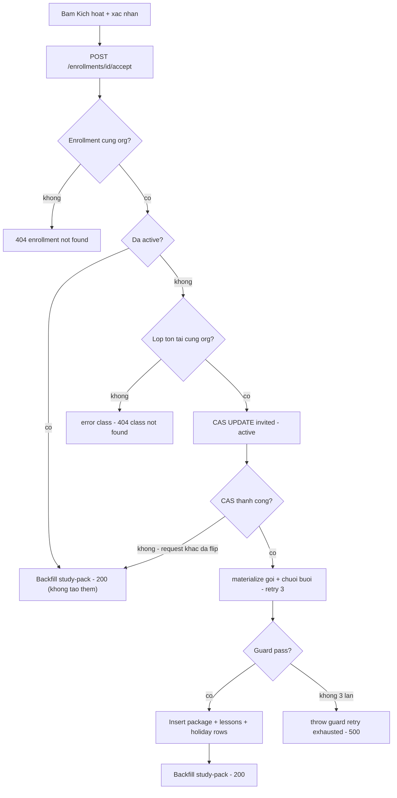
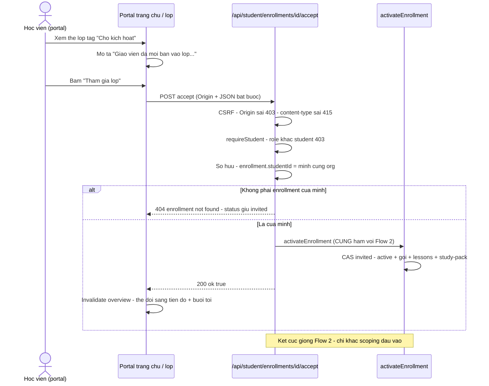
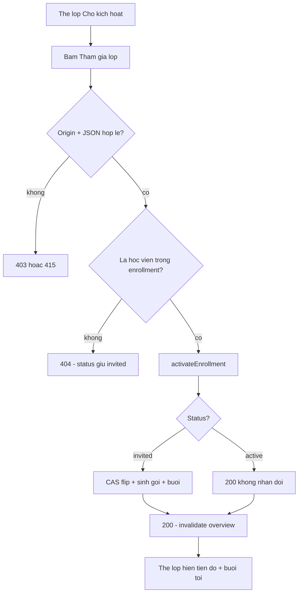
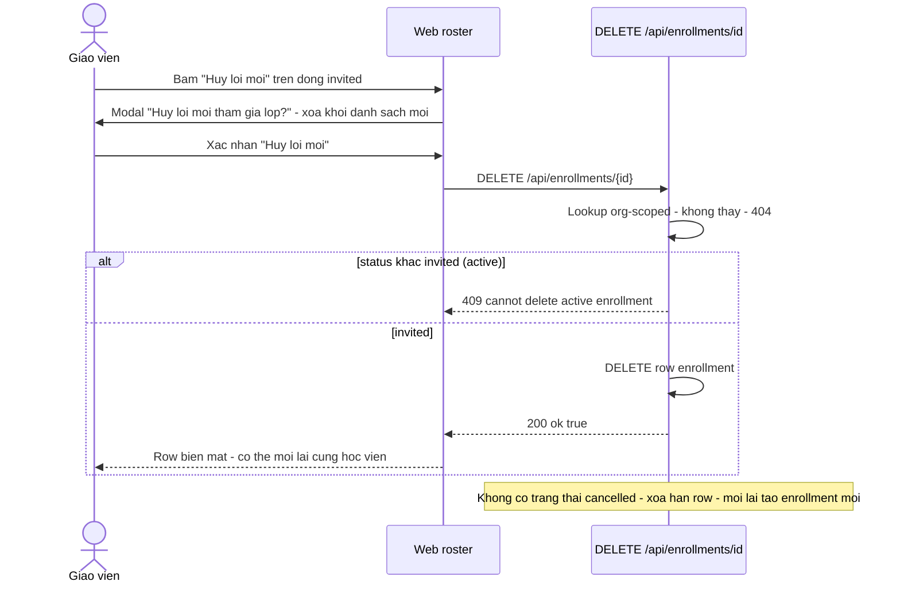
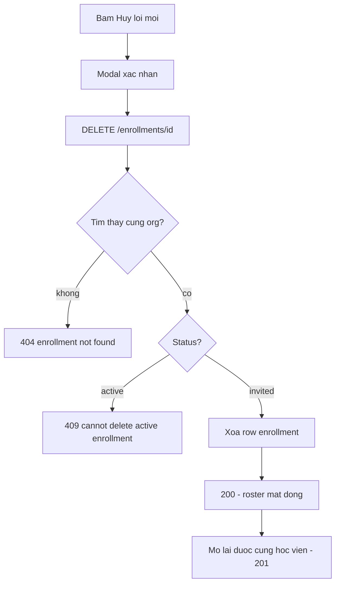
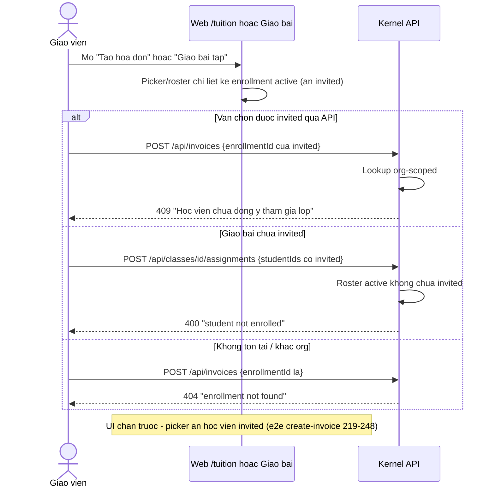
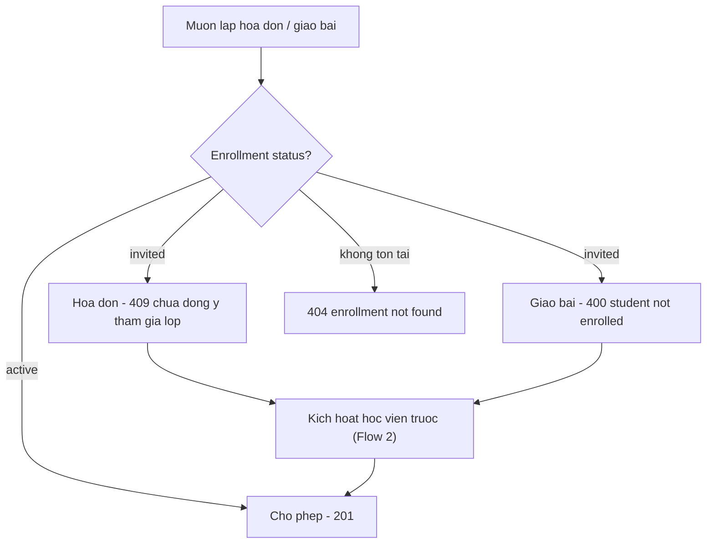

# enrollment-lifecycle — Flows tái lập (reverse)

> Mỗi flow: `sequenceDiagram` + `flowchart`, chỉ vẽ bước có trong code. Nhãn: ✅ chắc chắn · 🔵 suy đoán · 🟡 cần xác nhận.

## Flow 1: Giáo viên thêm học viên vào lớp (tạo invited)

### Sequence — Thêm học viên vào lớp

### Activity — Thêm học viên vào lớp

## Flow 2: Kích hoạt bởi giáo viên (nút "Kích hoạt")

### Sequence — Kích hoạt bởi giáo viên

### Activity — Kích hoạt bởi giáo viên

## Flow 3: Học viên chấp nhận từ portal (nút "Tham gia lớp")

### Sequence — Chấp nhận từ portal

### Activity — Chấp nhận từ portal

## Flow 4: Hủy lời mời enrollment (chỉ invited)

### Sequence — Hủy lời mời

### Activity — Hủy lời mời

## Flow 5: Hóa đơn / bài tập gặp enrollment chưa active (chặn)

### Sequence — Chặn khi chưa active

### Activity — Chặn khi chưa active

