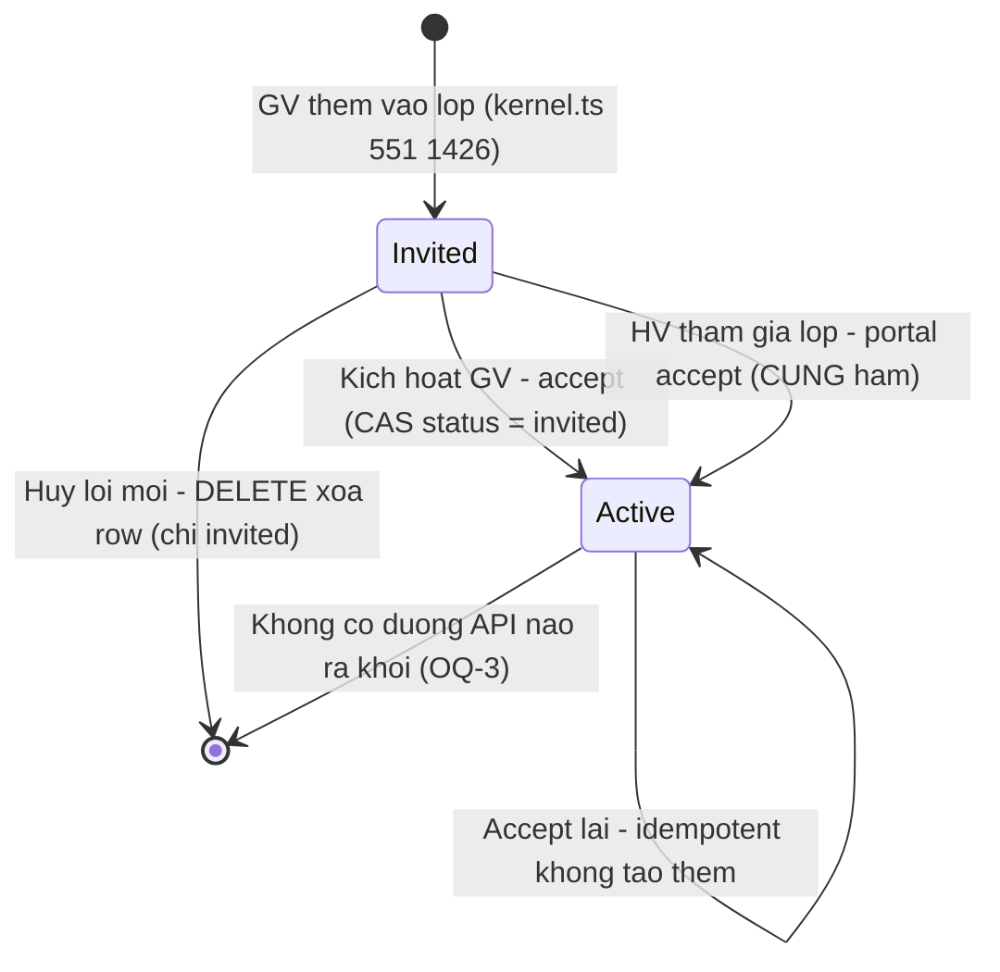
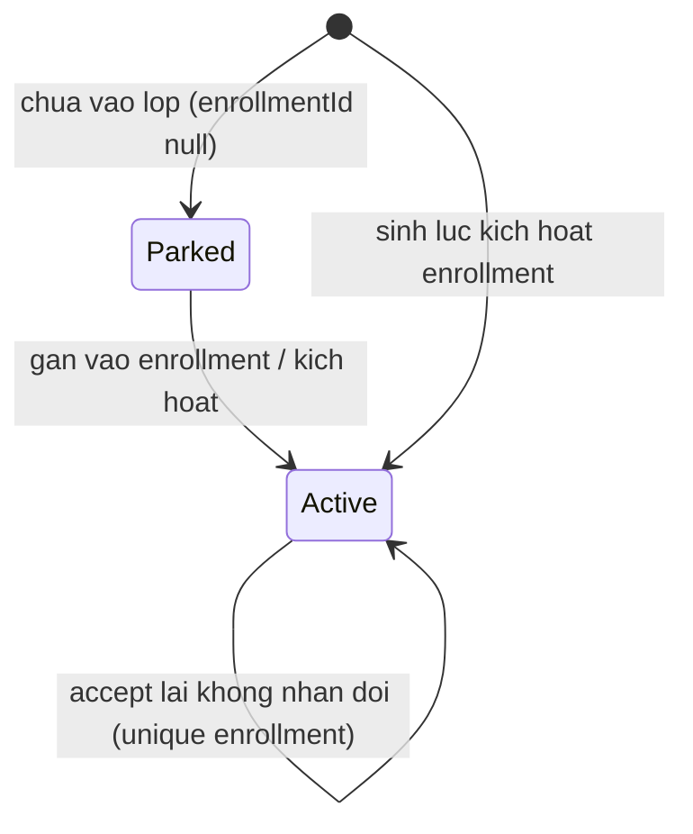

# enrollment-lifecycle — States tái lập (reverse)

## State: ENROLLMENT

> Nguồn: ✅ [S1 `packages/db/src/schema/enrollment.ts:30-34`] (comment lifecycle), ✅ [S2 `contracts.ts:1615-1616`] (enum), ✅ [S4 `enrollment-activation.ts:733-743`] (CAS), ✅ [S3 `kernel.ts:1480-1505`] (DELETE). DB chỉ ghi `invited` | `active` — ✅ [S6 `student-class.ts:134`].

**Ghi chú trạng thái:**

| Trạng thái | Ý nghĩa | Vào bằng | Ra bằng | Nguồn | Nhãn |
|-----------|---------|----------|---------|-------|------|
| Invited | "Đã mời" — giáo viên đã thêm vào lớp, học viên chưa xác nhận; CHƯA có gói/buổi/hóa đơn hợp lệ | POST enroll / POST students+classId (insert `status:"invited"`) | accept (2 đường) hoặc DELETE | S3 `kernel.ts:551,1426`; S19 `kernel.test.ts:7112-7134` | ✅ |
| Active | "Đang học" — đã có session_package + chuỗi lesson; được lập hóa đơn + giao bài | accept giáo viên HOẶC portal (CAS, idempotent) | KHÔNG có (không API un-enroll) | S4 `enrollment-activation.ts:733-776`; S19 `kernel.test.ts:7136-7171` | ✅ |
| (đã xóa) | Terminal không-phải-trạng-thái: hủy lời mời xóa hẳn row; mời lại tạo enrollment MỚI (idempotency key notify mới theo enrollmentId) | — | DELETE khi invited | S3 `kernel.ts:1499-1503`; S26 `templates.ts:67`; S19 `kernel.test.ts:7271-7303` | ✅ |
| default 'active' (legacy) | Giá trị default cột DB chỉ để backfill row trước Wave invitation; code mới luôn ghi tường minh | migration cũ | — | S1 `enrollment.ts:30-34` | 🟡 OQ-2 |

**Chuyển tiếp KHÔNG tồn tại (negative):** `active → invited` (không code), `invited → cancelled` (không có status cancelled — hủy là DELETE), `active → bất kỳ` ngoài tự-idempotent. ✅ negative-search [S3, S4].

## State: SESSION_PACKAGE (đính kèm vòng đời)

> ✅ [S25 `session-package.ts:45,48-50`] unique theo enrollment; gói "parked" khi enrollmentId null [S2 `contracts.ts:1626-1630`]. 🔵 Tên trạng thái "Parked" suy từ comment + partial unique index, không phải enum code.
