# exam-import-ai — Reverse Flows

Mỗi flow có CẢ sequenceDiagram (tác nhân) LẪN flowchart (nhánh quyết định). Nhánh lỗi AI vẽ đúng theo code. Lưu ý mô hình: KHÔNG có hàng đợi — request POST giữ mở tối đa 120s; "chờ — xem kết quả" là mở lại `?job=` (GET job) và sweep lười chạy ở request kế tiếp (xem F7).

## F1 — Nhập đề bằng AI (hạnh phúc)

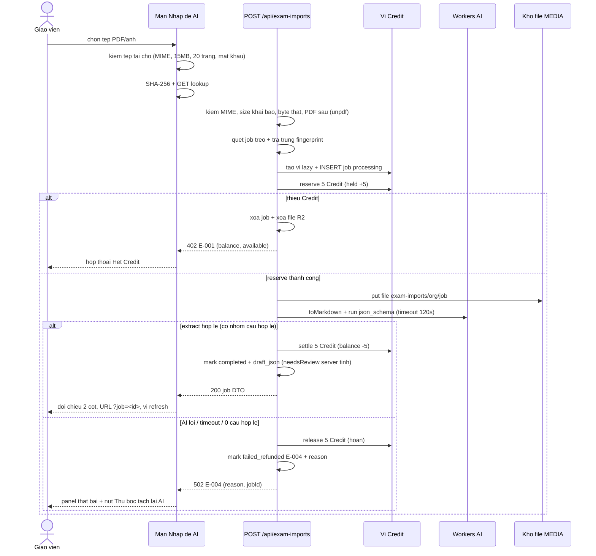

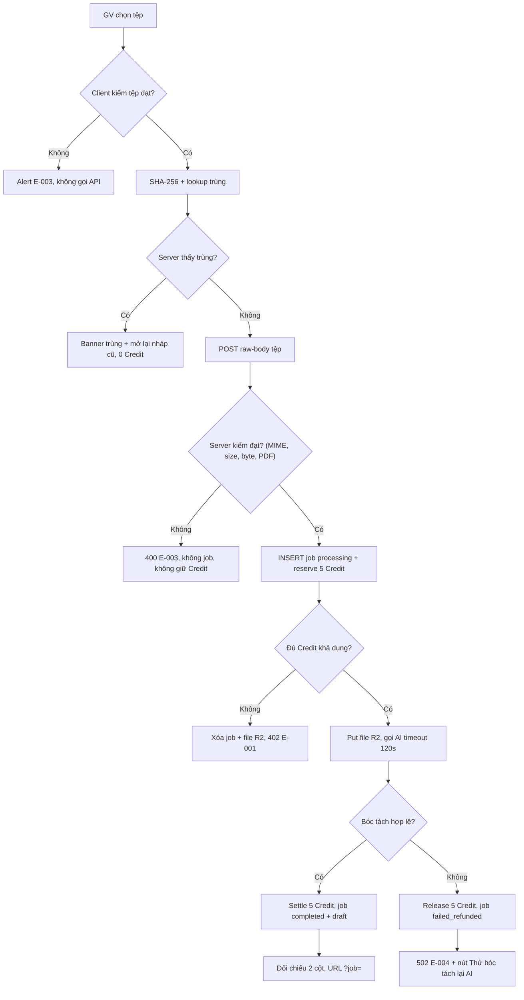

## F2 — Chặn tệp không hợp lệ, 2 lớp (E-003)

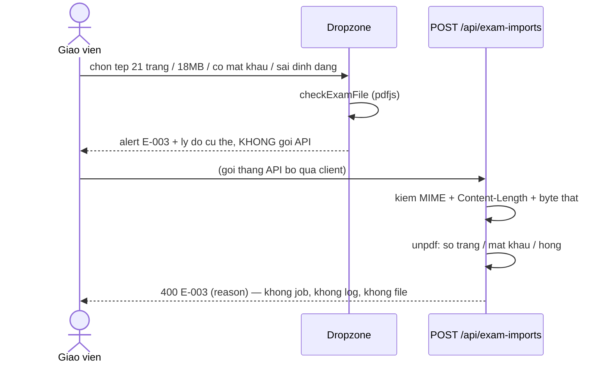

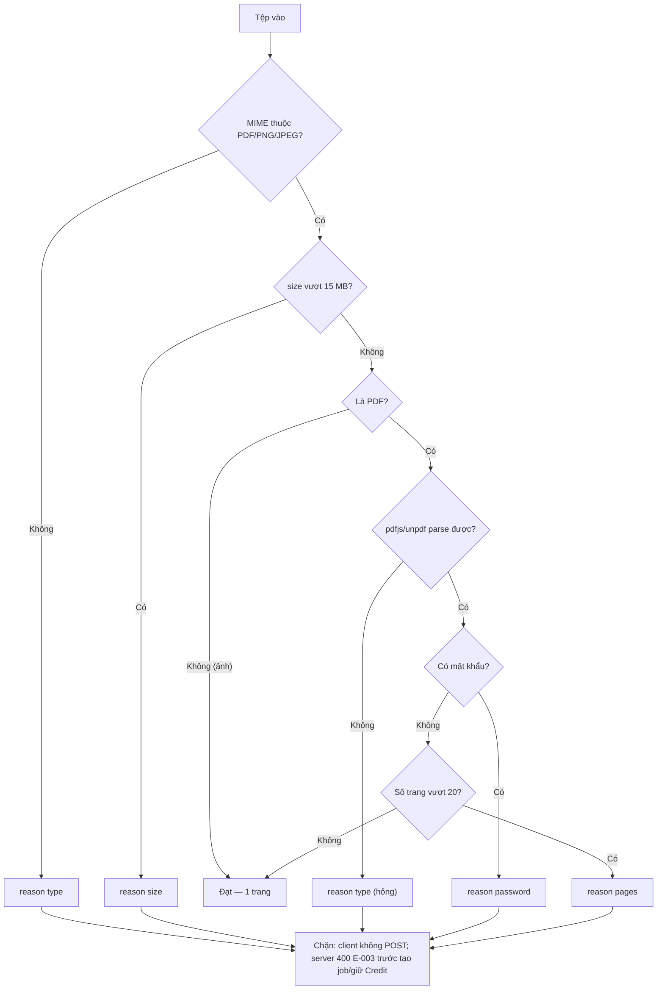

## F3 — Thiếu Credit (E-001) + reserve thua

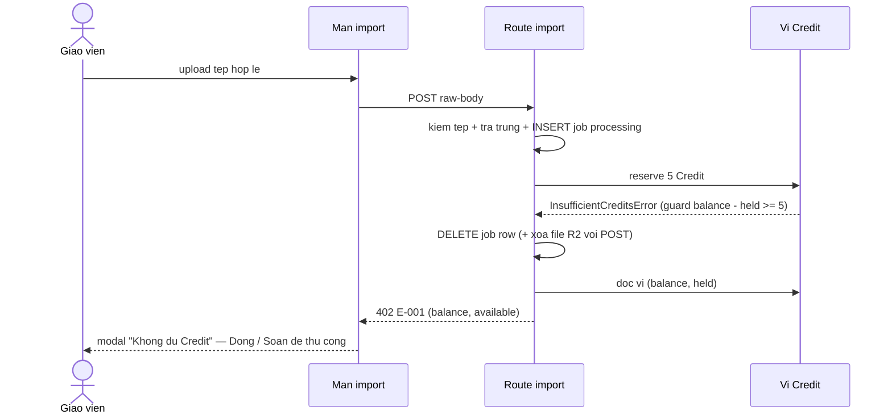

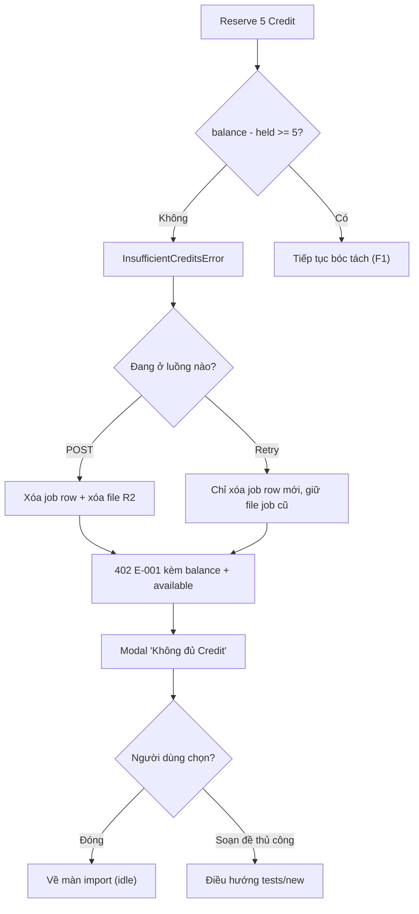

## F4 — AI thất bại → hoàn Credit → Thử bóc tách lại AI (E-004)

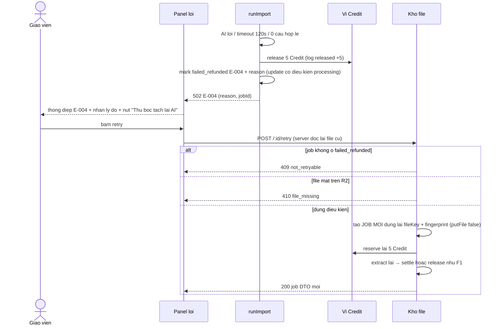

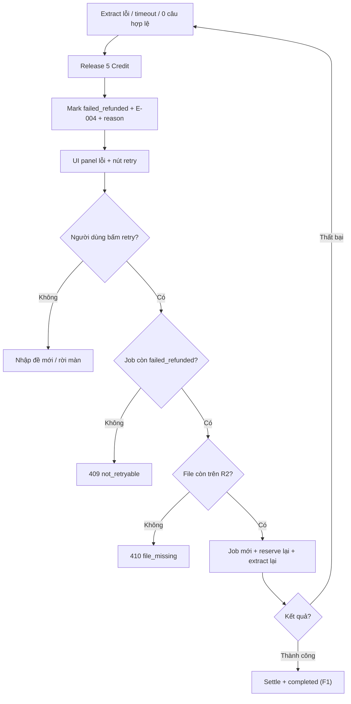

## F5 — Phát hiện tệp trùng, 0 Credit (lookup + POST) + mở lại bản nháp

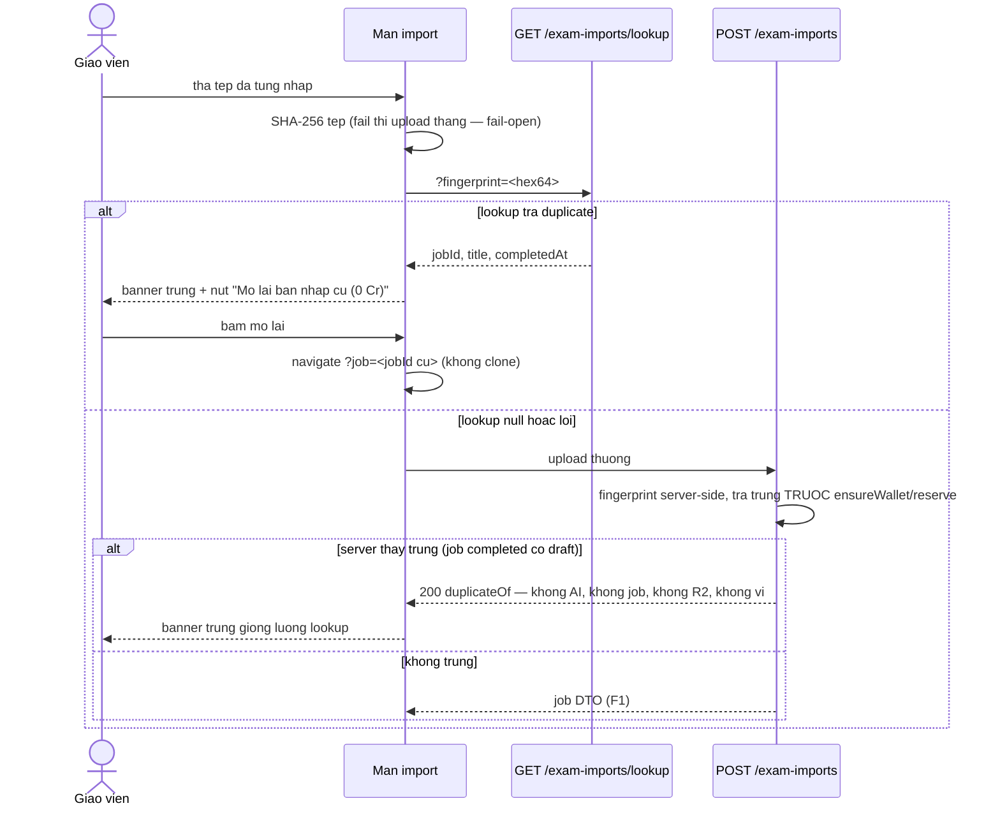

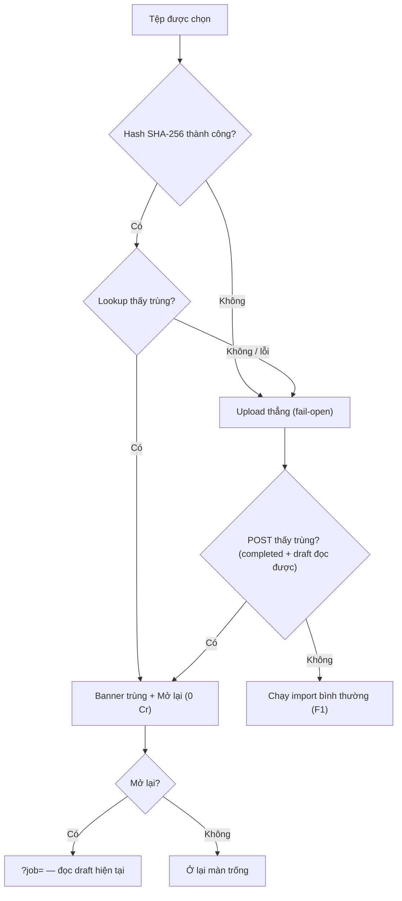

## F6 — Chỉnh sửa → xác nhận rà soát → xuất bản vào Ngân hàng đề

```mermaid
sequenceDiagram
    actor GV as Giao vien
    participant UI as Panel ben phai
    participant DRAFT as PATCH /:id/draft
    participant PUB as POST /:id/publish
    participant BANK as Ngan hang de

    GV->>UI: sua ten/ky nang/thoi gian/passage/cau (0 Credit)
    UI->>DRAFT: {draft}
    DRAFT->>DRAFT: merge bao toan confidence + needsReview goc
    DRAFT-->>UI: 200 job DTO ("Da luu ban nhap (0 Credit).")
    UI->>UI: reviewCount > 0 → khoa nut "Luu vao Ngan hang de" + hop kiem xac nhan
    GV->>UI: tich "Toi da kiem tra va xac nhan (N cau)"
    UI->>PUB: {draft, reviewConfirmed: true}
    PUB->>PUB: gate 2 lop: max(count draft merge, count draft DB) > 0 va chua xac nhan → 422
    PUB->>PUB: mixed → 422; vuot slot → 422; cau loi → 422 (partIndex, questionIndex)
    PUB->>BANK: 1 batch: prompt tung part + test + test part + update job (id tinh dinh)
    alt skill listening
        BANK-->>UI: testId + status draft ("can bo sung file nghe")
    else ky nang khac
        BANK-->>UI: testId + status ready
    end
    UI->>UI: refresh kernel → navigate /assignments/tests/<testId>
```

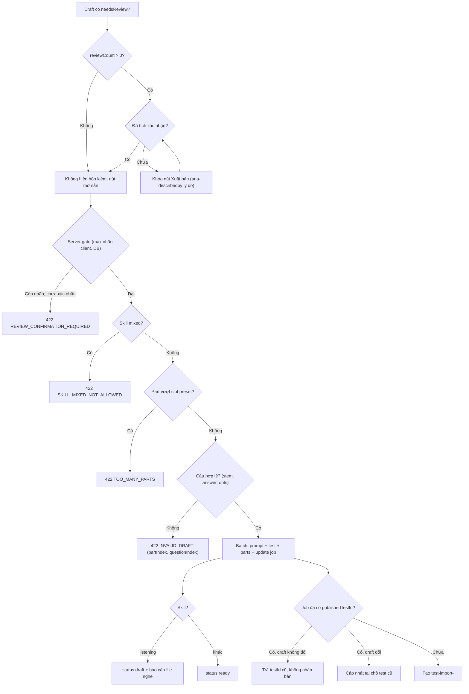

## F7 — Dọn job treo (lazy sweep, không cron)

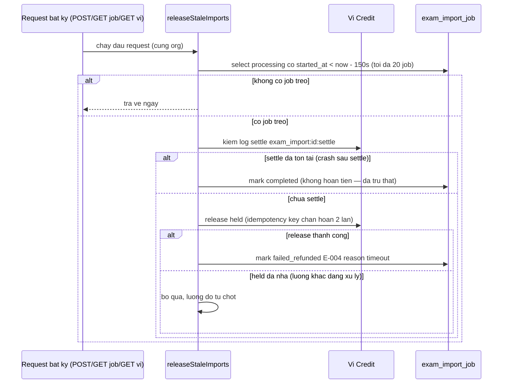

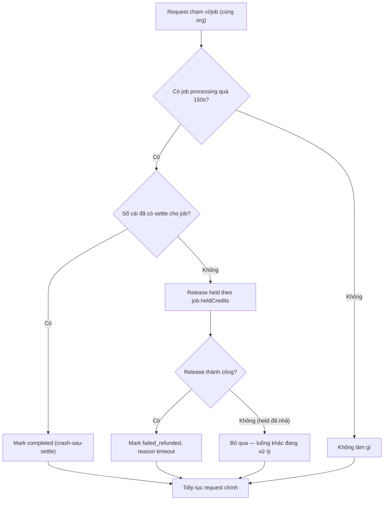
