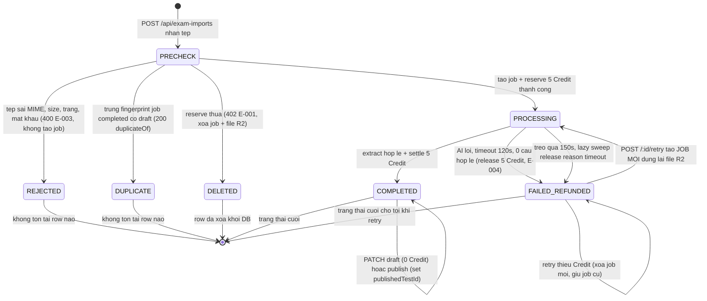

# exam-import-ai — Reverse States (vòng đời job import)

Trạng thái lưu DB: cột `import_status` của `exam_import_job` — enum code `packages/db/src/schema/exam-import-job.ts:31-32` ("processing" | "completed" | "failed_refunded"), wire enum `packages/api/src/contracts.ts:4402`. Trạng thái ảo `DELETED` (không còn row) sinh ra khi reserve thua ở POST (`apps/server/src/routes/exam-imports.ts:306-309`). Publish KHÔNG đổi `import_status` — chỉ set `published_test_id` + `draft_json` (`apps/server/src/lib/exam-import/publish-to-bank.ts:510-519`).

### Chuyển biến chi tiết

| Từ → Đến | Điều kiện | Credit | Site |
|----------|-----------|--------|------|
| (không có) → PRECHECK | POST nhận tệp, qua 401/403/503 | chưa đụng | `exam-imports.ts:156-173` |
| PRECHECK → REJECTED | MIME/size/name/byte/PDF không đạt | 0 (không tạo job) | `exam-imports.ts:178-259` |
| PRECHECK → DUPLICATE | `findCompletedImportByFingerprint` trúng | 0 (chạy trước ensureWallet/reserve) | `exam-imports.ts:264-275` |
| PRECHECK → PROCESSING | INSERT job + `reserveCredits` thành công | held +5 | `exam-imports.ts:283-325` |
| PRECHECK → DELETED | `InsufficientCreditsError` sau INSERT | 0 (job + file bị xóa) | `exam-imports.ts:306-309` |
| PROCESSING → COMPLETED | extract hợp lệ → settle → UPDATE có điều kiện `processing` | balance −5, held −5 | `run-import.ts:186-216` |
| PROCESSING → FAILED_REFUNDED | classify `timeout/ai_error/empty_result` → release → mark | held −5 (hoàn) | `run-import.ts:236-297` |
| PROCESSING → COMPLETED (sweep) | crash-sau-settle: log settle tồn tại | đã trừ rồi | `release-stale.ts:47-56` |
| PROCESSING → FAILED_REFUNDED (sweep) | started_at < cutoff 150s, release thành công | hoàn theo `job.heldCredits` | `release-stale.ts:58-72` |
| COMPLETED → COMPLETED | PATCH draft (merge) / publish (publishedTestId + draft) | 0 | `exam-imports.ts:662-674`, `publish-to-bank.ts:510-519` |
| FAILED_REFUNDED → PROCESSING | retry tạo JOB MỚI (job cũ giữ nguyên trạng thái) | job mới held +5 | `exam-imports.ts:526-551` |

### Máy trạng thái tầng màn (web, không lưu DB)

`idle → uploading → done | error` — `apps/web/src/routes/_auth/assignments/tests/import.tsx:65-69`; `?job=` nạp thẳng vào `done` (:128-155); banner trùng/failed panel là ràng nhánh hiển thị của `done`/`error` (:271-288, :386-430).
