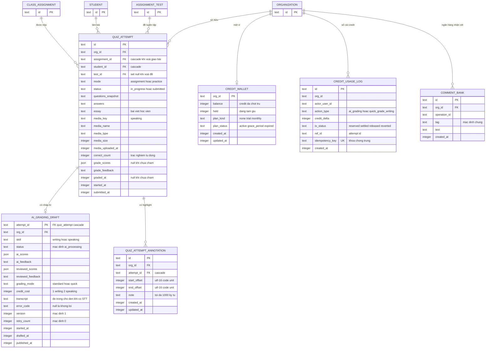

# ERD — grading (kiểu cột khớp schema Drizzle/D1 thật)

FK là RÀNG BUỘC DB THẬT (Drizzle `.references` + onDelete) — không phải chỉ app-level: quiz_attempt (assignment cascade, student cascade, test set null, org cascade), ai_grading_draft (attempt cascade, org cascade), quiz_attempt_annotation (attempt cascade, org cascade), comment_bank (org cascade), credit_wallet/log (org không khai references trực tiếp trong tệp — gắn theo org_id nghiệp vụ).

Chỉ mục & ràng buộc nổi bật (nguồn):

- quiz_attempt: UNIQUE (assignment_id, student_id) "không retake" — packages/db/src/schema/quiz-attempt.ts:86-89; CHECK assignment ⇒ assignment_id — :103-108; index history — :92-97.
- ai_grading_draft: PK attempt_id — packages/db/src/schema/ai-grading-draft.ts:29-31; index (org_id, status) — :76.
- quiz_attempt_annotation: index attempt, org — packages/db/src/schema/quiz-attempt-annotation.ts:37-38.
- credit_usage_log: UNIQUE idempotency_key — packages/db/src/schema/credit-wallet.ts:66-68; index (org_id, created_at) — :69.
- comment_bank: UNIQUE (org_id, operation_id) — packages/db/src/schema/comment-bank.ts:27-30.

- Ghi chú tx_status: schema chỉ bình luận 3 giá trị reserved/settled/released (packages/db/src/schema/credit-wallet.ts:56-57) nhưng code chấm nhanh dùng thêm "reverted" (apps/server/src/lib/credits/wallet.ts:185, 197-203) — liệt kê đủ 4 theo code.
