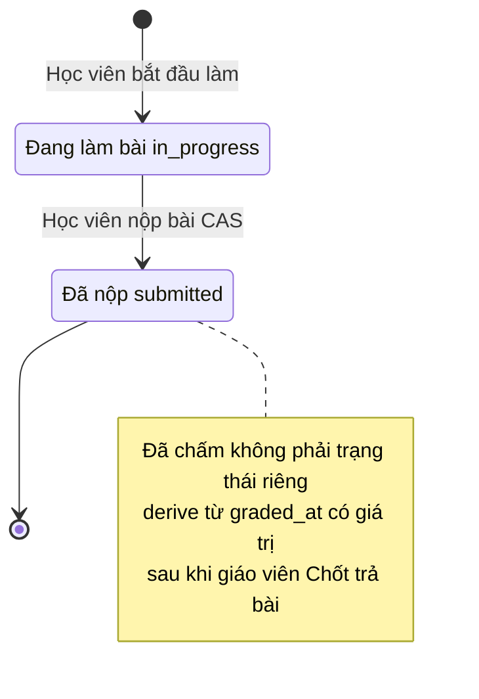
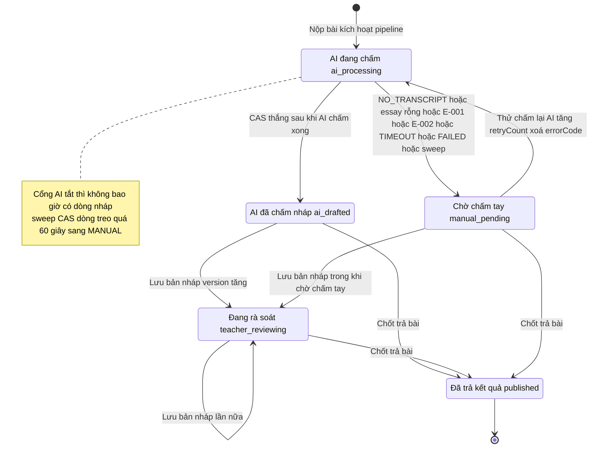

# Máy trạng thái — quiz_attempt và ai_grading_draft

Trạng thái lấy theo enum THẬT trong code.

## 1. quiz_attempt

Enum status thật chỉ có 2 giá trị: `"in_progress"` | `"submitted"` (packages/db/src/schema/quiz-attempt.ts:62). "Đã chấm" KHÔNG phải status — derive từ `graded_at` + `grade_scores` (cùng tệp :74-79).

- CAS nộp bài: apps/server/src/routes/student.ts:1939-1950.
- Không retake: UNIQUE (assignment_id, student_id) — packages/db/src/schema/quiz-attempt.ts:86-89.
- PATCH essay sau nộp bị chặn (essay "đóng băng") — packages/db/src/schema/quiz-attempt-annotation.ts:9-10.

## 2. ai_grading_draft

Enum status thật: `ai_processing` / `ai_drafted` / `teacher_reviewing` / `manual_pending` / `published` (packages/api/src/contracts.ts:2470-2476; mặc định `ai_processing` — packages/db/src/schema/ai-grading-draft.ts:38). Bình luận máy trạng thái + CAS: cùng tệp :7-23.

Chỗ code hậu thuẫn từng nhánh:

| Chuyển | Nguồn |
|---|---|
| [*] → ai_processing | apps/server/src/lib/ai-grading/run-grading.ts:344-356 |
| ai_processing → ai_drafted | apps/server/src/lib/ai-grading/run-grading.ts:216-239, 530-551 |
| ai_processing → manual_pending | apps/server/src/lib/ai-grading/run-grading.ts:243-254 (lỗi), :371-395 (NO_TRANSCRIPT/essay rỗng), :404-439 (Credit), :517-528; apps/server/src/lib/ai-grading/release-stale.ts:41-173 (sweep TIMEOUT) |
| ai_drafted/teacher_reviewing/manual_pending → teacher_reviewing | apps/server/src/routes/grading.ts:421-425 (EDITABLE_DRAFT_STATUSES), 1142-1221 |
| manual_pending → ai_processing | apps/server/src/routes/grading.ts:1292-1306 |
| * → published | apps/server/src/routes/grading.ts:1065-1110 (guard `ne(status,'published')` :1076; nháp CAS — grading.test.ts:2382-2435) |

- Trạng thái KHÔNG có trong enum code nhưng xuất hiện ở UI: không có — mọi nhãn UI map 1-1 với 5 status trên (apps/web/src/components/grading/ai-draft-panel.tsx:23-32).
- Xung đột C-1: bình luận contracts cũ nói manual_pending là kết — xem reverse-gaps.md.
