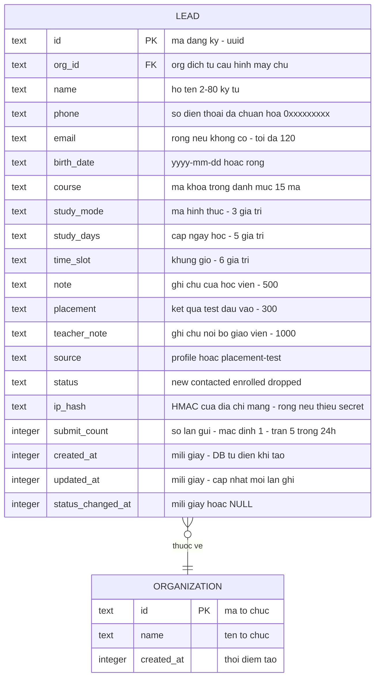

# Sơ đồ thực thể — lead

Khớp schema thật [S3] packages/db/src/schema/lead.ts:15-60 và migration 0057
[S8] packages/db/src/migrations/0057_exotic_vulture.sql:1-27; bảng tổ chức
[S30] packages/db/src/schema/organization.ts:3-10.

Chỉ mục phục vụ nghiệp vụ [S3] packages/db/src/schema/lead.ts:47-59:

1. `(org_id, status, created_at)` — danh sách phân trang + lọc trạng thái + trần ngày.
2. `(org_id, phone, updated_at)` — gộp trùng theo SĐT 24 giờ.
3. `(ip_hash, updated_at)` — đếm tần suất theo địa chỉ mạng 10 phút.

Ghi chú thiết kế đọc từ code:

- ✅ Xóa tổ chức kéo theo xóa đăng ký (khóa ngoại cascade). [S3] packages/db/src/schema/lead.ts:19-21; [S8] packages/db/src/migrations/0057_exotic_vulture.sql:22
- ✅ Không có bảng nào khác trong tính năng; mọi trường hợp gộp dạng danh mục
  (khoá, hình thức, lịch, khung giờ) lưu dạng mã văn bản, danh mục đóng nằm ở
  lớp hợp đồng chứ không phải bảng tra. [S4] packages/api/src/lead-contracts.ts:19-129
- 🟡 Không có ràng buộc duy nhất nào ở cấp bảng cho số điện thoại (gộp trùng là
  hành vi ứng dụng theo cửa sổ 24 giờ, không phải ràng buộc CSDL) —
  [S8] packages/db/src/migrations/0057_exotic_vulture.sql:1-27 (chỉ PRIMARY KEY).
