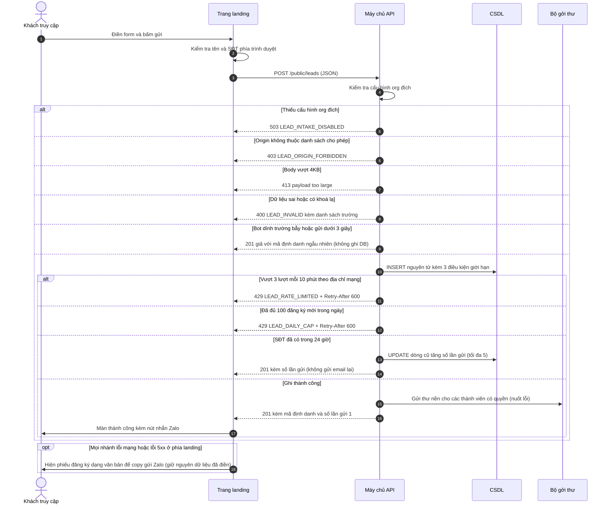
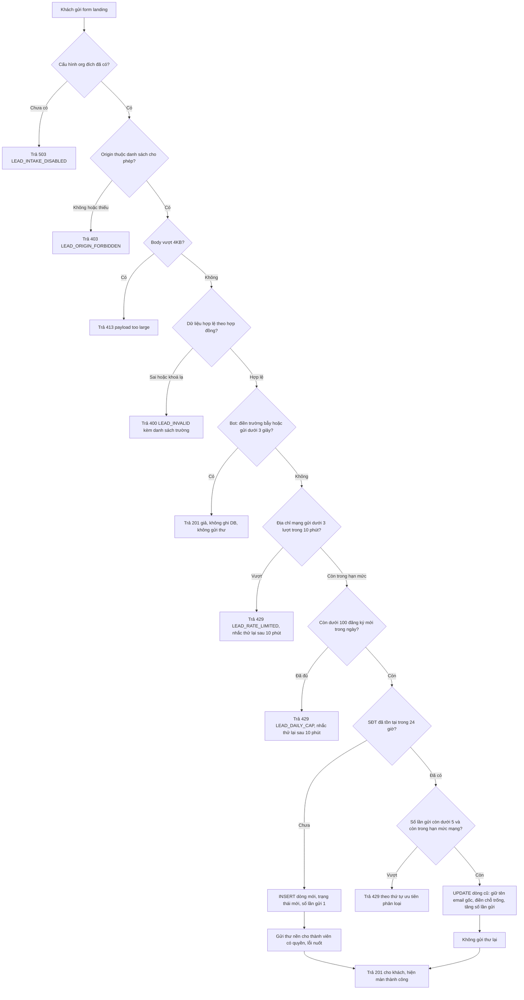
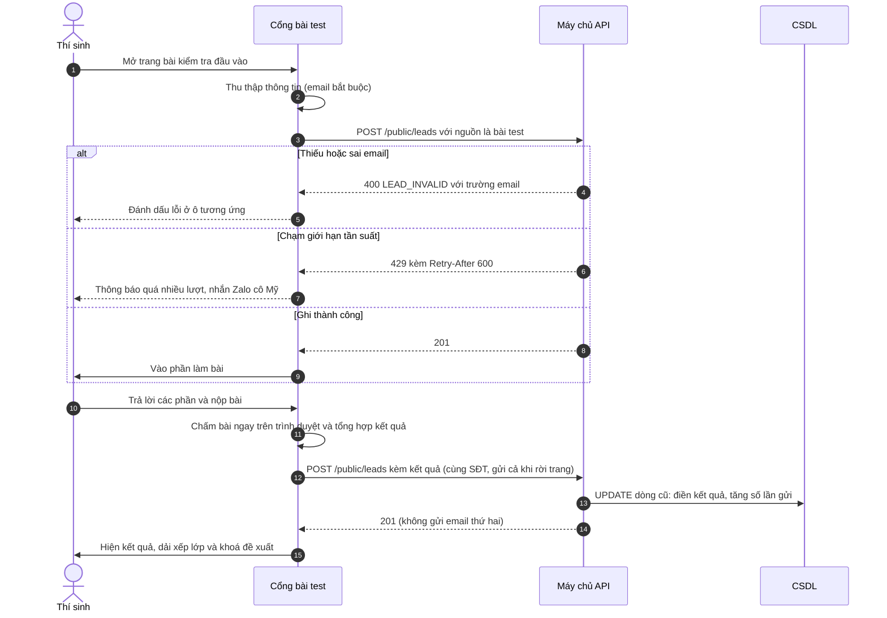
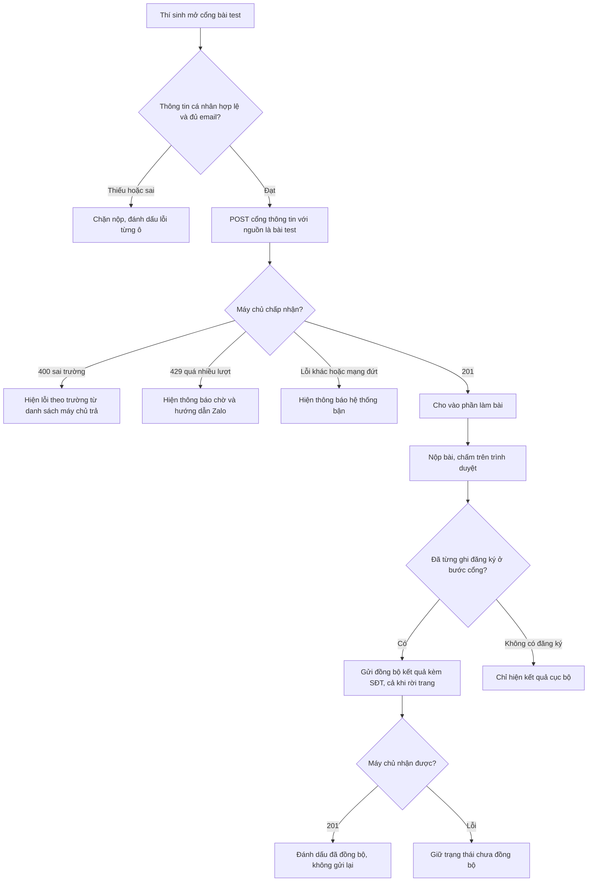
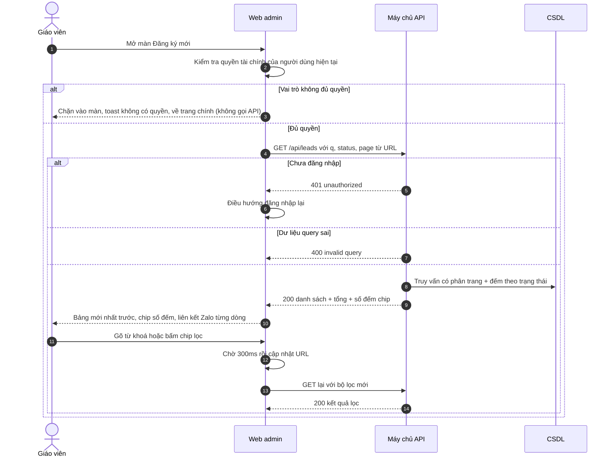
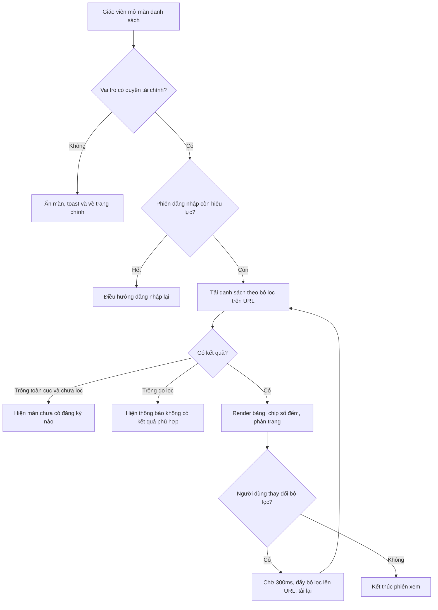
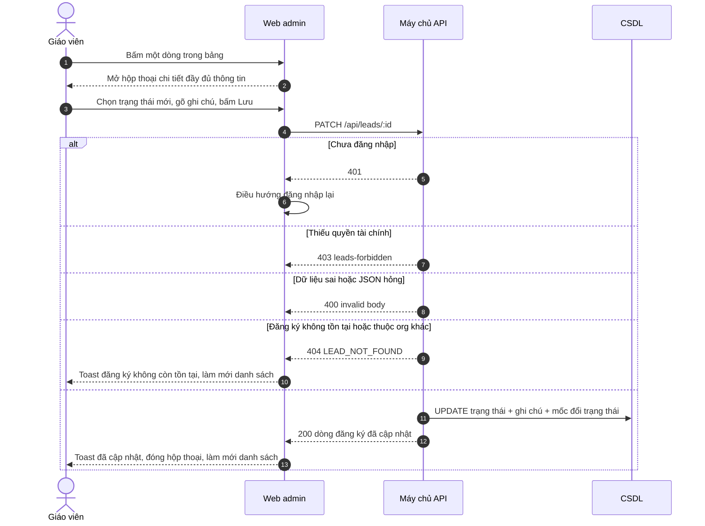
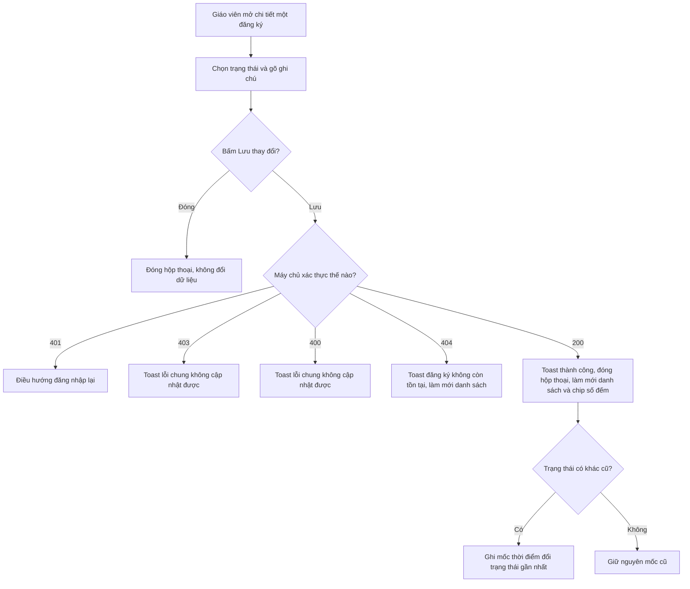

# Luồng nghiệp vụ — leads (mỗi luồng: sequenceDiagram + flowchart TD)

## F1 — Gửi đăng ký từ trang landing công khai

Bằng chứng chính: [S19] apps/profile/public/index.html:1614-1712; [S1] apps/server/src/routes/public-leads.ts:92-367; [S11] apps/server/src/lib/lead-notify.ts:23-109.

## F2 — Cổng bài kiểm tra đầu vào & đồng bộ kết quả

Bằng chứng chính: [S20] apps/profile/public/kiem-tra-dau-vao/lead-gate.js:132-284; [S21] apps/profile/public/kiem-tra-dau-vao/test.js:1029-1135, 1478-1512; [S1] apps/server/src/routes/public-leads.ts:230-235.

## F3 — Giáo viên tra cứu danh sách đăng ký

Bằng chứng chính: [S12] apps/web/src/routes/_auth/leads/index.tsx:147-279, 286-465; [S2] apps/server/src/routes/leads.ts:64-142; [S16] apps/web/src/lib/use-finance-route-guard.ts:12-31.

## F4 — Giáo viên cập nhật trạng thái và ghi chú

Bằng chứng chính: [S12] apps/web/src/routes/_auth/leads/index.tsx:180-208, 470-603; [S2] apps/server/src/routes/leads.ts:144-187.

