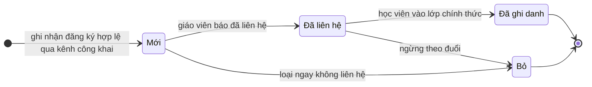

# Vòng đời trạng thái — lead

Nguồn enum: [S4] packages/api/src/lead-contracts.ts:131-144 (`LEAD_STATUSES`
= new / contacted / enrolled / dropped) và [S3] packages/db/src/schema/lead.ts:7
(mirror cùng union). Trạng thái khởi tạo "new": [S3] packages/db/src/schema/lead.ts:36,
[S1] apps/server/src/routes/public-leads.ts:215.

Chú giải hành vi thật của code (quan trọng):

- ✅ Bốn trạng thái là toàn bộ tập giá trị hợp lệ ở cả lớp hợp đồng lẫn cột
  trạng thái trong bảng. [S4] packages/api/src/lead-contracts.ts:131-137; [S3] packages/db/src/schema/lead.ts:7, 36
- ✅ Điểm vào vòng đời duy nhất là trạng thái "Mới" khi ghi nhận hợp lệ; nhánh
  trường bẫy/bot không tạo trạng thái nào (không ghi dữ liệu).
  [S1] apps/server/src/routes/public-leads.ts:215, 158-166
- ✅ Gộp trùng theo SĐT không đổi trạng thái (update không đụng cột trạng thái).
  [S1] apps/server/src/routes/public-leads.ts:249-261; [S6] apps/server/src/routes/public-leads.test.ts:292-324
- 🟡 Code KHÔNG ràng buộc chuyển tiếp: lệnh cập nhật chấp nhận mọi cặp chuyển
  giữa 4 trạng thái (kể cả đi lùi enrolled→new, hoặc enrolled→dropped), vì body
  chỉ kiểm giá trị thuộc enum rồi ghi thẳng. [S2] apps/server/src/routes/leads.ts:171-181; [S4] packages/api/src/lead-contracts.ts:250-256
- 🟡 Không có trạng thái "kết thúc" cứng: mọi trạng thái đều có thể bị cập nhật
  tiếp — hai nhánh về điểm kết thúc trong sơ đồ trên là quy ước nghiệp vụ suy
  ra (🔵: nhãn "Đã ghi danh"/"Bỏ" mang nghĩa chốt ở bản đồ nhãn và màu hiển thị),
  không phải ràng buộc code. [S4] packages/api/src/lead-contracts.ts:139-144; [S12] apps/web/src/routes/_auth/leads/index.tsx:96-101
- 🟡 Mốc "thời điểm đổi trạng thái gần nhất" chỉ ghi khi giá trị trạng thái
  thay đổi; UI chưa hiển thị mốc này (Gap-L01). [S2] apps/server/src/routes/leads.ts:171-179

OQ liên quan: OQ-L04 (có cần máy trạng thái cưỡng chế?).
