# srs/materials-reverse-flows — materials

Bảy luồng khớp danh mục F1-F7 ở spec Mục 9. Mỗi luồng có sơ đồ sequence + flowchart
(F1 flowchart bổ sung sequence truy vấn; F3/F6 gộp một sequence đại diện). Nhãn sơ đồ
viết ASCII không dấu. Nhãn: ✅ code khẳng định, 🔵 suy luận ≥2 bằng chứng, 🟡 kèm OQ.

## F1 — Duyệt và tìm kiếm ngân hàng tài liệu (UC-01)

Nguồn: apps/web/src/routes/_auth/materials/index.tsx:58-98,161-208,265-385;
apps/web/src/lib/repos/materials.ts:281-340; apps/server/src/routes/materials.ts:161-174,989-1030.

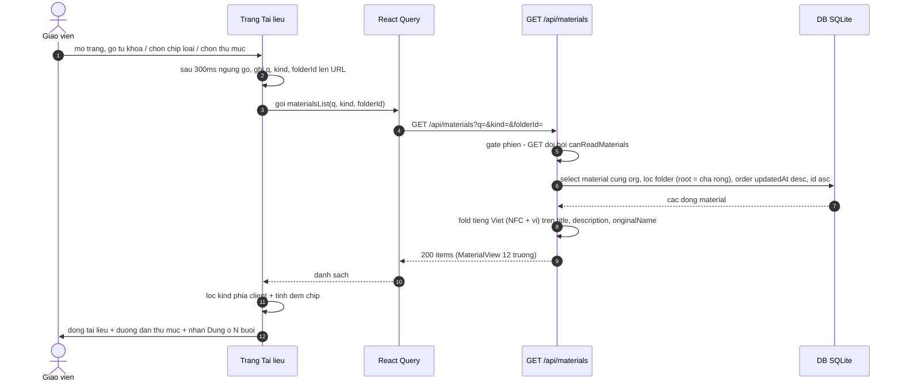

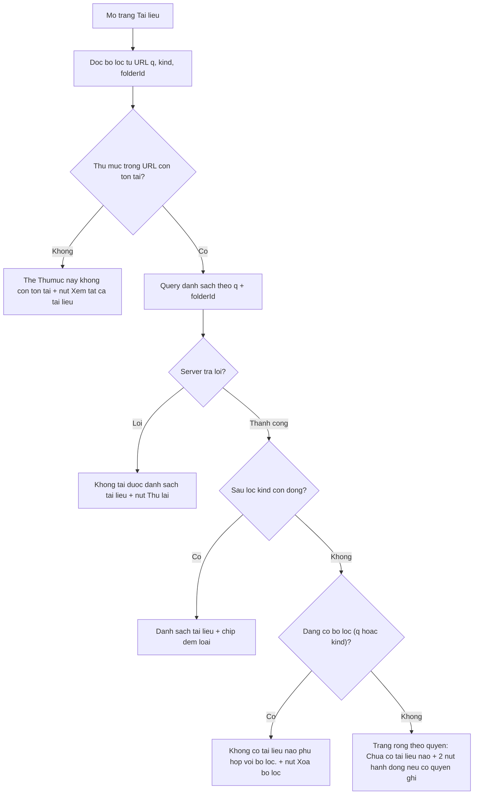

- ✅ Bộ lọc sống trong URL qua validateSearch, chuẩn hóa giá trị lạ —
  apps/web/src/routes/_auth/materials/index.tsx:72-98; debounce 300ms :161-178.
- ✅ Server lọc theo org phiên, `folderId=root` map cha-rỗng, sắp mới-sửa trước,
  từ khóa > 100 ký tự → 400, kind lạ → 400 — apps/server/src/routes/materials.ts:989-1030.
- ✅ Tìm tiếng Việt không dấu-hoa hạ ở SERVER bằng fold JS (lower() của SQLite chỉ
  hạ ASCII, "Đề" không khớp "đề") — materials.ts:1015-1026 (comment nguyên văn).
- ✅ Lọc chip loại chạy phía CLIENT trên danh sách đã lấy; đếm chip tính client —
  apps/web/src/routes/_auth/materials/index.tsx:105-113,193-208.
- ✅ 5 trạng thái khung (lỗi / rỗng-không-lọc / rỗng-có-lọc / thư mục-mất / có
  bộ lọc) đúng wording — :185-191,302-385.

## F2 — Tải file lên (UC-04, và đường thẳng vào buổi trong F4)

Nguồn: apps/web/src/components/materials/material-dialogs.tsx:350-433;
apps/web/src/lib/repos/materials.ts:224-271; packages/api/src/material-contracts.ts:303-330,141-173;
apps/server/src/routes/materials.ts:302-432,1067-1098,1295-1356.

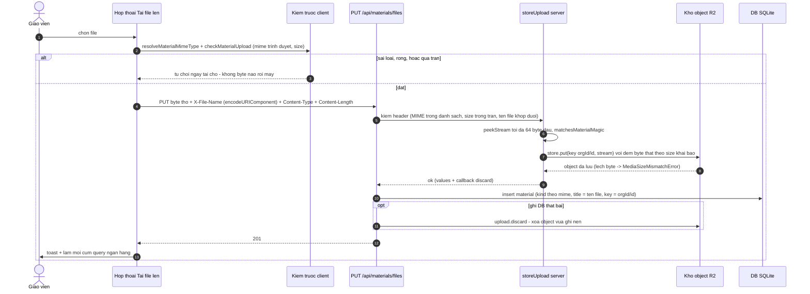

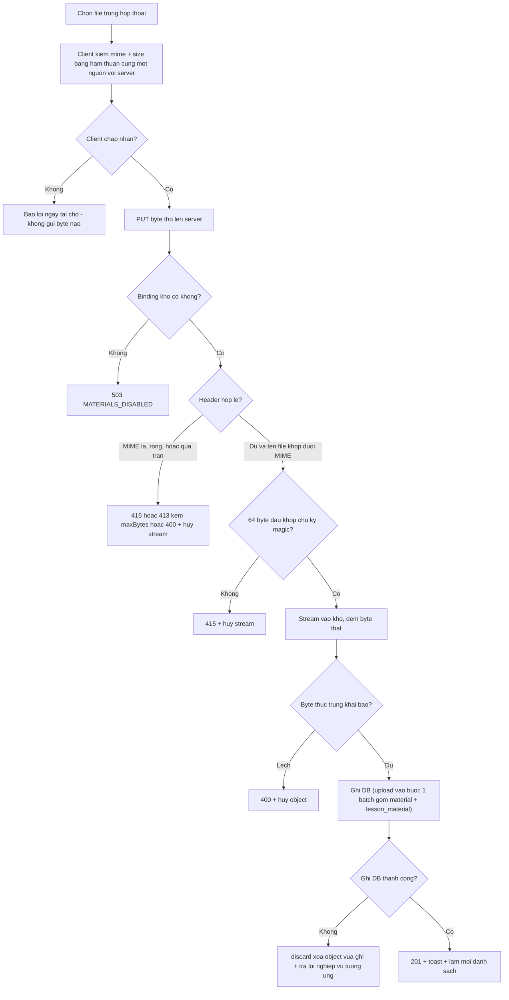

- ✅ Client kiểm TRƯỚC bằng chính hàm thuần server dùng (một nguồn sự thật) —
  packages/api/src/material-contracts.ts:4-8; apps/web/src/lib/repos/materials.ts:224-260;
  test chặn trước khi gửi apps/web/src/routes/_auth/materials/index.test.tsx:274-291.
- ✅ Chuỗi kiểm server: header → sanitize tên + khớp đuôi → peek 64 byte magic →
  đếm byte thật; mọi nhánh chặn cancel() stream trước khi trả lỗi —
  apps/server/src/routes/materials.ts:302-432 (cancel :338,365,369,390,394,411).
- ✅ Trần theo loại: tài liệu 25 MiB, audio-video 95 MiB (#647) —
  packages/api/src/material-contracts.ts:18-26.
- ✅ Ghi DB lỗi → discard object nền (inBackground); thư mục bị xóa giữa chừng →
  404 — apps/server/src/routes/materials.ts:403-404,429-430,1084-1091.
- ✅ Kích thước thực ≠ khai báo → 400 (kho đếm byte thật, không tin header) —
  apps/server/src/lib/media-store.ts:33-52; test materials.test.ts:2029-2302.

## F3 — Quản lý thư mục (UC-02)

Nguồn: apps/web/src/routes/_auth/materials/index.tsx:503-665;
apps/web/src/components/materials/material-dialogs.tsx:118-250;
apps/web/src/components/materials/folder-select.tsx:1-55;
apps/server/src/routes/materials.ts:677-985.

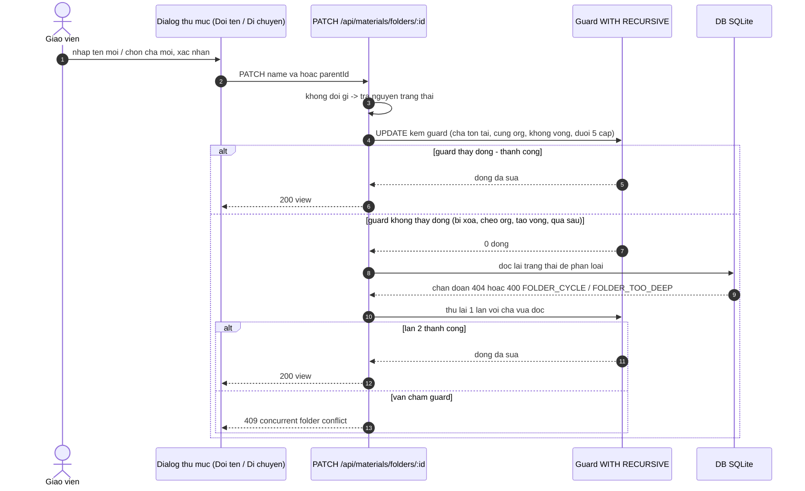

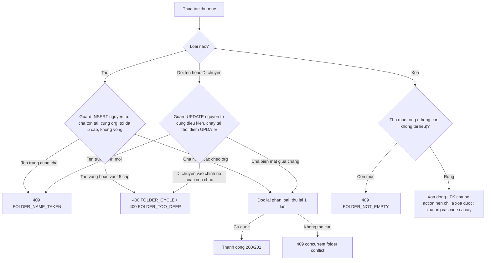

- ✅ Guard nguyên tử bằng WITH RECURSIVE (anc/sub, max(depth)+max(level) ≤ 5,
  CTE sub loại cạnh quay về chính id để thư mục kẹt vòng tự phục hồi được di
  chuyển ra) — apps/server/src/routes/materials.ts:677-756.
- ✅ Thua race: đọc lại phân loại (404 / FOLDER_CYCLE / FOLDER_TOO_DEEP), thử lại
  1 lần, lần 2 vẫn fail → 409 "concurrent folder conflict"; catch nameTaken → 409 —
  :758-792,800-855,857-950.
- ✅ Xóa chỉ-khi-rỗng, kiểm lại khi FK chặn (mục mới chen giữa lúc kiểm và xóa) —
  :952-985.
- ✅ Client: dialog di chuyển loại trừ chính subtree đang di chuyển —
  apps/web/src/components/materials/folder-select.tsx:23-38;
  apps/web/src/lib/material-folders.ts:64-84.
- 🔵 Thư mục kẹt vòng lịch sử (dữ liệu cũ) vẫn hiện trong cây ở gốc —
  apps/web/src/lib/material-folders.ts:33-62 + test ứng dụng
  apps/web/src/routes/_auth/materials/index.test.tsx (describe #646) + guard SQL
  cho phép move ra ngoài (:727-736) → cơ chế tự phục hồi 3 lớp.

## F4 — Tài liệu của buổi học (UC-08)

Nguồn: apps/web/src/components/class-detail/session-materials-modal.tsx:1-283;
apps/server/src/routes/materials.ts:434-653,1207-1386;
apps/server/src/lib/session-curriculum-materials.ts:1-174.

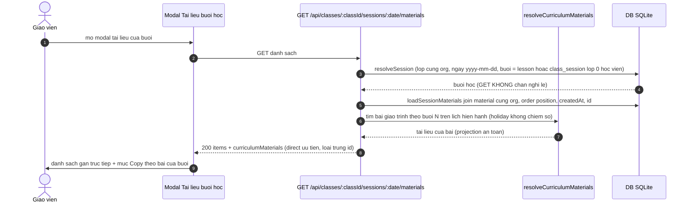

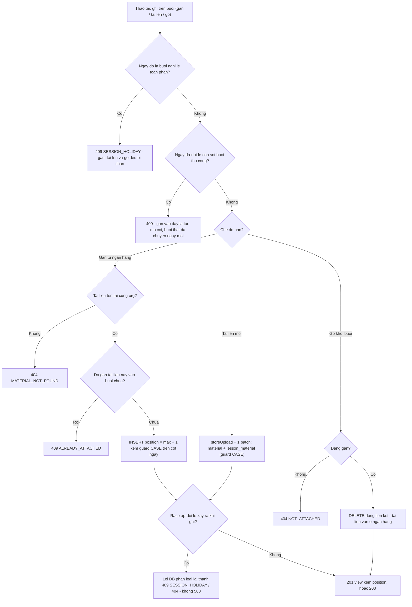

- ✅ GET không chặn holiday (comment "modal đang mở vẫn render") trong khi
  POST/PUT/DELETE chặn — apps/server/src/routes/materials.ts:573-575,1239-1242.
- ✅ Ba lớp guard: isHolidayBucket (#645, đếm lesson holiday/non-holiday, buổi
  thủ công lớp-0-học-viên coi là all-holiday #658), isShiftedHolidayBucket (#662),
  holidayBucketDateGuard CASE chặn race ngay ở cột NOT NULL — :434-550,544-550;
  comment 6 bề mặt drift :477-486.
- ✅ Gắn lặp-an-toàn: onConflictDoNothing → inserted rỗng → 409 ALREADY_ATTACHED —
  :1270-1288.
- ✅ Upload thẳng buổi: db.batch một lần cho material + lesson_material — :1316-1334.
- ✅ Gỡ KHÔNG đòi còn lesson (liên kết mồ côi sau xóa buổi vẫn gỡ được) —
  :1358-1366 (comment + requireLesson false).
- ✅ curriculumMaterials: mapping buổi N ↔ bài N theo lịch hiện hành, dedupe
  direct-ưu-tiên — apps/server/src/lib/session-curriculum-materials.ts:113-174;
  materials.ts:1218-1228.

## F5 — Mở / tải file tài liệu (UC-07)

Nguồn: apps/web/src/components/materials/material-item.tsx:67-107;
apps/web/src/lib/repos/materials.ts:401-404; apps/server/src/routes/materials.ts:1182-1203;
apps/server/src/lib/material-file-response.ts:1-112.

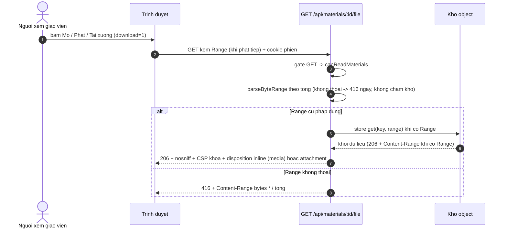

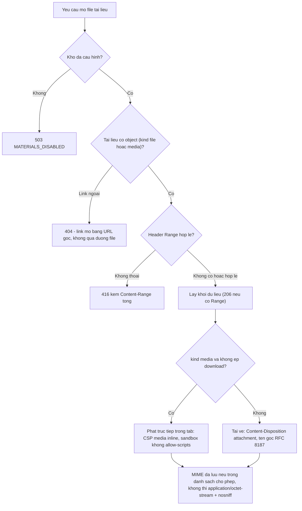

- ✅ MỘT dải Range: 206 kèm Content-Range (:100-103); Range không thoả → 416
  kèm `bytes */tổng` (:62-67) — apps/server/src/lib/material-file-response.ts:45-56.
- ✅ inline CHỈ khi kind media và không `?download=1`; tài liệu luôn attachment;
  STRICT_CSP cho file thường, INLINE_MEDIA_CSP (không allow-scripts) cho media —
  :14-34,90-112.
- ✅ Header khóa: nosniff, no-referrer, coop same-origin, cache riêng tư — :27-34.
- ✅ Nút theo loại ở client: link mở tab mới (noopener), media Phát + Tải xuống,
  file chỉ Tải xuống — apps/web/src/components/materials/material-item.tsx:67-107.
- ✅ Kho thiếu → 503 — apps/server/src/routes/materials.ts:1184-1187.

## F6 — Xóa tài liệu (UC-06; xóa thư mục theo F3)

Nguồn: apps/web/src/components/materials/material-dialogs.tsx:513-574;
apps/server/src/routes/materials.ts:139-150,265-286,1135-1180.

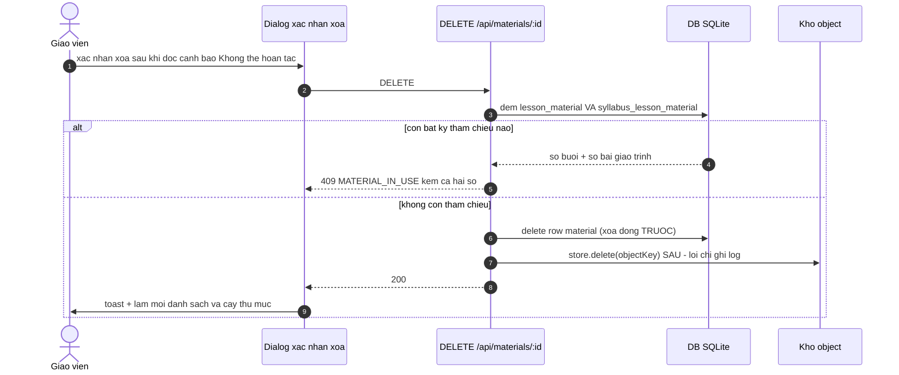

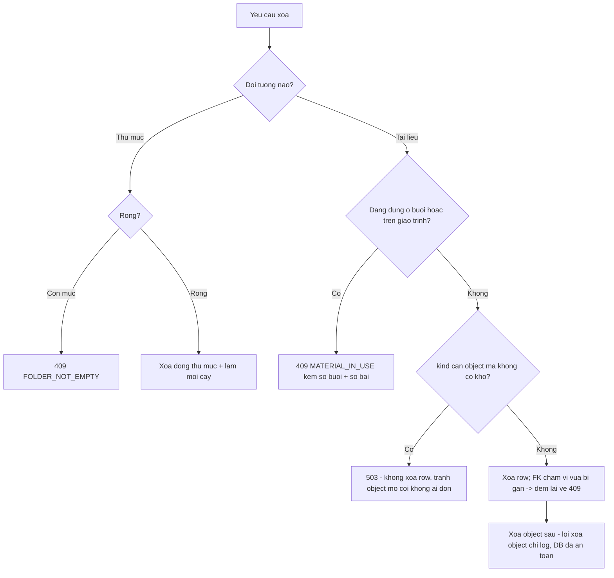

- ✅ Đếm CẢ HAI bảng tham chiếu khi chặn xóa (#655) kèm 2 số trong payload lỗi —
  apps/server/src/routes/materials.ts:265-286,1147-1153;
  packages/api/src/material-contracts.ts (MaterialRequestError fields ở client
  apps/web/src/lib/repos/materials.ts:35-62).
- ✅ Thứ tự row-trước-object là quyết định thiết kế có comment — :139-150
  ("xóa object trước sẽ để row trỏ object đã mất").
- ✅ Lỗi xóa object không làm API thất bại — :1167-1178 (catch chỉ log).
- 🔵 Nhãn "Dùng ở N buổi" trên danh sách CHỈ đếm lesson_material — người dùng có
  thể thấy "Chưa dùng ở buổi nào" nhưng xóa vẫn bị chặn vì giáo trình (bất đối
  xứng hiển thị/chặn) — materials.ts:67-68 vs :265-286 → OQ-02.

## F7 — Học viên đọc tài liệu buổi học (UC-09)

Nguồn: apps/server/src/routes/student-materials.ts:1-222;
apps/student/src/components/class/lesson-materials.tsx:1-221;
packages/api/src/material-contracts.ts:476-497.

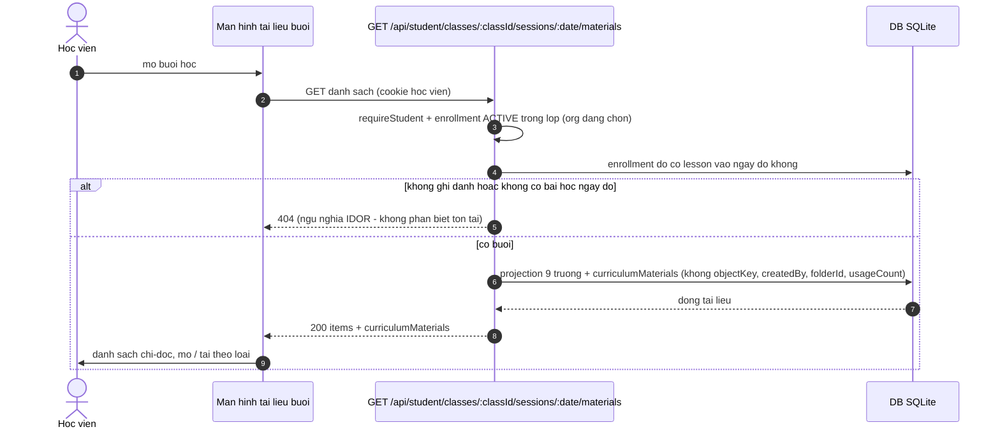

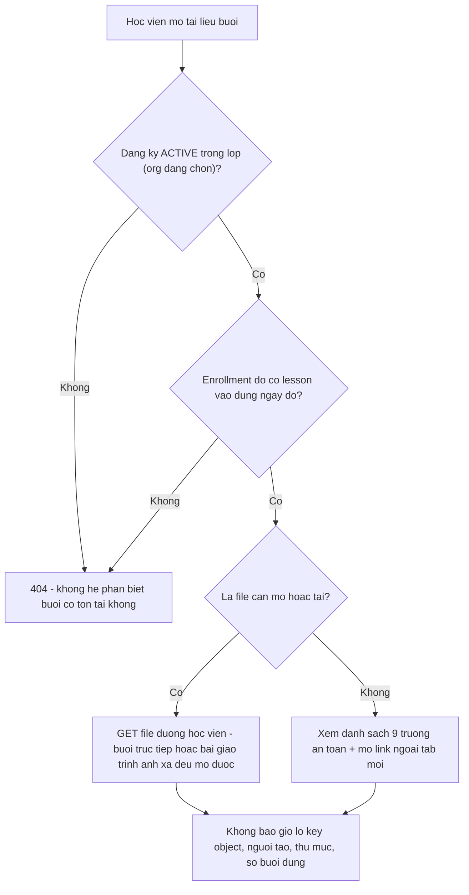

- ✅ Guard kép (enrollment active + lesson ngày đó) → 404, comment "ngữ nghĩa
  IDOR như /classes/:classId" — apps/server/src/routes/student-materials.ts:28-34,44-75.
- ✅ Projection an toàn tách bạch: StudentLessonMaterialView 9 trường, không
  teacher-only; cột objectKey/createdBy ghi chú teacher-only ngay trong schema —
  packages/api/src/material-contracts.ts:476-490;
  packages/db/src/schema/material.ts:50-58.
- ✅ File học viên: kho thiếu 503; sai id/ngoài buổi → 404; Range như giáo viên —
  apps/server/src/routes/student-materials.ts:132-219.
- ✅ Tài liệu giáo trình ánh xạ buổi vẫn mở được dù không có dòng liên kết —
  :150-190 (resolve lại danh sách rồi tìm id).
