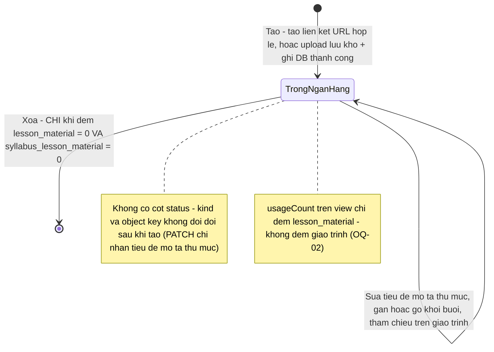
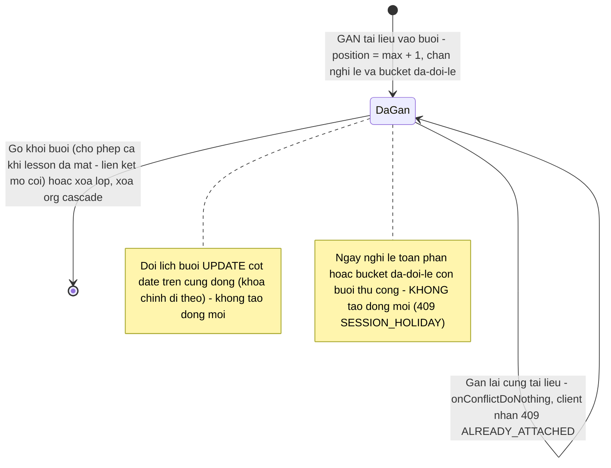
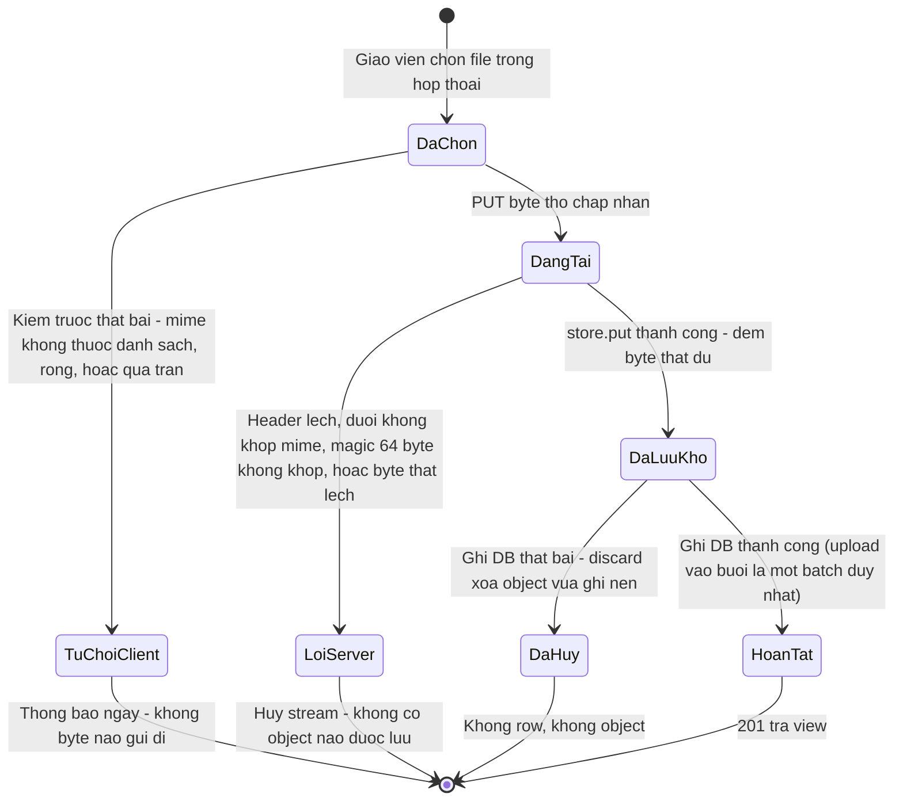

# srs/materials-reverse-states — materials

KHÔNG có cột trạng thái (status) nào trong 4 bảng của feature — mọi "trạng thái"
đều SUY TỪ sự tồn tại của dòng và số dòng tham chiếu, hoặc là tiến trình ngắn của
một request. Ba máy dưới đây là đủ; phần cuối liệt kê các máy KHÔNG tồn tại.

## 1. Vòng đời tài liệu trong ngân hàng (material)

Tài liệu không có trạng thái nghiệp vụ: nó chỉ "tồn tại" hoặc "đã xóa". Điều gì
được phép xảy ra phụ thuộc SỐ THAM CHIẾU (đếm lúc chạy, không lưu cột):

Chứng thực:

- PATCH tài liệu chỉ nhận title/description/folderId, schema "nothing to update" —
  packages/api/src/material-contracts.ts:398-413; apps/server/src/routes/materials.ts:1100-1133. ✅
- Xóa bị chặn khi đếm cả hai bảng > 0; đếm phải query lúc xóa (không có cột đếm) —
  apps/server/src/routes/materials.ts:265-286,1139-1153. ✅
- Không có soft-delete (negative-search #8) → "[*]" là xóa vĩnh viễn. ✅

## 2. Liên kết buổi học (lesson_material)

Dòng liên kết định danh cứng (classId, date, materialId); "di chuyển buổi" là
UPDATE ngày trên chính dòng (không xóa-tạo lại):

Chứng thực:

- PK (class_id, date, material_id); comment "dời buổi kéo theo `date` ở đây" —
  packages/db/src/schema/material.ts:93-127 (PK :120-123).
- Gắn: position coalesce(max,-1)+1, guard CASE, conflict → 409 —
  apps/server/src/routes/materials.ts:655-657,1262-1293.
- Gỡ: requireLesson:false + rejectHoliday:true — :1358-1366. ✅
- Xóa lớp cascade, xóa material no action — packages/db/src/schema/material.ts:106-113. ✅

## 3. Tiến trình upload một file (stream request)

Máy trạng thái NGẮN tồn tại trong một request PUT (không lưu đâu cả); hai điểm
hủy đều để lại KHÔNG tháng gì:

Chứng thực:

- Client chặn trước bằng hàm thuần chung; lỗi không gửi byte —
  apps/web/src/lib/repos/materials.ts:224-260; test
  apps/web/src/routes/_auth/materials/index.test.tsx:274-291. ✅
- Mọi nhánh chặn server cancel() stream TRƯỚC khi trả lỗi —
  apps/server/src/routes/materials.ts:338,365,369,390,394,411. ✅
- store.put lỗi mismatch → 400; discard chạy inBackground — :403-430. ✅
- Batch nguyên tử khi upload vào buổi — :1316-1334. ✅

## 4. Các máy KHÔNG tồn tại

- KHÔNG máy duyệt (nháp/chờ/đã-duyệt) — tạo là sống ngay; không cột trạng thái
  nào trong 4 bảng (packages/db/src/schema/material.ts:1-164). ✅
- KHÔNG thùng rác / khôi phục — xóa cứng, dialog nói "Không thể hoàn tác."
  (negative-search #8; apps/web/src/components/materials/material-dialogs.tsx:566-568). ✅
- KHÔNG máy "liên-kết-còn-sống/chết" — URL chỉ kiểm hình thức lúc tạo, không có
  job kiểm (negative-search #6; OQ-06). ✅
- KHÔNG máy chuyển đổi định dạng (transcode) — file phục vụ đúng byte đã lưu,
  đúng MIME đã lưu (apps/server/src/lib/material-file-response.ts:70-112). ✅
- KHÔNG quyền riêng theo thư mục — quyền là vai toàn cục, cây dùng chung mọi
  giáo viên (packages/db/src/schema/material.ts:16-17; OQ-07). ✅
- KHÔNG cờ bật/tắt runtime — feature luôn hiển thị (negative-search #1). ✅
