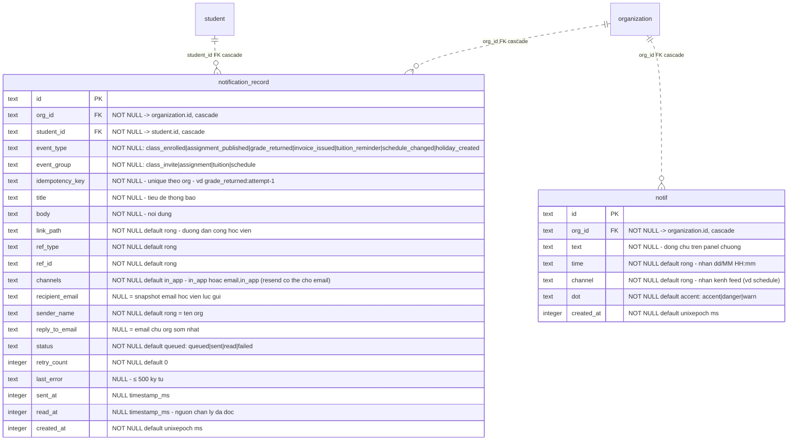

# srs/notifications-teacher-reverse-erd — notifications-teacher

Feature chạm ĐÚNG 2 schema thông báo; ERD dưới đây đối chiếu cả hai để không nhầm bảng:

- `notification_record` (packages/db/src/schema/notification-record.ts:19-72) — nhật ký MỖI THÔNG BÁO CHO 1 HỌC VIÊN, phục vụ cả email lẫn in-app. **Là bảng của feature này** (màn [5] đọc và gửi lại trên bảng này).
- `notif` (packages/db/src/schema/notif.ts:8-26) — feed thông báo cấp ORG đọc-only ("Read-only notification feed for the current product surface"), 1 dòng = 1 dòng chữ trên panel chuông topbar qua kernel snapshot. **KHÔNG phải nguồn của màn /notifications** (negative-search NEG-5). Giữ ở đây chỉ để đối chiếu và làm ranh giới.

FK ghi ở đây là FK schema-level (`references` + ON DELETE cascade); `notif` và `notification_record` KHÔNG có quan hệ nào với nhau (không FK, không cột tham chiếu chéo).

Index + unique của `notification_record` (schema thật — packages/db/src/schema/notification-record.ts:56-71; migration packages/db/src/migrations/0048_small_champions.sql:27-29):

- `notification_record_org_idempotency_key (org_id, idempotency_key)` — UNIQUE; khóa chống gửi trùng, enqueue dùng `onConflictDoNothing` (apps/server/src/lib/notifications/enqueue.ts:72-77).
- `notification_record_org_created_idx (org_id, created_at, id)` — phục vụ sort `created_at desc, id desc` của màn nhật ký.
- `notification_record_org_student_created_idx (org_id, student_id, created_at)` — phục vụ inbox học viên (GET /api/student/inbox).

Index của `notif` (packages/db/src/schema/notif.ts:23-25): `notif_org_created_idx (org_id, created_at, id)`.

Quan hệ tham chiếu ngoài feature (không đặc tả lại): `notification_record.student_id → student.id` (join lấy `student.name` cho cột Người nhận — apps/server/src/routes/notification-logs.ts:121); `student.email` đọc khi enqueue (apps/server/src/lib/notifications/enqueue.ts:31-38) và khi resend (apps/server/src/lib/notifications/requeue.ts:116, apps/server/src/lib/notifications/requeue.ts:206).

Nơi GHI duy nhất của `notification_record` trong apps/server/src: `enqueueNotifications` (apps/server/src/lib/notifications/enqueue.ts:72-77) — mọi route nghiệp vụ đi qua nó (trực tiếp: kernel.ts:653, kernel.ts:1228, kernel.ts:3464; gián tiếp qua `emitNotifications`/`notify`: kernel.ts:340-345 + grading.ts:1116 + assignments/index.ts:184 + holidays.ts:659). Update (không INSERT): deliver.ts:193-227, requeue.ts:110-127, requeue.ts:200-217, student.ts:830-836 (read_at), kernel.ts:283-302 (deliverSingleClassInviteSync).

Nơi GHI của `notif`: chỉ 2 callsite trong feature lịch nghỉ — apps/server/src/routes/holidays.ts:594-601 (apply) và apps/server/src/routes/holidays.ts:969-977 (hoàn tác). ĐỌC: apps/server/src/routes/reporting/loaders.ts:32-50 (snapshot `notifs`, apps/server/src/routes/snapshot.ts:350) và GET /api/notifs (apps/server/src/routes/reporting/index.ts:38-40).

Migration 0060 (packages/db/src/migrations/0060_study_pack.sql:1) xóa sạch dòng `event_type = 'self_study_released'` — event type đã bị gỡ khỏi enum hiện tại (7 loại, packages/api/src/contracts.ts:3896-3904); đây là dấu vết 1 event type cũ, chi tiết ở reverse-gaps (NEG-6).
