# srs/notifications-teacher-reverse-flows — notifications-teacher

Mỗi flow có CẢ HAI diagram (sequence + flowchart). Chỉ vẽ bước có trong code; bước suy đoán không vẽ, ghi ở reverse-gaps. Wording người dùng trích NGUYÊN VĂN từ throw-site/render.

Ghi chú về kiểm thử mermaid: 14/14 khối PASS; 25 cảnh báo NGHĨA còn lại đều là node terminal không có cạnh đi tiếp trong flowchart (điểm kết thúc thật của luồng: toast, empty-state, return lỗi, 404, hộp thoại đóng) — không phải thiếu bước.

## F1 — Xem nhật ký thông báo (GET /api/notification-logs)

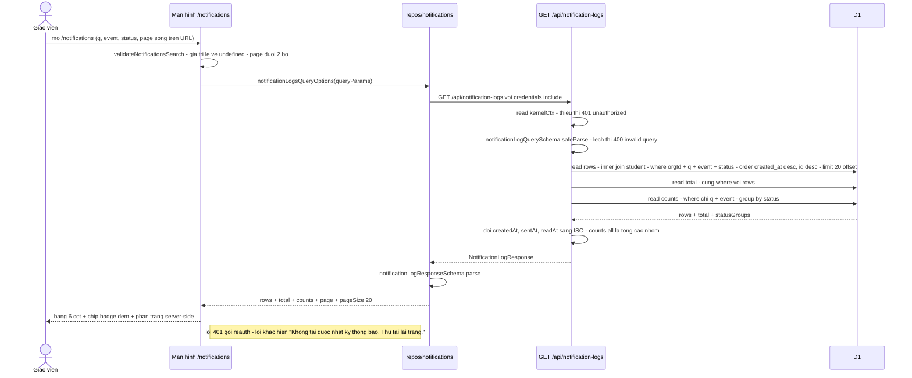

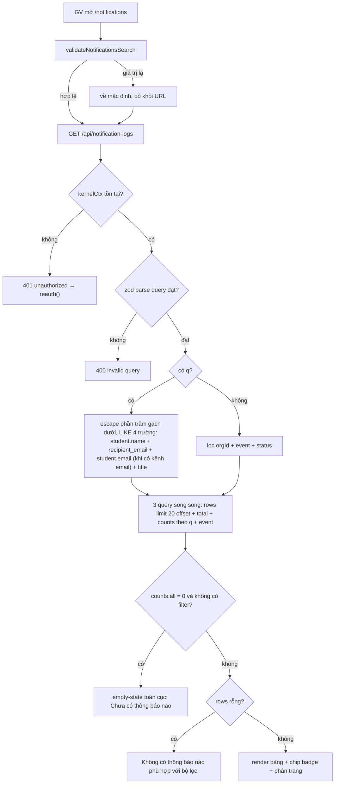

Nguồn: apps/server/src/routes/notification-logs.ts:71-189; apps/server/src/lib/notifications/requeue.ts:19-59; packages/api/src/contracts.ts:3946-3987; apps/web/src/routes/_auth/notifications/index.tsx:56-90, apps/web/src/routes/_auth/notifications/index.tsx:186-204, apps/web/src/routes/_auth/notifications/index.tsx:319-345, apps/web/src/routes/_auth/notifications/index.tsx:368-450; apps/web/src/lib/repos/notifications.ts:29-59; test: apps/server/src/routes/notification-logs.test.ts:169-317, apps/web/src/routes/_auth/notifications/index.test.tsx:128-318; E2E: apps/e2e/specs/notifications-ac-001.spec.ts:196-409.

## F2 — Xem chi tiết một thông báo (chỉ client)

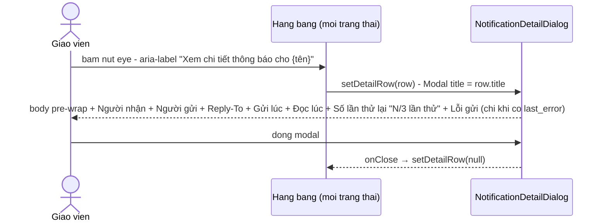

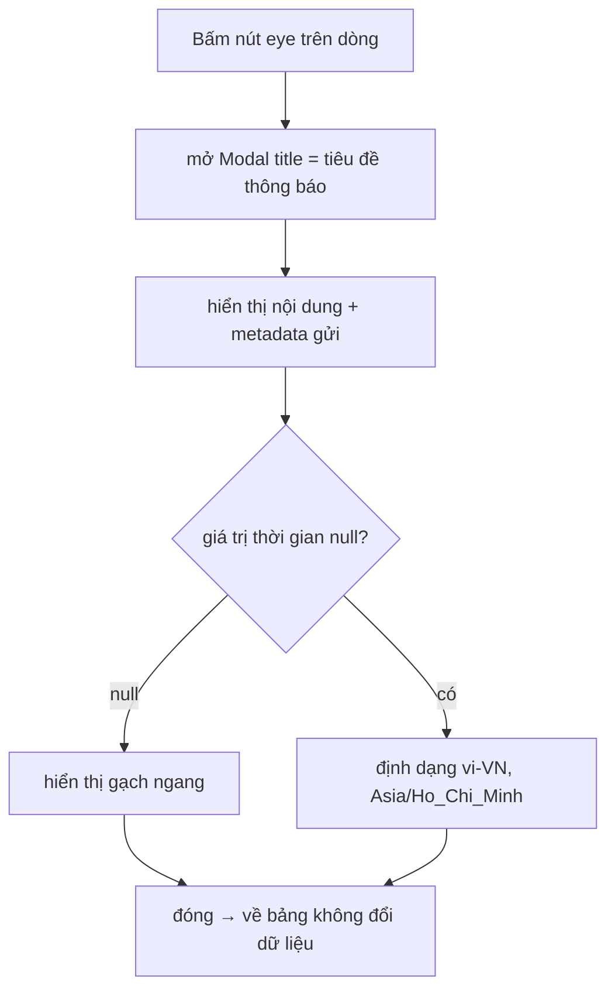

Nguồn: apps/web/src/routes/_auth/notifications/index.tsx:188, apps/web/src/routes/_auth/notifications/index.tsx:540-547, apps/web/src/routes/_auth/notifications/index.tsx:604-610; apps/web/src/components/notifications/notification-detail-dialog.tsx:35-89; test: apps/web/src/routes/_auth/notifications/index.test.tsx:224-272.

## F3 — Gửi lại một thông báo lỗi (POST /:id/resend)

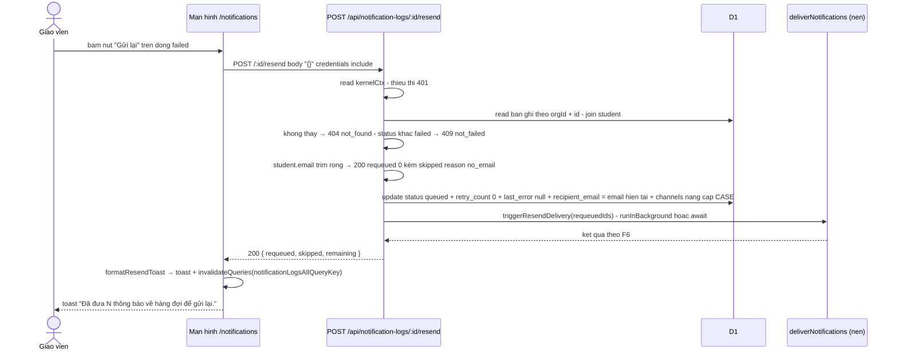

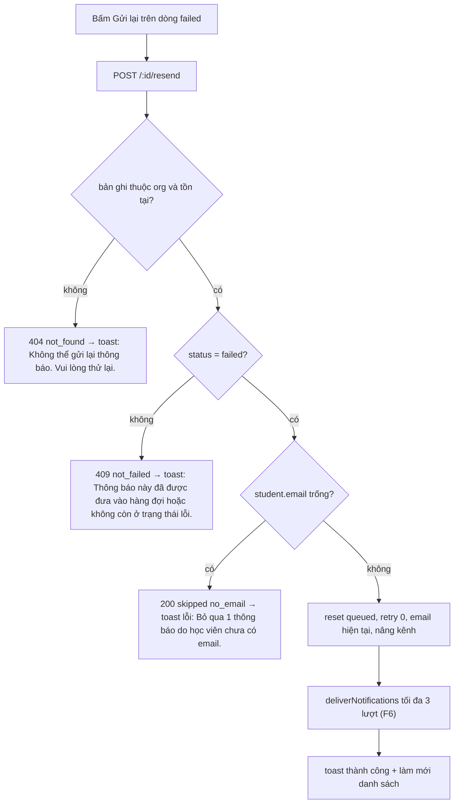

Nguồn: apps/server/src/routes/notification-logs.ts:50-69, apps/server/src/routes/notification-logs.ts:221-239; apps/server/src/lib/notifications/requeue.ts:61-142; apps/web/src/routes/_auth/notifications/index.tsx:147-168, apps/web/src/routes/_auth/notifications/index.tsx:206-231, apps/web/src/routes/_auth/notifications/index.tsx:523-539; test: apps/server/src/routes/notification-logs.test.ts:453-648, apps/server/src/routes/notification-logs.test.ts:769-802; E2E: apps/e2e/specs/notifications-ac-003.spec.ts:130-386.

## F4 — Gửi lại tất cả mục lỗi theo bộ lọc (POST /resend-failed)

```mermaid
sequenceDiagram
    actor GV as Giao vien
    participant Web as Man hinh /notifications
    participant Modal as Modal "Gửi lại tất cả thông báo lỗi?"
    participant API as POST /api/notification-logs/resend-failed
    participant DB as D1
    participant Del as deliverNotifications (nen)
    GV->>Web: thay nut "Gửi lại tất cả mục lỗi (N)" khi counts.failed > 0
    GV->>Modal: bam nut mo modal xac nhan
    alt Hủy
        GV->>Modal: Hủy
        Modal-->>Web: đóng - không gọi API
    else Xác nhận gửi lại
        GV->>Modal: "Xác nhận gửi lại"
        Modal->>API: POST /resend-failed body { q, event } - khong nhan status
        API->>API: read kernelCtx - 401; body JSON hỏng → 400 invalid json; lệch schema strict → 400 invalid body
        API->>DB: read eligible failed + email hợp lệ theo q + event - limit 50 mới nhất
        API->>DB: read tổng eligible + read danh sách no_email tách riêng
        API->>DB: update loạt queued + retry 0 + email hiện tại + nâng kênh - WHERE status failed
        API->>Del: triggerResendDelivery(requeuedIds)
        API-->>Web: 200 { requeued, skipped no_email, remaining = eligible - requeued }
        Web-->>GV: toast theo formatResendToast + đóng modal + làm mới
    end
```

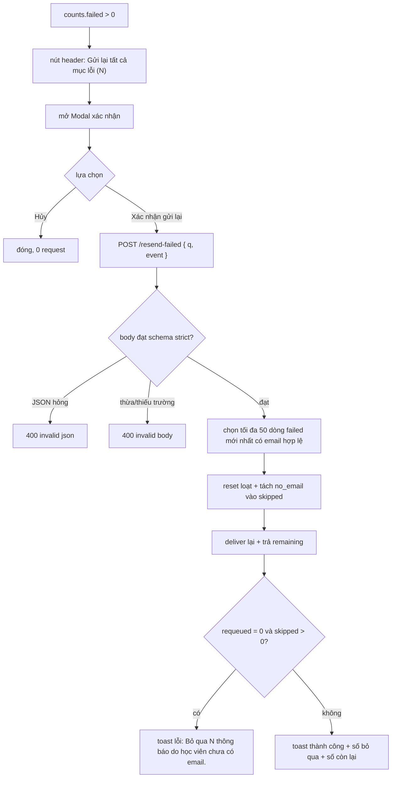

Nguồn: apps/server/src/routes/notification-logs.ts:191-219; apps/server/src/lib/notifications/requeue.ts:144-233; packages/api/src/contracts.ts:3989-4016; apps/web/src/routes/_auth/notifications/index.tsx:233-254, apps/web/src/routes/_auth/notifications/index.tsx:337-365, apps/web/src/routes/_auth/notifications/index.tsx:612-644; test: apps/server/src/routes/notification-logs.test.ts:319-452, apps/server/src/routes/notification-logs.test.ts:649-768; E2E: apps/e2e/specs/notifications-ac-003.spec.ts:130-386.

## F5 — Dòng nhật ký xuất hiện từ nghiệp vụ gốc (boundary — emit/enqueue)

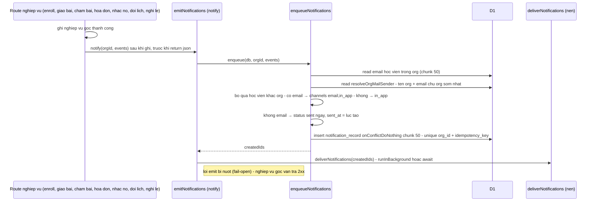

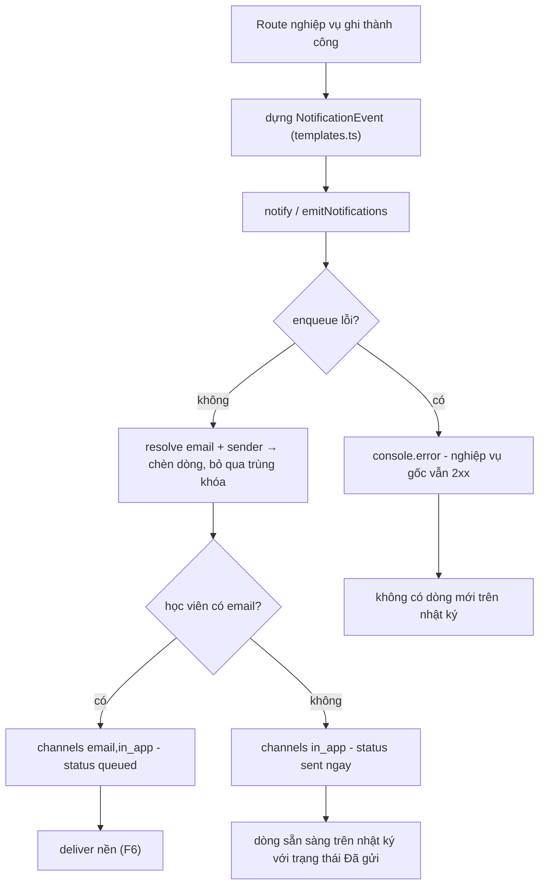

Nguồn: apps/server/src/routes/kernel.ts:337-345, apps/server/src/routes/kernel.ts:638-660, apps/server/src/routes/kernel.ts:1617-1626, apps/server/src/routes/kernel.ts:3101-3108, apps/server/src/routes/kernel.ts:3392-3480; apps/server/src/routes/grading.ts:1113-1131; apps/server/src/routes/assignments/index.ts:180-191; apps/server/src/routes/holidays.ts:636-671; apps/server/src/lib/notifications/emit.ts:61-91; apps/server/src/lib/notifications/enqueue.ts:20-80; apps/server/src/lib/notifications/templates.ts:40-193; apps/server/src/lib/notifications/org-mail-sender.ts:16-43; test: apps/server/src/kernel.test.ts:7446-7844, apps/server/src/lib/notifications/notifications.test.ts:33-516, apps/server/src/routes/debt-reminders.test.ts:1-395.

## F6 — Vòng gửi email tối đa 3 lượt (boundary — deliver)

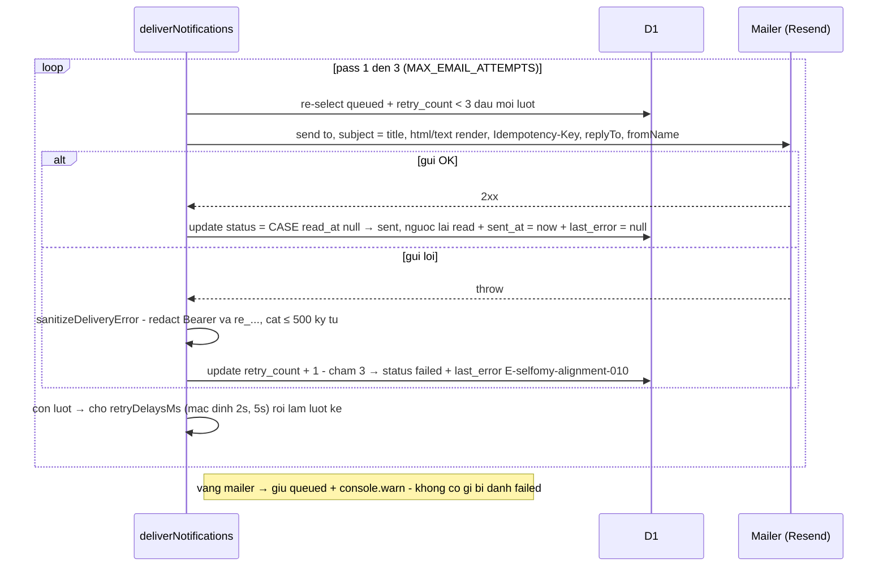

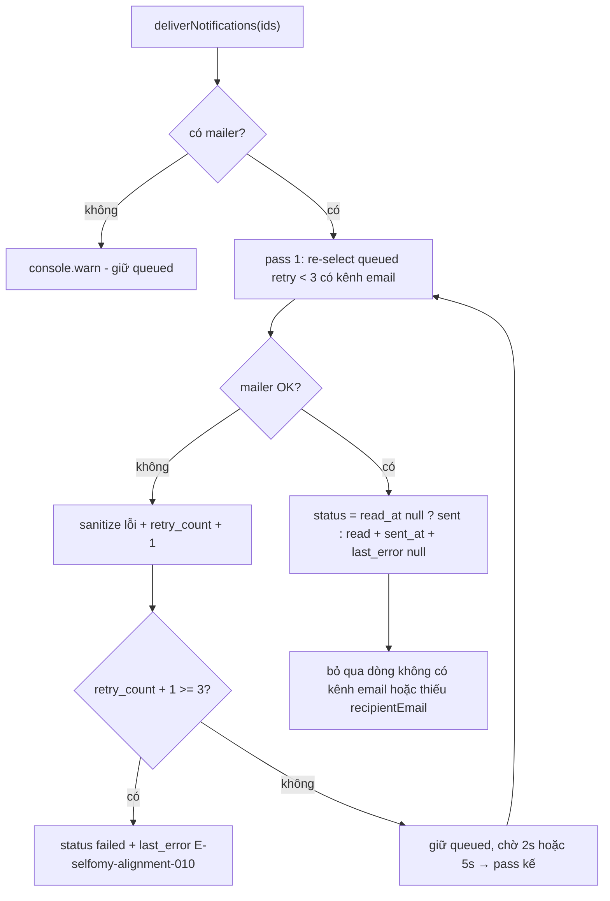

Nguồn: apps/server/src/lib/notifications/deliver.ts:12-53, apps/server/src/lib/notifications/deliver.ts:111-231; packages/api/src/contracts.ts:3940-3943; packages/auth/src/mail/mailer.ts:52-130; test: apps/server/src/lib/notifications/notifications.test.ts:180-463, apps/server/src/lib/notifications/notifications.test.ts:255-299; E2E: apps/e2e/specs/notifications-ac-002.spec.ts:91-241.

## F7 — Học viên đọc in-app → dòng nhật ký chuyển "Đã xem" (boundary)

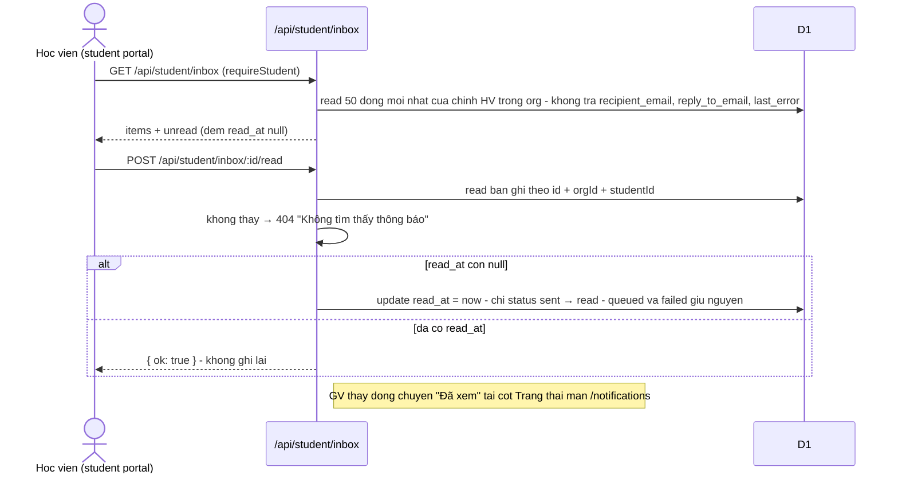

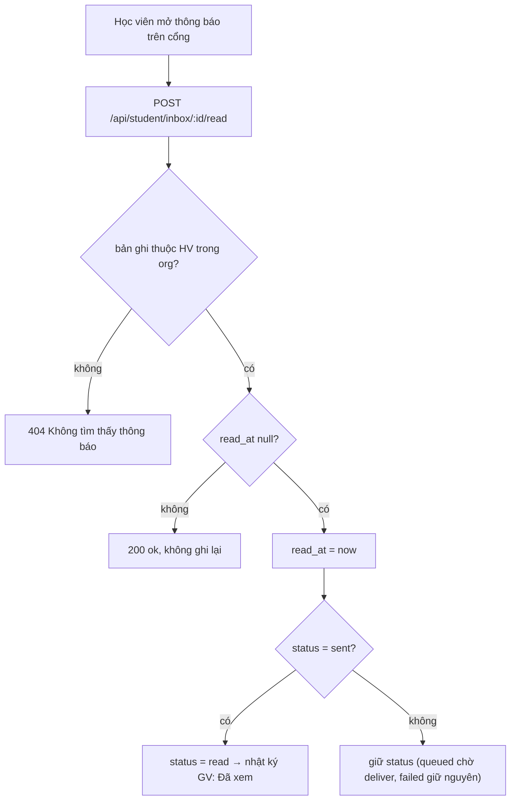

Nguồn: apps/server/src/routes/student.ts:755-841; packages/api/src/contracts.ts:4018-4036; apps/server/src/lib/notifications/deliver.ts:193-207; test: apps/server/src/routes/student-inbox.test.ts:1-329, apps/server/src/lib/notifications/notifications.test.ts:420-450.
