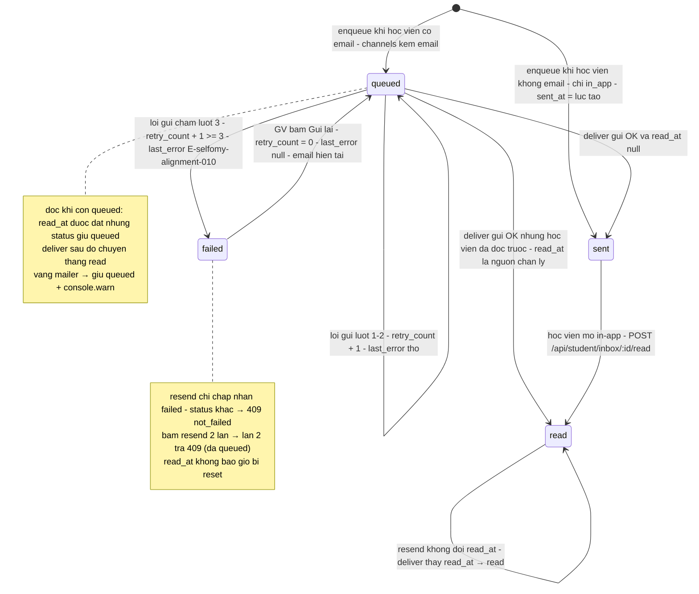
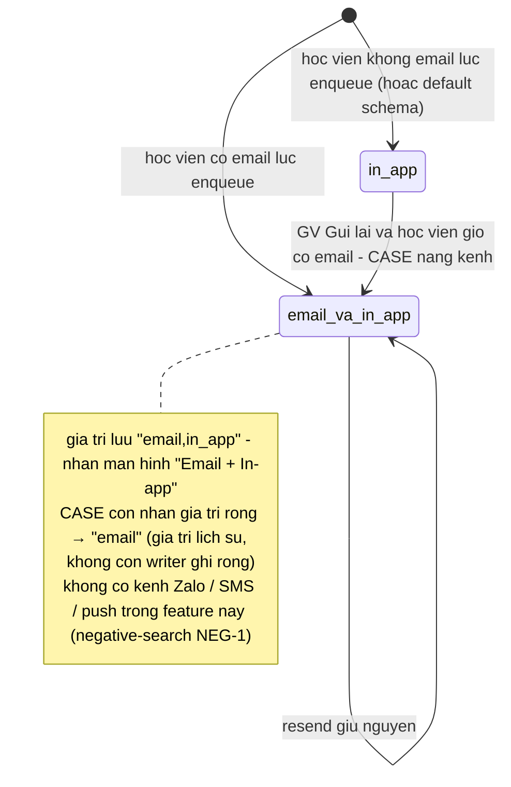
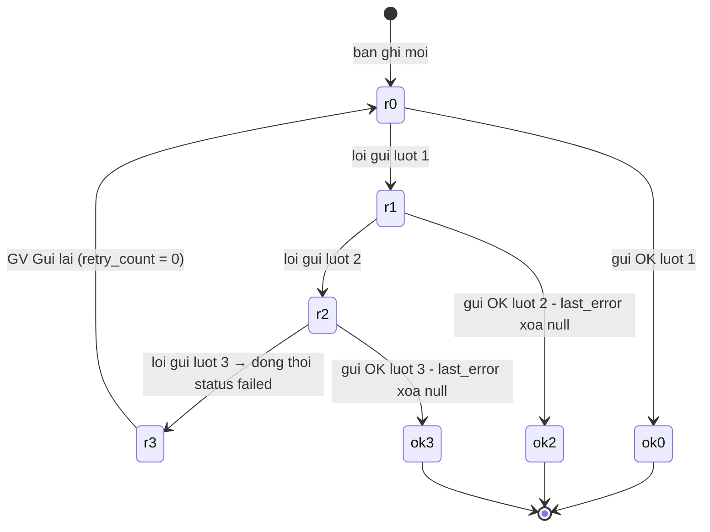
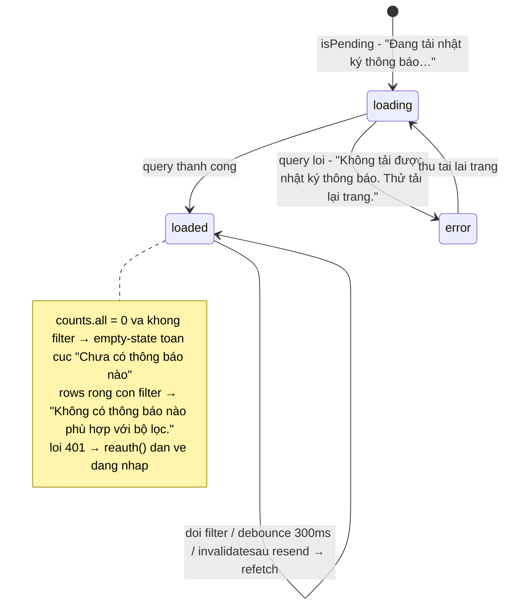

# srs/notifications-teacher-reverse-states — notifications-teacher

## 1. `notification_record.status` — máy trạng thái gửi (enum thật)

Enum: `queued | sent | read | failed` — packages/db/src/schema/notification-record.ts:44-47; packages/api/src/contracts.ts:3931-3937. Nhãn màn hình: `Đang chờ / Đã gửi / Đã xem / Lỗi gửi` — apps/web/src/components/notifications/notification-detail-dialog.tsx:8-16.

Chứng thực chuyển trạng thái:

- `queued → sent/read` khi gửi OK, CASE theo `read_at`: apps/server/src/lib/notifications/deliver.ts:193-207; test apps/server/src/lib/notifications/notifications.test.ts:180-217, apps/server/src/lib/notifications/notifications.test.ts:420-450.
- `queued → failed` chạm lượt 3 kèm `E-selfomy-alignment-010`: apps/server/src/lib/notifications/deliver.ts:211-227; test apps/server/src/lib/notifications/notifications.test.ts:255-299; E2E apps/e2e/specs/notifications-ac-002.spec.ts:91-241.
- `sent → read` qua route đọc in-app; `queued`/`failed` giữ nguyên status khi đọc: apps/server/src/routes/student.ts:822-839; test apps/server/src/routes/student-inbox.test.ts (mô tả test TOS-22 D5 — bản ghi failed giữ status).
- `failed → queued` qua resend, nguyên tử trên cùng dòng, không INSERT: apps/server/src/lib/notifications/requeue.ts:75-142, apps/server/src/lib/notifications/requeue.ts:151-233; test apps/server/src/routes/notification-logs.test.ts:453-555, apps/server/src/routes/notification-logs.test.ts:556-603.
- Sinh `sent` ngay khi chỉ in_app: apps/server/src/lib/notifications/enqueue.ts:63-65; test apps/server/src/lib/notifications/notifications.test.ts:130-154.

## 2. `notification_record.channels` — giá trị kênh thực tế

Cột là `text` không ràng buộc DB; 3 giá trị thực tế được ghi và hiển thị: `in_app` (default schema + enqueue khi không email), `email,in_app` (enqueue khi có email), `email` (chỉ xuất hiện từ giá trị rỗng qua CASE khi resend — không còn writer ghi giá trị rỗng mới). Nhãn màn hình: `Email / In-app / Email + In-app` — apps/web/src/routes/_auth/notifications/index.tsx:126-130.

Chứng thực: apps/server/src/lib/notifications/enqueue.ts:59; apps/server/src/lib/notifications/requeue.ts:117, apps/server/src/lib/notifications/requeue.ts:207; packages/db/src/schema/notification-record.ts:38-39; nhãn: apps/web/src/routes/_auth/notifications/index.tsx:126-130; negative-search NEG-1 (reverse-gaps.md).

## 3. `notification_record.retry_count` — bộ đếm lượt thử

Integer NOT NULL default 0 — packages/db/src/schema/notification-record.ts:48. Chỉ 2 điểm ghi: deliver tăng bằng SQL increment (apps/server/src/lib/notifications/deliver.ts:15-18, apps/server/src/lib/notifications/deliver.ts:211-227) và resend reset về 0 (apps/server/src/lib/notifications/requeue.ts:110-127, apps/server/src/lib/notifications/requeue.ts:200-217). Hiển thị `N/3 lần thử` (apps/web/src/components/notifications/notification-detail-dialog.tsx:82-84) và `sau N lần thử` (apps/web/src/lib/notification-error.ts:28).

## 4. Trạng thái màn `/notifications`

`isPending`/`error` của TanStack Query + dữ liệu trả về quyết định 4 hình thái hiển thị — apps/web/src/routes/_auth/notifications/index.tsx:319-345, apps/web/src/routes/_auth/notifications/index.tsx:368-450. Không có trạng thái lưu trữ; mọi chuyển đổi là tính được từ query + URL.

Chứng thực: apps/web/src/routes/_auth/notifications/index.tsx:196-204 (query + reauth 401), apps/web/src/routes/_auth/notifications/index.tsx:319-335 (loading/error), apps/web/src/routes/_auth/notifications/index.tsx:344-345 (điều kiện empty toàn cục), apps/web/src/routes/_auth/notifications/index.tsx:443-448 (filtered-empty); test: apps/web/src/routes/_auth/notifications/index.test.tsx:290-318.
