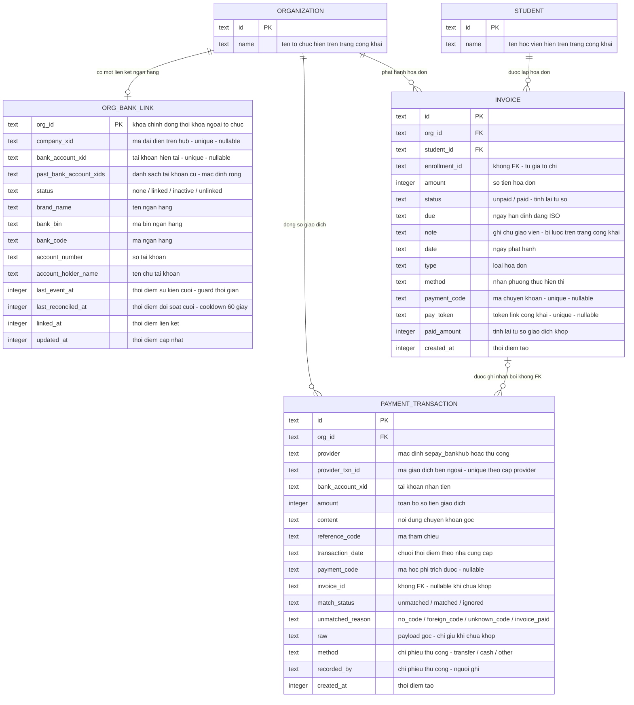

# online-payment — ERD tái lập (reverse)

> Khớp schema thật. ORGANIZATION và STUDENT chỉ liệt kê cột liên quan đến feature này (phần còn lại thuộc feature khác); ba bảng còn lại liệt kê ĐỦ cột theo schema.

**Ghi chú quan hệ:**
- `invoice_id` trên sổ giao dịch cố ý không có khóa ngoại — hồ sơ tài chính sống sót khi dòng tham chiếu bị xóa; tương tự `enrollment_id` trên hóa đơn. — ✅ [S7] `packages/db/src/schema/payment-transaction.ts:11-24`, `packages/db/src/schema/invoice.ts:12-17`.
- `paid_amount` trên hóa đơn không bao giờ cộng trực tiếp — luôn dựng lại từ tổng các dòng khớp. — ✅ [S7] `packages/db/src/schema/invoice.ts:19-24`; [S4] `apps/server/src/lib/payments/recompute-invoice.ts:5-6`.
- Khóa chống trùng duy nhất của cả feature: cặp nhà cung cấp + mã giao dịch bên ngoài (unique index). — ✅ [S7] `packages/db/src/schema/payment-transaction.ts:53-56`.
