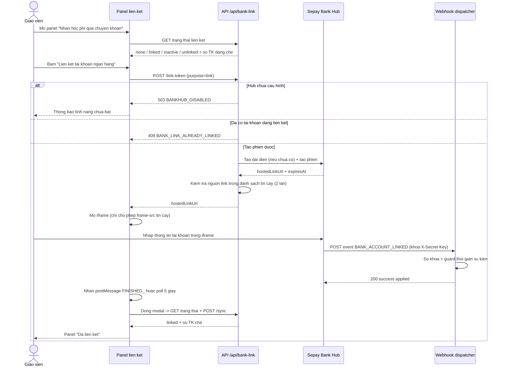
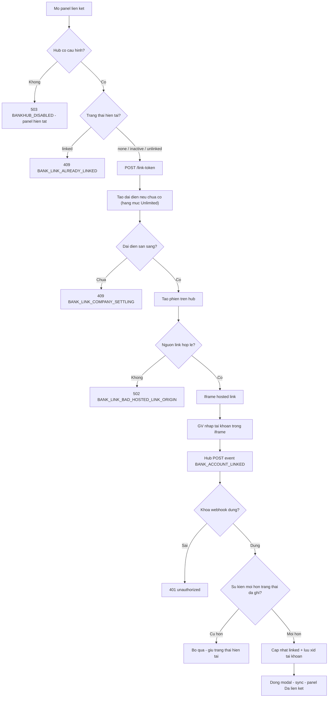
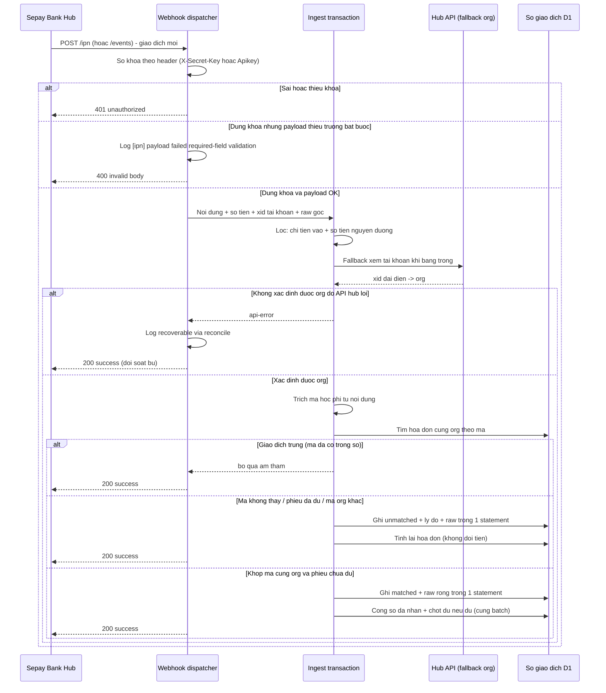
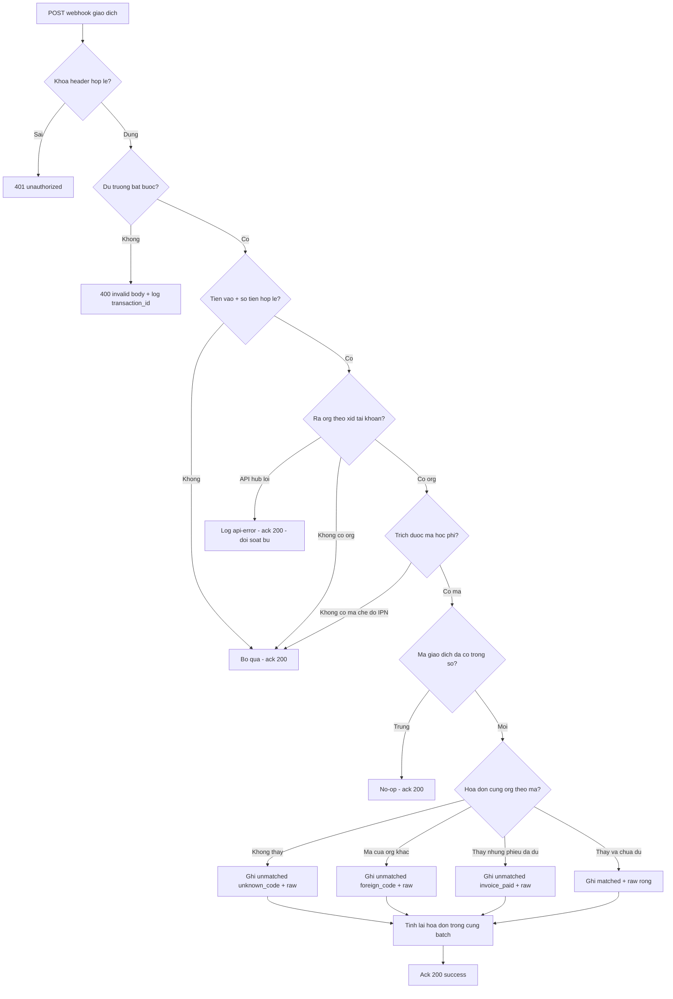
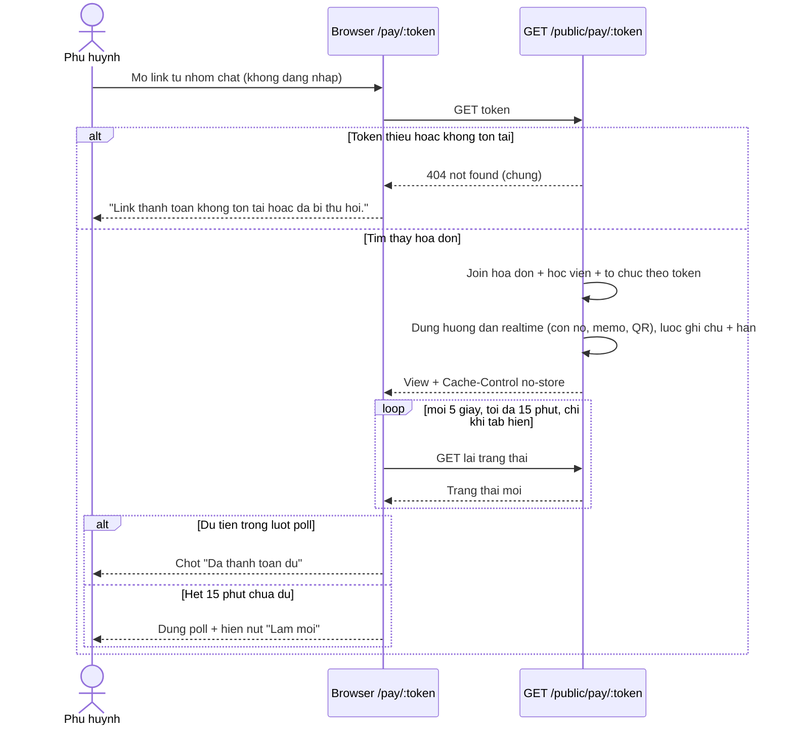
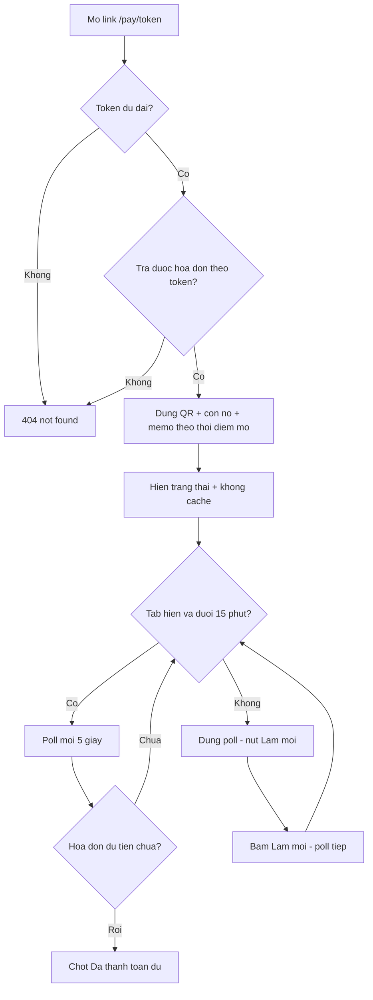
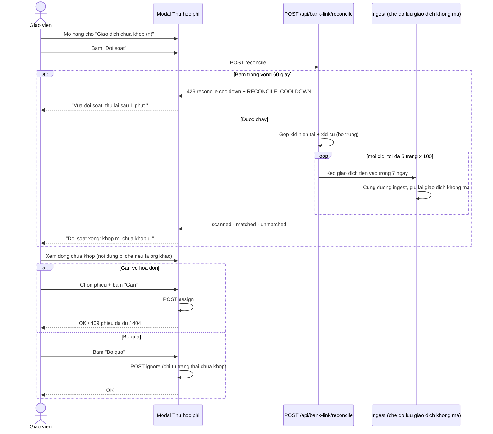
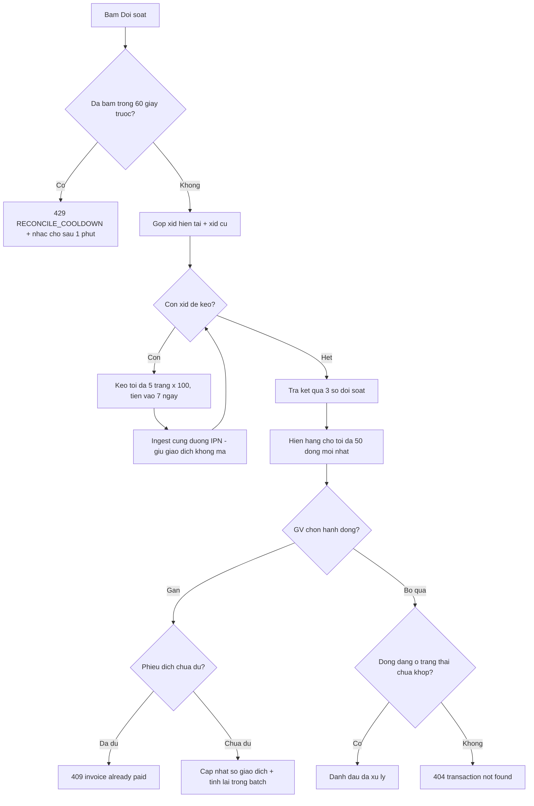
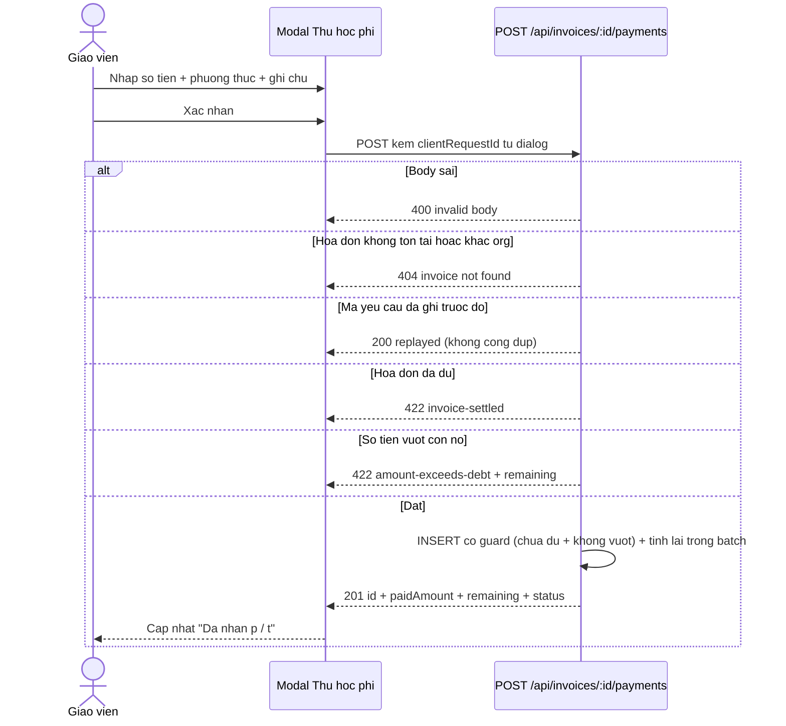
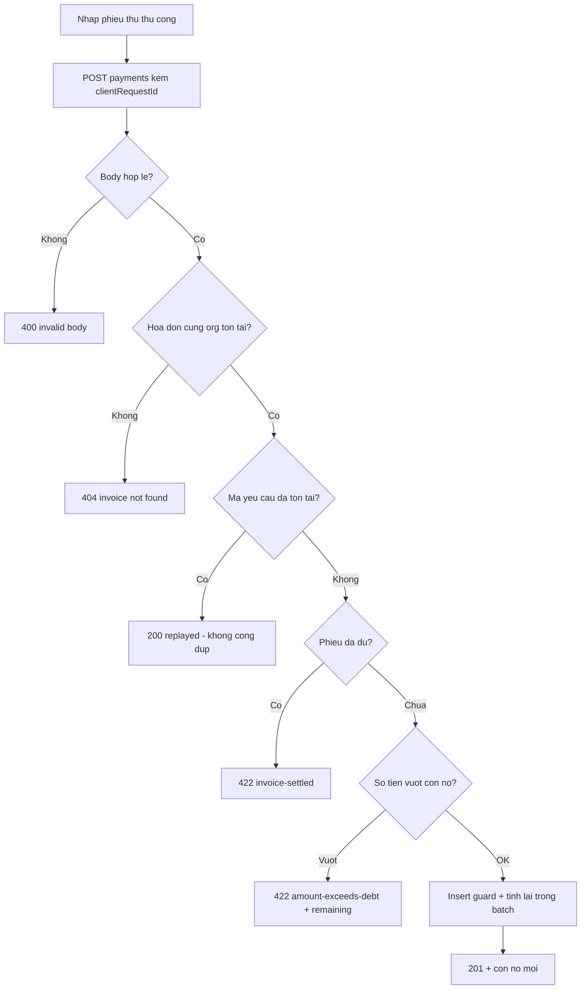

# online-payment — Flows tái lập (reverse)

> Quy ước: mọi nhãn đều truy vết được trong code (cite ở `_evidence.md`). Không vẽ bước không có trong code.

## Flow 1: Liên kết tài khoản ngân hàng (phiên hosted + sự kiện vòng đời)

### Sequence — Liên kết tài khoản ngân hàng

### Activity — Liên kết tài khoản ngân hàng

## Flow 2: Nhận giao dịch qua webhook (IPN) — nhiều chặng: verify → org → khớp → ghi sổ

### Sequence — Webhook giao dịch

### Activity — Webhook giao dịch

## Flow 3: Phụ huynh thanh toán qua link công khai

### Sequence — Trang thanh toán công khai

### Activity — Trang thanh toán công khai

## Flow 4: Đối soát thủ công và hàng chờ giao dịch chưa khớp

### Sequence — Đối soát + hàng chờ

### Activity — Đối soát + hàng chờ

## Flow 5: Thu học phí thủ công (ranh giới so sánh với luồng ngân hàng)

### Sequence — Thu học phí thủ công

### Activity — Thu học phí thủ công

