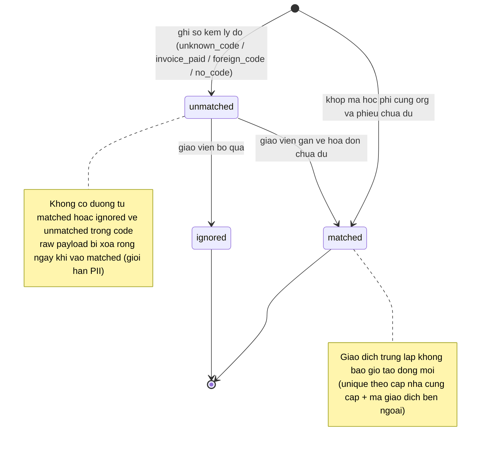
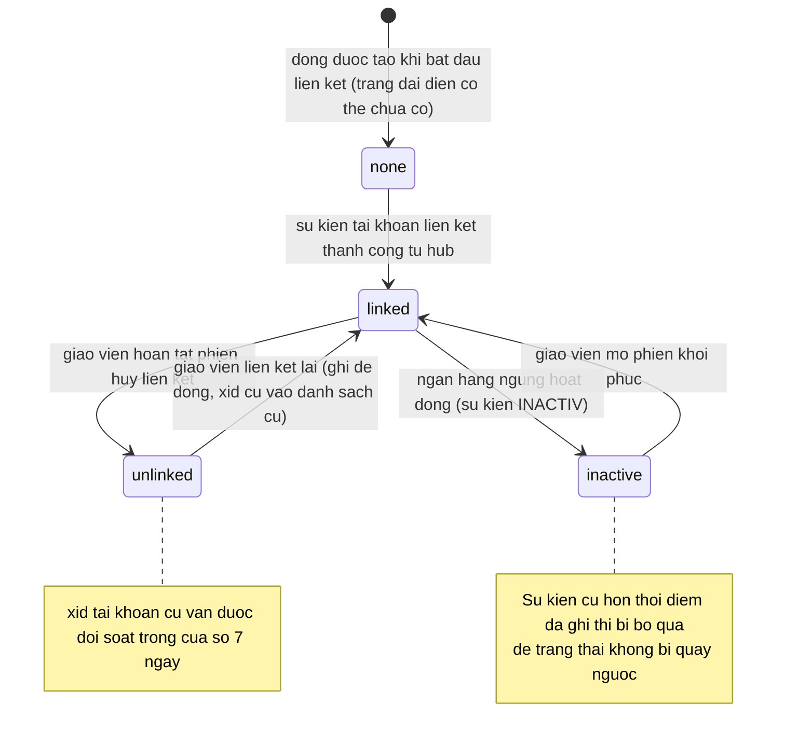

# online-payment — States tái lập (reverse)

## State 1: Vòng đời một dòng sổ giao dịch (theo giá trị `match_status` thật)

> Nguồn: [S7] `packages/db/src/schema/payment-transaction.ts:41` (default "unmatched"), [S4] `apps/server/src/lib/payments/ingest-transaction.ts:58-138` (các đường vào), `apps/server/src/routes/payment-transactions.ts:117-149` (assign/ignore). — ✅

**Các đường "không tạo dòng" (skipped — không phải trạng thái):** không phải tiền vào; số tiền không phải số nguyên dương; không có mã ở chế độ IPN; không xác định được tổ chức. — ✅ [S4] `apps/server/src/lib/payments/ingest-transaction.ts:58-65,86`.

**Bảng trạng thái:**

| Trạng thái (giá trị thật) | Ý nghĩa | Vào bằng | Ra bằng | Nguồn | Nhãn |
|---|---|---|---|---|---|
| `unmatched` | Đã ghi sổ nhưng chưa đụng hóa đơn; giữ raw để điều tra/đối soát | Khớp thất bại có org (4 lý do) hoặc đối soát kéo về không mã | Gán (→ matched) hoặc bỏ qua (→ ignored) | `apps/server/src/lib/payments/ingest-transaction.ts:103-130`; `apps/server/src/routes/payment-transactions.ts:117-149` | ✅ |
| `matched` | Đã đếm vào số đã nhận của một hóa đơn; raw rỗng | Khớp mã ngay lúc ingest, hoặc gán tay từ unmatched | Không có đường ra trong code | `apps/server/src/lib/payments/ingest-transaction.ts:117-122`; `apps/server/src/lib/payments/recompute-invoice.ts:19-38` | ✅ |
| `ignored` | Giáo viên quyết không xử lý | Chỉ từ unmatched (else 404) | Không có đường ra trong code | `apps/server/src/routes/payment-transactions.ts:132-149` | ✅ |

**Lý do chưa khớp (giá trị thật):** `no_code` (chỉ từ đối soát), `foreign_code` (mã tổ chức khác — nội dung bị che ở DTO), `unknown_code` (mã không tồn tại), `invoice_paid` (phiếu đã đủ trước khi tiền về). — ✅ [S4] `apps/server/src/lib/payments/ingest-transaction.ts:123-130`; nhãn UI [S13] `apps/web/src/components/modals/invoice-payment-modal.tsx:254-259`.

## State 2: Vòng đời liên kết tài khoản ngân hàng (giá trị `status` thật: none/linked/inactive/unlinked)

> Nguồn: [S7] `packages/db/src/schema/org-bank-link.ts:10-17,30` (docblock lifecycle + default "none"), [S5] `apps/server/src/lib/bank-hub/bank-link-service.ts:119-178` (sync), `:188-236` (applyAccountEvent), [S3] `apps/server/src/routes/bank-link.ts:152-249` (mở phiên). — ✅

**Bảng trạng thái:**

| Trạng thái (giá trị thật) | Ý nghĩa | Vào bằng | Ra bằng | Nguồn | Nhãn |
|---|---|---|---|---|---|
| `none` | Chưa liên kết | Tạo dòng khi mở phiên đầu | Sự kiện liên kết thành công | `packages/db/src/schema/org-bank-link.ts:30`; `apps/server/src/lib/bank-hub/bank-link-service.ts:188-236` | ✅ |
| `linked` | Đang nhận tiền | Sự kiện tài khoản hoặc đồng bộ từ hub | Ngừng hoạt động (bank-side) hoặc hủy (teacher) | `apps/server/src/lib/bank-hub/bank-link-service.ts:188-236` | ✅ |
| `inactive` | Ngân hàng ngừng hoạt động tài khoản | Sự kiện INACTIV từ hub (guard thời gian) | Khôi phục qua phiên reactivate | `apps/server/src/lib/bank-hub/bank-link-service.ts:188-236` | ✅ |
| `unlinked` | Giáo viên chủ động hủy | Phiên unlink hoàn tất | Liên kết lại (ghi đè row, giữ xid cũ) | `apps/server/src/lib/bank-hub/bank-link-service.ts:188-236`; `apps/server/src/routes/bank-link.ts:188-196` | ✅ |

## Trạng thái liên quan (ranh giới)

- Hóa đơn `unpaid → paid`: tính lại từ sổ, paid là trạng thái dính — thuộc feature `invoices`, chốt ở `apps/server/src/lib/payments/recompute-invoice.ts:29-32`. — ✅
- Phiếu thu thủ công không tạo trạng thái hóa đơn riêng — chỉ cộng `paid_amount` và ghi dòng sổ provider thủ công. — ✅ [S7] `packages/db/src/schema/payment-transaction.ts:11-24`.
