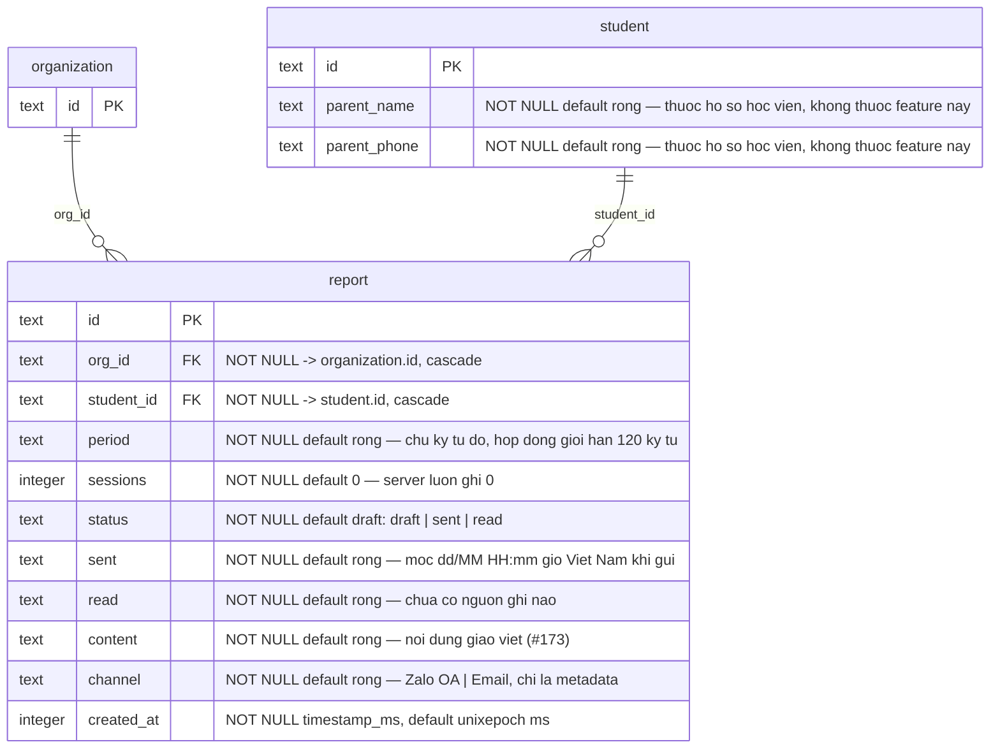

# srs/parent-reports-reverse-erd — parent-reports

Feature có ĐÚNG MỘT thực thể dữ liệu riêng: bảng `report`. student và organization
chỉ là tham chiếu FK (thuộc feature học viên/tổ chức) — vẽ tối thiểu để thể hiện
quan hệ, KHÔNG đặc tả sâu thuộc tính của feature khác. Kiểu cột khớp schema thật
(packages/db/src/schema/report.ts).

Chỉ mục (schema thật):

- `report_org_created_idx (org_id, created_at, id)` — danh sách theo tổ chức, cũ
  nhất trước — packages/db/src/schema/report.ts:31-34;
  packages/db/src/migrations/0005_mature_sasquatch.sql:37. ✅
- `report_student_idx (student_id)` — lọc theo học viên (dùng cho hồ sơ học viên khi
  cụm bật) — packages/db/src/schema/report.ts:33;
  packages/db/src/migrations/0005_mature_sasquatch.sql:38. ✅

Ghi chú quan hệ:

- Xóa organization hoặc student → xóa dây chuyền báo cáo (ON DELETE cascade) —
  packages/db/src/schema/report.ts:13-18. ✅
- `content` và `channel` thêm sau bởi migration 0015 (mặc định "") —
  packages/db/src/migrations/0015_high_wither.sql:1-2. ✅
- Danh sách hiển thị chỉ chọn 7 trường (không content/channel): nội dung chưa có chỗ
  xem lại — apps/server/src/routes/reporting/loaders.ts:13-22; OQ-09. ✅
- Ranh giới: `comment_bank` và `notif` được tạo trong CÙNG migration 0005 và cùng
  module server nhưng thuộc feature Chấm bài / Nhật ký thông báo — không vẽ vào đây —
  packages/db/src/migrations/0005_mature_sasquatch.sql:1-22,
  apps/server/src/routes/reporting/loaders.ts:32-62. ✅
- Bảng workspace_settings (tpl_report — template báo cáo cũ) đã MỘ #321, không thuộc
  mô hình dữ liệu đang sống của feature — packages/db/src/schema/settings.ts:6-10,23-26;
  packages/db/src/migrations/0016_real_butterfly.sql:6; OQ-07. ✅
