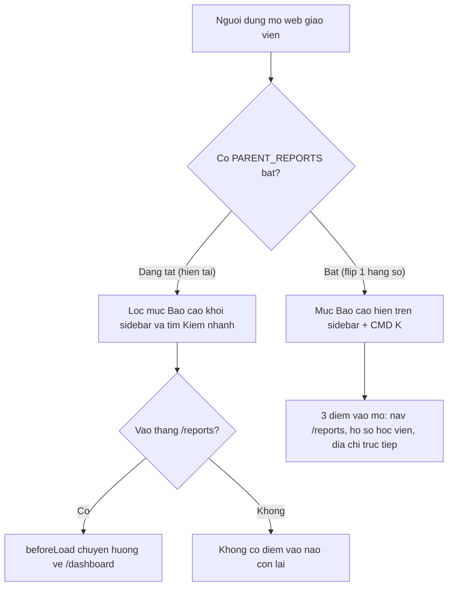
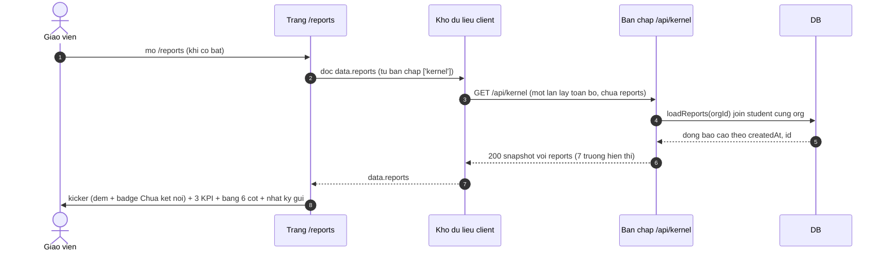
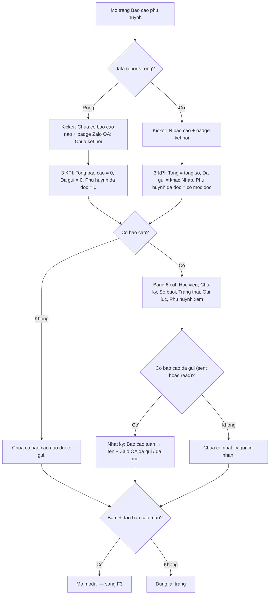
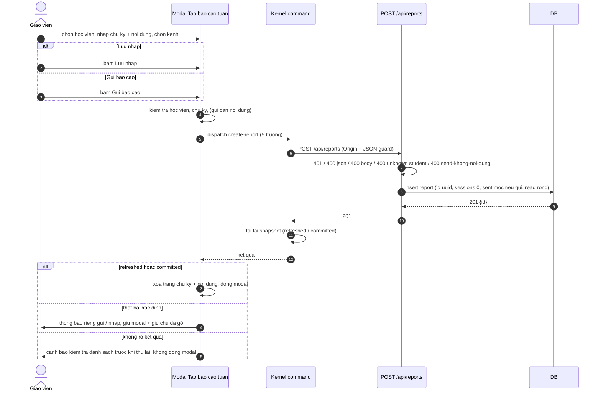
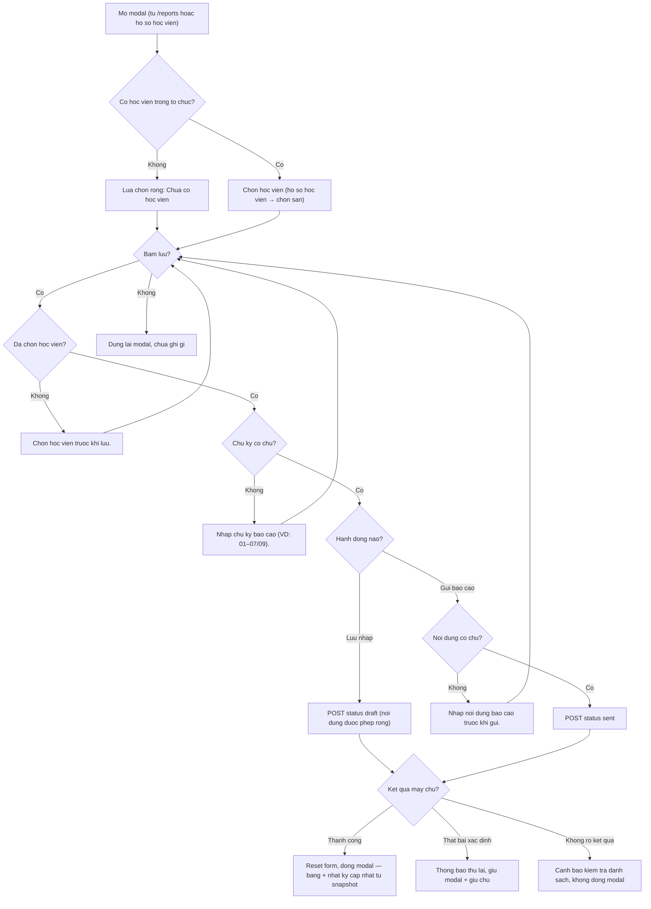

# srs/parent-reports-reverse-flows — parent-reports

Mỗi luồng có sơ đồ sequence + flowchart (F1 chỉ flowchart — là luồng cấu hình, không
tương tác thời gian). Nhãn: ✅ code khẳng định, 🔵 suy luận ≥2 bằng chứng, 🟡 kèm OQ.
Nhớ: hiện tại cờ TẮT — F2/F3 mô tả hành vi khi bật (test chạy ở chế độ mock cờ bật).

## F1 — Cổng vào cụm (cơ chế cờ tắt/bật)

Nguồn: apps/web/src/lib/features.ts:3-7; apps/web/src/components/layout/sidebar.tsx:106-124;
packages/ui/src/components/app-shell/nav-group.tsx:207-209;
apps/web/src/components/command-search/search-index.ts:178-191;
apps/web/src/routes/_auth/reports.tsx:15-22; apps/web/src/routes-matcher.ts:13.

- ✅ Cờ là hằng false, lọc tại nguồn danh sách nav (sidebar.tsx:121,
  nav-group.tsx:209) và ⌘K dùng chung danh sách + bộ lọc (search-index.ts:180-183).
- ✅ Redirect client-side qua beforeLoad (reports.tsx:15-22); route vẫn nằm trong
  allowlist service worker để redirect kịp chạy (routes-matcher.ts:13).
- ✅ Điểm vào khi bật: nav/⌘K + nút "Tạo báo cáo" ở hồ sơ học viên
  ($studentId.tsx:218-222) + URL trực tiếp.
- 🟡 Điều kiện/ thời điểm bật lại — OQ-01, OQ-10.

## F2 — Xem trang "Báo cáo phụ huynh"

Nguồn: apps/web/src/routes/_auth/reports.tsx:35-191; apps/web/src/lib/repos/reports.ts:4-14;
apps/web/src/lib/repos/kernel.ts:622-640 (fetchKernelSnapshot → GET /api/kernel);
apps/server/src/routes/reporting/loaders.ts:9-30.

- ✅ Kicker 2 nhánh trung thực (#172) — reports.tsx:64-84; hằng chưa kết nối :42.
- ✅ KPI: "Đã gửi" = lọc khác nháp, "Phụ huynh đã đọc" = đếm mốc đọc — :93-103.
- ✅ Nhật ký chỉ lấy sent/read, reverse mới nhất trước — :44-58.
- ✅ Empty wording: "Chưa có báo cáo nào được gửi." :110-113, "Chưa có nhật ký gửi
  tin nhắn." :162-165.
- 🔵 "Phụ huynh đã đọc" và nhãn "Đã đọc" không thể có dữ liệu thực: create luôn ghi
  read = "" và status chỉ draft|sent (reporting/index.ts:81-96,
  packages/api/src/contracts.ts:1303-1315) + không endpoint cập nhật (negative-search
  #4) → hai hiển thị này luôn ở giá trị "0"/"Chưa mở" — OQ-02.

## F3 — Tạo và gửi báo cáo tuần (modal)

Nguồn: apps/web/src/components/modals/create-report-modal.tsx:1-142;
apps/web/src/lib/data-actions.ts:95-106; apps/web/src/lib/repos/kernel.ts:181-186, 393-421;
apps/server/src/routes/reporting/index.ts:54-101.

- ✅ Validate 3 bước client — create-report-modal.tsx:26-39; busy guard chống ghi
  đôi :27.
- ✅ Chặn gửi rỗng ở cả server qua refine hợp đồng —
  packages/api/src/contracts.ts:1312-1314; test server kernel.test.ts:2701-2714.
- ✅ Mốc gửi chỉ khi status "sent"; nháp mốc rỗng; read luôn "" lúc tạo; sessions 0
  — reporting/index.ts:81-96.
- ✅ Phân loại kết quả 4 nhánh + hành vi modal tương ứng — repos/kernel.ts:393-421,
  create-report-modal.tsx:53-73; test giữ chữ khi lỗi và cảnh báo outcome-unknown —
  create-report-modal.test.tsx:123-149.
- 🔵 Store không tự thêm dòng (chờ snapshot sau ghi) — data-store-reducer.ts:97-105 +
  result kinds refreshed/committed ở repos/kernel.ts:393-397.
- 🟡 Vì sao "Số buổi" cứng 0 và ai sẽ điền — OQ-03; kênh Email chưa có nhãn "chưa
  kết nối" — OQ-06.
