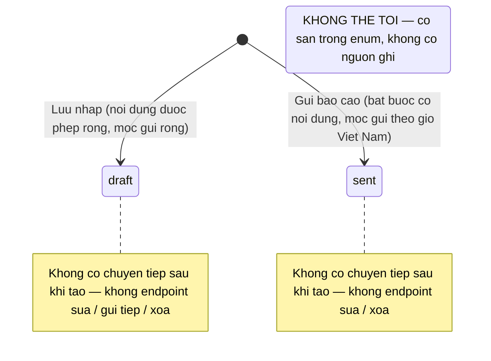

# srs/parent-reports-reverse-states — parent-reports

Feature này KHÔNG có máy trạng thái phức hợp. Chỉ có MỘT máy trạng thái dữ liệu
(trạng thái báo cáo) và một vòng đời UI ngắn của modal (không bền, mô tả bằng văn
bản trong F3, không lập sơ đồ riêng).

## 1. Trạng thái báo cáo (report.status)

Tên giữ "từ hợp đồng": status = draft | sent | read (schema +
bản chép hiển thị). Điểm đặc biệt: trạng thái gán MỘT LẦN lúc tạo (client chọn
draft hoặc sent); KHÔNG có chuyển trạng thái sau tạo vì không có endpoint cập nhật.

Chứng thực:

- Trạng thái chỉ được chọn lúc tạo, enum tạo chỉ draft | sent —
  packages/api/src/contracts.ts:1309; insert theo body —
  apps/server/src/routes/reporting/index.ts:81-96. ✅
- Không có route cập nhật/xóa cho report (chỉ GET list + POST create) —
  apps/server/src/routes/reporting/index.ts:54-103; negative-search #4 trong
  reverse-gaps.md. ✅
- "read" có trong enum schema và được UI map nhãn "Đã đọc" + KPI đếm mốc đọc, nhưng
  create luôn ghi read = "" và không có nguồn ghi nào khác —
  packages/db/src/schema/report.ts:6,21,23; apps/web/src/routes/_auth/reports.tsx:24-33,100-103;
  negative-search #4, #5. ✅ (ý nghĩa nghiệp vụ của trạng thái chờ này 🟡 OQ-02)
- UI trung gian PHÂN BIỆT "đã gửi" theo 2 cách không đồng bộ nhưng nhất quán dữ liệu:
  KPI "Đã gửi" = status khác draft; nhật ký = status sent hoặc read —
  apps/web/src/routes/_auth/reports.tsx:44-45, 96-98. ✅

## 2. Ghi chú các "máy" KHÔNG tồn tại

- Không có máy trạng thái gửi (không hàng đợi, không retry, không scheduled job) —
  negative-search #6 trong reverse-gaps.md.
- Không có máy trạng thái modal bền (mở/đóng là useState cục bộ, mất khi rời trang) —
  apps/web/src/routes/_auth/reports.tsx:37, apps/web/src/routes/_auth/students/$studentId.tsx:138. ✅
- Cờ cụm là hằng biên dịch, không phải máy trạng thái runtime —
  apps/web/src/lib/features.ts:3-7. ✅
