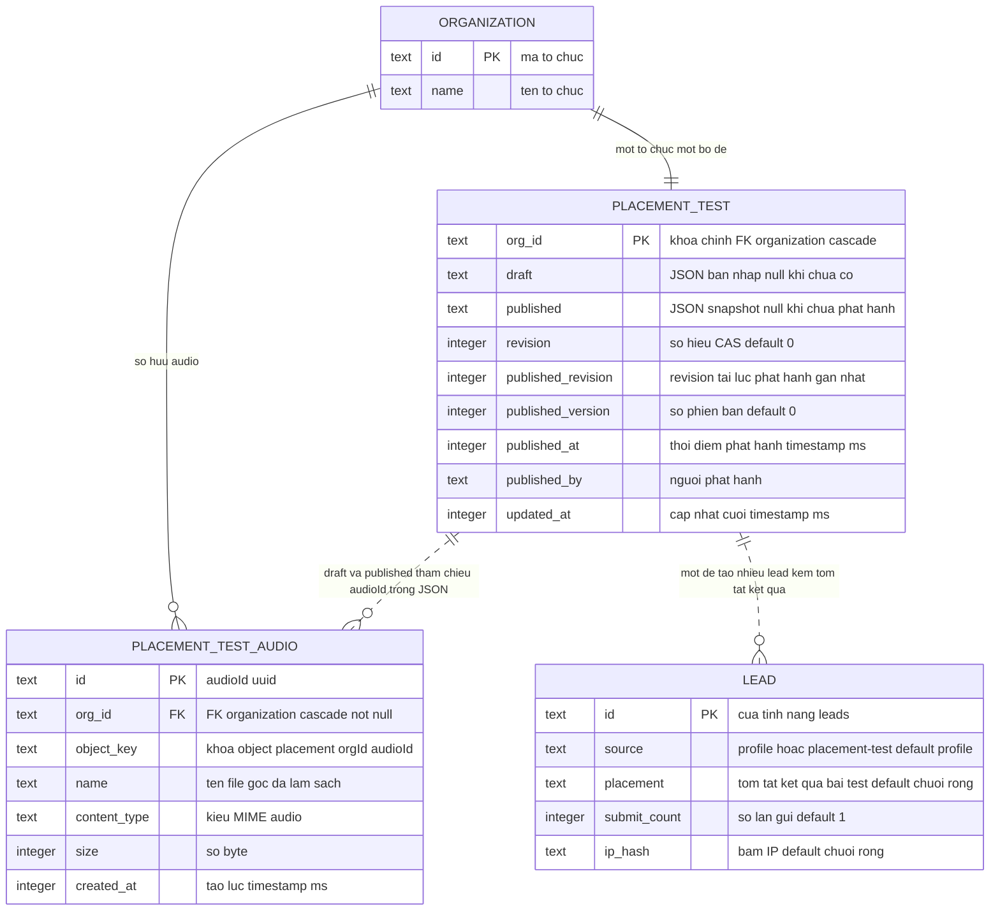

# ERD — feature `placement-test`

> Quy ước nhãn: ✅ = có code minh họa kèm path:line; 🔵 = suy luận từ ≥2 bằng chứng (liệt kê đầy đủ ở reverse-sources.md / _evidence.md); 🟡 = chưa rõ, phải có OQ tương ứng trong reverse-gaps.md. Mỗi mệnh đề mang nhãn riêng; không nâng 🟡 lên ✅ nếu không có code.

Bảng thuộc feature: `placement_test`, `placement_test_audio` (toàn bộ cột là cột thật trong schema). Bảng tham chiếu biên: `organization`, `lead` (chỉ liệt kê cột feature này dùng). Quan hệ tham chiếu qua JSON (draft/published chứa audioId) vẽ nét đứt. ✅ packages/db/src/schema/placement-test.ts:13-51; packages/db/src/migrations/0058_simple_lady_deathstrike.sql:1-24

Chỉ mục thật (từ migration):

- `placement_test`: PRIMARY KEY (`org_id`). ✅ packages/db/src/migrations/0058_simple_lady_deathstrike.sql:1-12
- `placement_test_audio`: PRIMARY KEY (`id`); `placement_test_audio_org_id_idx` ON (`org_id`). ✅ packages/db/src/schema/placement-test.ts:49-51; packages/db/src/migrations/0058_simple_lady_deathstrike.sql:14-25
- `lead` (biên): `lead_ip_updated_idx` ON (`ip_hash`,`updated_at`). ✅ packages/db/src/migrations/0057_exotic_vulture.sql:27

Ghi chú: nội dung đề (câu hỏi, đoạn nghe, ngưỡng) nằm trong JSON `draft`/`published`, không tách bảng quan hệ; `published` là snapshot allowlist do `buildPlacementSnapshot` tạo. ✅ packages/api/src/placement-test-contracts.ts:447-514
