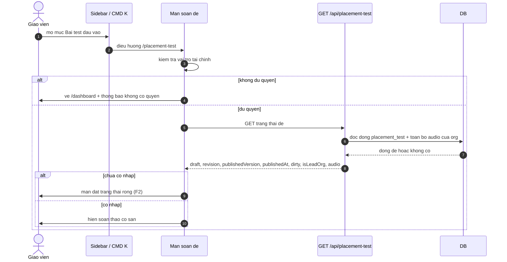
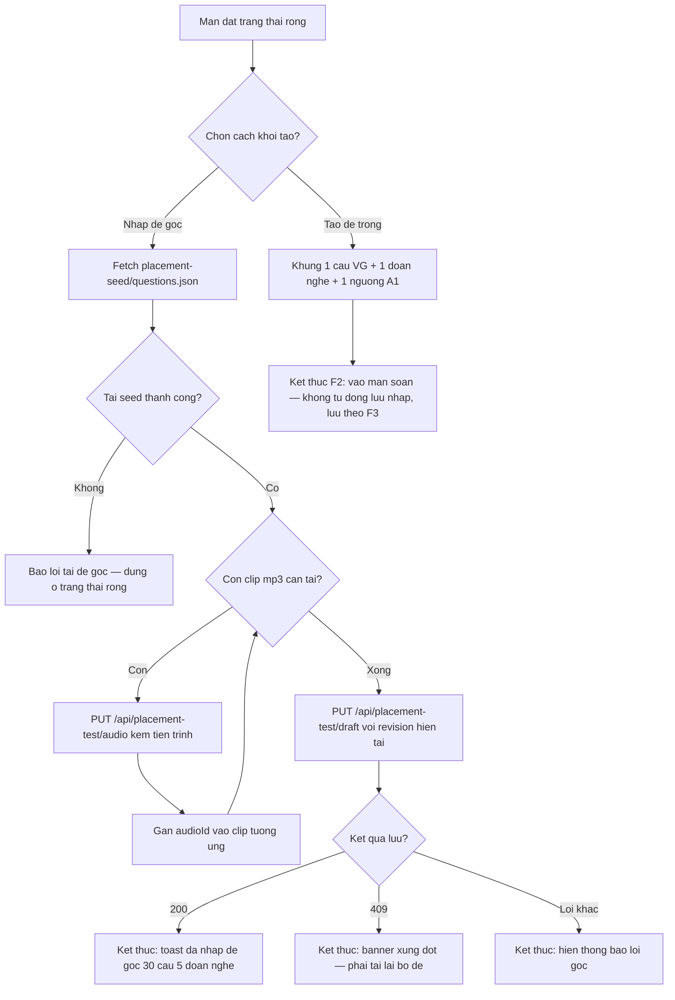
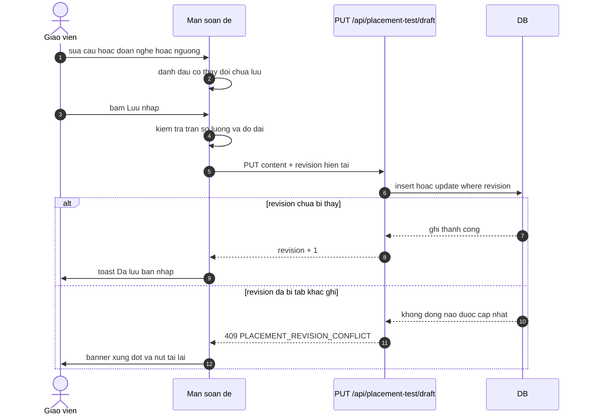
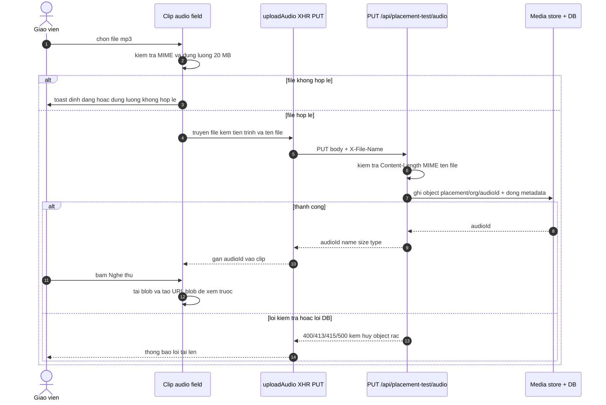
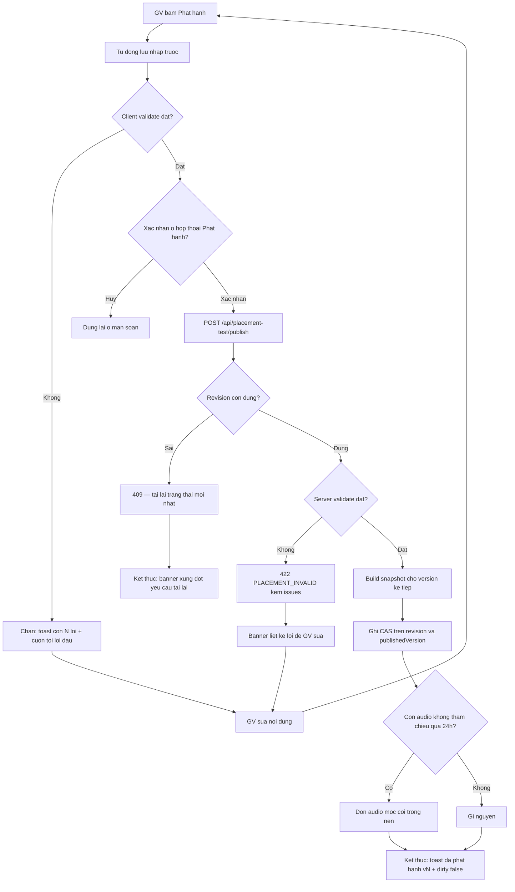
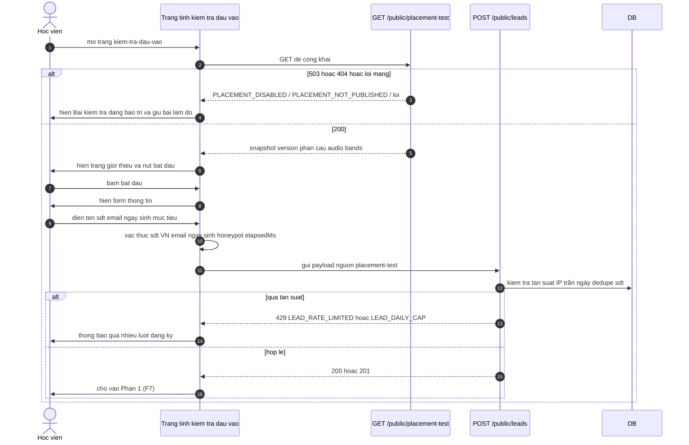
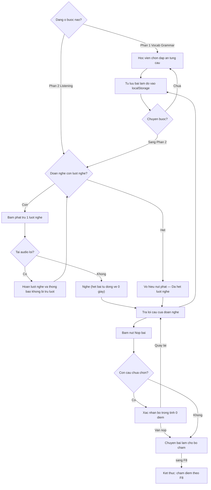
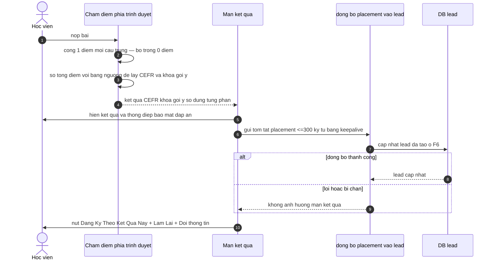

# Luồng — feature `placement-test`

> Quy ước nhãn: ✅ = có code minh họa kèm path:line; 🔵 = suy luận từ ≥2 bằng chứng (liệt kê đầy đủ ở reverse-sources.md / _evidence.md); 🟡 = chưa rõ, phải có OQ tương ứng trong reverse-gaps.md. Mỗi mệnh đề mang nhãn riêng; không nâng 🟡 lên ✅ nếu không có code.

## F1 — GV nạp màn soạn đề

Nguồn: apps/web/src/routes-matcher.ts:31; apps/web/src/lib/use-finance-route-guard.ts:1-31; apps/web/src/routes/_auth/placement-test/index.tsx:128-181,526-555; apps/server/src/routes/placement-test.ts:134-181. ✅

Chứng thực: guard 403 theo vai trò tại apps/server/src/routes/placement-test.ts:121-132; dirty tính từ so sánh draft với snapshot (:159-163); isLeadOrg (:164-167); `Cache-Control: no-store` (:179). ✅

## F2 — Khởi tạo đề: nhập đề gốc hoặc tạo đề trống

Nguồn: apps/web/src/components/placement-test/seed-empty-state.tsx:17-55; apps/web/src/routes/_auth/placement-test/index.tsx:60-102,334-415; apps/web/src/lib/repos/placement-test.ts:114-204. ✅

Chứng thực: fetch seed (:339); vòng upload 5 mp3 + gắn audioId (:351-375); toast "Đã nhập đề gốc (30 câu, 5 đoạn nghe)." (:398); lỗi seed (:400-405); createBlankContent mặc định (:60-102); 409 xung đột (:257-261). ✅

## F3 — Soạn và lưu nháp (CAS revision)

Nguồn: apps/web/src/routes/_auth/placement-test/index.tsx:165-269; apps/server/src/routes/placement-test.ts:183-270; apps/web/src/lib/repos/placement-test.ts:92-112. ✅

Chứng thực: CAS hai nhánh insert/update với 409 ở apps/server/src/routes/placement-test.ts:231-239,259-267; test CAS trùng revision 0 và revision cũ (:269-326 của placement-test.test.ts). ✅

## F4 — Tải lên và nghe thử audio đoạn nghe

Nguồn: apps/web/src/components/placement-test/clip-audio-field.tsx:60-188; apps/web/src/lib/repos/placement-test.ts:114-237; apps/server/src/routes/placement-test.ts:272-361. ✅

Chứng thực: server kiểm tra và discardObject khi lỗi (apps/server/src/routes/placement-test.ts:285-354); MIME cho phép (packages/api/src/library-contracts.ts:43-54); blob preview (apps/web/src/lib/repos/placement-test.ts:206-237); e2e thay audio + nghe thử blob (apps/e2e/specs/placement-test-editor.spec.ts:209-230). ✅

## F5 — Phát hành bộ đề

Nguồn: apps/web/src/routes/_auth/placement-test/index.tsx:271-332; apps/web/src/components/placement-test/publish-dialog.tsx:31-66; apps/server/src/routes/placement-test.ts:407-533; packages/api/src/placement-test-contracts.ts:285-514. ✅

Chứng thực: autosave trước publish (:274-278); validate client + scroll (:280-288); hộp thoại cảnh báo hiệu lực ngay + học viên làm dở phải làm lại (:746-756 và publish-dialog.tsx:49-66); server 422 các loại (placement-test.ts:438-479); snapshot version+1 (:481-482); GC nền (:518-525); toast thành công (:305). ✅

## F6 — Học viên mở trang công khai và qua cổng thông tin

Nguồn: apps/profile/public/kiem-tra-dau-vao/test.js:52-350,604-1129,1646-1671; apps/profile/public/kiem-tra-dau-vao/lead-gate.js:132-248; apps/server/src/routes/public-placement-test.ts:39-68; apps/server/src/routes/public-leads.ts:292-328. ✅

Chứng thực: các trạng thái bảo trì không xóa bài dở (test.js:316-350; e2e editor spec :74-97,:261-283); honeypot + elapsedMs 3500 (lead-gate.js:8-12,206-248); 429 hai mã (public-leads.ts:292-328); 200/201 vào Phần 1 (test.js:1076-1086). ✅

## F7 — Làm bài hai phần với giới hạn lượt nghe

Nguồn: apps/profile/public/kiem-tra-dau-vao/test.js:1139-1470; apps/profile/public/kiem-tra-dau-vao/grading.js:13-40. ✅

Chứng thực: hai phần và stepper (test.js:52,352-384,1139-1470); trừ lượt khi sự kiện playing (:1302-1310); hoàn lượt khi lỗi (:1318-1337); reset currentTime (:1345-1349); hộp xác nhận còn câu trống kèm hai nút (:1422-1465); tự lưu localStorage (:17,145-238); e2e hoàn lượt + xác nhận (profile e2e spec :535-663). ✅

## F8 — Nộp bài: chấm điểm, kết quả, đồng bộ lead

Nguồn: apps/profile/public/kiem-tra-dau-vao/grading.js:49-131; apps/profile/public/kiem-tra-dau-vao/test.js:1472-1644. ✅

Chứng thực: chấm + map band fallback (grading.js:49-110); buildPlacementSummary ≤300 (:119-131); keepalive đồng bộ (test.js:1483-1519); màn kết quả + "🔄 Làm Lại" (:1472-1644); "Không phải bạn? Đổi thông tin" ở bước thông tin (:299). ✅
