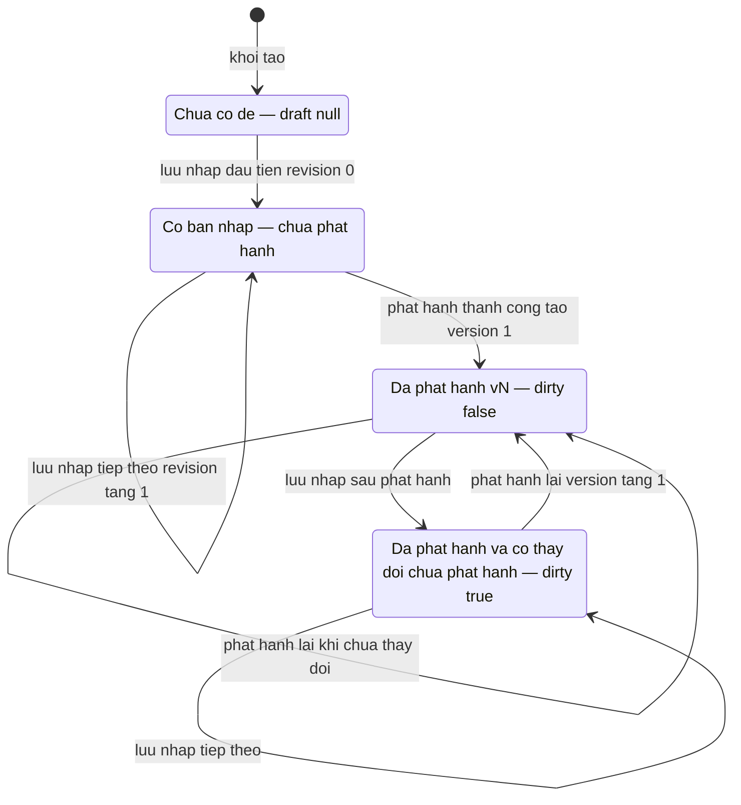
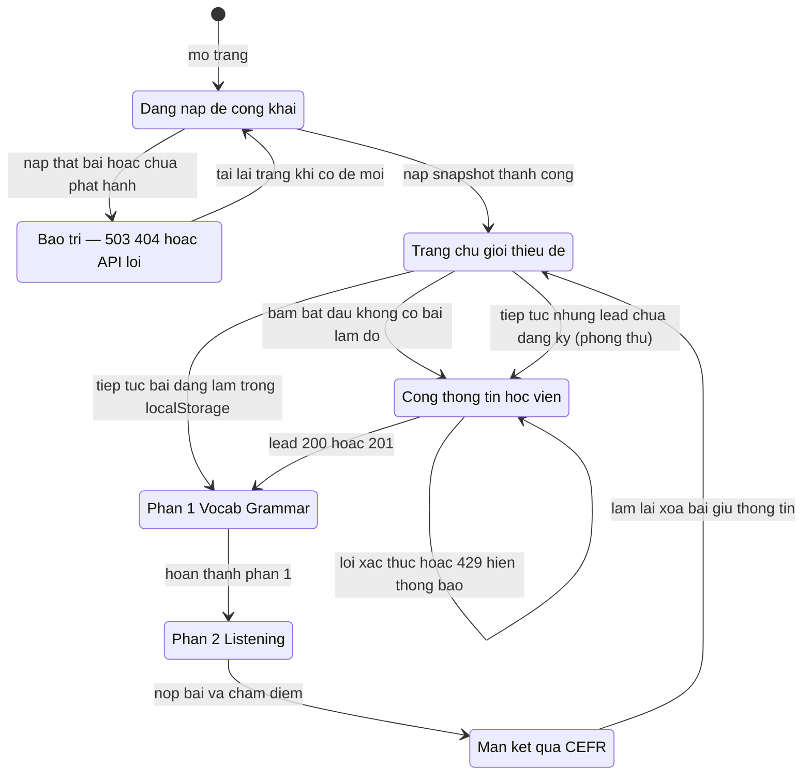
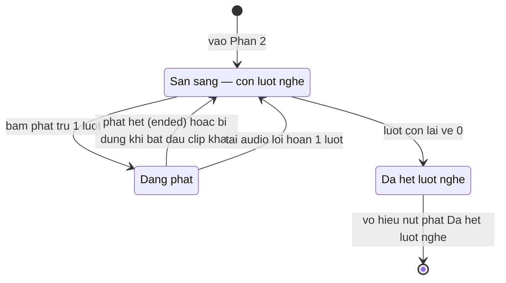

# Sơ đồ trạng thái — feature `placement-test`

> Quy ước nhãn: ✅ = có code minh họa kèm path:line; 🔵 = suy luận từ ≥2 bằng chứng (liệt kê đầy đủ ở reverse-sources.md / _evidence.md); 🟡 = chưa rõ, phải có OQ tương ứng trong reverse-gaps.md. Mỗi mệnh đề mang nhãn riêng; không nâng 🟡 lên ✅ nếu không có code.

## SM-01 — Vòng đời bộ đề của tổ chức (nháp ↔ phát hành)

Nguồn: packages/db/src/schema/placement-test.ts:13-27; apps/server/src/routes/placement-test.ts:159-163,231-267,481-506; apps/server/src/routes/placement-test.test.ts:328-397. ✅

Chứng thực: cờ dirty tính bằng so draft JSON với published (placement-test.ts:159-163); test "lưu nháp sau khi phát hành không làm đổi response công khai và bật lại dirty = true" (placement-test.test.ts:328-397); publishedVersion tăng mỗi lần phát hành (placement-test.ts:481-506). ✅

## SM-02 — Hành trình học viên trên trang công khai

Nguồn: apps/profile/public/kiem-tra-dau-vao/test.js:52,145-238,316-350,352-384,529-541,1076-1086,1472-1644,1646-1671. ✅

Chứng thực: VALID_STEPS 5 bước (test.js:52); loadSavedAttempt + "Tiếp Tục Bài Đang Làm →" (test.js:145-238,529-541); bảo trì không xóa bài dở (test.js:316-350; e2e :74-97,:261-283); 200/201 mới sang Phần 1 (test.js:1076-1086); kết quả → làm lại về trang chủ (test.js:1625-1639). ✅

## SM-03 — Lượt nghe audio của học viên (mỗi đoạn nghe)

Nguồn: apps/profile/public/kiem-tra-dau-vao/test.js:1302-1349; packages/api/src/placement-test-contracts.ts:81-91. ✅

Chứng thực: trừ lượt khi sự kiện playing (:1302-1310); hoàn lượt khi lỗi kèm thông điệp không trừ lượt (:1318-1337); reset currentTime về 0 (:1345-1349); nhãn "Còn X/Y lượt nghe" / "Đã hết lượt nghe" (:1275-1299). ✅
