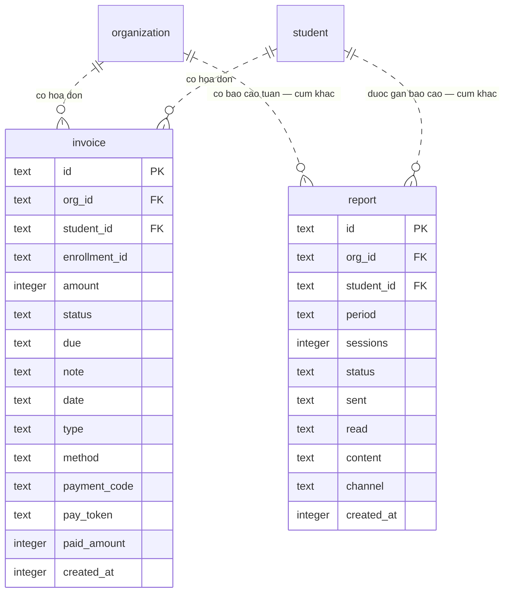

# srs/reports-reverse-erd — reports

> Quy ước nhãn — mỗi mệnh đề mang nhãn riêng: ✅ = khẳng định bởi code/test, có cite `path:line`; 🔵 = suy luận từ ≥2 bằng chứng độc lập; 🟡 = phỏng đoán nghiệp vụ/vì sao, bắt buộc kèm OQ tương ứng.

Chỉ vẽ thuộc tính LÀ CỘT SCHEMA THẬT. Feature này KHÔNG sở hữu bảng nào: đọc 4
cột của `invoice` và KHÔNG chạm `report` (BIÊN GIỚI (b) — vẽ kèm để tường minh
sự tách). Hai "thực thể" còn lại trong Mục 8 spec (kỳ doanh thu, kỳ xếp) là
lựa chọn xem / đơn vị tính trong bộ nhớ — KHÔNG có bảng, không vẽ trong ERD.

- ✅ `invoice` đủ 15 cột như khai báo
  (packages/db/src/schema/invoice.ts:28-48): amount :36, status :37,
  paid_amount :45, created_at :46-48 là BỐN cột feature này đọc; payment_code
  :43 và pay_token :44 thuộc luồng thanh toán (tuition-invoicing).
- ✅ `report` đủ 11 cột (packages/db/src/schema/report.ts:12-29); docblock :8
  nói rõ đây là projection báo cáo tuần tạo qua POST /api/reports (#173),
  kênh gửi chỉ là metadata — KHÔNG liên quan tiền; negative-search #2, #3
  (reverse-gaps.md) chốt không có coupling.
- ✅ Quan hệ một-nhiều qua org_id/student_id cascade
  (invoice.ts:29-34; report.ts:13-18).
- ✅ Mốc created_at hai bảng cùng kiểu timestamp_ms default
  unixepoch*1000 (invoice.ts:46-48; report.ts:27-29) — nhưng đường truyền
  khác shape: invoice serialize ISO ở loader (snapshot.ts:87-91), report không
  thuộc feature này nên không đặc tả.
- 🔵 Trên CLIENT, `invoice` hiện thân là kiểu có mốc miligiây
  (mock-data.ts:151-154; repos/invoices.ts:30-33 chuyển ISO → ms) — một bảng,
  hai hình ảnh theo tầng; phạm vi tranh luận của ERD là tầng schema nên chỉ
  vẽ cột thật.

Đọc ERD theo góc feature: các mũi tên vào `invoice` phục vụ join org khi nạp
bản chụp (snapshot.ts:81-85); `report` chỉ xuất hiện để ghi ranh giới — mọi
luồng của feature này đi qua `invoice` và dừng ở đó.
