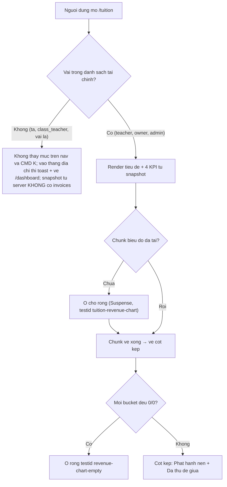
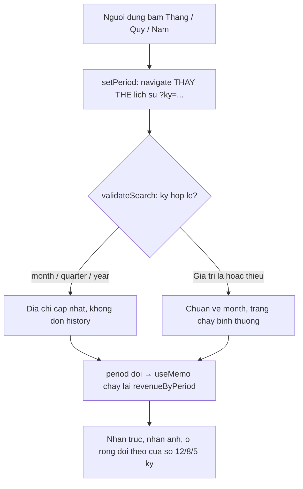
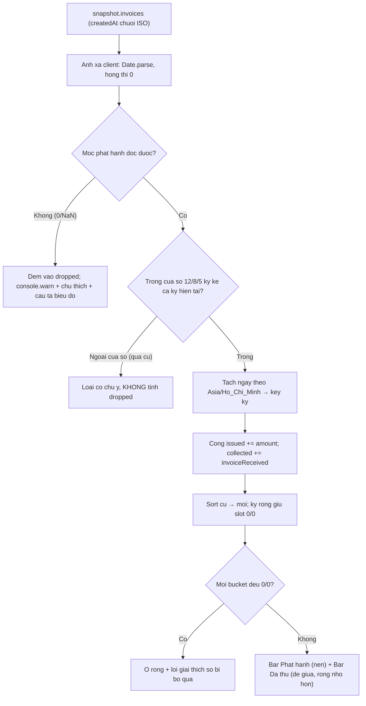
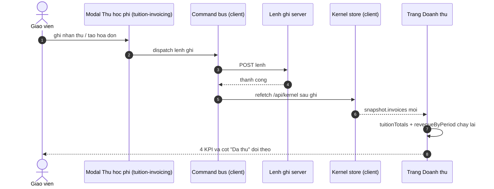

# srs/reports-reverse-flows — reports

> Quy ước nhãn — mỗi mệnh đề mang nhãn riêng: ✅ = khẳng định bởi code/test, có cite `path:line`; 🔵 = suy luận từ ≥2 bằng chứng độc lập; 🟡 = phỏng đoán nghiệp vụ/vì sao, bắt buộc kèm OQ tương ứng.

Bốn luồng đúng danh mục Mục 9 spec. Nhãn sơ đồ viết ASCII không dấu để an toàn
khi render; câu chữ UI trích nguyên văn nằm ở phần chứng bên dưới từng sơ đồ.

## F1 — Mở trang Doanh thu (cổng vai → bản chụp → KPI + biểu đồ)

Nguồn: apps/web/src/components/layout/sidebar.tsx:109,128-145;
apps/web/src/routes/_auth/tuition/index.tsx:40-53,60-90,109-144;
apps/web/src/lib/use-finance-route-guard.ts:6,16-29; apps/server/src/routes/snapshot.ts:348;
apps/web/src/lib/repos/kernel.ts:622-679.

```mermaid
sequenceDiagram
    autonumber
    actor GV as Giao vien
    participant NAV as Sidebar nhom Kinh doanh
    participant TR as Trang /tuition
    participant GR as Coong vai tai chinh
    participant KH as Kernel store (client)
    participant API as GET /api/kernel
    GV->>NAV: bam muc "Doanh thu"
    NAV->>TR: mo route (khong co ky → month)
    TR->>GR: kiem tra vai hien tai
    alt vai ngoai danh sach tai chinh
        GR-->>GV: toast "Ban khong co quyen xem So cong no" + ve /dashboard
    else vai trong danh sach
        TR->>KH: doc snapshot.invoices
        KH->>API: nap 1 lan neu chua co (staleTime vo han)
        API-->>KH: snapshot (invoices ISO; server cat invoices neu vai thieu quyen)
        KH-->>TR: invoices
        TR-->>GV: tieu de + 4 KPI + cho chunk bieu do (Suspense)
        TR->>TR: lazy import chunk bieu do
        TR-->>GV: bieu do cot kep theo ky
    end
```



- ✅ Mục nav chỉ hiện cho vai tài chính: lọc tại nguồn danh sách
  (sidebar.tsx:128-145) và bảng chọn lệnh dùng chung danh sách + lọc
  (search-index.ts:179-193).
- ✅ Cổng client: hàm guard điều hướng về /dashboard và bắn toast một lần
  (use-finance-route-guard.ts:6,16-29); trang dừng render (index.tsx:90).
- ✅ Ranh giới chính ở dữ liệu: máy chủ trả mảng hóa đơn rỗng cho vai thiếu
  quyền (snapshot.ts:348).
- ✅ Nạp một lần, không polling (FR-13): query-client.ts:9-24; nhật cook
  "store nạp bản chụp MỘT LẦN lúc login"
  (plans/journals/2026-10-08-cook-261007-1628-doanh-thu-chart-issue-343.md:16).
- 🟡 Câu toast nêu "Sổ công nợ" cho cả trang Doanh thu — OQ-09.

## F2 — Đổi kỳ xem (Tháng/Quý/Năm)

Nguồn: apps/web/src/components/tuition/revenue-chart.tsx:146-170;
apps/web/src/routes/_auth/tuition/index.tsx:40-53,64,84-88;
apps/e2e/specs/tuition-revenue-chart.spec.ts:179-195,198-209.



- ✅ Nút có nhãn bật/tắt (aria-pressed) và testid riêng từng kỳ
  (revenue-chart.tsx:156-157); nhóm có nhãn "Kỳ doanh thu" :151.
- ✅ Replace lịch sử — bấm liên tục không dồn bước (index.tsx:84-88, chú thích
  :84-85); e2e xác nhận `?ky=quarter` rồi `?ky=month`
  (tuition-revenue-chart.spec.ts:179-195).
- ✅ Giá trị lạ an toàn: e2e `?ky=lạ` trang sống, ô rỗng hiện
  (:198-209); validateSearch không throw (index.tsx:40-53).
- ✅ Kỳ sống trong địa chỉ — BR-06; khi sang chi tiết được mang theo (F3 của
  tuition-invoicing; FR-12).

## F3 — Chặng dữ liệu: bản chụp → cột biểu đồ

Nguồn: apps/web/src/lib/repos/invoices.ts:30-33;
apps/web/src/lib/tuition-from-kernel.ts:21-33,73-97,102-184;
apps/web/src/components/tuition/revenue-chart.tsx:129-142,214-229.



- ✅ Luật tiền một nguồn cho cả issued-collected và KPI (EV-1:
  tuition-from-kernel.ts:21-48).
- ✅ Ba kênh báo dropped: console.warn (:132-138), nhãn ảnh (:140-142), chú
  thích dưới biểu đồ (:248-252) — FR-07.
- ✅ Hóa đơn thật ngoài cửa sổ KHÔNG tính dropped (docblock :108-110; test
  :666-676).
- ✅ Hoạt ảnh tắt hoàn toàn (:220, :228); hai cột căn giữa slot
  (FR-05); màu dùng token chart-1/chart-2 (:219, :227).

## F4 — Dữ liệu đổi sau lệnh ghi (luồng liên feature)

Nguồn: apps/web/src/lib/data-provider.tsx:101-108;
apps/web/src/routes/_auth/tuition/index.tsx:66-68;
plans/journals/2026-10-08-cook-261007-1628-doanh-thu-chart-issue-343.md:16;
apps/e2e/specs/tuition-revenue-chart.spec.ts:125-153.



note right of KH : Khong polling — so doi CHI khi lenh ghi thanh cong hoac nap lai thu cong (FR-13)

- ✅ Bus làm mới sau ghi là CƠ CHẾ DUY NHẤT trừ nạp thủ công
  (data-provider.tsx:101-108; query-client.ts:9-24).
- ✅ Comment tại trang khẳng định mô hình này ("the command bus refetches after
  mark-paid", index.tsx:66-68).
- ✅ e2e ghi nhận hệ quả được chấp nhận: dữ liệu gieo sau login phải tải lại
  trang mới thấy (tuition-revenue-chart.spec.ts:150-153).
- 🟡 Mâu thuẫn chú thích "polling snapshot" cùng dòng #343 — GAP-1, OQ-03.
