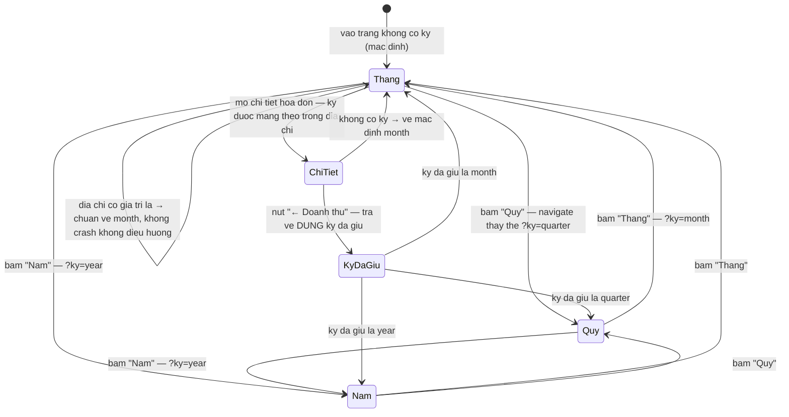
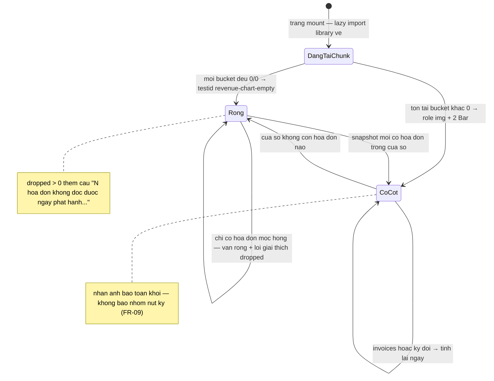
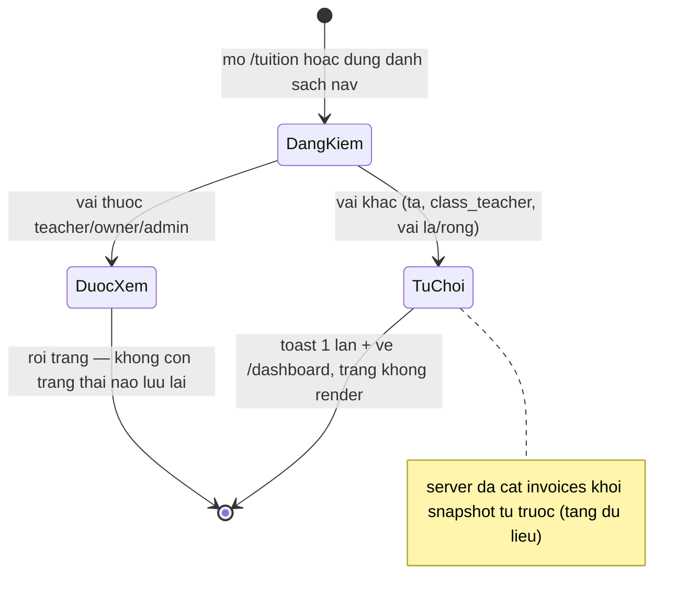

# srs/reports-reverse-states — reports

> Quy ước nhãn — mỗi mệnh đề mang nhãn riêng: ✅ = khẳng định bởi code/test, có cite `path:line`; 🔵 = suy luận từ ≥2 bằng chứng độc lập; 🟡 = phỏng đoán nghiệp vụ/vì sao, bắt buộc kèm OQ tương ứng.

Feature này không có máy trạng thái dữ liệu bền (không bản ghi nào được tạo/sửa
bởi reporting) — ba máy trạng thái sau đều là trạng thái PHÍA CLIENT: kỳ xem
(trong địa chỉ), khối biểu đồ, và cổng quyền.

## ST-1 — Máy trạng thái kỳ doanh thu (tham số địa chỉ `ky`)

Nguồn: apps/web/src/routes/_auth/tuition/index.tsx:40-53,64,84-88;
apps/web/src/routes/_auth/tuition/$invoiceId.tsx:33-43,140;
apps/e2e/specs/tuition-revenue-chart.spec.ts:179-209.

- ✅ Ba trạng thái = chuỗi "month" | "quarter" | "year"
  (tuition-from-kernel.ts:50-51); mặc định month (index.tsx:64).
- ✅ Chuyển kỳ = replace lịch sử (index.tsx:86-88) — không dồn bước.
- ✅ Giá trị lạ tự về month ở CẢ HAI route (index.tsx:44-51;
  $invoiceId.tsx:39-43) — E-02; e2e chứng thực (:198-209).
- ✅ Giữ kỳ qua chi tiết là hành vi đã chốt #345 ($invoiceId.tsx:33-34) —
  FR-12, BR-06.
- Không có trạng thái bộ nhớ riêng — làm mới trình duyệt giữ kỳ qua địa chỉ.
  ✅ index.tsx:40-53.

## ST-2 — Máy trạng thái khối biểu đồ

Nguồn: apps/web/src/routes/_auth/tuition/index.tsx:32-38,136-143;
apps/web/src/components/tuition/revenue-chart.tsx:129-142,173-184,186-189.

- ✅ Trạng thái treo là ô chờ trong Suspense (index.tsx:32-38,136-143).
- ✅ Điều kiện rỗng tính trên TOÀN BỘ cửa sổ, không phải một kỳ
  (revenue-chart.tsx:129-130).
- ✅ dropped > 0 khi rỗng vẫn giải thích trong ô rỗng (:180-182) — E-04.
- ✅ Khi có cột: khối vẽ là một ảnh có nhãn; hoạt ảnh tắt (:186-189, :220,
  :228).

## ST-3 — Máy trạng thái quyền truy cập cụm

Nguồn: packages/auth/src/role.ts:75-87; apps/web/src/lib/use-finance-route-guard.ts:6,16-29;
apps/web/src/components/layout/sidebar.tsx:128-145;
apps/server/src/routes/snapshot.ts:348.

- ✅ Cùng một hàm kiểm vai cho nav, bảng chọn lệnh, route và server
  (role.ts:85-87); tầng dữ liệu là ranh giới chính — BR-05.
- ✅ Toast bắn một lần mỗi lần bị chặn, câu cố định (guard :6) — E-01;
  🟡 câu nêu "Sổ công nợ" — OQ-09.
- 🔵 Trạng thái KHÔNG tái kiểm khi dữ liệu đổi: vai lấy lúc đăng nhập, bản
  chụp một lần — không có cơ chế đổi vai giữa phiên trong phạm vi code đọc
  (query-client.ts:9-24 + guard không đăng ký theo dõi vai). Không có OQ riêng —
  hành vi nhất quán với mô hình nạp một lần (FR-13).
