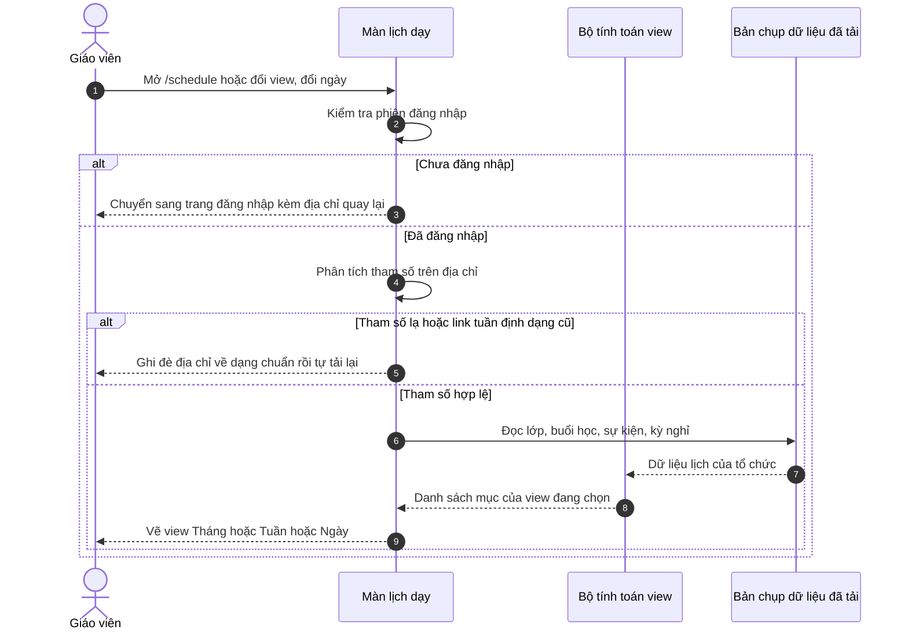
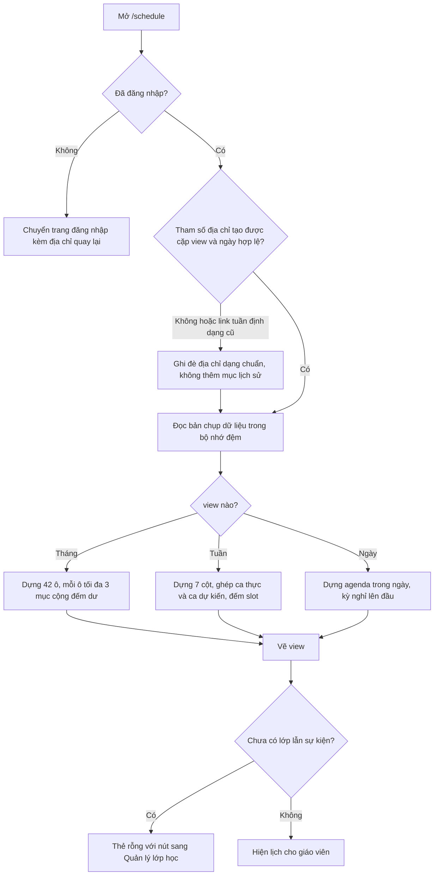
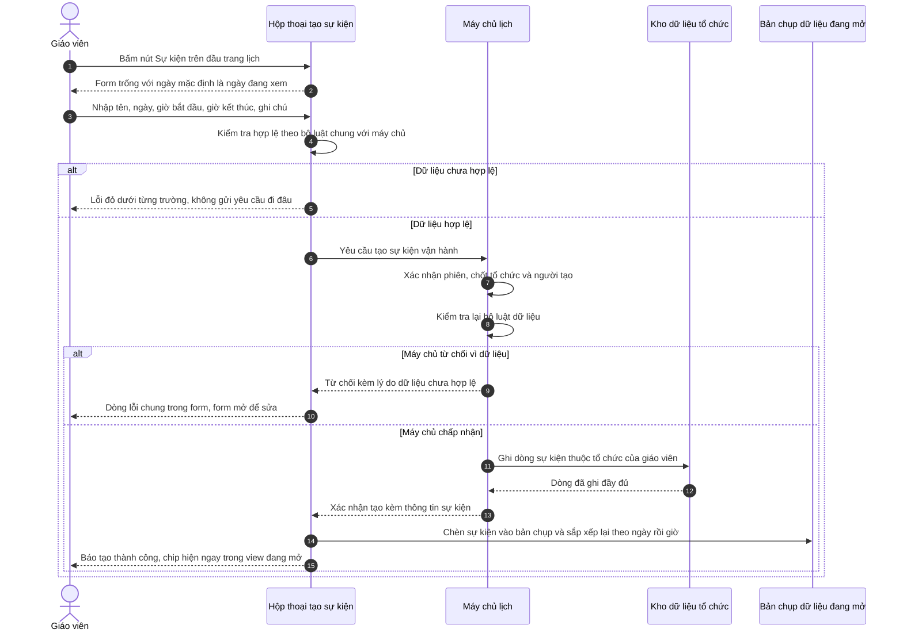
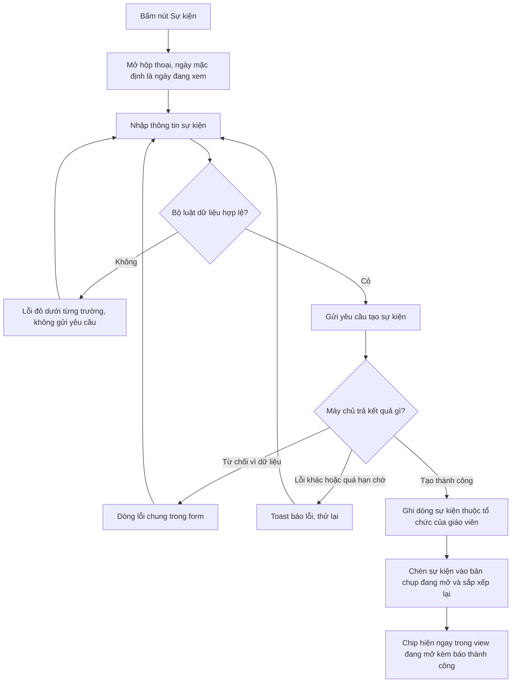
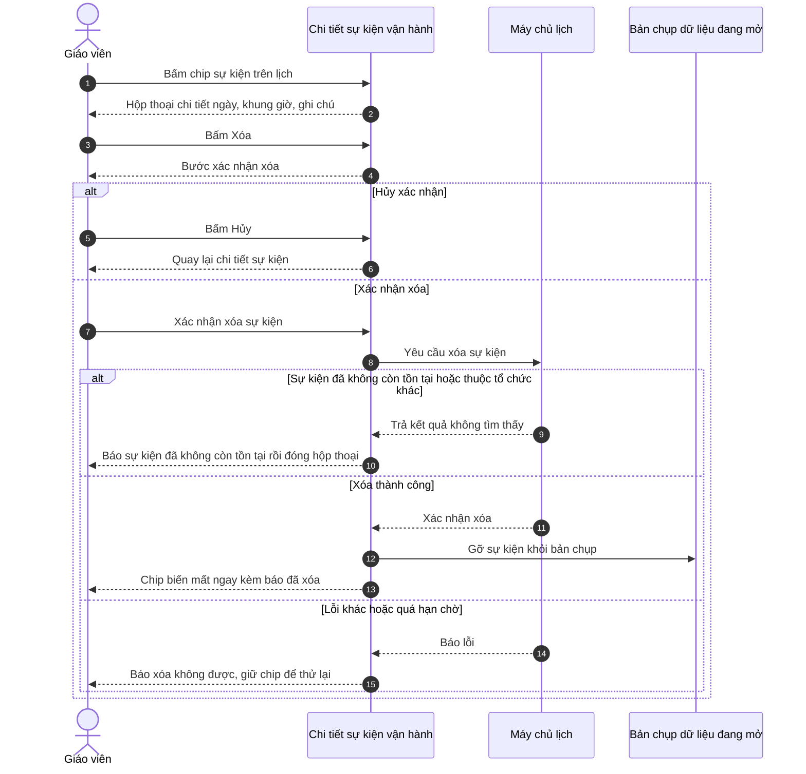
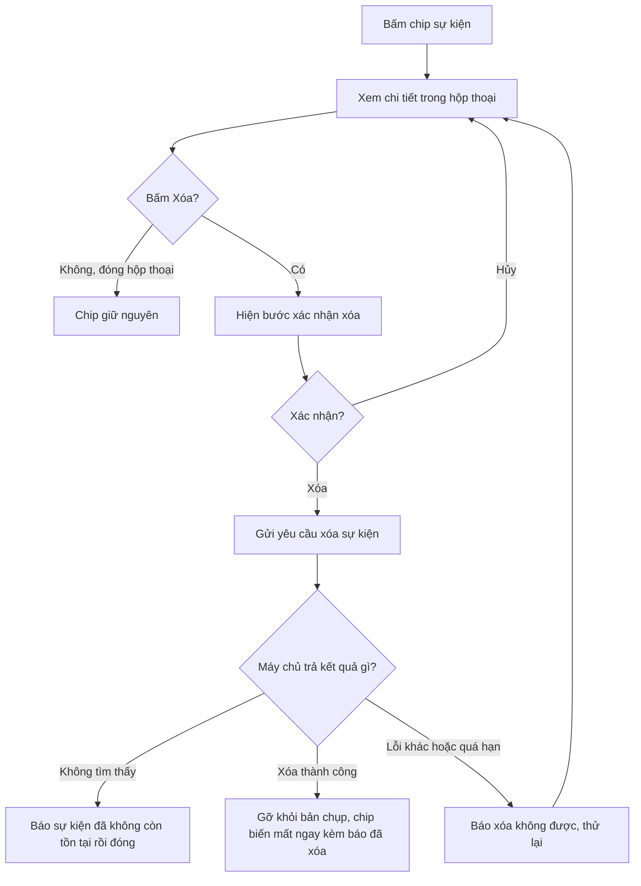
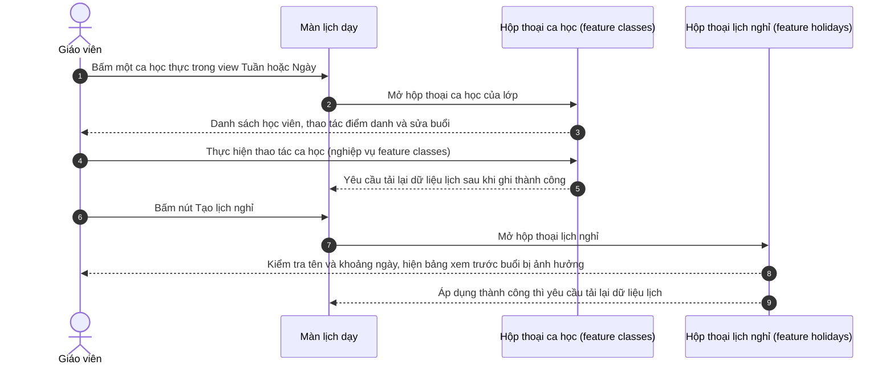
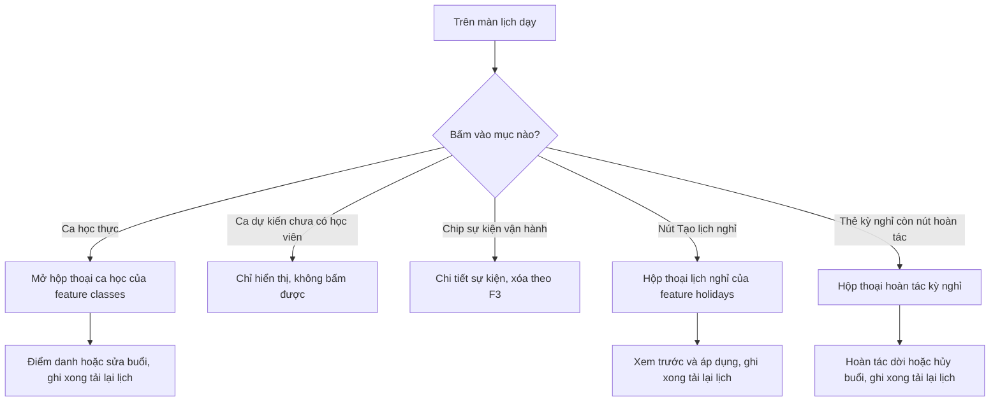

# schedule-reverse-flows.md — Luồng nghiệp vụ tái lập (feature `schedule`)

> Mỗi luồng có cả sequenceDiagram (tương tác) lẫn flowchart (nhánh quyết định). Ngôn ngữ nghiệp vụ; tên endpoint/bảng/hàm chỉ nằm ở cột Nguồn và `_evidence.md`.

## F1 — Xem lịch dạy và chuyển Tháng / Tuần / Ngày (UC-01)

**Nguồn:** `apps/web/src/routes/_auth/schedule.tsx:56-258`; `apps/web/src/lib/schedule-view.ts:47-83`; `apps/web/src/lib/schedule-week.ts:303-328`; `apps/web/src/lib/schedule-month.ts:176-276`; `apps/web/src/lib/schedule-day.ts:95-168`; `apps/web/src/routes/_auth/route.tsx:5-40`.

Điểm chính: đổi view không gọi mạng — chỉ đổi địa chỉ và tính lại trên dữ liệu đã tải (NFR-001); tham số URL là nơi lưu trạng thái (FR-005).

## F2 — Tạo sự kiện vận hành (UC-02)

**Nguồn:** `apps/web/src/routes/_auth/schedule.tsx:149-156,252-256`; `apps/web/src/components/schedule/org-event-modal.tsx:44-117`; `apps/web/src/lib/repos/events.ts:55-93`; `apps/server/src/routes/events.ts:34-63`; `packages/api/src/event-contracts.ts:35-46`.

Điểm chính: một bộ luật kiểm hai lần (client chặn sớm, server chốt lần cuối — BR-001..004); id tổ chức do phiên quyết, không nhận từ form (BR-005); sau khi tạo không tải lại toàn bộ dữ liệu (FR-009).

## F3 — Xóa sự kiện vận hành (UC-03)

**Nguồn:** `apps/web/src/components/schedule/org-event-chip.tsx:33-58,101-141`; `apps/web/src/lib/repos/events.ts:96-121`; `apps/server/src/routes/events.ts:65-78`.

Điểm chính: xóa là vĩnh viễn, có 2 bước chặn bấm nhầm; trường hợp "đã bị xóa nơi khác" hiển thị như thông báo, không phải lỗi (E-schedule-005).

## F4 — Điểm chạm ca học và kỳ nghỉ từ lịch (UC-04, biên feature classes / holidays)

**Nguồn:** `apps/web/src/components/schedule/schedule-day-view.tsx:66-68,102-135`; `apps/web/src/components/schedule/schedule-week-view.tsx:64-67,236-271`; `apps/web/src/routes/_auth/schedule.tsx:157-162,238-251`; `apps/web/src/components/schedule/class-session-modal.tsx:18-25`; `apps/web/src/components/schedule/holiday-modal.tsx:1-9`.

Điểm chính: lịch chỉ là điểm chạm — ghi dữ liệu ca học và kỳ nghỉ thuộc feature tương ứng; ca dự kiến cố ý không mở hộp thoại nào (BR-010).
